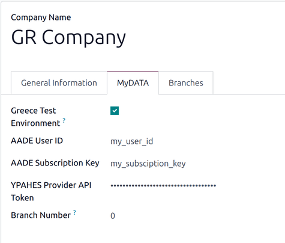
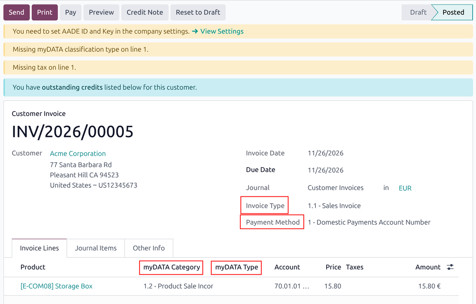
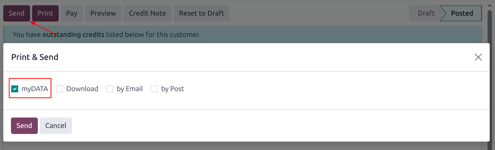
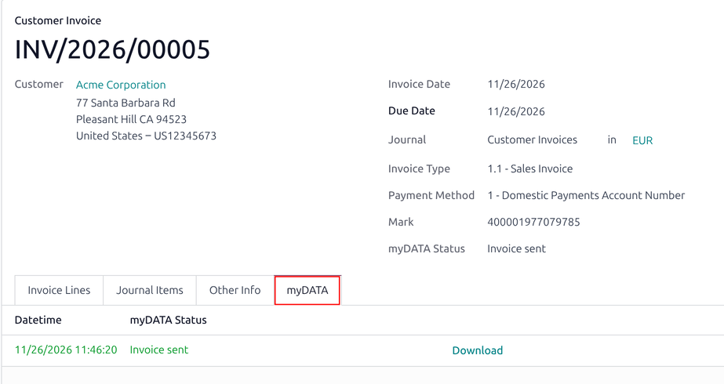
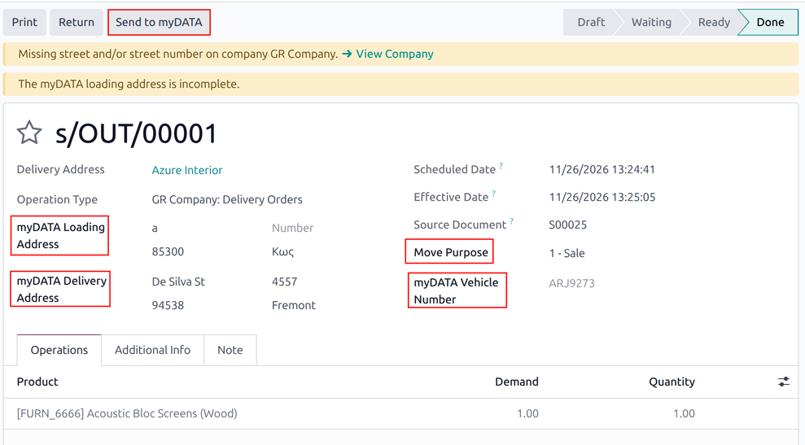
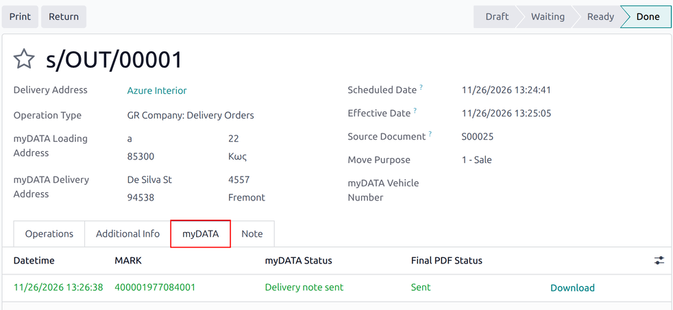

======
Greece
======

.. _localizations/greece/configuration/modules:

Modules
=======

The following modules are installed automatically with the Greek localization:

.. list-table::
   :header-rows: 1
   :widths: 25 25 50

   * - Name
     - Technical name
     - Description
   * - :guilabel:`Greece - Accounting`
     - `l10n_gr`
     - Greek :ref:`fiscal localization package <fiscal_localizations/packages>`.
   * - :guilabel:`Greece - Accounting Reports`
     - `l10n_gr_reports`
     - Provides Greek accounting reports, such as the balance sheet and the profit and loss.
   * - :guilabel:`Greece - myDATA`
     - `l10n_gr_edi`
     - Integration with :ref:`myDATA <localizations/greece/mydata>`, the electronic platform of
       the Greek tax authority used to declare invoices and expense classifications.
   * - :guilabel:`Greece - myDATA E-invoicing through e-invoo`
     - `l10n_gr_edi_e_invoo`
     - Issues customer invoices electronically through the e-invoo e-invoicing provider.
   * - :guilabel:`Greece - myDATA E-invoicing through e-invoo (direct API)`
     - `l10n_gr_edi_e_invoo_bridge`
     - Connects Odoo to the e-invoicing provider's API using the company's YPAHES provider API
       token. **This module is required** to send customer invoices to myDATA.

.. note::
   In some cases, such as when upgrading to a version with additional modules, it is possible that
   modules may not be installed automatically. Any missing modules can be manually :doc:`installed
   <../../general/apps_modules>`.

.. important::
   The `l10n_gr_edi_e_invoo` and `l10n_gr_edi_delivery_note_e_invoo` modules do not work without
   the `l10n_gr_edi_e_invoo_bridge` module: it **must** be installed to issue customer invoices and
   delivery notes through e-invoo. If the bridge module is missing, an error message is displayed
   when sending an invoice, with a :guilabel:`Go to module` button to install it.

The following modules can be :ref:`installed <general/install>` if needed:

.. list-table::
   :header-rows: 1
   :widths: 25 25 50

   * - Name
     - Technical name
     - Description
   * - :guilabel:`Greece Intrastat Declaration`
     - `l10n_gr_intrastat`
     - Generates the Intrastat declaration report based on invoices.
   * - :guilabel:`Greece - myDATA Delivery Note`
     - `l10n_gr_edi_delivery_note`
     - Adds the myDATA fields and checks needed to issue :ref:`delivery notes
       <localizations/greece/mydata-delivery-notes>` from delivery orders.
   * - :guilabel:`Greece - myDATA Delivery Note through e-invoo`
     - `l10n_gr_edi_delivery_note_e_invoo`
     - Issues delivery notes electronically through the e-invoo e-invoicing provider.

.. note::
   The delivery note modules are installed automatically only if the **Sales** and **Inventory**
   apps are installed at the time the Greek localization is installed, or later. On databases where
   these apps were already installed before the modules became available, the modules must be
   installed manually.

.. _localizations/greece/loc-overview:

Localization overview
=====================

The Greek localization package ensures compliance with Greek fiscal and accounting regulations. It
includes tools for managing taxes, fiscal positions, reporting, and electronic invoicing, as well as
a predefined chart of accounts tailored to Greece's standards.

The Greek localization package provides the following key features to ensure compliance with local
fiscal and accounting regulations:

- :ref:`Chart of accounts <localizations/greece/coa>`
- :doc:`../accounting/taxes/fiscal_positions`: automated tax adjustments based on customer or
  supplier registration status
- :doc:`Taxes <../accounting/taxes>`: pre-configured tax rates, including standard VAT, reduced,
  zero-rated, and exempt options
- :ref:`Reporting <localizations/greece/reporting>`
- :ref:`Electronic invoicing with myDATA <localizations/greece/mydata>`

.. _localizations/greece/coa:

Chart of accounts
-----------------

The Greek :doc:`chart of accounts <../accounting/get_started/chart_of_accounts>` is based on the
Greek Accounting Standards (*Ελληνικά Λογιστικά Πρότυπα*, ELP) and is installed by default when the
company's country is set to Greece.

To verify it is installed, go to :menuselection:`Accounting --> Configuration --> Settings` and
check the :guilabel:`Package` field under the :guilabel:`Fiscal Localization` section.

.. warning::
   Selecting another package is only possible if no accounting entries have been created. If one
   was posted, a new company or database must be set up to select another package. In addition, all
   journal entries will need to be created again.

.. _localizations/greece/reporting:

Reports
-------

The following Greek-specific reports are available:

- Balance Sheet
- Profit & Loss
- Tax report
- EC Sales List
- Intrastat (requires the `l10n_gr_intrastat` module)

.. _localizations/greece/mydata:

Electronic invoicing with myDATA
================================

**myDATA** (*my Digital Accounting and Tax Application*) is the electronic platform of the
Independent Authority for Public Revenue (:abbr:`AADE (Ανεξάρτητη Αρχή Δημοσίων Εσόδων)`), the
Greek tax authority. Businesses use it to declare their invoices and the classification of their
revenues and expenses.

In Odoo, customer invoices are issued electronically through the **e-invoo** e-invoicing provider,
operated by Methodoos. Vendor bills are fetched from myDATA, and their expense classifications are
sent back to myDATA.

.. warning::
   Odoo is not an AADE-certified e-invoicing provider (:abbr:`YPAHES (Υπηρεσία Παρόχου Ηλεκτρονικής
   Έκδοσης Στοιχείων)`) and is therefore not authorized to transmit invoices directly to AADE.
   Using a certified e-invoicing provider, such as e-invoo or :ref:`another provider
   <localizations/greece/mydata-other-provider>`, is mandatory.

   Using the `l10n_gr_edi` or `l10n_gr_edi_delivery_note` modules alone, without an e-invoicing
   provider, is done at the user's own risk; Odoo cannot be held responsible for the compliance of
   documents sent this way.

The customer invoice workflow is as follows:

#. :ref:`Create the invoice <localizations/greece/mydata-invoices>` and check its details.
#. Confirm the invoice.
#. :ref:`Send it <localizations/greece/mydata-send>` with the :guilabel:`myDATA` option selected.
#. :ref:`Check the result <localizations/greece/mydata-result>`.

.. important::
   Confirming an invoice only posts it in Odoo. The invoice is issued electronically only when it is
   sent with the :guilabel:`myDATA` option selected.

.. _localizations/greece/mydata-configuration:

Configuration
-------------

.. _localizations/greece/mydata-credentials:

Credentials
~~~~~~~~~~~

To connect Odoo to myDATA and e-invoo, for both customer invoices and :ref:`delivery notes
<localizations/greece/mydata-delivery-notes>`, the following credentials are needed:

- an **AADE user ID** and **subscription key**, obtained by registering for the myDATA REST API on
  the `AADE myDATA portal <https://www.aade.gr/mydata>`_;
- a **YPAHES provider API token**, obtained from the e-invoicing provider. To set up an e-invoo
  account, contact Methodoos at support@methodoos.com.

Then, go to :menuselection:`Accounting --> Configuration --> Settings`, scroll down to the
:guilabel:`Electronic Invoicing - myDATA` section, and fill in the following fields:

- :guilabel:`AADE User ID`
- :guilabel:`AADE Subscription Key`
- :guilabel:`Branch Number`: the company's branch number registered with AADE. It is set to `0` by
  default; make sure this value is correct for the company.
- :guilabel:`YPAHES Provider API Token`

These fields are also available in the :guilabel:`MyDATA` tab of the :doc:`company record
</applications/general/companies>`.

.. admonition:: Test mode

   To test the integration without sending real data, enable the :guilabel:`Greece Test
   Environment` option in the same section. In this case, test credentials must be used.

.. _localizations/greece/mydata-other-provider:

Use another e-invoicing provider
~~~~~~~~~~~~~~~~~~~~~~~~~~~~~~~~

By default, Odoo sends customer invoices and delivery notes to the e-invoo API. Another
AADE-certified e-invoicing provider can be used instead by changing the API URLs in the system
parameters. To do so, activate the :ref:`developer mode <developer-mode>`, go to
:menuselection:`Settings --> Technical--> System Parameters`, and edit the following parameters:

.. list-table::
   :header-rows: 1
   :widths: 50 50

   * - Key
     - Default value
   * - `l10n_gr_edi_ypahes_bridge.e_invoicing_api_url`
     - `https://e-invoo.com/aade/api`
   * - `l10n_gr_edi_ypahes_bridge.e_invoicing_test_api_url`
     - `https://test.e-invoo.com/aade/api`

The test URL is used when the :guilabel:`Greece Test Environment` option is enabled. The provider's
API token must then be set in the :guilabel:`YPAHES Provider API Token` field.

.. important::
   The provider's API must be compatible with the requests sent by Odoo, for both customer
   invoices and delivery notes, as Odoo does not adapt to each provider's API. In particular:

   - Odoo sends a `POST` request to `<API URL>/send_invoice`, authenticated with the API token as a
     bearer token (`Authorization: Bearer <token>` header).
   - The request body is sent as multipart form data and contains the `send_action`, `xml`,
     `invoice_name`, `invoice_amount_total`, `invoice_datetime`, `move_id`, `invoice_currency`, and
     `issue_date` fields.
   - The response must be in JSON. A successful response must contain `"success": true` and the
     `mark`, `uid`, `qrUrl`, `b1_auth_string`, `provider_uid`, `inv_identifier`, and
     `provider_qrUrl` fields. In case of error, the response must contain `"success": false` and
     an `error` message.

.. _localizations/greece/mydata-company-partners:

Company and partners
~~~~~~~~~~~~~~~~~~~~

The following information is required to send documents to myDATA:

- On the :doc:`company record </applications/general/companies>`: the :guilabel:`VAT` number,
  :guilabel:`Country` (Greece), :guilabel:`City`, and :guilabel:`ZIP` code.
- On the customer record: the :guilabel:`VAT` number and :guilabel:`Country`. The
  :guilabel:`City` and :guilabel:`ZIP` code are also required for foreign customers and certain
  invoice types. For partners with several branches registered with AADE, the :guilabel:`Branch
  Number` can be set in the :guilabel:`Accounting` tab of the contact form.

For :ref:`delivery notes <localizations/greece/mydata-delivery-notes>`, the :guilabel:`Street`
(including the street number, e.g., `Ermou 25`), :guilabel:`City`, and :guilabel:`ZIP` code are
required on both the company and the customer records.

.. note::
   If the customer is a contact belonging to a parent company, the electronic invoice uses the
   parent company's VAT number, country, and address. Make sure this information is also filled in
   on the parent company.

.. tip::
   In a :doc:`multi-company <../../general/companies/multi_company>` environment, always check the
   active company before creating an invoice.

.. _localizations/greece/mydata-classification:

Preferred myDATA classifications
~~~~~~~~~~~~~~~~~~~~~~~~~~~~~~~~

Each invoice line sent to myDATA must have a classification, made of a :guilabel:`myDATA Category`
(the income or expense category) and a :guilabel:`myDATA Type` (the detailed classification code).
To avoid setting them manually on every line, default classifications can be defined:

- on **products**: open the product form, go to the :guilabel:`Accounting` tab, and find the
  :guilabel:`myDATA Classification` section;
- on **fiscal positions**: go to :menuselection:`Accounting --> Configuration --> Fiscal Positions`,
  open a fiscal position, and go to the :guilabel:`myDATA` tab.

For each line, select the :guilabel:`Invoice Type` (the myDATA document type the classification
applies to), :guilabel:`myDATA Category`, and :guilabel:`myDATA Type`. When several lines are
defined, they are applied in the order of the :guilabel:`Priority` column, which can be changed by
dragging and dropping the lines.

Fiscal position classifications take priority over product classifications. A fiscal position can
also determine the default invoice type.

.. note::
   The available categories and types depend on the invoice type and, for some documents, on the
   correlated original invoice.

.. _localizations/greece/mydata-taxes:

Taxes and exemptions
~~~~~~~~~~~~~~~~~~~~

myDATA only accepts the following VAT rates: 24%, 17%, 13%, 9%, 6%, 4%, and 0%. Each invoice line
must have exactly one tax; multiple taxes on the same line are not supported.

For taxes with a 0% rate, set a :guilabel:`Default Tax Exemption Category` on the tax form
(:menuselection:`Accounting --> Configuration --> Taxes`). It is then automatically used on invoice
lines with that tax.

.. _localizations/greece/mydata-invoices:

Customer invoices
-----------------

To create a customer invoice, go to :menuselection:`Accounting --> Customers --> Invoices` and
click :guilabel:`New`. Select the customer, then fill in the invoice date, payment terms, currency,
and fiscal position, if applicable.

.. important::
   The accounting date of an invoice must be the current date in Greece (Europe/Athens time zone)
   for it to be issued electronically, regardless of the user's time zone.

Then, review the following myDATA-specific fields:

- :guilabel:`Invoice Type`: the myDATA invoice type (e.g., :guilabel:`Sales Invoice`).
- :guilabel:`Correlated Invoice`: the original invoice, required for some invoice types, such as
  correlated credit notes.
- :guilabel:`Payment Method`: the payment method, required for some invoice types (e.g., bank
  account, cash, check, on credit, web banking, or POS/e-POS).

On each invoice line, the :guilabel:`myDATA Category` and :guilabel:`myDATA Type` are filled in
automatically from the :ref:`preferred classifications <localizations/greece/mydata-classification>`
and can be modified if needed. Optional columns, such as :guilabel:`Tax Exemption Category`,
:guilabel:`VAT Classification`, and :guilabel:`Detail Type`, can be displayed by clicking the
:icon:`oi-settings-adjust` (:guilabel:`additional options`) icon. The :guilabel:`Tax Exemption
Category` is required on lines with a 0% tax.

Once ready, click :guilabel:`Confirm`. If any required information is missing, an alert is
displayed at the top of the invoice with a button to open the related record. Resolve these alerts
before sending the invoice.

.. _localizations/greece/mydata-send:

Send the invoice
~~~~~~~~~~~~~~~~

To issue a posted customer invoice or credit note electronically:

#. Click :guilabel:`Send`.
#. In the dialog, make sure the :guilabel:`myDATA` option is selected.
#. Select the other sending options, such as :guilabel:`by Email`, as needed.
#. Click :guilabel:`Send`.

.. note::
   The :guilabel:`Send to myDATA` action available in the list view is only used for vendor bills.
   Customer invoices must be sent using the :guilabel:`Send` button.

.. _localizations/greece/mydata-result:

Check the result
~~~~~~~~~~~~~~~~

Once the invoice is sent, check the :guilabel:`myDATA Status` and the :guilabel:`Mark` (the unique
registration number given by myDATA) on the invoice. The :guilabel:`myDATA` tab lists all
submission attempts and their results; the submitted XML file can be downloaded from there.

.. list-table::
   :header-rows: 1
   :widths: 25 40 35

   * - Status
     - Meaning
     - Action
   * - *No status*
     - No successful or pending submission. An error may still be listed in the :guilabel:`myDATA`
       tab.
     - Review the alerts and the :guilabel:`myDATA` tab before sending.
   * - :guilabel:`Invoice submission pending`
     - The submission result has not been confirmed yet.
     - Click :guilabel:`Send` again on the same invoice.
   * - :guilabel:`Invoice sent`
     - The invoice was issued successfully.
     - Check the final PDF.
   * - :guilabel:`Invoice send failed`
     - The validation or submission failed.
     - Read the error, correct its cause, and send the invoice again.

After a successful issuance, the invoice PDF includes the following information:

- the provider information and software license;
- the issuance date and time in Greece;
- the MARK, UID, and authentication code;
- the invoice identifier;
- a verification QR code and link.

.. _localizations/greece/mydata-retry:

Pending submissions and errors
~~~~~~~~~~~~~~~~~~~~~~~~~~~~~~

If the submission is **pending**, click :guilabel:`Send` again on the same invoice. Odoo reuses the
XML file and timestamp saved for this submission, so changes made to the customer or the invoice
after the first attempt are not taken into account. Do not create a new invoice to replace a pending
one.

.. warning::
   Pending and issued customer invoices cannot be reset to draft.

Electronic issuance and the upload of the final PDF to the provider are two separate steps. If an
error such as *The invoice was issued, but the electronic invoicing process could not be completed*
appears, the invoice has been issued (and may already have a MARK), but the final PDF could not be
uploaded. Click :guilabel:`Send` again on the same invoice: the final PDF is uploaded without
issuing a new invoice.

.. note::
   If a transmission failure (TF1 or TF2) occurs, the invoice is not issued. Click :guilabel:`Send`
   again to retry.

.. admonition:: XML error: counterpart - invalid child element branch - expected country

   This error means the customer's :guilabel:`Country` is missing. Set the country on the customer
   record (and on its parent company, if any), save, and send the invoice again.

   If the invoice status is :guilabel:`Invoice submission pending`, the original XML is reused and
   the correction is not taken into account. In this case, contact your Odoo support provider.

.. _localizations/greece/mydata-correction:

Correct an issued invoice
~~~~~~~~~~~~~~~~~~~~~~~~~

An issued invoice cannot be modified or cancelled in Odoo; changing it in Odoo does not cancel the
electronic invoice. To correct it, create a :doc:`credit note
<../accounting/customer_invoices/credit_notes>` from the original invoice. The original invoice is
automatically set as the :guilabel:`Correlated Invoice` on the credit note.

Check the credit note's invoice type, correlated invoice, classifications, taxes, and dates, then
:guilabel:`Confirm` and :ref:`send it <localizations/greece/mydata-send>`.

.. _localizations/greece/mydata-bills:

Vendor bills
------------

Every day, Odoo fetches from myDATA the invoices issued to the company by third parties during the
last 90 days and creates the corresponding draft vendor bills. Their :guilabel:`myDATA Status` is
set to :guilabel:`Expense classification ready to send`.

Go to :menuselection:`Accounting --> Vendors --> Bills` and check the draft bills against the actual
vendor invoices: vendor, dates, references, quantities, prices, accounts, taxes, totals, myDATA
invoice type, and classifications. Imported bills may need to be completed before being posted.

To send the expense classification to myDATA:

#. Set the :guilabel:`myDATA Category` and :guilabel:`myDATA Type` on each line.
#. :guilabel:`Confirm` the bill.
#. Click :guilabel:`Send Expense Classifications to myDATA`.

Once accepted, the :guilabel:`myDATA Status` is set to :guilabel:`Expense classification sent`, and
the :guilabel:`Classification Mark` is displayed on the bill.

.. tip::
   Several bills can be sent at once from the list view: select them, click the :icon:`fa-cog`
   (:guilabel:`Actions`) button, and select :guilabel:`Send to myDATA`. All selected bills must meet
   the requirements.

.. note::
   The :guilabel:`Send Expense Classifications to myDATA` button is only available on posted bills
   with a myDATA MARK.

.. _localizations/greece/mydata-delivery-notes:

Delivery notes
--------------

Delivery notes (myDATA document type 9.3) can be issued electronically from delivery orders through
e-invoo, with the `l10n_gr_edi_delivery_note` and `l10n_gr_edi_delivery_note_e_invoo` modules. They
use the same :ref:`credentials <localizations/greece/mydata-credentials>` and :ref:`provider API URL
<localizations/greece/mydata-other-provider>` as customer invoices.

Make sure both modules are :ref:`installed <general/install>`, as well as the
`l10n_gr_edi_e_invoo_bridge` module.

.. warning::
   The `l10n_gr_edi_delivery_note` module alone does not issue delivery notes: it requires an
   e-invoicing provider module, such as `l10n_gr_edi_delivery_note_e_invoo`. Sending delivery notes
   directly to myDATA without a provider is done at the user's own risk, as Odoo is not an
   AADE-certified e-invoicing provider.

Prepare the delivery order
~~~~~~~~~~~~~~~~~~~~~~~~~~

When a sales order is confirmed, the delivery order is created with the following myDATA fields
filled in automatically:

- :guilabel:`myDATA Loading Address`: the street, number, ZIP code, and city of the company;
- :guilabel:`myDATA Delivery Address`: the street, number, ZIP code, and city of the customer;
- :guilabel:`Move Purpose`: set to :guilabel:`1 - Sale` by default. If :guilabel:`19 - Other
  Movements` is selected, a description of the move purpose must be entered.

The :guilabel:`Vehicle number` can also be entered if needed.

Make sure that:

- a contact is set on the delivery order;
- the delivery order's reference ends with a number (e.g., `WH/OUT/00012`);
- the unit of measure of each product is one of the units accepted by myDATA: :guilabel:`Units`,
  :guilabel:`kg`, :guilabel:`L`, :guilabel:`m`, :guilabel:`m²`, or :guilabel:`m³`.

.. note::
   When a return is created from a delivery order, its :guilabel:`Move Purpose` is set to
   :guilabel:`5 - Return`, and the loading and delivery addresses are swapped.

.. _localizations/greece/mydata-delivery-notes-send:

Send the delivery note
~~~~~~~~~~~~~~~~~~~~~~

#. :guilabel:`Validate` the delivery order.
#. Resolve any alerts displayed at the top of the form (e.g., missing street number, ZIP code, VAT
   number, or YPAHES provider API token).
#. Click :guilabel:`Send to myDATA`.

.. _localizations/greece/mydata-delivery-notes-result:

Check the result
~~~~~~~~~~~~~~~~

Once the delivery note is sent, check its :guilabel:`myDATA Status` and :guilabel:`MARK`. The
:guilabel:`myDATA` tab lists all submission attempts and their results; the submitted XML file can
be downloaded from there.

.. list-table::
   :header-rows: 1
   :widths: 25 40 35

   * - Status
     - Meaning
     - Action
   * - *No status*
     - The delivery note has not been sent yet.
     - Resolve the alerts and click :guilabel:`Send to myDATA`.
   * - :guilabel:`Delivery note submission pending`
     - The submission result has not been confirmed yet.
     - Click :guilabel:`Send to myDATA` again on the same delivery order.
   * - :guilabel:`Delivery note sent`
     - The delivery note was issued successfully.
     - Check the delivery slip PDF.
   * - :guilabel:`Delivery note send failed`
     - The validation or submission failed.
     - Read the error, correct its cause, and click :guilabel:`Send to myDATA` again.

Once the delivery note is issued, the myDATA fields of the delivery order can no longer be modified.
The delivery slip PDF is attached to the delivery order and includes the following information:

- the provider information and software license;
- the issuance date and time in Greece;
- the MARK, UID, and authentication code;
- the document identifier;
- a verification QR code and link.

.. tip::
   When the related customer invoice is created from the sales order, the MARKs of the delivery
   notes issued on myDATA are automatically linked to the invoice.

Pending submissions and errors
~~~~~~~~~~~~~~~~~~~~~~~~~~~~~~

If the submission is **pending**, click :guilabel:`Send to myDATA` again on the same delivery order.
Odoo reuses the XML file and timestamp saved for this submission, so changes made to the delivery
order after the first attempt are not taken into account.

As for invoices, the electronic issuance and the upload of the delivery slip PDF to the provider are
two separate steps. If the delivery note was issued (it has a MARK) but the PDF could not be
uploaded, the :guilabel:`Send to myDATA` button remains available: click it to upload the PDF
without issuing a new delivery note.

.. note::
   If a transmission failure (TF1 or TF2) occurs, the delivery note is not issued. Click
   :guilabel:`Send to myDATA` again to retry.
