=====
India
=====

.. _india/installation:

Installation
============

:ref:`Install <general/install>` the following modules to get all the features of the Indian
localization:

.. list-table::
   :header-rows: 1
   :widths: 25 25 50

   * - Name
     - Technical name
     - Description
   * - :guilabel:`Indian - Accounting`
     - `l10n_in`
     - Default :ref:`fiscal localization package <fiscal_localizations/packages>`
   * - :guilabel:`Indian E-invoicing`
     - `l10n_in_edi`
     - :ref:`Indian e-invoicing integration <india/e-invoicing>`
   * - :guilabel:`Indian E-waybill`
     - `l10n_in_ewaybill`
     - :ref:`Indian E-way bill integration <india/e-waybill>`
   * - :guilabel:`Indian E-waybill Stock`
     - `l10n_in_ewaybill_stock`
     - :ref:`E-waybill creation from the Inventory app <india/e-waybill-stock>`
   * - :guilabel:`Indian - Accounting Reports`
     - `l10n_in_reports`
     - Adds the :ref:`Indian GST Return filing <india/gstr>` and the :ref:`Indian
       Tax reports <india/gstr_reports>`.
   * - :guilabel:`Indian - Bill Of Entry`
     - `l10n_in_boe`
     - :ref:`Bill of Entry (BOE) <india/bill-of-entry>` support for imports and customs duty landed
       costs.

.. seealso::
   :doc:`Indian Payroll localization documentation <../../hr/payroll/payroll_localizations/india>`

.. _india/company:

Company
-------

To configure your company information, open the **Settings** app, scroll down to the
:guilabel:`Companies` section, click :guilabel:`Update Info`, and configure the following:

- :guilabel:`Company Name`
- :guilabel:`Address`, including the :guilabel:`Street`, :guilabel:`City`, :guilabel:`State`,
  :guilabel:`ZIP`, and :guilabel:`Country`
- :guilabel:`PAN`: essential for determining the type of taxpayer.
- :guilabel:`GSTIN`: necessary for generating e-Invoices, E-waybills and filing GST returns.

.. _india/gsp_configuration:

GSP configuration
-----------------

To use the :ref:`e-Invoicing <india/e-invoicing>`, :ref:`E-Way bill <india/e-waybill>`, and
:ref:`GST return filing <india/gstr>` services in Odoo, configure :guilabel:`BVM IT Consulting
Services India Private Limited` as the :abbr:`GSP (GST Suvidha Provider)`. To do so,
follow these steps :

#. If needed :ref:`Upgrade <general/upgrade>` the :guilabel:`Indian - Accounting` (`l10n_in`) module.
#. Go to :menuselection:`Accounting --> Configuration --> Settings`.
#. Scroll down to the :guilabel:`Select GSP Provider` section, and set the :guilabel:`GSP` field to :guilabel:`BVM IT Consulting`.
#. :ref:`Log into the NIC e-invoice portal <india/e-invoicing-api>` and
   :ref:`NIC E-Way bill portal <india/e-waybill-api>` and create a new API user for each.
#. Go to :menuselection:`Accounting --> Configuration --> Settings`, scroll down to
   the :guilabel:`Indian Integration` section, and enter the new :guilabel:`Username` and :guilabel:`Password` for the :ref:`e-Invoicing <india/e-invoicing-configuration>` and :ref:`E-Way bill <india/e-waybill-configuration>` features.

.. _india/indian-configuration:

Indian Configuration
====================

The **Indian Integration** section provides essential taxation and compliance features to simplify
financial operations. To enable these features, navigate to :menuselection:`Accounting -->
Configuration --> Settings` and scroll down to the :guilabel:`Indian Integration` section.

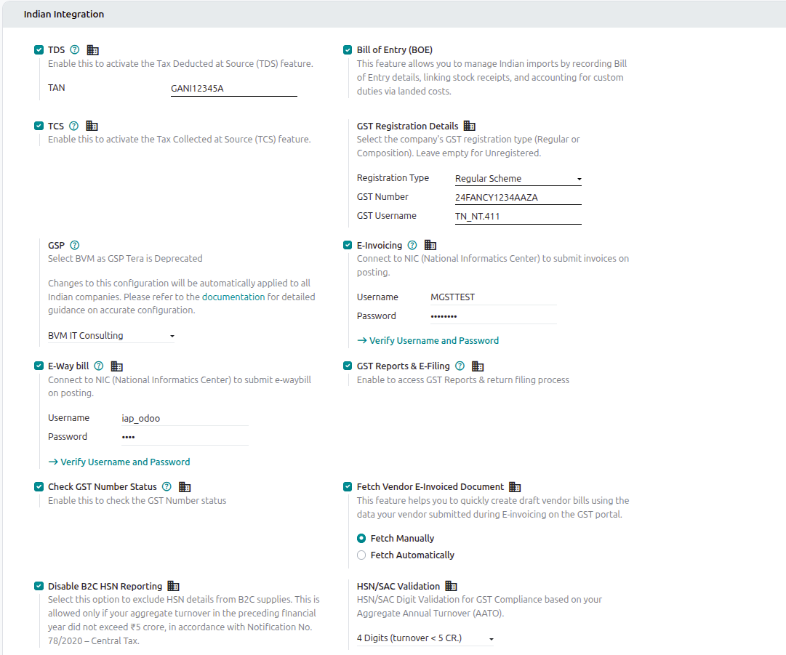

- :guilabel:`TDS/TCS`: Activate this to enable :ref:`TDS/TCS <india/tds-tcs-threshold>`
  functionality along with account-based TDS/TCS section suggestions.
- :guilabel:`GST Registration Details`: Select the company's GST :guilabel:`Registration Type` to
  access GST-related features, including e-invoice, e-waybill, GST e-filing, fetch vendor
  e-invoiced document and check GST number status:

  - :guilabel:`Regular Scheme`: Select if the business is registered as a regular GST taxpayer.
  - :guilabel:`Composition Scheme`: Select if the business has opted for the :ref:`GST Composition
    Scheme <india/composition>`.
  - Leave the field empty if the business is not registered under GST (:guilabel:`Unregistered`).

  Once a registration type is selected, enter the company's :guilabel:`GST Number`.
- :guilabel:`E-Invoicing`: Connects to the :ref:`e-invoice <india/e-invoicing>` :abbr:`NIC
  (National Informatics Center)` portal to submit invoices.
- :guilabel:`E-Way bill`: Connects to the :ref:`e-waybill <india/e-waybill>` :abbr:`NIC
  (National Informatics Center)` portal to generate e-waybills.
- :guilabel:`GST E-Filing & Matching`: Enable the feature to facilitate :ref:`GST return filing
  <india/gstr>` and connect with the GST portal to submit GSTR-1 and retrieve GSTR-2B.
- :guilabel:`Check GST Number Status`: Enable to verify :ref:`GSTIN Status <india/gstin_status>`.
- :guilabel:`Fetch Vendor E-Invoiced Document`: Helps in creating draft vendor bills using
  e-invoice data submitted by vendors on GST portal.

.. important::
   Check the :guilabel:`Production Environment` checkbox to start using Indian services in the
   production environment. If you want to use the testing environment then keep the checkbox
   unchecked.

.. _india/composition:

GST Composition Scheme
----------------------

The **GST Composition Scheme** is a simplified tax mechanism for small taxpayers whose aggregate
turnover does not exceed the limit set by the government (₹1.5 crore for suppliers of goods and ₹50
lakh for service providers). Unlike regular taxpayers, composition dealers:

- Pay tax at a fixed percentage of their turnover;
- Cannot claim :abbr:`ITC (Input Tax Credit)` on their purchases;
- Cannot collect tax from their customers or issue tax invoices. They issue a **Bill of Supply**
  instead;
- Cannot make inter-state outward supplies of goods.

Composition dealers file the following returns:

- **CMP-08**: quarterly statement used to declare and pay tax, due by the **18th of the month
  following the quarter**.
- **GSTR-4**: annual return, due by **30th April following the end of the financial year**.

.. _india/composition-configuration:

Configuration
~~~~~~~~~~~~~

To register a company under the composition scheme, follow these steps:

#. Go to :menuselection:`Accounting --> Configuration --> Settings` and scroll down to the
   :guilabel:`Indian Integration` section.
#. In the :guilabel:`GST Registration Details` setting, set the :guilabel:`Registration Type` to
   :guilabel:`Composition Scheme`.
#. Enter the company's :guilabel:`GST Number`.
#. Select the applicable composition :guilabel:`Tax Rate`:

   - :guilabel:`1% for Manufacturers and Traders`
   - :guilabel:`5% for Restaurants`
   - :guilabel:`6% for Service Providers`

#. Click :guilabel:`Save`.

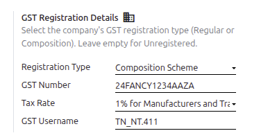

When the :guilabel:`Composition Scheme` is selected, Odoo automatically:

- Activates the taxes applicable to composition dealers, i.e., the purchase taxes without input tax
  credit (:guilabel:`(No ITC)`), the reverse charge purchase taxes, and the nil-rated, exempt, and
  non-GST taxes. All other GST taxes are archived;
- Removes the default sales tax and sets :guilabel:`5% GST P (No ITC)` as the default purchase
  tax;
- Hides the features that do not apply to composition dealers: :guilabel:`E-Invoicing`,
  :guilabel:`Fetch Vendor E-Invoiced Document`, :guilabel:`Disable B2C HSN Reporting`, and
  :guilabel:`HSN/SAC Validation`;
- Sets the tax return periodicity to quarterly if the :guilabel:`Indian - Accounting Reports`
  (`l10n_in_reports`) module is installed.

.. note::
   The :guilabel:`E-Way bill`, :ref:`Check GST Number Status <india/gstin_status>`, and :ref:`GST
   return filing <india/composition-returns>` features remain available for composition dealers.

.. _india/composition-sales:

Customer invoices
~~~~~~~~~~~~~~~~~

As composition dealers cannot collect tax from customers, leave the :guilabel:`Taxes` field empty
on customer invoice lines. The tax due is computed on the turnover using the composition
:guilabel:`Tax Rate` in the :ref:`CMP-08 report <india/cmp-08_report>`.

When printed, the invoice PDF report is titled **Bill of Supply** and includes the mention
:guilabel:`Composition Taxable Person - Not Eligible to Collect Tax on Supplies`.

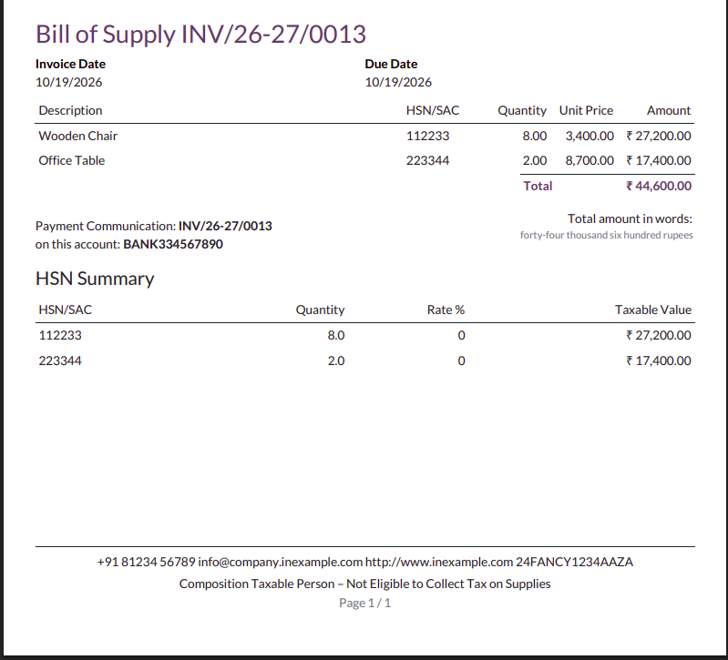

.. important::
   Customer invoices with GST taxes or with an inter-state place of supply are flagged by the
   :ref:`CMP-08 validation checks <india/cmp-08>`.

.. _india/composition-purchases:

Vendor bills
~~~~~~~~~~~~

As composition dealers cannot claim input tax credit, use the :guilabel:`(No ITC)` taxes on vendor
bills (e.g., :guilabel:`5% GST P (No ITC)`). The GST amount is added to the cost of the purchased
goods or services instead of being recorded as a recoverable tax.

For purchases subject to the reverse charge mechanism, use the reverse charge purchase taxes. The
tax payable on these purchases is reported in the :ref:`CMP-08 report <india/cmp-08_report>`.

.. _india/e-invoicing:

e-Invoice system
================

Odoo is compliant with the **Indian Goods and Services Tax (GST) e-Invoice system** requirements.

.. note::
   The e-Invoice system is not available for companies registered under the :ref:`GST Composition
   Scheme <india/composition>`, as composition dealers issue a **Bill of Supply** instead of a tax
   invoice.

Setup
-----

.. _india/e-invoicing-api:

NIC e-Invoice registration
~~~~~~~~~~~~~~~~~~~~~~~~~~

You must register on the :abbr:`NIC (National Informatics Centre)` e-Invoice portal to get your
**API credentials**. You need these credentials to :ref:`configure your Odoo Accounting app
<india/e-invoicing-configuration>`.

#. Log in to the `NIC e-Invoice portal <https://einvoice1.gst.gov.in/>`_ by clicking
   :guilabel:`Login` and entering your :guilabel:`Username` and :guilabel:`Password`;

   .. note::
      If you are already registered on the NIC portal, you can use the same login credentials.

   .. image:: india/e-invoice-system-login.png
      :alt: Register Odoo ERP system on e-invoice web portal

#. From the dashboard, go to :menuselection:`API Registration --> User Credentials --> Create API
   User`;
#. After that, you should receive an :abbr:`OTP (one-time password)` code on your registered mobile
   number. Enter the OTP code and click :guilabel:`Verify OTP`;
#. Select :guilabel:`Through GSP` for the API interface, set :guilabel:`BVM IT Consulting Services
   India Private Limited` as GSP, and type in a :guilabel:`Username` and :guilabel:`Password` for
   your API. Once it is done, click :guilabel:`Submit`.

   .. image:: india/submit-api-registration-details.png
      :alt: Submit API specific Username and Password

.. _india/e-invoicing-configuration:

Configuration in Odoo
~~~~~~~~~~~~~~~~~~~~~

To enable the e-Invoice service in Odoo, :ref:`activate <india/indian-configuration>` the
:guilabel:`E-Invoicing` feature and enter the :guilabel:`Username` and :guilabel:`Password`
previously set for the API.

Additionally, make sure the :ref:`GSP field is configured <india/gsp_configuration>` in the
Accounting settings.

.. _india/e-invoicing-workflow:

Workflow
--------

.. _india/generate-e-invoice:

Generate e-Invoice
~~~~~~~~~~~~~~~~~~

Once an invoice is confirmed, click the :guilabel:`Send` button to open the wizard. Select
:guilabel:`E-Invoicing`, then click the :guilabel:`Generate` button. Odoo will upload the
JSON-signed file of the invoice to the NIC e-Invoice portal.

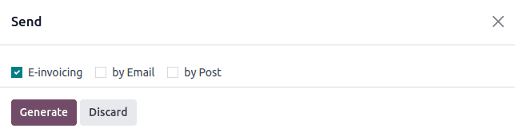

.. note::
   - You can find the JSON-signed file and check the e-Invoicing status in the chatter.

.. _india/invoice-pdf-report:

Invoice PDF report
~~~~~~~~~~~~~~~~~~

Once an invoice is validated and submitted, the invoice PDF report can be printed. The report
includes the :abbr:`IRN (Invoice Reference Number)`, :guilabel:`Acknowledgement` (number and date)
and QR code. These certify that the invoice is a valid fiscal document.

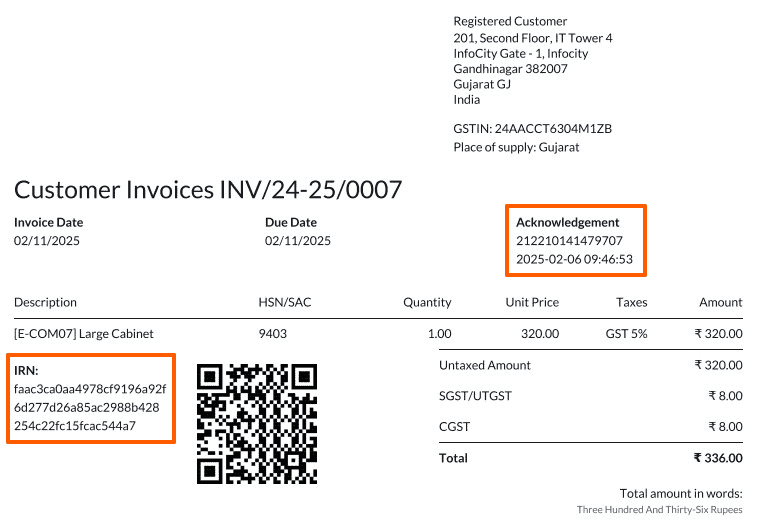

.. _india/edi-cancellation:

e-Invoice cancellation
~~~~~~~~~~~~~~~~~~~~~~

To cancel an e-Invoice, click the :guilabel:`Request Cancel` button on the related invoice. In the
:guilabel:`Cancel E-Invoice` window, fill out the :guilabel:`Cancel Reason` and :guilabel:`Cancel
Remarks`.

.. note::
   - You can find the e-Invoicing status in the chatter.

.. _india/e-invoice-negative-lines:

Management of negative lines in e-Invoices
~~~~~~~~~~~~~~~~~~~~~~~~~~~~~~~~~~~~~~~~~~

Negative lines are typically used to represent discounts or adjustments associated with specific
products or global discounts. The government portal prohibits the submission of data with negative
lines, which means they need to be converted based on the HSN code and GST rate. This is done
automatically by Odoo.

.. example::

   Consider the following example:

   +---------------------------------------------------------------------------------------------------+
   |                                     **Product Details**                                           |
   +=======================+==============+==================+==============+==============+===========+
   | **Product Name**      | **HSN Code** | **Tax Excluded** | **Quantity** | **GST Rate** | **Total** |
   +-----------------------+--------------+------------------+--------------+--------------+-----------+
   | Product A             |  123456      |  1,000           |  1           |  18%         |  1,180    |
   +-----------------------+--------------+------------------+--------------+--------------+-----------+
   | Product B             |  239345      |  1,500           |  2           |  5%          |  3,150    |
   +-----------------------+--------------+------------------+--------------+--------------+-----------+
   | Discount on Product A |  123456      |  -100            |  1           |  18%         |  -118     |
   +-----------------------+--------------+------------------+--------------+--------------+-----------+

   Here's the transformed representation:

   +-------------------------------------------------------------------------------------------------------------+
   |                                         **Product Details**                                                 |
   +==================+==============+==================+==============+==============+==============+===========+
   | **Product Name** | **HSN Code** | **Tax Excluded** | **Quantity** | **Discount** | **GST Rate** | **Total** |
   +------------------+--------------+------------------+--------------+--------------+--------------+-----------+
   | Product A        |  123456      |  1,000           |  1           |  100         |  18%         |  1,062    |
   +------------------+--------------+------------------+--------------+--------------+--------------+-----------+
   | Product B        |  239345      |  1,500           |  2           |  0           |  5%          |  3,150    |
   +------------------+--------------+------------------+--------------+--------------+--------------+-----------+

   In this conversion, negative lines have been transformed into positive discounts, maintaining
   accurate calculations based on the HSN Code and GST rate. This ensures a more straightforward and
   standardized representation in the E-invoice records.

.. _india/price-adjustment-credit-debit-notes:

Managing price adjustment credit/debit notes
~~~~~~~~~~~~~~~~~~~~~~~~~~~~~~~~~~~~~~~~~~~~

:ref:`Customer credit <accounting/credit_notes/issue-credit-note>` and :ref:`debit notes
<accounting/credit_notes/issue-debit-note>` can be issued either:

- to change the quantity, such as when goods are returned, additional goods are supplied, or refunds
  are issued.
- to change the amount, without changing the quantity.

.. important::
   Under GST, these two cases must be reported differently. For price-only corrections, no reduction
   or increase in quantity should be declared in e-Invoices or GST returns, since no goods were
   actually moved.

In the :guilabel:`Other Info` tab of the credit or debit note, select the appropriate
:guilabel:`Adjustment Type`:

- :guilabel:`Standard`: Select when the quantity changes.
- :guilabel:`Price Adjustment`: Use when only the amount changes. Odoo automatically:

  - reports both the quantity and unit price as zero in the e-Invoice, while the taxable value and
    GST amounts are reported as usual;
  - excludes the note's quantity from the HSN summary in the :ref:`GSTR-1 return <india/gstr-1>`;
  - leaves the invoiced quantity of the related sales order unchanged.

.. example::
   A customer is invoiced for 10 units at ₹1,000 each, plus 18% GST.

   - **Two units are returned**: Create a credit note for 2 units at ₹1,000 with the
     :guilabel:`Standard` adjustment type. The e-Invoice reports a quantity of 2, the HSN quantity
     in GSTR-1 is reduced by 2, and the sales order shows 8 units invoiced.
   - **Post-sales discount of ₹500**: Create a credit note for ₹500 with the
     :guilabel:`Price Adjustment` selected as the adjustment type. The e-Invoice reports both the
     quantity and unit price as zero, with a taxable value of ₹500 and GST of ₹90. The HSN quantity
     in GSTR-1 is not affected, and the sales order still shows 10 units invoiced.

.. _india/verify-e-invoice:

GST e-Invoice verification
~~~~~~~~~~~~~~~~~~~~~~~~~~

After submitting an e-Invoice, you can verify if the invoice is signed from the GST e-Invoice system
website itself.

#. Download the JSON file from the attached files. It can be found in the chatter of the related
   invoice;
#. Open the `NIC e-Invoice portal <https://einvoice1.gst.gov.in/>`_ and go to
   :menuselection:`Search --> Verify Signed Invoice`;
#. Select the JSON file and submit it;

   .. image:: india/verify-invoice.png
      :alt: select the JSON file for verify invoice

   If the file is signed, a confirmation message is displayed.

   .. image:: india/signed-invoice.png
      :alt: verified e-invoice

.. _india/e-waybill:

E-Way bill
==========

.. _india/e-waybill-setup:

Setup
-----

Odoo is compliant with the **Indian Goods and Services Tax (GST) E-waybill system** requirements.

.. _india/e-waybill-api:

API registration on NIC E-Way bill
~~~~~~~~~~~~~~~~~~~~~~~~~~~~~~~~~~

You must register on the :abbr:`NIC (National Informatics Centre)` E-Way bill portal to create your
**API credentials**. You need these credentials to :ref:`configure your Odoo Accounting app
<india/e-waybill-configuration>`.

#. Log in to the `NIC E-Way bill portal <https://ewaybillgst.gov.in/>`_ by clicking
   :guilabel:`Login` and entering your :guilabel:`Username` and :guilabel:`Password`;
#. From your dashboard, go to :menuselection:`Registration --> For GSP`;
#. Click :guilabel:`Send OTP`. Once you have received the code on your registered mobile number,
   enter it and click :guilabel:`Verify OTP`;
#. Check if :guilabel:`BVM IT Consulting Services India Private Limited` is already on the
   registered GSP/ERP list. If so, use the username and password used to log in to the NIC portal.
   Otherwise, follow the next step.

   .. image:: india/e-waybill-gsp-list.png
      :alt: E-Way bill list of registered GSP/ERP

#. Select :guilabel:`Add/New`, select :guilabel:`BVM IT Consulting Services India Private Limited`
   as your GSP Name, create a :guilabel:`Username` and a :guilabel:`Password` for your API, and
   click :guilabel:`Add`.

   .. image:: india/e-waybill-registration-details.png
      :alt: Submit GSP API registration details

.. _india/e-waybill-configuration:

Configuration in Odoo
~~~~~~~~~~~~~~~~~~~~~

To enable the E-Way bill service in Odoo, :ref:`activate <india/indian-configuration>` the
:guilabel:`E-Way bill` feature and enter the :guilabel:`Username` and :guilabel:`Password`.

Additionally, make sure the :ref:`GSP field is configured <india/gsp_configuration>` in the
Accounting settings.

.. _india/e-waybill-workflow:

Workflow
--------

.. _india/generate-e-waybill:

Generate E-Way bill
~~~~~~~~~~~~~~~~~~~

To generate an E-Way bill, confirm the customer invoice/vendor bill and click :guilabel:`Create
e-Waybill`. Enter the necessary details and click :guilabel:`Generate e-Waybill` to proceed.

.. note::
   - You can find the JSON-signed file in the attached files in the chatter.

Invoice PDF report
~~~~~~~~~~~~~~~~~~

You can print the invoice PDF report once you have submitted the E-Way bill. The report includes the
**E-Way bill number** and the **E-Way bill validity date**.

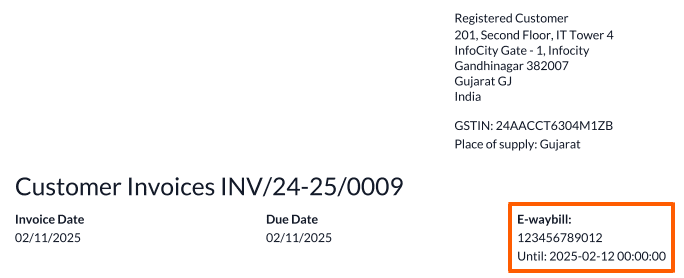

.. _india/e-waybill-cancellation:

E-Way bill cancellation
~~~~~~~~~~~~~~~~~~~~~~~

To cancel an E-Way bill, click :guilabel:`e-Waybill` on the related invoice/bill, then
:guilabel:`Cancel e-Waybill`. In the :guilabel:`Cancel Ewaybill` window, fill out the
:guilabel:`Cancel Reason` and :guilabel:`Cancel Remarks`.

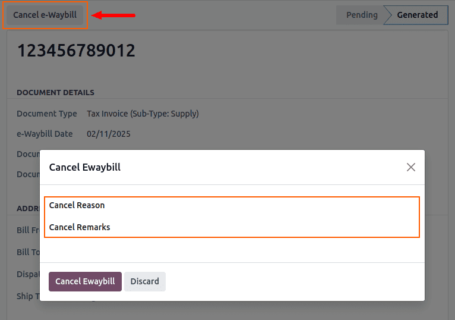

.. note::
   - Once you request to cancel the E-Way bill, Odoo automatically submits the JSON-signed file to
     the government portal. You can check the JSON file in the chatter.

.. _india/e-waybill-stock:

E-waybill creation from receipts and delivery orders
----------------------------------------------------

.. note::
   Make sure the **E-Way bill Stock** module is :ref:`installed <general/install>` and
   the :ref:`E-Way bill setup <india/e-waybill-setup>` is complete.

To create E-Way bills from :doc:`receipts and deliveries
</applications/inventory_and_mrp/inventory/shipping_receiving/daily_operations>` in the Inventory
app, follow these steps:

#. Go to :menuselection:`Inventory --> Operations --> Deliveries` or :menuselection:`Inventory -->
   Operations --> Receipts` and select an existing delivery order/receipt or create a new one.

#. Click :guilabel:`Create E-waybill/Challan`.

   .. note::
      To create an E-way bill:

      - A delivery order must be in the :guilabel:`Done` state (i.e., validated)
      - A receipt must have the :guilabel:`Ready` or :guilabel:`Done` state.

#. Click :guilabel:`Generate e-Waybill` to validate the E-Way bill and send it to the NIC E-Way
   bill portal.

   .. tip::
      To use the E-Way bill as a challan for goods deliveries without sending it to the NIC
      E-Waybill portal, click :guilabel:`Use as Challan`.

To print the E-waybill or the challan, click the :icon:`fa-cog` :guilabel:`(gear)` icon and select
:icon:`fa-print` :guilabel:`Ewaybill / Delivery Challan`.

.. _india/gstin_status:

Indian Check GSTIN Status
=========================

The :guilabel:`Indian - Check GST Number Status` allows you to verify the status of a
:abbr:`GSTIN (Goods and Services Tax Identification Number)` directly from Odoo.

To verify the status of a contact's GST number, access the customer's/vendor's form and click
:guilabel:`Check GSTIN Status` next to the :guilabel:`GSTIN` field.

To verify the status of a GST number entered on an invoice/bill, access the invoice/bill and click
the :icon:`fa-refresh` (:guilabel:`refresh`) button next to the :guilabel:`GST Status` field.

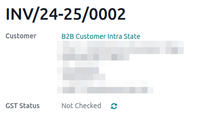

A notification is displayed to confirm the status update and the GSTIN status and verification date
are logged in the contact's chatter.

.. _india/gstr:

Indian GST Return filing
========================

.. _india/gstr_api:

Enable API access
-----------------

To file GST Returns in Odoo, you must first enable API access on the GST portal.

#. Log into the `GST portal <https://services.gst.gov.in/services/login>`_ by entering your
   :guilabel:`Username` and :guilabel:`Password`, and go to :guilabel:`My Profile` on your **profile
   menu**;

   .. image:: india/gst-portal-my-profile.png
      :alt: Click On the My Profile from profile

#. Select :guilabel:`Manage API Access`, and click :guilabel:`Yes` to enable API access;

   .. image:: india/gst-portal-api-yes.png
      :alt: Click Yes

.. note::
   It is recommended to set the :guilabel:`Duration` to :guilabel:`30 days` to avoid the need for
   frequent token reauthentication.

#. Doing so enables a :guilabel:`Duration` drop-down menu. Select the :guilabel:`Duration` of your
   preference, and click :guilabel:`Confirm`.

.. _india/gstr_configuration:

Indian GST Service In Odoo
--------------------------

Once you have enabled the :ref:`API access <india/gstr_api>` on the GST portal, :ref:`activate
<india/indian-configuration>` the :guilabel:`GST E-Filing & Matching Feature` to start using GST
Service. Then, in the :guilabel:`GST Registration Details` setting, fill in the required
:guilabel:`GST Username`.

   .. image:: india/gst-setup.png
      :alt: Please enter your GST portal Username as Username

Additionally, make sure the :ref:`GSP field is configured <india/gsp_configuration>` in the
Accounting settings.

.. _india/gstr_workflow:

File-in GST Return
------------------

To file a GST return, make sure the :ref:`GST E-Filing & Matching Feature
<india/indian-configuration>` is enabled. Then, go to the Accounting dashboard and click
:guilabel:`Tax Returns` on the :guilabel:`Tax Returns` journal. In the
:guilabel:`Accounting Periods` window, fill in the following fields.

- :guilabel:`Opening Date`: Starting date from which tax return periods are created.
- :guilabel:`Fiscal Year End`: End date of the fiscal year (e.g., :guilabel:`31 March`).
- :guilabel:`GSTIN Periodicity`: Frequency of return filing (e.g., :guilabel:`Monthly`).

.. note::
   Odoo generates the returns based on the company's :guilabel:`Registration Type`:

   - :guilabel:`Regular Scheme`: :ref:`GSTR-1 <india/gstr-1>` and :ref:`GSTR-2B <india/gstr-2b>`
     returns.
   - :guilabel:`Composition Scheme`: :ref:`CMP-08 <india/cmp-08>` and :ref:`GSTR-4
     <india/gstr-4>` returns.

.. tip::
   Alternatively, go to :menuselection:`Accounting --> Reporting --> Tax Report`, click
   :icon:`fa-book` :guilabel:`Report:` and select :guilabel:`GSTR-1 (IN)`. Then, click
   :guilabel:`Returns` to file the return.

.. note::
   To reconcile vendor bills with GST portal data, go to
   :menuselection:`Accounting --> Reporting --> Tax Report`, click :icon:`fa-book`
   :guilabel:`Report:` and select :guilabel:`GSTR-2B`, and click :guilabel:`Reconcile`.

.. _india/gstr-1:

Filing GSTR-1 tax return
~~~~~~~~~~~~~~~~~~~~~~~~

To file a GSTR-1 tax return, follow these steps:

#. Click the suitable :guilabel:`GSTR-1` report for the desired period to open the filing view.

   .. image:: india/gst-gstr-1-file.png
      :alt: GSTR-1 filing view

   .. note::
      It is recommended to file the return **five days before the filing date** to avoid any
      penalties.

#. Odoo automatically performs validation checks before submission to ensure compliance with GST
   portal requirements that must be addressed before filing.

   .. note::
      The following types of validation issues can be raised:

      - :guilabel:`Apply Appropriate Tax`: :guilabel:`IGST` is not applicable for intra-state
        transactions.
      - :guilabel:`Wrong CGST/SGST on Inter-State Transactions`: :guilabel:`CGST/SGST` cannot be
        applied on inter-state transactions.
      - :guilabel:`Fiscal Year Reversed Move`: Credit Notes for invoices issued in a given financial
        year should not be included in GSTR-1 after **November 30th**; remove tax from these lines.
      - :guilabel:`Invalid HSN Codes`:
        - For products (non-services), HSN codes must not begin with `99`.
        - For services, HSN codes must begin with `99`.
      - :guilabel:`Missing HSN Codes`: Some product lines do not have HSN codes for journal
        items.
      - :guilabel:`Invalid UQC Codes`: The Unit Quantity Code (UQC) must comply with Indian GST
        standards.
      - :guilabel:`Missing Document Summary`: Document summary lines are mandatory for GSTR-1. This
        check is always marked as :guilabel:`Anomaly` initially. After reviewing the summary by
        clicking the relevant check, it changes to :guilabel:`Reviewed`.
      - :guilabel:`Missing E-Invoice`: Some invoices are not linked to an e-invoice.
      - :guilabel:`Unlinked Unregistered Credit Notes`: Credit Notes have been issued without
        referencing an invoice.

   Validation checks have four stages:

   - :guilabel:`To Review`: Check requires review.
   - :guilabel:`Reviewed`: Check has been reviewed.
   - :guilabel:`Supervised`: Check is supervised, and a supervisor is assigned.
   - :guilabel:`Anomaly`: Check has failed.

   Click on any individual check to view and resolve the corresponding issue.

   .. tip::
      A tax return can only be validated when all checks are in the :guilabel:`Reviewed` or
      :guilabel:`Supervised` stage.

   After reviewing the checks, click :guilabel:`Validate`. The :guilabel:`Review` stage appears in
   green then.

#. Click :guilabel:`GSTR-1 (IN)` to review the report.

#. Click :guilabel:`Submit`, and click :guilabel:`Push Data` in the
   :guilabel:`Submission Instructions` window to send the report to the GST portal.

   During this step, GST portal credentials must be verified. As the data is being sent, the
   :guilabel:`Send` stage in the progress bar appears orange. Once the GST portal confirms receipt,
   the stage turns green. If an error occurs, the :guilabel:`Send` stage changes to red.

   .. note::
      Click the :icon:`fa-ellipsis-v` :guilabel:`(ellipsis)` icon on the relevant :guilabel:`GSTR-1`
      line to display additional options:

      - :guilabel:`Generate XLSX`: Download the GSTR-1 report as an XLSX file.
      - :guilabel:`Reset`: Clear the current state and revert the return to the initial stage.

#. Click :guilabel:`Check Status` to retrieve the current status from the GST portal.
   Once the confirmation is received, the :guilabel:`Review` stage in the progress bar turns green.
   Then, click :guilabel:`Mark as Filed` to finalize and submit the return as filed.

   .. important::
      Once a return is marked as **Filed**, it cannot be reset or filed again.

.. _india/gstr-2b:

Receive GSTR-2B tax reconciliation
~~~~~~~~~~~~~~~~~~~~~~~~~~~~~~~~~~

#. Select the relevant :guilabel:`GSTR-2B` report for the desired period that needs to be
   reconciled.

#. In the validation checks view, click :guilabel:`Fetch E-Invoice` to retrieve vendor e-invoice
   data for the reconciliation period. The check is initially marked as :guilabel:`Anomaly` and
   changes to :guilabel:`Reviewed` after fetching. Then, click :guilabel:`Validate` to confirm and
   mark the :guilabel:`Review` stage as green.

   .. important::
      The :guilabel:`Fetch E-Invoice` check only turns green if the e-invoice data is fetched
      **two days after the end of the last month's reconciliation period**.

#. Click :guilabel:`Fetch GSTR-2B` to retrieve all invoices from the GST portal. Once the data is
   fetched, the :guilabel:`Fetch` stage in the progress bar turns green. To view the raw report
   data, click :guilabel:`GSTR-2B (IN)`.

#. The fetched invoices are automatically matched with the E-invoices. Click :guilabel:`View Bills`
   to see detailed matching results.

   .. note::
      The :guilabel:`Match` stage indicates the reconciliation status:

      - Orange: Partially matched (some bills require correction).
      - Green: Fully matched (all bills reconciled).

      In case of mismatches, correct the affected bills, then click the :icon:`fa-ellipsis-v`
      :guilabel:`(ellipsis)` icon to access additional options:

      - :guilabel:`Re-Match`: Re-run the matching process after making corrections.
      - :guilabel:`Reset`: Reset the reconciliation to the :guilabel:`Match` stage.

#. After all bills are fully matched, click the :icon:`fa-ellipsis-v` :guilabel:`(ellipsis)` icon
   and select :guilabel:`Mark as Complete`.
   The :guilabel:`Complete` stage in the progress bar turns green, finalizing the bill
   reconciliation.

.. _india/composition-returns:

GST returns for composition dealers
~~~~~~~~~~~~~~~~~~~~~~~~~~~~~~~~~~~

Companies registered under the :ref:`GST Composition Scheme <india/composition>` file the
:guilabel:`CMP-08` statement every quarter and the :guilabel:`GSTR-4` return every financial year.
These returns are available on the :guilabel:`Tax Returns` once the :ref:`GST E-Filing & Matching
Feature <india/indian-configuration>` is enabled.

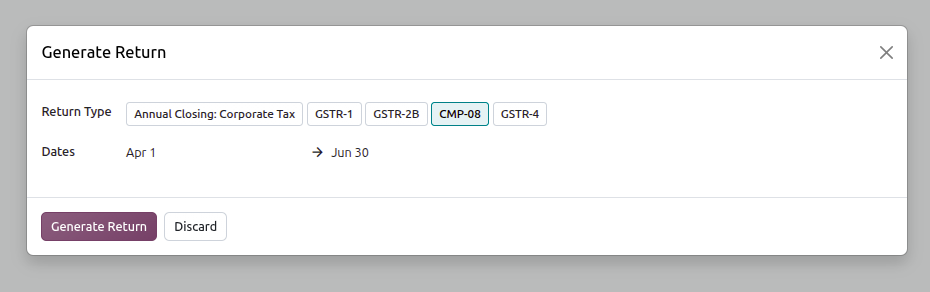

.. important::
   Odoo does not send the :guilabel:`CMP-08` and :guilabel:`GSTR-4` returns to the GST portal. Use
   Odoo to review and validate the data, then file the return on the `GST portal
   <https://services.gst.gov.in/services/login>`_.

.. _india/cmp-08:

Filing CMP-08 statement
***********************

To file a CMP-08 statement, follow these steps:

#. Click the :guilabel:`CMP-08` return for the desired quarter.

   .. note::
      The CMP-08 statement must be filed by the **18th of the month following the quarter**.

#. Odoo automatically performs validation checks to ensure compliance with the composition scheme
   rules:

   .. note::
      The following types of validation issues can be raised:

      - :guilabel:`Apply Appropriate Sale Tax`: Regular GST rates are not applicable on sales for composition dealers.
      - :guilabel:`No Inter State Sale`: Composition dealers cannot make sales outside their home
        state.

   Click on any individual check to view and correct the related invoices. Once all checks are
   reviewed, click :guilabel:`Validate`.

#. Click :guilabel:`CMP-08` to review the :ref:`report <india/cmp-08_report>`. If applicable, click
   the amounts of the :guilabel:`3.4 Interest, Late Fee, Penalty and Others (Manual)` line to enter
   them manually.

#. Pay the :guilabel:`3.3 Tax Payable` amount and file the CMP-08 statement on the GST portal.

#. Click :guilabel:`Submit` to mark the return as submitted. Odoo attaches a PDF copy of the report
   to the return.

.. _india/gstr-4:

Filing GSTR-4 annual return
***************************

To file a GSTR-4 annual return, follow these steps:

#. Click the :guilabel:`GSTR-4` return for the desired financial year.

   .. note::
      The GSTR-4 return must be filed by **30th April following the end of the financial year**.

#. Odoo automatically performs validation checks:

   .. note::

      - :guilabel:`All CMP-08 Filled`: All four :ref:`CMP-08 statements <india/cmp-08>` of the
        financial year must be submitted before filing the GSTR-4 return.
      - :guilabel:`Missing GST Treatment Type`: A GST treatment must be set on all invoices and bills.
        Click the check to open the list of related contacts and set their :guilabel:`GST Treatment`.

   Once all checks are reviewed, click :guilabel:`Validate`.

#. Click :guilabel:`GSTR-4` to review the :ref:`report <india/gstr-4_report>`. If applicable, click
   the amounts of the :guilabel:`(Manual)` lines (i.e., advances paid or adjusted, interest, and
   late fees) to enter them manually.

#. File the GSTR-4 return on the GST portal.

#. Click :guilabel:`Submit` to mark the return as submitted. Odoo attaches a PDF copy of the report
   to the return.

.. _india/gstr_reports:

Tax reports
===========

The available GST reports depend on the company's :guilabel:`Registration Type`:

- :guilabel:`Regular Scheme`: :ref:`GSTR-1 <india/gstr-1_report>`, :ref:`GSTR-2B
  <india/gstr-2b_report>`, and :ref:`GSTR-3B <india/gstr-3b_report>` reports.
- :guilabel:`Composition Scheme`: :ref:`CMP-08 <india/cmp-08_report>` and :ref:`GSTR-4
  <india/gstr-4_report>` reports.

.. _india/gstr-1_report:

GSTR-1 report
-------------

The :guilabel:`GSTR-1` report is divided into sections. It displays the :guilabel:`Base` amount,
:abbr:`CGST (Central Goods and Services Tax)`, :abbr:`SGST (State Goods and Service Tax)`,
:abbr:`IGST (Integrated Goods and Services Tax)`, and :guilabel:`CESS` for each section.

   .. image:: india/gst-gstr-1-report.png
      :alt: GSTR-1 Report

.. _india/gstr-2b_report:

GSTR-2B report
--------------

The :guilabel:`GSTR-2` report is divided into sections. It displays the :guilabel:`Base` amount,
:abbr:`CGST (Central Goods and Services Tax)`, :abbr:`SGST (State Goods and Service Tax)`,
:abbr:`IGST (Integrated Goods and Services Tax)`, and :guilabel:`CESS` for each section.

   .. image:: india/gst-gstr-2b-report.png
      :alt: GSTR-2B Report

.. _india/gstr-3b_report:

GSTR-3B report
--------------

The :guilabel:`GSTR-3B` report contains different sections:

- Details of inward and outward supply subject to a **reverse charge**;
- Eligible :abbr:`ITC (Income Tax Credit)`;
- Values of **exempt**, **Nil-rated**, and **non-GST** inward supply;
- Details of inter-state supplies made to **unregistered** persons.

   .. image:: india/gst-gstr-3b-report.png
      :alt: GSTR-3B Report

.. _india/cmp-08_report:

CMP-08 report
-------------

The :guilabel:`CMP-08` report is used by :ref:`composition dealers <india/composition>` to declare
the tax payable for the quarter. It displays the :guilabel:`Base` amount, :abbr:`IGST (Integrated
Goods and Services Tax)`, :abbr:`CGST (Central Goods and Services Tax)`, :guilabel:`SGST/UTGST`,
and :guilabel:`CESS` for each section:

- :guilabel:`3.1 Taxable Outward Supplies`: Intra-state sales without GST taxes. The CGST and SGST
  amounts are computed by applying the composition :guilabel:`Tax Rate` to the turnover, split
  equally between CGST and SGST.
- :guilabel:`3.2 Inward Supplies attracting Reverse Charge including Import of Services`: Purchases
  subject to the reverse charge mechanism, including the import of services.
- :guilabel:`3.3 Tax Payable`: Sum of the :guilabel:`3.1` and :guilabel:`3.2` lines.
- :guilabel:`3.4 Interest, Late Fee, Penalty and Others (Manual)`: Interest, late fees, and
  penalties, to be entered manually.

.. example::
   A trader registered under the composition scheme with the :guilabel:`1% for Manufacturers and
   Traders` tax rate makes intra-state sales of ₹10,00,000 during the quarter. The
   :guilabel:`3.1 Taxable Outward Supplies` line displays a :guilabel:`Base` amount of ₹10,00,000,
   a CGST amount of ₹5,000, and an SGST amount of ₹5,000.

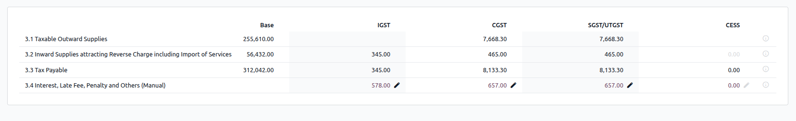

.. _india/gstr-4_report:

GSTR-4 report
-------------

The :guilabel:`GSTR-4` report is the annual return of :ref:`composition dealers
<india/composition>`. It displays the :guilabel:`Base` amount, :abbr:`IGST (Integrated Goods and
Services Tax)`, :abbr:`CGST (Central Goods and Services Tax)`, :guilabel:`SGST/UTGST`, and
:guilabel:`CESS` for each section:

- :guilabel:`4. Inward Supplies`: Purchases from registered persons (with and without reverse
  charge), from unregistered persons, and import of services.
- :guilabel:`5. Debit/Credit Notes (Inward Supplies)`: Debit and credit notes received from
  registered and unregistered persons.
- :guilabel:`6. Tax on Outward Supplies`: Turnover and tax payable on sales for the financial year.
- :guilabel:`8. Advance Paid/Adjusted`: Advances paid and adjusted, to be entered manually.
- :guilabel:`11. Interest, Late fee, Penalty and Others`: Interest and late fees, to be entered
  manually.

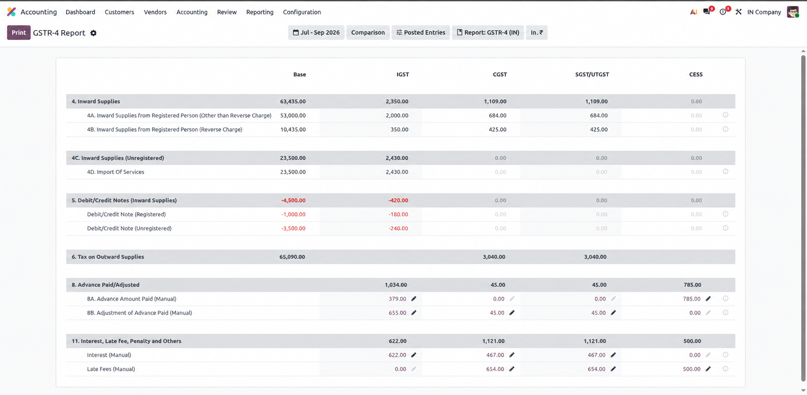

Profit and Loss (IN) report
---------------------------

This is a :guilabel:`Profit and Loss` report that displays the balances for **Opening Stock** and
**Closing Stock**. It helps users using Continental accounting to accurately determine the cost of
goods (i.e :guilabel:`Opening Stock` + purchases during the period - :guilabel:`Closing Stock`).

   .. image:: india/profit-and-loss-report.png
      :alt: Profit and Loss report

.. _india/tds-tcs-threshold:

TDS/TCS threshold alert
=======================

:abbr:`TDS (tax deducted at source)` and :abbr:`TCS (tax collected at source)` are tax provisions
under Indian law, triggered when transaction amounts exceed specified thresholds. This alert
notifies users when the value of invoices or bills surpasses these limits, prompting the application
of the appropriate TDS/TCS.

To configure Odoo to advise you on when to apply TDS/TCS, set the :guilabel:`TDS/TCS section`
field on the corresponding account in the chart of accounts. Odoo will display a banner suggesting
the TDS/TCS section under which tax might be applicable when recording an invoice or bill.

Configuration
-------------

#. Navigate to :menuselection:`Accounting --> Configuration --> Settings`
#. In the :guilabel:`Indian Integration` section, enable the :guilabel:`TDS` or :guilabel:`TCS`
   feature as required.
#. Navigate to :menuselection:`Accounting --> Configuration --> Chart of Accounts`.
#. Click :guilabel:`View` on the desired account, and set the :guilabel:`TDS/TCS Section` field.

.. note::
   The TDS/TCS sections are pre-configured with threshold limits. If you need to modify these
   limits, go to :menuselection:`Accounting --> Configuration --> Taxes`. In the :guilabel:`Advanced
   Options` tab, click on the  :icon:`fa-arrow-right` :guilabel:`(internal link)` icon of the
   :guilabel:`Section` field.

   .. image:: india/tds-tcs-section-modify.png
      :alt: TDS/TCS section modify

Applying TCS/TDS on invoices and bills
--------------------------------------

Based on the account used on the customer invoice or vendor bill, Odoo checks the TCS/TDS threshold
limit. If the limit specified in the :guilabel:`TCS/TDS Section` of the account is exceeded, Odoo
displays an alert that suggests applying the appropriate TCS/TDS. The alert will disappear once the
TCS/TDS is applied.

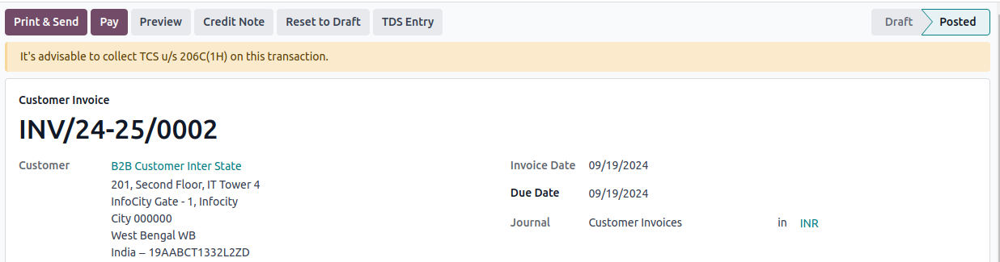

**TCS** is directly applicable in the tax on the invoice lines. To apply **TDS**, click the
:guilabel:`TDS Entry` smart button on the vendor bill/payment. The popup window allows specifying
the TDS details. Confirm the entry to apply the TDS.

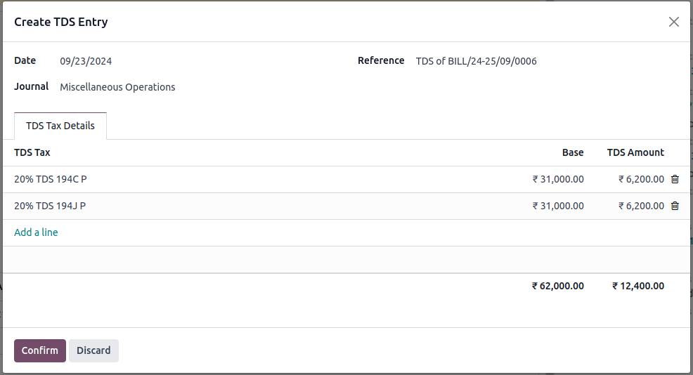

In Odoo, the aggregate total is calculated for partners sharing the same PAN number, across all company branches.

.. example::

   .. list-table::
      :header-rows: 1
      :widths: 10 20 10 20 15

      * - **Branch**
        - **Customer**
        - **Invoice**
        - **Transaction Amount (₹)**
        - **PAN Number**
      * - IN - MH
        - XYZ Enterprise - GJ
        - Invoice 1
        - ₹50,000
        - ABCPX1234E
      * - IN - MH
        - XYZ Enterprise - GJ
        - Invoice 2
        - ₹30,000
        - ABCPX1234E
      * - IN - MH
        - XYZ Enterprise - MH
        - Invoice 3
        - ₹40,000
        - ABCPX1234E
      * - IN - DL
        - XYZ Enterprise - GJ
        - Invoice 4
        - ₹20,000
        - ABCPX1234E
      * - IN - GJ
        - XYZ Enterprise - MH
        - Invoice 5
        - ₹60,000
        - ABCPX1234E

   -  **Aggregate total** = 50,000 + 30,000 + 40,000 + 20,000 + 60,000 = ₹200,000
   -  The aggregate total for all customers (XYZ Enterprise - GJ, MH, DL) sharing the PAN number
      ABCPX1234E across all branches is ₹200,000.

.. _india/bill-of-entry:

Bill of Entry (BOE)
===================

A Bill of Entry (:abbr:`BOE (Bill of Entry)`) is a legal document filed by importers with the
customs department to declare imported goods, assessable values, customs duties, and import taxes.
In Odoo, creating a Bill of Entry generates a customs vendor bill and allocates customs duties to
the related stock receipts using landed costs.

.. note::
   - Make sure the :guilabel:`Indian - Bill Of Entry` (`l10n_in_boe`) module is :ref:`installed
     <general/install>`.
   - The imported products must use the :guilabel:`First In First Out (FIFO)` or :guilabel:`Average
     Cost (AVCO)` costing method.

To create a Bill of Entry, follow these steps:

#. Go to :menuselection:`Accounting --> Vendors --> Bills` and open a posted vendor bill with its
   :guilabel:`GST Treatment` set to :guilabel:`Overseas` (or select multiple posted overseas vendor
   bills for the same vendor and currency from the list view, and click :menuselection:`Action -->
   Bill of Entry`).
#. :ref:`Match the relevant purchase order to the vendor bill <accounting/vendor_bills/vendor-bills-matching-po>`.
#. Click :guilabel:`Bill Of Entry` to open the wizard and fill in the required details:

   - :guilabel:`Transfers`: Select the validated (:guilabel:`Done`) incoming stock receipts linked
     to the purchase.
   - :guilabel:`Currency`: Verify the document currency and conversion rate if it differs from the
     company currency.
   - :guilabel:`Bill of Entry Number`, :guilabel:`Bill of Entry Date`, and :guilabel:`Port Code`.

#. In the :guilabel:`Lines` tab, review the :guilabel:`Assessable Value` for each product line,
   enter the :guilabel:`Custom Duty`, and select the applicable purchase :guilabel:`Taxes`.
#. Click :guilabel:`Confirm`.

A draft Bill of Entry vendor bill is created for the customs duty and import tax, and a linked
landed cost record is generated to allocate the customs duty across the selected transfers.

.. example::
   Goods are imported into India, valued at $10,000 on an assessable value basis, with the following
   details:

   .. list-table::
      :header-rows: 1
      :widths: 40 20 20 20

      * - **Particulars**
        - **Date**
        - **Exchange Rate (CBIC)**
        - **Basic Customs Duty Rate**
      * - Date of submission of Bill of Entry
        - 25th February 2018
        - ₹58/USD
        - 10%
      * - Date of entry inwards granted to the vessel
        - 5th March 2018
        - ₹58.75/USD
        - 12%

   - **Relevant rate of duty**: 12% (the rate on the date of submission of the Bill of Entry or the
     date of entry inwards granted to the vessel, whichever is later).
   - **Exchange rate**: ₹58 per USD (the CBIC rate as on the date of submission of the Bill of
     Entry).
   - **Assessable Value** = ₹5,80,000 (USD 10,000 × ₹58)
   - **Basic Customs Duty** = ₹69,600 (₹5,80,000 × 12%)
   - **10% Social Welfare Surcharge** = ₹6,960 (₹69,600 × 10%)
   - **Custom Duty** (entered in the BOE wizard) = ₹76,560 (₹69,600 + ₹6,960)
   - **Taxable Amount** = ₹6,56,560 (₹5,80,000 + ₹76,560)
   - **IGST (18%)** = ₹1,18,181 (18% on ₹6,56,560)
   - **Total Customs Duty including IGST** = ₹1,94,741 (₹76,560 + ₹1,18,181)

   The corresponding Bill of Entry wizard is shown below:

   .. image:: india/boe-wizard.png
      :alt: Bill of Entry wizard with an assessable value of ₹5,80,000 and customs duty of ₹76,560.
