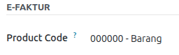
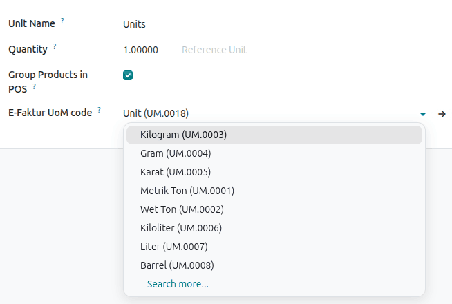
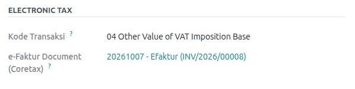
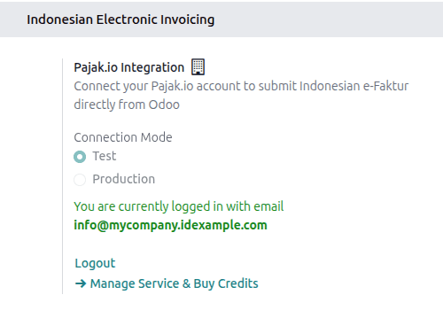
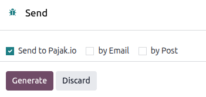
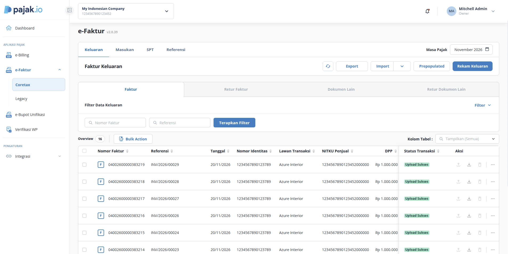
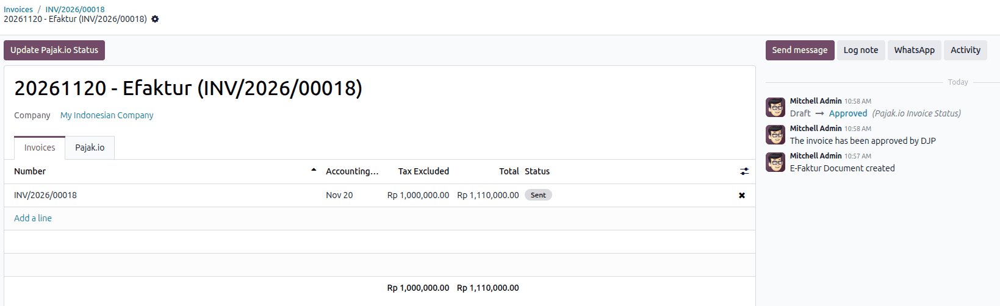
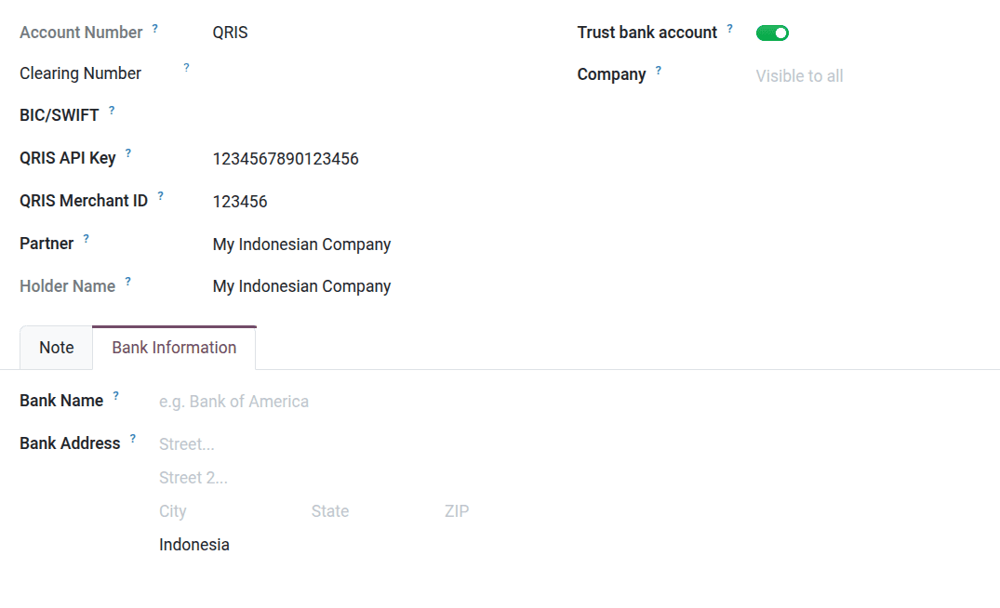
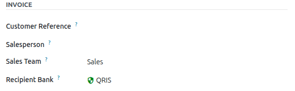

=========
Indonesia
=========

.. _localizations/indonesia/modules:

Modules
=======

:ref:`Install <general/install>` the following modules to get all the features of the Indonesian
localization:

.. list-table::
   :widths: 25 25 50
   :header-rows: 1

   * - Name
     - Technical name
     - Description
   * - :guilabel:`Indonesian - Accounting`
     - `l10n_id`
     - This module includes the default :ref:`fiscal localization package
       <fiscal_localizations/packages>`.
   * - :guilabel:`Indonesia E-faktur (Coretax)`
     - `l10n_id_efaktur_coretax`
     - This module facilitates the generation of XML files for the Coretax system.
   * - :guilabel:`Indonesia - Accounting Reports`
     - `l10n_id_reports`
     - This module includes the accounting reports for Indonesia.
   * - :guilabel:`Indonesia - Pajak.io Integration`
     - `l10n_id_pajakio`
     - This module integrates Odoo with Pajak.io to send e-invoice data to Coretax.
   * - :guilabel:`Indonesia - Point of Sale`
     - `l10n_id_pos`
     - This module allows QRIS payments in the *Point of Sale* app.
   * - :guilabel:`Indonesia - POS Self Order QRIS`
     - `l10n_id_pos_self_order_qris`
     - This module allows QRIS payments through *Point of Sale* self-ordering.

.. note::
   Only the modules for the features in use need to be installed. For example, the Pajak.io and
   *Point of Sale* modules are not needed to generate e-Faktur XML files.

.. _localizations/indonesia/overview:

Overview
========

The Indonesian localization package ensures compliance with Indonesian fiscal and accounting
regulations. It provides tools for managing taxes, fiscal positions, and a predefined chart of
accounts tailored to Indonesian standards.

- :ref:`Chart of accounts <localizations/indonesia/chart-of-accounts>`: predefined structure
  tailored to Indonesian accounting standards
- :ref:`Taxes <localizations/indonesia/taxes>`: pre-configured tax rates, including value-added tax
  (PPN) and luxury goods sales tax (PPnBM)
- :doc:`Fiscal positions <../accounting/taxes/fiscal_positions>`: automated tax and account mapping
  based on partner registration status

.. _localizations/indonesia/configuration:

Configuration
=============

.. _localizations/indonesia/chart-of-accounts:

Chart of accounts
-----------------

To access the chart of accounts, go to :menuselection:`Accounting --> Configuration --> Chart of
Accounts`.

The Indonesian chart of accounts includes pre-configured accounts. To add a new account, click
:guilabel:`New`, fill in the new line, click :guilabel:`Save`, and then click :guilabel:`Setup` to
configure it further.

.. seealso::
   :doc:`../accounting/get_started/chart_of_accounts`

.. _localizations/indonesia/taxes:

Taxes
-----

Default taxes are created automatically when the :guilabel:`Indonesian - Accounting` (`l10n_id`)
module is installed. To review them, go to :menuselection:`Accounting --> Configuration -->
Taxes`. On an invoice, the tax is selected in the :guilabel:`Taxes` column of each invoice line. A
:doc:`fiscal position <../accounting/taxes/fiscal_positions>` can select it automatically.

.. _localizations/indonesia/taxes-ppn:

PPN
~~~

**PPN** (*Pajak Pertambahan Nilai*) is Indonesia's value-added tax (VAT), charged on the sale of
most goods and services at every stage of production and distribution.

The standard VAT rate in Indonesia is 12%. However, some goods and services use the *Other Value Tax
Base* (*DPP Nilai Lain*) to determine the VAT. A DPP Nilai Lain of 11/12 is applied to non-luxury
goods and services, and other rates apply to specific categories of goods and services. A zero
percent rate is applied to basic commodities, such as rice and clean tap water.

.. _localizations/indonesia/taxes-ppnbm:

PPnBM
~~~~~

**PPnBM** (*Pajak Penjualan atas Barang Mewah*), or sales tax on luxury goods (STLG), is imposed on
the import or delivery of certain taxable goods (*Barang Kena Pajak*, or BKP) classified as luxury.

.. _localizations/indonesia/taxes-pemungut-ppn:

Pemungut PPN
~~~~~~~~~~~~

A **VAT collector** (*Pemungut PPN*, or *WAPU*) is a government-designated entity, such as a digital
platform, state agency, or state-owned enterprise, that is authorized to withhold VAT on
transactions and remit it directly to the Indonesian state treasury, rather than paying it to the
seller.

The :guilabel:`Pemungut PPN` tax is not recorded in the journal items, but the tax amount is still
visible to customers on the invoice report.

.. _localizations/indonesia/taxes-categories:

Installed taxes
~~~~~~~~~~~~~~~

The following categories of taxes are installed:

- Value-added tax (VAT): 12% (non-luxury goods, using the DPP Nilai Lain of 11/12) and 12%
- Non-creditable tax (NCR): 12%
- Sales tax on luxury goods (STLG): 20%
- Exempt, zero-rated, and export: 0%
- Pemungut PPN: 12% Pemungut (non-luxury goods) and 12% Pemungut

.. note::
   It is recommended to use the default taxes instead of creating new ones, as the taxes are used
   in e-Faktur. If a new tax is required, make sure to map it to an existing **tax group**.

.. _localizations/indonesia/configuration-company:

Company and contacts
--------------------

Configure the company and each partner (customer or vendor) before generating e-Faktur files. The
same fields are used for both, because Coretax files contain the seller and the buyer information.

To configure the company, open the :doc:`Contacts <../../essentials/contacts>` app, search for the
company, and open its contact form. Alternatively, go to :menuselection:`Settings --> Companies`
and click :ref:`Update Info <general/companies/company>`. To configure a partner, open the
partner's contact form in the :guilabel:`Contacts` app.

Configure the following fields:

- :guilabel:`Name` and :guilabel:`Address`: enter the street name and number in the
  :guilabel:`Street` field, the neighborhood in the :guilabel:`Street 2` field, and the
  :guilabel:`City`, :guilabel:`State`, :guilabel:`ZIP`, and :guilabel:`Country`.
- :guilabel:`NPWP/NIK`: *Nomor Pokok Wajib Pajak* (16 digits) or *Nomor Induk Kependudukan*. The
  first digit indicates the entity type: `0` for companies, `1` to `9` for individuals.
- :guilabel:`TKU`: *Tempat Kegiatan Usaha* code (6 digits).

In the :guilabel:`Accounting` tab, under the :guilabel:`Coretax Information` section, configure the
following fields:

- :ref:`Transaction Code <localizations/indonesia/transaction-code>`: select the partner's default
  transaction code. It is pre-filled on the partner's invoices, and it can be changed on each
  invoice.
- :ref:`Document Type <localizations/indonesia/document-type>`: select the identification
  document: NPWP (TIN), national ID (NIK), passport, or other documents.

.. example::
   The following is a completed company contact form.

   .. image:: indonesia/coretax-contact.png
      :alt: Indonesian company information settings.

.. note::
   Optionally, set up a :doc:`fiscal position <../accounting/taxes/fiscal_positions>` on each
   partner so that Odoo selects the right tax automatically.

.. _localizations/indonesia/coretax:

Coretax
=======

`Coretax <https://coretaxdjp.pajak.go.id/>`_ is Indonesia's all-in-one tax platform that unifies
separate systems, such as e-Faktur and e-Bupot, into a single portal. Taxes can be reported to
Coretax using an XML file generated from Odoo.

Odoo supports two ways to report e-Faktur to Coretax:

.. list-table::
   :header-rows: 1
   :widths: 20 45 35

   * - Method
     - How it works
     - Requirements
   * - :ref:`Manual upload <localizations/indonesia/e-faktur-xml>`
     - Odoo generates the e-Faktur XML file. The file is downloaded and uploaded to Coretax
       manually.
     - No additional service
   * - :ref:`Pajak.io <localizations/indonesia/pajakio>`
     - Odoo sends the e-Faktur to Coretax automatically through Pajak.io.
     - A Pajak.io account and Pajak.io credits

.. _localizations/indonesia/coretax-terminology:

Coretax terminology
-------------------

The following Coretax terms are used in the configuration and in the e-Faktur files.

.. _localizations/indonesia/transaction-code:

Transaction code
~~~~~~~~~~~~~~~~

The **transaction code** (*Kode Transaksi*) used in e-Faktur represents the first two digits of the
tax invoice serial number (*Nomor Seri Faktur Pajak*, or NSFP). It identifies the type of delivery
of taxable goods (*Barang Kena Pajak*, or BKP) and/or taxable services (*Jasa Kena Pajak*, or
JKP), and the party that charges or collects the VAT.

The following transaction codes are available:

.. list-table::
   :header-rows: 1
   :widths: 15 85

   * - Code
     - Description
   * - `01`
     - To parties that are not VAT collectors (regular customers)
   * - `02`
     - To the treasurer
   * - `03`
     - To VAT collectors other than the treasurer
   * - `04`
     - Other value of VAT imposition base (*DPP Nilai Lain*)
   * - `05`
     - Specified amount (Article 9A, paragraph 1 of the VAT Law)
   * - `06`
     - To individuals holding foreign passports
   * - `07`
     - Deliveries for which the VAT is not collected
   * - `08`
     - Deliveries for which the VAT is exempted
   * - `09`
     - Deliveries of assets (Article 16D of the VAT Law)
   * - `10`
     - Other deliveries

.. _localizations/indonesia/document-type:

Document type
~~~~~~~~~~~~~

The **document type** (*Tipe Dokumen*) field in Coretax indicates the identification document used
by the company or the partner. The available options are :guilabel:`TIN`, :guilabel:`NIK`,
:guilabel:`Passport`, and :guilabel:`Others`. If an option other than :guilabel:`TIN` is selected,
the document number must also be entered.

.. _localizations/indonesia/e-faktur:

E-Faktur
--------

The e-Faktur is an official electronic tax invoice used to document the collection of value-added
tax (VAT/PPN) on taxable goods and services.

.. _localizations/indonesia/e-faktur-products:

Products
~~~~~~~~

E-Faktur requires each product to have its own product code, such as :guilabel:`000000 - Barang`.
To configure the product code:

#. Go to :menuselection:`Accounting --> Customers --> Products` and open the desired product form.
#. Go to the :guilabel:`Accounting` tab, under the :guilabel:`E-Faktur` section.
#. Select a code in the :guilabel:`Product Code` field. By default, the code is set to
   :guilabel:`000000 - Barang`.

.. note::
   Odoo pre-generates e-Faktur product codes to comply with e-Faktur regulations. Select the
   appropriate code from the drop-down list.

.. _localizations/indonesia/e-faktur-uom-code:

E-Faktur UoM code
~~~~~~~~~~~~~~~~~

The e-Faktur unit of measure (UoM) code is a standardized set of codes required for all goods and
services in e-Faktur. Map each Odoo unit of measure to the corresponding e-Faktur UoM code.

.. important::
   Go to :menuselection:`Inventory --> Configuration --> Settings` and make sure the
   :guilabel:`Units of Measure & Packagings` option is enabled.

To configure the :guilabel:`E-Faktur UoM code`, go to :menuselection:`Inventory --> Configuration
--> Units & Packagings`. Open the desired unit of measure, and select the appropriate
:guilabel:`E-Faktur UoM code` from the options.

.. _localizations/indonesia/e-faktur-xml:

Generate an e-Faktur XML file
~~~~~~~~~~~~~~~~~~~~~~~~~~~~~

Before generating the file, make sure the :ref:`company and partner information
<localizations/indonesia/configuration-company>`, the :ref:`product codes
<localizations/indonesia/e-faktur-products>`, and the :ref:`UoM codes
<localizations/indonesia/e-faktur-uom-code>` are configured.

To generate an e-Faktur XML file:

#. Go to :menuselection:`Accounting --> Customers --> Invoices` and :ref:`create an invoice
   <accounting/invoice/creation>`.
#. In the :guilabel:`Accounting` tab, under the :guilabel:`Coretax Information` section, select a
   :guilabel:`Transaction Code`.
#. After confirming the invoice, click the :icon:`fa-cog` :guilabel:`(Actions)` icon and select
   :guilabel:`Download E-Faktur`.

After the file is generated, the :guilabel:`E-Faktur Document (Coretax)` field in the
:guilabel:`Electronic Tax` section of the invoice is populated automatically.

.. tip::
   To create a batch XML file for several invoices, select them in the invoice list view, click
   :icon:`fa-cog` :guilabel:`(Actions)`, and then :guilabel:`Download E-Faktur`.

.. important::
   - The tax invoice number (*Nomor Seri Faktur Pajak*, or NSFP) is generated by Coretax, not by
     Odoo.
   - Once an e-Faktur XML file has been downloaded, it cannot be changed. Any subsequent download
     retrieves the original file. To correct an error, see :ref:`Correct a downloaded e-Faktur
     <localizations/indonesia/e-faktur-correct>`.

.. note::
   If the XML file cannot be generated, or if Coretax rejects it, check that the
   :guilabel:`NPWP/NIK`, :guilabel:`TKU`, and :guilabel:`Document Type` of the company and the
   partner, the product code, the UoM code, and the :guilabel:`Transaction Code` of the invoice are
   all configured.

.. _localizations/indonesia/e-faktur-correct:

Correct a downloaded e-Faktur
~~~~~~~~~~~~~~~~~~~~~~~~~~~~~

An e-Faktur XML file cannot be changed once it is downloaded. To correct it, delete the file from
the invoice and generate a new one:

#. Open the invoice and go to the :guilabel:`Other Info` tab.
#. In the :guilabel:`Electronic Tax` section, click the :guilabel:`E-Faktur Document (Coretax)`
   record.
#. Delete the e-Faktur XML file from the record.
#. Reset the invoice to draft, make the necessary changes, and confirm it again.
#. Click the :icon:`fa-cog` :guilabel:`(Actions)` icon and select :guilabel:`Download E-Faktur` to
   generate the e-Faktur again.

.. seealso::
   :ref:`accounting/credit_notes/issue-credit-note`

.. _localizations/indonesia/e-faktur-upload:

Upload the XML file to Coretax
~~~~~~~~~~~~~~~~~~~~~~~~~~~~~~

Upload the downloaded XML file in the output tax invoice (*Pajak Keluaran*) section of the
`Coretax <https://coretaxdjp.pajak.go.id/>`_ portal. The number of the tax invoice is assigned by
Coretax after the upload.

.. _localizations/indonesia/pajakio:

Pajak.io
========

`Pajak.io <https://pajak.io/>`_ is an Indonesian cloud-based tax management platform and official
application service provider (*Penyedia Jasa Aplikasi Perpajakan*, or PJAP) authorized by the
Directorate General of Taxes (*Direktorat Jenderal Pajak*, or DJP) to automate corporate tax
processes, including e-Faktur, withholding slips, and compliance reporting. Pajak.io in Odoo
automatically sends e-Faktur documents to Coretax. As a PJAP, Pajak.io can access the Coretax data
of an NPWP, so the company does not need to authorize Pajak.io in Coretax or hold a certificate.

Two accounts are involved. A Pajak.io account is :ref:`registered in Odoo
<localizations/indonesia/pajakio-registration>`, and the credits used for each e-Faktur are bought
through the :abbr:`IAP (In-App Purchase)` account.

.. _localizations/indonesia/pajakio-prerequisite:

Prerequisites
-------------

Before sending e-Faktur documents to Coretax through Pajak.io, make sure the following requirements
are met:

- **Fiscal localization package**: set it to Indonesia, so that Odoo uses the Indonesian taxes and
  e-Faktur features. To check it, go to :menuselection:`Accounting --> Configuration -->
  Settings` and look under the :guilabel:`Fiscal Localization` section. If another package is
  selected, select :guilabel:`Indonesia` and click :guilabel:`Save`.
- **Company information**: set the company's :guilabel:`City`, :guilabel:`Country`, and
  :guilabel:`NPWP/NIK`. The country must be :guilabel:`Indonesia`. The NPWP identifies the company
  in Coretax, and it is also used to fill in the Pajak.io registration automatically. See
  :ref:`localizations/indonesia/configuration-company` for the company fields.
- **Pajak.io credits**: make sure the IAP account has a Pajak.io balance, since each e-Faktur sent
  through Pajak.io uses credits. To check the balance, go to :menuselection:`Accounting -->
  Configuration --> Settings`, scroll to the :guilabel:`Indonesian Electronic Invoicing` section,
  and click :guilabel:`Manage Service & Buy Credits`. The IAP page shows the current balance and
  allows buying more credits.

.. note::
   Each month, 50 free credits are provided. Free credits expire at the end of the month and are
   used before purchased credits. If more credits are needed, they can be bought at any time.
   Purchased credits never expire.

.. seealso::
   - :doc:`../../essentials/in_app_purchase`
   - `Pajak.io IAP <https://iap.odoo.com/iap/in-app-services/869>`_

.. _localizations/indonesia/pajakio-setup:

Setup
-----

#. :ref:`Install <general/install>` the :guilabel:`Indonesia - Pajak.io Integration` module. To do
   so, go to the :guilabel:`Apps` page, search for `Indonesia - Pajak.io Integration`, and click
   :guilabel:`Activate`.
#. Go to :menuselection:`Accounting --> Configuration --> Settings`.
#. In the :guilabel:`Indonesian Electronic Invoicing` section, change the connection mode to
   :guilabel:`Production`, then click :guilabel:`Save`. The connection mode defines whether
   e-Faktur documents are sent to Coretax or only tested.

.. note::
   The test connection mode allows testing the feature without uploading e-Faktur to Coretax. Use
   it to check the configuration before switching to the production mode.

After the module is installed and the connection mode is set, :ref:`register a Pajak.io user
<localizations/indonesia/pajakio-registration>`, or :ref:`sign in
<localizations/indonesia/pajakio-sign-in>` if an account already exists.

.. _localizations/indonesia/pajakio-registration:

Register user
~~~~~~~~~~~~~

A Pajak.io account is required to send e-Faktur documents to Coretax. Create the account and
register the company first:

#. In the :guilabel:`Indonesian Electronic Invoicing` section, click :guilabel:`Register User`.
#. Fill in the following user information:

   - :guilabel:`Email`: the email address of the Pajak.io account.
   - :guilabel:`Password`: the password of the Pajak.io account.
   - :guilabel:`Name`: the name of the user.
   - :guilabel:`Phone`: the phone number of the user.

#. Click :guilabel:`Register User`.
#. Fill in the following company information:

   - :guilabel:`Email`: the email address just registered in the previous step.
   - :guilabel:`Company Name`: the name of the company.
   - :guilabel:`Address`: the address of the company.
   - :guilabel:`City`: the city of the company.
   - :guilabel:`NPWP`: the company's NPWP. It is filled in automatically from the company's contact
     and can be changed if needed. Pajak.io detects the company name and address from the NPWP.

#. Enter the password of the Pajak.io account.
#. Click :guilabel:`Register Company`.

Once the registration is complete, the message :guilabel:`You are currently logged in with email
[your email]` appears. It confirms that Odoo is connected to the Pajak.io account.

.. _localizations/indonesia/pajakio-sign-in:

Sign in
~~~~~~~

If a Pajak.io account already exists, sign in with it instead of registering a new one:

#. In the :guilabel:`Indonesian Electronic Invoicing` section, click :guilabel:`Sign In`.
#. Fill in the :guilabel:`Email` and :guilabel:`Password` of the existing Pajak.io account. The NPWP
   is filled in automatically from the company's contact.

.. _localizations/indonesia/pajakio-upload-efaktur:

Upload e-Faktur
---------------

Once the setup is complete, e-Faktur documents can be sent to Coretax directly from an invoice:

#. Create and confirm an invoice. Make sure the :guilabel:`Transaction Code` is set and the
   customer's :ref:`Coretax fields <localizations/indonesia/configuration-company>` are configured.
#. Click :guilabel:`Send` at the top left of the invoice to open the wizard.
#. Select the :guilabel:`Send to Pajak.io` option.
#. Click :guilabel:`Generate`.

The e-Faktur is then uploaded to Coretax automatically. A Pajak.io credit is consumed when the
e-Faktur is approved. Rejected e-Faktur documents do not consume a credit.

.. tip::
   To upload several invoices to Pajak.io at once, select them in the list view and click
   :guilabel:`Send`.

If the e-Faktur cannot be sent, make sure the IAP account has enough Pajak.io credits. See
:ref:`localizations/indonesia/pajakio-prerequisite` for how to check the balance.

.. note::
   If the error :guilabel:`Failed to create invoice in Pajak.io. Expecting value: line 1 column 1
   (char 0)` appears, Pajak.io did not return a valid response, for example because the service is
   temporarily unavailable. Wait a few minutes and send the e-Faktur again. Check that the
   connection mode is correct and that the Pajak.io user is signed in. If the error persists,
   contact support.

To check the uploaded e-Faktur documents in the Pajak.io dashboard, go to
:menuselection:`e-Faktur --> Coretax --> Keluaran`.

.. _localizations/indonesia/pajakio-update-status:

Update Pajak.io status
----------------------

If the e-Faktur status is not :guilabel:`Approved`, check and update the Pajak.io status by
following these steps:

#. Open the invoice and go to the :guilabel:`Other Info` tab.
#. In the :guilabel:`Electronic Tax` section, click the e-Faktur document record.
#. Click :guilabel:`Update`.

The status is displayed in the chatter. The status can be one of the following:

.. list-table::
   :header-rows: 1
   :widths: 20 80

   * - Status
     - Description
   * - :guilabel:`Approved`
     - The e-Faktur has been approved by the Directorate General of Taxes (DJP).
   * - :guilabel:`Waiting`
     - The e-Faktur is waiting for DJP verification, or it is still being sent.
   * - :guilabel:`Rejected`
     - The e-Faktur has been rejected by the DJP. The reason for the rejection is provided by
       Pajak.io.

.. _localizations/indonesia/pajakio-cancel:

Request cancellation
--------------------

A sent e-Faktur can be canceled after it is uploaded to Pajak.io. Canceling the e-Faktur also
cancels the invoice in Odoo. To cancel an e-Faktur submitted to Pajak.io:

#. Open the invoice and click :guilabel:`Request Cancel`.
#. In the pop-up window, fill in the reason for the cancellation.
#. Click the confirmation button to submit the request.

.. note::
   Canceling an e-Faktur does not consume a credit. However, the credit consumed when the e-Faktur
   was approved is not refunded.

.. _localizations/indonesia/qris:

QRIS
====

`QRIS <https://qris.online/homepage/>`_ is a digital payment system that allows customers to make
payments by scanning a QR code with their preferred e-wallet. QRIS is available in Odoo for
invoices and for *Point of Sale*.

.. seealso::
   :ref:`QRIS QR codes on Point of Sale <localizations/indonesia/pos>`

.. note::
   QRIS payments are also available in the *eCommerce* app through the Xendit payment provider.

.. _localizations/indonesia/qris-activate-qr-code:

Activate QR codes
-----------------

Go to :menuselection:`Accounting --> Configuration --> Settings`. Under the :guilabel:`Customer
Payments` section, enable the :guilabel:`QRIS Code` feature.

.. _localizations/indonesia/qris-bank-account-config:

QRIS bank account configuration
-------------------------------

Go to :menuselection:`Accounting --> Configuration --> Journals` and open the desired bank journal.
Create a :guilabel:`Bank Account Number`, and set the :guilabel:`QRIS API Key` and :guilabel:`QRIS
Merchant ID` based on the information provided by QRIS.

.. note::
   There are two ways to get the :guilabel:`QRIS API Key` and the :guilabel:`QRIS Merchant ID`:

   - Register through `this link
     <https://www.odoo.com/survey/start/3e20dc36-e4e5-4101-aeca-fd37bb3eaa54>`_.
   - Contact the account manager.

   Once the API key is available, a notification is sent to the email address registered in the
   QRIS interactive account.

.. important::
   The country of the account holder must be set to Indonesia on its contact form.

.. _localizations/indonesia/qris-invoices:

QRIS QR codes on invoices
-------------------------

When creating a new invoice, go to the :guilabel:`Other Info` tab. In the :guilabel:`Invoice`
section, select the :guilabel:`Recipient Bank` configured previously. Odoo uses this bank account to
generate the QRIS QR code, which is displayed in the customer portal.

.. important::
   According to the `QRIS API documentation <https://qris.online/api-doc/create-invoice.php>`_, a
   QRIS code expires after 30 minutes. Due to this restriction, the QR code is not included in
   reports or emails sent to customers and is only available in the customer portal.

.. note::
   If the QRIS QR code is not displayed, check that the :guilabel:`QRIS Code` feature is enabled,
   that the :guilabel:`QRIS API Key` and :guilabel:`QRIS Merchant ID` are set on the bank account,
   and that the :guilabel:`Recipient Bank` is selected on the invoice.

.. _localizations/indonesia/pos:

Point of Sale
=============

.. _localizations/indonesia/pos-qris:

QRIS QR codes on Point of Sale
------------------------------

QRIS in the *Point of Sale* app lets customers pay by scanning a QR code on the point of sale
device or in the self-ordering kiosk.

.. important::
   Before using QRIS in *Point of Sale*:

   - Install the :guilabel:`Indonesia - Point of Sale` module. For the self-ordering kiosk, also
     install the :guilabel:`Indonesia - POS Self Order QRIS` module.
   - Make sure the :ref:`QR codes are activated <localizations/indonesia/qris-activate-qr-code>`.
   - Complete the :ref:`POS QR code configuration <pos/qrcode/payment-method>`.

To accept a QRIS payment in a session, create an order and select the payment method of the bank
journal on which QRIS is configured. The QRIS payment method is also available in the self-ordering
kiosk.
