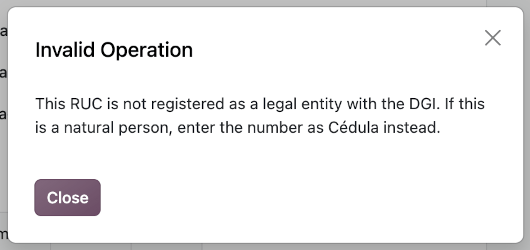

======
Panama
======

.. |DGI| replace:: :abbr:`DGI (Dirección General de Ingresos)`
.. |PAC| replace:: :abbr:`PAC (Proveedor de Autorización Calificado)`
.. |EDI| replace:: :abbr:`EDI (Electronic Data Interchange)`
.. |CUFE| replace:: :abbr:`CUFE (Código Único de Factura Electrónica)`
.. |CAFE| replace:: :abbr:`CAFE (Comprobante Auxiliar de Factura Electrónica)`
.. |RUC| replace:: :abbr:`RUC (Registro Único de Contribuyente)`
.. |DV| replace:: :abbr:`DV (Dígito Verificador)`
.. |ITBMS| replace:: :abbr:`ITBMS (Impuesto de Transferencia de Bienes Muebles y la Prestación de
   Servicios)`
.. |UNSPSC| replace:: :abbr:`UNSPSC (United Nations Standard Products and Services Code)`

.. _localizations/panama/modules:

Modules
=======

The following modules are automatically installed with the Panamanian localization:

.. list-table::
   :header-rows: 1
   :widths: 25 25 50

   * - Name
     - Technical name
     - Description
   * - :guilabel:`Panama - Accounting`
     - `l10n_pa`
     - The default :doc:`fiscal localization package <../fiscal_localizations>` required for a
       company to operate in Panama according to the |DGI| guidelines. The module's installation
       automatically loads the chart of accounts, taxes, and document types.

Additionally, the following module must be manually :doc:`installed <../../general/apps_modules>` in
order to use The Factory HKA electronic documents system.

.. list-table::
   :header-rows: 1
   :widths: 25 25 50

   * - Name
     - Technical name
     - Description
   * - :guilabel:`Panama - Electronic Invoicing`
     - `l10n_pa_edi`
     - Includes all the technical and functional requirements to generate and validate
       :doc:`electronic invoices <../accounting/customer_invoices/electronic_invoicing>` through
       The Factory HKA, based on the technical documentation published by the |DGI|.

.. _localizations/panama/glossary:

Glossary
--------

The following terms are used throughout the Panamanian localization:

- **DGI**: *Dirección General de Ingresos* is the government entity responsible for enforcing tax
  payments in Panama.
- **PAC**: *Proveedor de Autorización Calificado* is a third party authorized by the DGI to validate,
  sign, and authorize electronic invoices on behalf of the taxpayer.
- **The Factory HKA**: the PAC that Odoo connects with to generate and submit electronic documents to
  the DGI.
- **CUFE**: *Código Único de Factura Electrónica* is the unique code that identifies each
  authorized electronic document.
- **CAFE**: *Comprobante Auxiliar de Factura Electrónica* is the printed or PDF representation of
  an authorized electronic invoice.
- **RUC**: *Registro Único de Contribuyente* is the taxpayer identification number.
- **DV**: *Dígito Verificador* is the check digit of the RUC, assigned by the DGI.
- **ITBMS**: *Impuesto de Transferencia de Bienes Muebles y la Prestación de Servicios*
  is the Panamanian value-added tax.
- **Balboa**: the official currency of Panama (PAB), at par with the US dollar (USD).

.. _localizations/panama/loc-review:

Localization overview
=====================

The Panamanian localization package ensures compliance with Panamanian fiscal and accounting
regulations. It provides the following key features:

- :ref:`Chart of accounts <localizations/panama/chart-of-accounts>`: a predefined structure tailored
  to Panamanian accounting standards.
- :ref:`Taxes <localizations/panama/taxes>`: pre-configured |ITBMS| rates, including the standard,
  reduced, exempt, and zero-rated options.
- :ref:`Electronic invoicing (The Factory HKA) <localizations/panama/electronic-invoicing>`:
  integration for electronic invoicing in line with the |DGI| requirements.

.. _localizations/panama/chart-of-accounts:

Chart of accounts
-----------------

The :doc:`chart of accounts <../accounting/get_started/chart_of_accounts>` is installed by default
as part of the data set included with the localization module. Accounts are automatically mapped to
taxes, default accounts payable, and default accounts receivable.

Use the :ref:`predefined structure <chart-of-account/create>` or create and delete accounts
according to the company's needs.

.. _localizations/panama/taxes:

Taxes
-----

As part of the Panamanian localization module, :doc:`taxes <../accounting/taxes>` are automatically
created with their configuration and related financial accounts. The main sales taxes include:

- :guilabel:`ITBMS 7%`: standard rate applied to most goods and services.
- :guilabel:`ITBMS 10%`: rate applicable to alcoholic beverages and lodging services.
- :guilabel:`ITBMS 15%`: rate applicable to tobacco products.
- :guilabel:`ITBMS Exempt`: for goods and services exempt from |ITBMS|.
- :guilabel:`ITBMS 0% Export`: for export sales.
- :guilabel:`ITBMS Non-taxable`: for operations not subject to |ITBMS|.

Purchase taxes for other levies (*Otras Tasas o Impuestos*, such as SUME 911 or the insurance
premium tax) are also included.

.. important::
   For electronic invoicing, each invoice line must have exactly one |ITBMS| tax, of 0%, 7%, 10%, or
   15%. The rate reported to the |DGI| is determined by the tax percentage. Exempt, export, and
   non-taxable lines are reported with the 0% rate.

Multi-currency
--------------

The official currency of Panama is the Balboa (PAB), which is at par with the US dollar (USD).
:doc:`Additional foreign currencies <../accounting/get_started/multi_currency>` can also be enabled
and configured, as needed.

.. note::
   Panama does not have a central bank that publishes an official exchange rate. Exchange rates for
   other currencies can be updated manually or with any of the :ref:`automatic rate providers
   <multi-currency/automatic-update>` available in Odoo.

.. _localizations/panama/company-contacts:

Company and contacts
====================

.. _localizations/panama/company:

Company
-------

To use all the features of the panamanian localization, the following fields are required on the
:doc:`company record </applications/general/companies>`:

- :guilabel:`Company Name`
- :guilabel:`Address`, including the :guilabel:`Street`, :guilabel:`City`, :guilabel:`State`, and
  :guilabel:`Country`
- :guilabel:`Tax ID`: enter the company's |RUC|.
- :guilabel:`DV`: enter the company's |DV|.
- :guilabel:`Branch Code (PA)`: the four-digit code of the branch (*sucursal*) registered in The
  Factory HKA portal. By default, `0000` (main branch).

.. important::
   The issuer data of the electronic document is taken from the :ref:`branch configuration
   <general/branches>` in The Factory HKA portal. Make sure every branch is fully configured there,
   including its phone number: otherwise, The Factory HKA rejects the documents.

.. _localizations/panama/contacts:

Contacts
--------

The following fields must be completed on :doc:`contact <../../essentials/contacts>` forms:

- :guilabel:`Name`
- :guilabel:`Address`. For taxpayer customers, the :guilabel:`Corregimiento`, :guilabel:`City`
  (District), and :guilabel:`State` (Province) are required.
- An identification number, depending on the type of customer:

  - **Companies**: enter the |RUC| in the :guilabel:`Tax ID` field.
  - **Natural persons**: leave the :guilabel:`Tax ID` field empty, click the :icon:`add`
    :guilabel:`(Add an identifier)`, and add a :guilabel:`Cédula` identifier with the person's ID
    number.
  - **Foreign customers**: set a :guilabel:`Country` other than Panama and add their identification
    number (passport or foreign tax ID).

- :guilabel:`DV`: required for taxpayers. Click the :icon:`fa-refresh` (:guilabel:`Fetch the DV from
  the DGI`) icon next to the field to retrieve it from the |DGI| through The Factory HKA.
- :guilabel:`Payment Method (PA)`: in the :guilabel:`Sales & Purchase` tab, select the default
  :ref:`payment method <accounting/payments/payment-methods>` reported on this customer's invoices
  (for example, :guilabel:`Cash` or :guilabel:`Bank Transfer or Deposit`).

.. note::
   - The :icon:`fa-refresh` (:guilabel:`Fetch the DV from the DGI`) icon is only available in the
     :guilabel:`Test` and :guilabel:`Production` environments, once the :ref:`HKA credentials
     <localizations/panama/e-invoice-configuration>` are set.
   - The phone number is reported to the |DGI| only if it has seven or eight digits (the `507`
     country prefix is removed, e.g., 6123-4567 or 212-23456).

The type of customer reported to the |DGI| is computed automatically from the contact's data:

.. list-table::
   :header-rows: 1
   :widths: 40 30 30

   * - Contact data
     - Receiver type
     - Taxpayer type
   * - :guilabel:`Country` other than Panama
     - Foreign (*Extranjero*)
     - Not applicable
   * - :guilabel:`Tax ID` (|RUC|) with |DV|
     - Taxpayer (*Contribuyente*)
     - Legal entity
   * - :guilabel:`Cédula` identifier with |DV|
     - Taxpayer (*Contribuyente*)
     - Natural person
   * - :guilabel:`Cédula` identifier without |DV|
     - Final consumer (*Consumidor final*)
     - Natural person
   * - No identification
     - Final consumer (*Consumidor final*)
     - Not applicable

.. tip::
   - If a :guilabel:`Tax ID` is not registered as a legal entity with the |DGI|, fetching the |DV|
     shows a message suggesting to enter the number as a :guilabel:`Cédula` identifier instead.
   - If a person is not registered as a taxpayer with the |DGI|, there is no |DV| to fetch. Leave
     the :guilabel:`DV` field empty: the person is invoiced as a final consumer.

.. _localizations/panama/electronic-invoicing:

Electronic invoicing with The Factory HKA
=========================================

The following documents are supported:

- :guilabel:`01 - Factura de Operación Interna` (*internal operation invoice*)
- :guilabel:`03 - Factura de Exportación` (*export invoice*)
- :guilabel:`04 - Nota de Crédito referente a una o varias FE` (*credit note referencing an
  electronic invoice*)
- :guilabel:`05 - Nota de Débito referente a una o varias FE` (*debit note referencing an electronic
  invoice*)
- :guilabel:`06 - Nota de Crédito Genérica` (*generic credit note*)
- :guilabel:`07 - Nota de Débito Genérica` (*generic debit note*)

.. note::
   A `The Factory HKA <https://thefactoryhka.com.pa/odoo/>`_ account is required to generate and
   submit electronic documents to the |DGI|.

.. _localizations/panama/e-invoice-configuration:

Configuration
-------------

.. note::
   Make sure to :ref:`install <general/install>` the :guilabel:`Panama - Electronic Invoicing`
   (`l10n_pa_edi`) module.

Odoo connects with The Factory HKA to generate and submit electronic documents to the |DGI|. To
configure this connection:

#. Sign a service agreement directly with `The Factory HKA <https://thefactoryhka.com.pa/odoo/>`_
   to receive the integration credentials.
#. In The Factory HKA portal, register the branches (*sucursales*) that will issue electronic
   documents.
#. In Odoo, go to :menuselection:`Accounting --> Configuration --> Settings` and scroll down to the
   :guilabel:`Panama Electronic Invoicing` section.
#. Select the :guilabel:`HKA Environment`: :guilabel:`Demo`, :guilabel:`Test`, or
   :guilabel:`Production`.
#. In :guilabel:`HKA Credentials`, enter the :guilabel:`Username` and :guilabel:`Password` provided
   by The Factory HKA.
#. Click :guilabel:`Check Connection` to verify the credentials. If the connection is successful,
   the available folios and the license expiration date are displayed.
#. Click :guilabel:`Save`.

.. tip::
   - The credentials are required for both the :guilabel:`Test` and :guilabel:`Production`
     environments. If they are not available, contact The Factory HKA support.
   - In the :guilabel:`Demo` environment, documents are authorized automatically without contacting
     The Factory HKA. No credentials are needed to use it.
   - Documents authorized in the :guilabel:`Test` environment have no fiscal value. Their |CAFE|
     shows *FE generada en ambiente de pruebas - sin valor comercial ni fiscal* instead of the
     company name.

.. _localizations/panama/e-invoice-journals:

Journals
~~~~~~~~

For electronic invoicing flows, :doc:`journals <../accounting/get_started/journals>` must be
configured with the following settings:

- :guilabel:`Type`: Sales
- :guilabel:`Use Documents?`: Enabled, to enforce document type selection on invoices.
- :guilabel:`Fiscal Billing Point`: the three-digit billing point (*punto de facturación*) used by
  a journal (for example, `001`). It cannot be `000`, and each journal of the company must use a
  different one.

.. important::
   The billing point is a three-digit code that identifies each system issuing electronic documents
   for a branch (for example, Odoo, The Factory HKA portal, or another invoicing software). Each
   combination of branch, billing point, and document type has its own numbering. Use a billing
   point in Odoo that no other system uses, to avoid duplicate numbers.

.. _localizations/panama/e-invoice-document-types:

Document types
~~~~~~~~~~~~~~

The Panamanian localization defines the following document types, accessible under
:menuselection:`Accounting --> Configuration --> Document Types`:

.. list-table::
   :header-rows: 1
   :widths: 10 50 20 20

   * - Code
     - Name
     - Document Code Prefix
     - Internal Type
   * - 01
     - Factura de Operación Interna
     - FE
     - Invoices
   * - 03
     - Factura de Exportación
     - FX
     - Invoices
   * - 04
     - Nota de Crédito referente a una o varias FE
     - NC
     - Credit Notes
   * - 05
     - Nota de Débito referente a una o varias FE
     - ND
     - Debit Notes
   * - 06
     - Nota de Crédito Genérica
     - NCG
     - Credit Notes
   * - 07
     - Nota de Débito Genérica
     - NDG
     - Debit Notes

.. note::
   Other document types defined by the |DGI| (import, free trade zone, reimbursement, and foreign
   operation invoices) are available to register vendor bills.

.. _localizations/panama/e-invoice-numbering:

Numbering
*********

Electronic document numbers have exactly ten digits (for example, `FE 0000000001`) and cannot be
restarted. Each document type has its own sequence per journal.

For the first document of each type, enter the starting number manually in the
:guilabel:`Document Number` field before confirming the invoice. Odoo pads it with zeros to ten
digits. The following documents of that type are numbered automatically.

.. note::
   If The Factory HKA already holds the same number for another document of that billing point, the
   invoice is rejected with a message indicating it. Use a number not sent to The Factory HKA yet.

.. _localizations/panama/customer-invoices:

Customer invoices
-----------------

Once the :ref:`configuration <localizations/panama/e-invoice-configuration>` is complete,
electronic documents can be :ref:`created <localizations/panama/invoice-creation>` and :ref:`sent
<localizations/panama/invoice-sending>` to the |DGI|.

.. _localizations/panama/invoice-creation:

Invoice creation
~~~~~~~~~~~~~~~~

When :ref:`creating a customer invoice <accounting/invoice/creation>`, complete the following
fields before clicking :guilabel:`Confirm`:

- :guilabel:`Customer`: select a customer :ref:`contact <localizations/panama/contacts>`.
- :guilabel:`Journal`: If the company has several *sales* journal, select an :ref:`electronic
  invoicing sales journal <localizations/panama/e-invoice-journals>` in the :guilabel:`Journal`
  field.
- :guilabel:`Document Type`: select the document type to generate.
- :guilabel:`Payment Method (PA)`: filled in from the customer's default payment method, and can be
  changed.
- :guilabel:`Payment Terms`: used to report the payment term (cash, credit, or mixed) and the
  installments.
- :guilabel:`Products`: specify the product(s) with the correct |ITBMS| tax. Each line needs a
  label, which is reported as its description (up to 500 characters).

  - Optionally, set the |UNSPSC| code in the :guilabel:`UNSPSC Category` field of the product's
    :guilabel:`Accounting` tab. The |DGI| classifies products with the *Codificación Panameña de
    Bienes y Servicios* (CPBS), which is based on the first levels of the |UNSPSC|. When the code is
    set, Odoo reports it on the electronic invoice.

    .. note::
       If a product has no |UNSPSC| code, the invoice is still authorized, and the |DGI| returns a
       notification, which is posted in the chatter. If the code does not exist in the |DGI|
       catalog, the invoice is rejected.

.. note::
   - The content of the :guilabel:`Terms and Conditions` field is sent to the |DGI| as additional
     information on the electronic invoice.
   - The :guilabel:`Reference` field is sent as the purchase order number when it has up to 12
     letters, digits, spaces, or hyphens.

.. important::
   The following invoices cannot be sent to The Factory HKA:

   - Invoices with lines that have a negative quantity or unit price (for example, global discount
     or down payment deduction lines).
   - Invoices with early payment discounts that reduce the tax base.

.. seealso::
   :doc:`../accounting/customer_invoices/terms_conditions`

.. _localizations/panama/invoice-sending:

Invoice sending
~~~~~~~~~~~~~~~

To send the invoice, follow these steps:

#. Click :guilabel:`Send`.
#. In the :guilabel:`Send` window, enable these options:

   - :guilabel:`Send to HKA`: to submit the electronic invoice to the |DGI| through The Factory
     HKA.
   - :guilabel:`by Email`: to send the authorized document to the customer's email.

#. Click :guilabel:`Send`.

If any required data is missing, a message lists the issues before sending. Otherwise, the following
actions occur:

- The request is generated and attached in the chatter.
- The Factory HKA validates the document, signs it, and authorizes or rejects it.
- If authorized:

  - The :guilabel:`PA Status` is set to :guilabel:`Authorized`, and the :guilabel:`CUFE`,
    :guilabel:`Authorization Protocol`, and :guilabel:`Authorization Date` fields are filled in the
    :guilabel:`Panama Electronic Invoicing` section of the :guilabel:`Other Info` tab.
  - The signed XML file is downloaded from The Factory HKA and attached in the chatter. Any
    notifications returned by the |DGI| are also posted in the chatter.
  - The |CAFE| (PDF) is generated with the |CUFE|, the authorization protocol, and the QR code.
  - The invoice can no longer be reset to draft.

- If rejected, the :guilabel:`PA Status` is set to :guilabel:`Rejected` and the error code and
  message returned by The Factory HKA are displayed at the top of the invoice.

.. tip::
   If the invoice is rejected, click :guilabel:`Reset to Draft`, make the necessary corrections,
   confirm it, and send it again. The invoice keeps its number.

.. note::
   If no response is received from The Factory HKA, the :guilabel:`PA Status` is set to
   :guilabel:`Pending`, and the invoice cannot be reset to draft. Click :guilabel:`Update Status`
   to request the current status of the document.

.. _localizations/panama/export-invoices:

Export invoices
~~~~~~~~~~~~~~~

To issue an export invoice:

- Select a customer whose :guilabel:`Country` is not Panama.
- Select the :guilabel:`03 - Factura de Exportación` document type.
- Set the :guilabel:`Incoterm` in the :guilabel:`Other Info` tab.
- Use the :guilabel:`ITBMS 0% Export` tax on the invoice lines.

If the invoice currency is not USD or PAB, the currency, the exchange rate, and the total amount in
that currency are also reported to the |DGI|.

.. _localizations/panama/debit-credit-notes:

Debit and credit notes
----------------------

To send a debit or credit note to the |DGI|, create the :ref:`debit note
<accounting/credit_notes/issue-debit-note>` or :ref:`credit note
<accounting/credit_notes/issue-credit-note>` from the original invoice using the :guilabel:`Debit
Note` or :guilabel:`Credit Note` buttons, respectively, and select the document type:

- :guilabel:`04 - Nota de Crédito referente a una o varias FE` or :guilabel:`05 - Nota de Débito
  referente a una o varias FE`: when the original invoice was authorized by The Factory HKA. The
  original invoice is referenced in the electronic document.
- :guilabel:`06 - Nota de Crédito Genérica` or :guilabel:`07 - Nota de Débito Genérica`: when there
  is no original electronic invoice.

Then, follow the same :ref:`sending process <localizations/panama/invoice-sending>` as for
invoices.

.. _localizations/panama/cancellation:

Cancellation
------------

An authorized electronic document can be cancelled (*anulado*) at The Factory HKA within seven days
of its emission. To do so:

#. Open the authorized invoice and click :guilabel:`Request Cancel`.
#. In the :guilabel:`Annul at HKA` window, enter the :guilabel:`Reason`. The |DGI| requires
   between 15 and 1000 characters.
#. Click :guilabel:`Annul`.

The :guilabel:`PA Status` is set to :guilabel:`Cancelled`, and the invoice is cancelled.

.. warning::
   - A cancellation cannot be undone.
   - After seven days, or if the customer has already confirmed the operation, the document cannot
     be cancelled: issue a credit note instead.

.. _localizations/panama/multi-currency:
