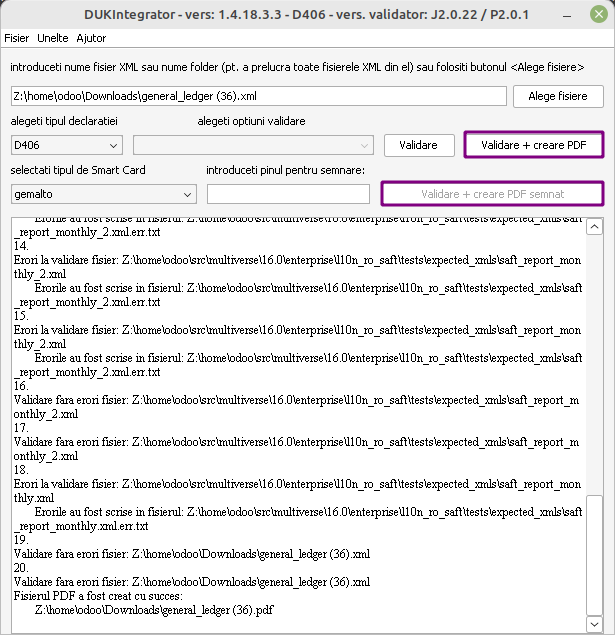

=======
Romania
=======

Configuration
=============

The following modules are :ref:`installed <general/install>` automatically with the Romanian
localization.

.. list-table::
   :header-rows: 1

   * - Name
     - Technical name
     - Description
   * - :guilabel:`Romania - Accounting`
     - `l10n_ro`
     - Default :ref:`fiscal localization package <fiscal_localizations/packages>`.
   * - :guilabel:`Romania - E-invoicing`
     - `l10n_ro_edi`
     - Enables sending an receiving electronic invoices
   * - :guilabel:`Romania - Accounting Reports`
     - `l10n_ro_reports`
     - Tailors :ref:`accounting reports <l10n_ro/reports>` to meet Romanian standards
   * - :guilabel:`Romania - D300 VAT Report`
     - `l10n_ro_reports_d300`
     - Adds the D300 tax return to be generated and submitted to the Romanian tax authorities

Additionally, the following modules can be manually :ref:`installed <general/install>` for
additional workflows:

.. list-table::
   :header-rows: 1

   * - Name
     - Technical name
     - Description
   * - :guilabel:`Romania - CPV Code`
     - `l10n_ro_cpv_code`
     - Adds CPV codes
   * - :guilabel:`Romania - E-Transport`
     - `l10n_ro_edi_stock`
     - Enables generation of e-Transport declarations
   * - :guilabel:`Romania - E-Transport Batch Pickings`
     - `l10n_ro_edi_stock_batch`
     - Enables including batch pickings in e-Transport declarations
   * - :guilabel:`Romania - Intrastat Declaration`
     - `l10n_ro_intrastat`
     - :doc:`Intrastat <../accounting/reporting/intrastat>` for Romania
   * - :guilabel:`Romanian SAF-T Export`
     - `l10n_ro_saft`
     - Module to generate the **D.406 declaration** in the SAF-T format
   * - :guilabel:`Romania - SAF-T Import`
     - `l10n_ro_saft_import`
     - Enables import of SAF-T files for Romania
   * - :guilabel:`Romania SAF-T Export (Stocks)`
     - `l10n_ro_saft_stock`
     - Includes stocks in the **D.406 declaration**

.. note::
   The localization's core modules are installed automatically with the localization. The rest can
   be manually :ref:`installed <general/install>`.

.. seealso::
   :doc:`Documentation on e-invoicing’s legality and compliance in Romania
   <../accounting/customer_invoices/electronic_invoicing/romania>`

.. _l10n_ro/overview:

Localization overview
=====================

- :ref:`Financial reports <l10n_ro/reports>`
- :ref:`D.406 declaration (SAF-T) <l10n_ro/d406>`
- :ref:`E-invoicing <l10n_ro/e-inv>`
- :ref:`E-transport <l10n_ro/e-inv>`

.. _l10n_ro/reports:

Financial reports
-----------------

The Romanian localization includes the following customized reports:

- :guilabeL:`D300` VAT report (which is integrated in the :doc:`tax return
  <../accounting/reporting/tax_returns>` process)
- D390 :guilabeL:`EC Sales List` (which is integrated in the :doc:`tax return
  <../accounting/reporting/tax_returns>` process)
- :guilabel:`Intrastat (Goods)` and :guilabel:`Intrastat (Services)` reports (which are integrated
  in the :doc:`tax return <../accounting/reporting/tax_returns>` process)
- :guilabel:`Sales journal report`
- :guilabel:`Purchase journal report`
- :guilabel:`Trial Balance (4 columns)` and :guilabel:`Trial Balance (5 columns)`

.. _l10n_ro/config:

Configuration
-------------

The various workflows of the Romanian localization require the correct :ref:`master data
<accounting/get_started/master-data>` configuration to function properly.

.. _l10n_ro/config/company:

Company
~~~~~~~

Under :menuselection:`Settings --> General Settings`, in the :guilabel:`Companies` section, click
:guilabel:`Update Info` and fill in the company's :guilabel:`Street`, :guilabel:`Country`,
:guilabel:`City`, :guilabel:`ZIP`, and :guilabel:`Phone` number.

Provide your company's :abbr:`CUI (Codul Unic de Inregistrare)` number or :abbr:`CIF (*Codul de
identificare fiscală*)` number (for foreign companies) in the :guilabel:`Company ID` field, without
the `RO` prefix (e.g., `18547290`).

If your company does not yet have a :ref:`bank account <accounting/batch/create-bank>` set on its
contact record, open the :guilabel:`Contacts` app, select the company's contact record, and add one.

At least one contact individual must be linked to your company in the :guilabel:`Contacts` app. If
no contact person is linked, create a new one by clicking :guilabel:`New`, set it as an
:guilabel:`Individual`, and select your company in the :guilabel:`Company` field.

.. _l10n_ro/config/coa:

Chart of accounts
~~~~~~~~~~~~~~~~~

To generate a file receivable by the Romanian Tax Agency, the chart of accounts must not deviate
from one of the official charts of accounts:

- the chart of accounts for commercial companies (*PlanConturiBalSocCom*), which is installed by
  default when creating a company with the Romanian localization
- the chart of accounts for companies following `IFRS <https://www.ifrs.org/>`_ (*PlanConturiIFRS*)

.. note::
   The :guilabel:`Romanian localization` section and the :guilabel:`Tax Accounting Basis` field are
   only available if the SAF-T modules have been installed.

.. seealso::
   :doc:`../accounting/get_started/chart_of_accounts`

.. _l10n_ro/config/contacts:

Customer and supplier
~~~~~~~~~~~~~~~~~~~~~

Fill in the :guilabel:`Country`, :guilabel:`City`, and :guilabel:`ZIP` of each partner that
appears in your invoices, vendor bills, or payments through the **Contacts** app.

For partners that are companies based in Romania, fill in either the :abbr:`CUI (Codul Unic de
Inregistrare)` or the :abbr:`VIES (VAT Information Exchange System)` VAT number (including the
country prefix) in the :guilabel:`VAT` field.

For partners that are companies based outside of Romania but in the EU, fill in the :abbr:`VIES (VAT
Information Exchange System)` VAT number in the :guilabel:`VAT` field.

.. _l10n_ro/config/taxes:

Taxes
~~~~~

Each tax record requires both an SAF-T Tax Type (3-digit number) and an SAF-T tax code (6-digit
number). These fields are already set on the default taxes that are installed with the Romanian
localization. If any custom taxes have been created, go to :menuselection:`Accounting -->
Configuration --> Taxes` and open the tax record. On each tax record, in the :guilabel:`Advanced
Options` tab, set the :guilabel:`Romanian SAF-T Tax Type` and :guilabel:`Romanian SAF-T Tax Code`.

.. note::
   The **tax type** and **tax code** are codes defined by the Romanian Tax Agency for the **D.406
   declaration**. The tax types and codes are published in an Excel spreadsheet on the `Romanian Tax
   Agency's website
   <https://www.anaf.ro/anaf/internet/ANAF/despre_anaf/strategii_anaf/proiecte_digitalizare/saf_t/>`_
   as guidance for completing the declaration.

.. seealso::
   :doc:`../accounting/taxes`

.. _l10n_ro/d406:

D.406 declaration
=================

Starting January 1, 2023, companies registered for tax purposes in Romania must report their
accounting data to the Romanian Tax Agency monthly or quarterly in the D.406 declaration.

Odoo exports the data of this declaration in the SAF-T XML format, which you can then validate and
sign using the software provided by the Romanian Tax Agency.

To be able to generate the SAF-T report, go to :menuselection:`Accounting --> Configuration
--> Settings`, and, in the :guilabel:`Romanian localization` section, set the :guilabel:`Tax
Accounting Basis` to reflect the accounting regulations and chart of accounts used by the company.

.. _l10n_ro/d406/generate:

Generate the declaration
------------------------

To export the XML for the D.406 declaration, go to :menuselection:`Accounting --> Reports -->
General Ledger` and click the :icon:`fa-cog` (:guilabel:`gear`) icon, then select the desired SAF-T
report.

Then validate and sign the XML file using the Romanian Tax Agency's validation software,
*DUKIntegrator*.

.. _l10n_ro/d406/sign:

Sign the report
~~~~~~~~~~~~~~~

Download and install the *DUKIntegrator* validation software found on the `Romanian Tax Agency's
website
<https://www.anaf.ro/anaf/internet/ANAF/despre_anaf/strategii_anaf/proiecte_digitalizare/saf_t/>`_.

After generating the SAF-T XML, open 'DUKIntegrator' and select the file.

Click on :guilabel:`Validare + creare PDF` to create an **unsigned** PDF containing the report, or
:guilabel:`Validare + creare PDF semnat` to create a **signed** PDF containing the report.

If the *DUKIntegrator* validator detects errors or inconsistencies in your data, it generates a file
that explains the errors. In this case, correct those inconsistencies before submitting the report
to the Romanian Tax Agency.

.. _l10n_ro/e-inv:

E-invoicing and e-Transport
===========================

In Romania, it is required to register e-invoices with the government for both B2B and B2C sales.
Additionally, e-Transport documents can be registered with the government to declare the movement of
goods with high tax impacts.

.. _l10n_ro/e-inv/config:

Configuration
-------------

Both the e-invoicing and e-Transport flows require generating and registering a token. To use these
features, you must have a digital signature USB token from Romania connected with an ANAF account.

To configure the e-invoicing and e-Transport connection, follow these steps:

#. Insert the digital signature USB token that is connected with an ANAF account.
#. Go to https://pfinternet.anaf.ro/_. Log in or sign up if you don't have an account with ANAF yet.

   .. important::
      The account with ANAF must be connected to an individual's SPV user.

#. Go to :guilabel:`Editare profil Oauth`.
#. Generate new client data:

   #. Fill :guilabel:`Denumire Aplicatie` with any desired name for your registration data.
   #. Go to :menuselection:`Accounting --> Configuration --> Settings`, scroll to the
      :guilabel:`Romanian E-Factura` section of the settings, copy the :guilabel:`Callback URL 1`,
      and paste it in the :guilabel:`Callback URL 1` in the SVP.
   #. In :guilabel:`Serviciu`, select the desired service(s) (:guilabel:`E-Factura` and/or
      :guilabel:`E-Transport`).
   #. Submit the form by clicking :guilabel:`Generare Client ID`.

#. Copy the generated :guilabel:`Client ID` and :guilabel:`Client Secret`.
#. Back in the :guilabel:`Romanian E-Factura` section of the Accounting settings, and paste the
   :guilabel:`Client ID` and :guilabel:`Client Secret` into their respective fields.
#. Click :guilabel:`Generate Token` to generate the :guilabel:`Access Token` and :guilabel:`Refresh
   Token` fields.

.. note::
   The :guilabel:`Access Token` is used until the :guilabel:`Access Token Expiry Date`, at which
   point the :guilabel:`Refresh Token` is used to automatically update the :guilabel:`Access Token`.
   After the :guilabel:`Refresh Token Expiry Date`, the above steps must be repeated to update the
   tokens.

In the :guilabel:`Import Vendor Bills` field, select the desired purchase journal to import and
store e-invoices that are received from vendors.

The :guilabel:`Use Test Environment` checkbox is ticked by default. Untick the checkbox after
testing to send and receive real e-invoices.

.. _l10n_ro/e-inv/e-inv:

E-invoices
----------

Send e-invoices
~~~~~~~~~~~~~~~

To send an e-invoice, follow these steps:

#. Create a normal :doc:`invoice <../accounting/customer_invoices>`.
#. When sending the invoice, tick the :guilabel:`Send E-Factura to SPV` checkbox, then send the
   invoice. After sending the invoice, the :guilabel:`E-Factura` tab appears.
#. | In the :guilabel:`E-Factura` tab, the :guilabel:`E-Factura Status` starts as :guilabel:`Sent`.
     Even though it has been sent, it is important to confirm that SPV has received and validated
     the invoice. To do so, click :guilabel:`Fetch status`. If the invoice has been validated, the
     :guilabel:`E-Factura Status` will update to :guilabel:`Validated`.

   | If there is an error, the error returned from the SPV is logged in the chatter.

The :guilabel:`E-Factura Index` field displays the unique e-invoice number.

Receive e-invoices
~~~~~~~~~~~~~~~~~~

To fetch e-invoices from the SPV, go to :menuselection:`Accounting --> Vendors --> Bills`, and click
the :icon:`fa-cog` (:guilabel:`gear`) icon, then click :guilabel:`Synchronize with ANAF`.

.. note::
   Clicking :guilabel:`Synchronize with ANAF` synchronizes all messages from ANAF, including both
   incoming vendor bills and validation of sent invoices.

Upon clicking :guilabel:`Synchronize with ANAF`, incoming vendor bills are created in draft status
in the journal selected in the Accounting settings. If no PDF was attached to the e-invoice, Odoo
downloads a PDF generated by ANAF representing the e-invoice and attaches it to have a visual
reference.

Self-invoicing
~~~~~~~~~~~~~~

In the case that you have not received a vendor bill from a supplier, it is possible to create a
self-invoice to record the bill. First, create the bill, then, in the :guilabel:`Other Info` tab,
tick the :guilabel:`Is self-invoice (RO)?` checkbox.

.. _l10n_ro/e-inv/e-trans:

e-Transport
-----------

The e-Transport workflow to declare the movement of goods with high tax impact requires additional
configuration to ensure the proper information is communicated to the government.

Configuration
~~~~~~~~~~~~~

The contact set on the delivery order must have a complete delivery address.

The warehouse that is sending/receiving transfers must have a complete address.

Products must have the following fields completed:

- :guilabel:`Intrastat code`
- :guilabel:`Weight`
- :guilabel:`Cost`

The delivery method must have a :guilabel:`Partner` set, and the partner must have both a complete
address and the :guilabel:`VAT` field completed.

Register e-Transport documents
~~~~~~~~~~~~~~~~~~~~~~~~~~~~~~

To be able to register e-Transport documents on transfers such as incoming receipts and outgoing
deliveries, follow these steps:

#. In the :guilabel:`Additional Info` tab, set the preferred delivery method in the
   :guilabel:`Carrier` field.
#. Optionally, update the :guilabel:`Weight for shipping` field. This field defaults to the sum of
   the weight of the products but can be manually updated to include packaging weight. The
   :guilabel:`Weight for shipping` must be greater than 0.
#. If using batch transfers, add the transfer to a batch.

   .. note::
      Once a transfer is marked as to-do or validated, the :guilabel:`eTransport` tab is no longer
      available on the individual transfer and is instead available on its batch transfer.

#. In the :guilabel:`eTransport` tab (on the batch transfer if using batch transfers, otherwise on
   the original transfer), configure the following fields:

   #. Select the correct :guilabel:`eTransport Operation Type` and :guilabel:`Operation Scope`.
   #. Depending on the :guilabel:`eTransport Operation Type`, it may be necessary to set the
      :guilabel:`Start Location Type` and/or :guilabel:`End Location Type` and other fields.

      .. example::
         For an :guilabel:`Intra-Community delivery`, the :guilabel:`End Location Type` should be
         set to :guilabel:`Border Crossing Point` and the :guilabel:`End Border Crossing Point`
         should be set to the appropriate border crossing point.

   #. Enter the :guilabel:`Vehicle Number` and (if applicable) the :guilabel:`Trailer 1 Number` and
      :guilabel:`Trailer 2 Number`.

#. :guilabel:`Validate` the transfer.

#. Click :guilabeL:`Send eTransport`. This creates a new :guilabeL:`eTransport Documents` tab with a
   :guilabeL:`Status` column that indicates if the e-Transport documents were sent successfully.

   #. If an error occurs while sending the e-Transport documents, :guilabeL:`Error`
      :icon:`fa-info-circle` is displayed in the :guilabeL:`Status` column. Click on the
      :icon:`fa-info-circle` (:guilabel:`information`) icon to see the details of the error.
   #. After resolving the error, click :guilabeL:`Send eTransport` again and check the status to see
      if the e-Transport documents were successfully sent.

Once the e-Transport documents are successfully sent, the e-Transport UIT is included on the printed
delivery order.
