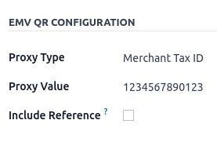

========
Thailand
========

.. _localizations/thailand/modules:

Modules
=======

The following modules are installed automatically with the Thai localization:

.. list-table::
   :header-rows: 1

   * - Name
     - Technical name
     - Description
   * - :guilabel:`Thailand - Accounting`
     - `l10n_th`
     - Default :ref:`fiscal localization package <fiscal_localizations/packages>`, complete with
       the Thai chart of accounts and taxes.
   * - :guilabel:`Thailand - Accounting Reports`
     - `l10n_th_reports`
     - Thailand-specific tax reports, including the P.P. 30 VAT report and the P.N.D. 3 and 53
       withholding tax reports.

.. note::
   The localization's core modules are installed automatically with the localization. The rest
   can be :ref:`installed manually <general/install>`.

.. _localizations/thailand/specifics:

Localization overview
=====================

The Thai localization package ensures compliance with Thailand's fiscal and accounting
regulations. It includes:

- A predefined :doc:`chart of accounts <../accounting/get_started/chart_of_accounts>` tailored to
  Thai standards.
- :doc:`Fiscal positions <../accounting/taxes/fiscal_positions>`: automated tax mapping for
  domestic and foreign customers and vendors.
- Default :ref:`taxes <localizations/thailand/taxes>`, including withholding taxes.
- :ref:`Tax reports <localizations/thailand/tax_reports>` that can be exported for e-Filing with
  the Revenue Department.

.. _localizations/thailand/taxes:

Taxes
-----

The following :doc:`taxes <../accounting/taxes>` are available by default with the Thai
localization package and are used to generate the :ref:`tax reports
<localizations/thailand/tax_reports>`:

- **VAT 7%**: for goods where VAT is recognized upon invoicing.
- **VAT 7% S**: for services where VAT is recognized upon payment.
- **VAT 0%**: for taxable goods or services charged at a zero rate, usually exports.
- **VAT-exempted**: for specific goods or services completely exempted from the collection or
  payment of VAT.
- :doc:`Withholding taxes <../accounting/taxes/retention>`: for payments where tax must be
  deducted at the source by the payer.

.. _localizations/thailand/income_tax_type:

Income tax type (under Section 40)
~~~~~~~~~~~~~~~~~~~~~~~~~~~~~~~~~~

Income tax types are required to generate :ref:`withholding tax certificates (50 Tawi)
<localizations/thailand/reports/50tawi>` and :ref:`P.N.D. 3 & 53 reports
<localizations/thailand/reports/pnd>`, and to ensure compliance with regulatory requirements.

To configure income tax types, go to :menuselection:`Accounting --> Configuration --> Taxes`. For
each tax with the :guilabel:`Purchase` tax type and the :guilabel:`Withhold On Payment` option
enabled, select the appropriate :guilabel:`Income Tax Type`.

.. _localizations/thailand/tax_reports:

Tax reporting
-------------

The relevant VAT and withholding tax (WHT) reports can be generated and exported as `CSV` files
compatible with RD Prep, the `Thai Revenue Department's official software
<https://efiling.rd.go.th/rd-cms/>`_ used to format tax data for e-Filing.

.. _localizations/thailand/reports/pp30:

P.P. 30 - VAT report
~~~~~~~~~~~~~~~~~~~~

The **P.P. 30** is a monthly value-added tax (VAT) return report required by the Revenue
Department of Thailand. It summarizes the output and input VAT for the period.

To export the P.P. 30 report in `CSV` format for RD Prep, follow these steps:

#. Go to :menuselection:`Accounting --> Reporting --> Tax Report`, click :icon:`fa-book`
   :guilabel:`Report`, and select :guilabel:`P.P.30 - VAT Report`.
#. Filter by the appropriate date or date range.
#. Click the :icon:`fa-cog` :guilabel:`(gear)` icon and select :guilabel:`Export for RD Prep
   (CSV)`.

.. _localizations/thailand/reports/sales_purchase:

Sales and purchase tax reports
******************************

The sales and purchase tax reports detail all input and output VAT transactions for a specific
period. VAT-registered businesses must keep these reports as compliance documents and present
them to the Revenue Department during tax audits.

To export the sales and purchase tax reports as `XLSX` files, follow these steps:

#. Open the :ref:`P.P. 30 - VAT report <localizations/thailand/reports/pp30>`.
#. Filter by the appropriate month.
#. Click the :icon:`fa-cog` :guilabel:`(gear)` icon and select :guilabel:`Sales Tax Report (xlsx)`
   or :guilabel:`Purchase Tax Report (xlsx)`.

.. _localizations/thailand/reports/pnd:

P.N.D. 3 & 53 - WHT report
~~~~~~~~~~~~~~~~~~~~~~~~~~

The **P.N.D. 3** and **P.N.D. 53** reports list all transactions within the period that are
subject to income tax withholding on vendor bills. This applies when a company pays for services
(such as rental, hiring, transportation, insurance, management fees, or consulting) and must
withhold personal (P.N.D. 3) or corporate (P.N.D. 53) income tax.

To access them, go to :menuselection:`Accounting --> Reporting --> Tax Report`, click
:icon:`fa-book` :guilabel:`Report`, and select :guilabel:`P.N.D. 3 & 53 - WHT Report (TH)`.

To export the P.N.D. 3 or P.N.D. 53 report in `CSV` format for RD Prep, follow these steps:

#. Filter by the appropriate month.
#. Click the :icon:`fa-cog` :guilabel:`(gear)` icon and select :guilabel:`PND3 - Export for RD
   Prep (CSV)` or :guilabel:`PND 53 - Export for RD Prep (CSV)`.

This generates the :file:`Tax Report PND 3.csv` or :file:`Tax Report PND 53.csv` file, which
lists all vendor bill lines with the applicable withholding tax.

.. _localizations/thailand/reports/50tawi:

Withholding tax certificate (50 Tawi)
-------------------------------------

The **50 Tawi**, or *Withholding Tax Certificate*, is a certificate issued by a payer to a payee
as official proof that tax has been withheld from a payment for remittance to the Revenue
Department.

To generate a 50 Tawi certificate as a `PDF` file, follow these steps:

#. Go to :menuselection:`Accounting --> Vendors --> Payments` and select the payment subject to
   withholding tax.
#. Click :guilabel:`Print 50 Tawi`.

.. _localizations/thailand/contacts:

.. _localizations/thailand/company:

.. _localizations/thailand/branch_code:

Branch code
===========

The branch code is used in Revenue Department reports and submission files. It can be set on the
company record and on any company contact in the :doc:`/applications/essentials/contacts` app.

To add a branch code, open the company's contact form and click the :icon:`fa-plus`
:guilabel:`(plus)` icon next to the :guilabel:`Tax ID` field:

- If the company is a branch, enter its branch number in the :guilabel:`Branch Code` field.
- If the company is the headquarters, enter `00000` in the :guilabel:`Branch Code` field or leave
  it blank.

.. note::
   The :guilabel:`Branch Code` field is only available for companies with an address in Thailand.

.. _localizations/thailand/accounting:

Accounting
==========

.. _localizations/thailand/tax_invoice:

Tax invoice
-----------

A tax invoice is generated automatically, with its own numbering sequence, when VAT becomes due:

- **Goods** (:guilabel:`VAT 7%` tax): a tax invoice (for example, `TINV/2026/00001`) is generated
  when the customer invoice is confirmed.
- **Services** (:guilabel:`VAT 7% S` tax): a receipt/tax invoice (for example, `RCT/2026/00001`)
  is generated when the payment is registered, as VAT on services is due upon payment.

.. _localizations/thailand/tax_invoice/configuration:

Configuration
~~~~~~~~~~~~~

To generate tax invoices, the company must be registered for VAT. To do so, go to the
:guilabel:`Settings` app, scroll down to the :guilabel:`Companies` section, and click
:guilabel:`Update Info`. On the company form, enable the :guilabel:`VAT Registered` checkbox.

.. _localizations/thailand/tax_invoice/goods:

Tax invoice for goods
~~~~~~~~~~~~~~~~~~~~~

#. :ref:`Create an invoice <accounting/invoice/creation>` with the :guilabel:`VAT 7%` tax on the
   invoice lines.
#. Click :guilabel:`Confirm`. The :guilabel:`Tax Invoice` tab appears on the invoice and lists the
   tax invoice number, total amount, and VAT amount.
#. In the :guilabel:`Tax Invoice` tab, click :guilabel:`Print Tax Invoice` to download the tax
   invoice as a `PDF` file.

.. _localizations/thailand/tax_invoice/services:

Receipt/tax invoice for services
~~~~~~~~~~~~~~~~~~~~~~~~~~~~~~~~

.. important::
   To generate receipt/tax invoices, an :ref:`outstanding receipts account
   <accounting/journals/outstanding-accounts>` must be set on the bank journal's payment method.

#. :ref:`Create an invoice <accounting/invoice/creation>` with the :guilabel:`VAT 7% S` tax on
   the invoice lines, then click :guilabel:`Confirm`. No tax invoice is generated yet.
#. Click :guilabel:`Pay`, fill in the payment details, and click :guilabel:`Create Payment`. The
   payment is registered, and the :guilabel:`Tax Invoice` tab appears on the invoice. It lists
   the receipt/tax invoice number and the related cash basis entry in the :guilabel:`Reference`
   column.
#. In the :guilabel:`Tax Invoice` tab, click :guilabel:`Print Tax Invoice` to download the
   receipt/tax invoice as a `PDF` file.

.. note::
   The :guilabel:`Print` button at the top of the invoice prints the regular (commercial) invoice,
   not the tax invoice.

.. _localizations/thailand/promptpay:

.. _localization/thailand/promptpay:

PromptPay QR code on invoices
-----------------------------

A PromptPay QR code can be added to invoices so customers can pay with any PromptPay-supported
banking app. The QR code is generated from the invoice amount and one of the following merchant
identifiers:

- :guilabel:`Ewallet ID`
- :guilabel:`Merchant Tax ID`
- :guilabel:`Mobile Number`

.. _localizations/thailand/configureqr:

Configuration
~~~~~~~~~~~~~

To enable PromptPay QR codes on invoices, go to :menuselection:`Accounting --> Configuration -->
Settings`. In the :guilabel:`Customer Payments` section, enable the :guilabel:`PromptPay QR Code`
setting, then click :guilabel:`Save`.

Then, configure the bank account:

#. Go to :menuselection:`Accounting --> Configuration --> Journals` and open the journal linked to
   the relevant bank account.
#. Under the :guilabel:`Journal Entries` tab, fill in the bank account number:

   - For an existing account: hover over the account number and click the
     :icon:`oi-arrow-right` icon.
   - For a new account: type the account number and click :guilabel:`Create`.

#. In the bank account form, open the :guilabel:`Payment QR Settings` tab, select the relevant
   :guilabel:`Account Identifier Type`, and enter the corresponding :guilabel:`Identifier Value`.
   To include the invoice reference in the QR code, enable :guilabel:`Include Reference`.

.. note::
   The :guilabel:`Payment QR Settings` fields can only be edited when the :guilabel:`Trust bank
   account` option is disabled on the bank account.

.. seealso::
   :doc:`../accounting/bank`

.. _localizations/thailand/issueqrinvoice:

Workflow
~~~~~~~~

When creating an invoice, open the :guilabel:`Other Info` tab and set the :guilabel:`Recipient
Bank` to the account with :ref:`PromptPay QR configured <localizations/thailand/configureqr>`.

