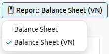

=======
Vietnam
=======

.. _SInvoice: https://www.sinvoice.vn/
.. _SInvoice Delivery Note: https://viettel-invoice.vn/phieu-xuat-kho-kiem-van-chuyen-noi-bo/

.. _localizations/vietnam/modules:

Modules
=======

The following modules are installed automatically with the Vietnamese localization:

.. list-table::
   :header-rows: 1

   * - Name
     - Technical name
     - Description
   * - :guilabel:`Vietnam - Accounting`
     - `l10n_vn`
     - Base Vietnamese
       :ref:`fiscal localization package <fiscal_localizations/packages>`
       complete with the Vietnamese chart of accounts and taxes.
   * - :guilabel:`Vietnam - Accounting Reports`
     - `l10n_vn_reports`
     - Vietnam-specific financial and tax reports.

Additionally, the following modules must be :ref:`installed <general/install>` to use the :ref:`localizations/vietnam/sinvoice` integration for managing electronic documents:

.. list-table::
   :header-rows: 1

   * - Name
     - Technical name
     - Description
   * - :guilabel:`Vietnam - E-invoicing`
     - `l10n_vn_edi_viettel`
     - Integration module enabling the generation of electronic invoices.
   * - :guilabel:`Vietnam - POS E-invoicing`
     - `l10n_vn_edi_viettel_pos`
     - For sending and receiving electronic invoices in Point of Sale.
   * - :guilabel:`Vietnam - Delivery E-invoicing`
     - `l10n_vn_edi_viettel_stock`
     - For sending and receiving Electronic Internal Transfer Notes.

.. note::
   In some cases, such as when upgrading to a version with additional modules, it is possible that
   modules may not be installed automatically. Any missing modules can be manually :ref:`installed
   <general/install>`.

.. _localizations/vietnam/specifics:

Localization overview
=====================

The Vietnam localization package ensures compliance with Vietnam fiscal and accounting
regulations. It includes tools for managing taxes, E-invoicing, reporting, and a predefined
chart of accounts tailored to Vietnam's standards.

The Vietnam localization package provides the following key features to ensure compliance with
local fiscal and accounting regulations:

- :ref:`localizations/vietnam/coa`: a predefined structure tailored to Vietnamese
  Accounting Standards (VAS)
- :ref:`localizations/vietnam/reporting`: pre-configured Vietnamese Accounting reports
- :ref:`localizations/vietnam/taxes`: pre-configured tax rates, including standard VAT, zero-rated,
  and exempt options
- :ref:`localizations/vietnam/sinvoice`: integration with SInvoice to meet electronic document regulations

.. _localizations/vietnam/coa:

Chart of accounts
-----------------

In the :doc:`chart of accounts <../accounting/get_started/chart_of_accounts>`, accounts are
automatically mapped to their corresponding taxes and default accounts payable and accounts
receivable fields.

.. note::
   The Vietnam chart of accounts is based on the accounting regulations established by the
   Ministry of Finance (MoF) in compliance with current Circulars (Circular 99/2025/TT-BTC),
   which provide a baseline of the necessary accounts. Additional or specialized accounts can
   be created or modified as needed.

.. _localizations/vietnam/reporting:

Reports
-------

In addition to the :doc:`generic reports <../accounting/reporting>`, the following reports are
available for the Vietnam localization under the :menuselection:`Accounting --> Reporting` menu:

- :guilabel:`Balance Sheet (VN)`: shows the company's financial position, aligning with **Form B01-DN** under Circular 99/2025/TT-BTC.
- :guilabel:`Profit and Loss (VN)`: details the company's financial performance, aligning with **Form B02-DN** under Circular 99/2025/TT-BTC.
- :guilabel:`General Journal (VN)`: provides a record of all financial transactions, aligning with **Form S03a-DN** under Circular 99/2025/TT-BTC.
- :guilabel:`General Ledger (VN)`: displays all accounting entries grouped by account, aligning with **Form S03b-DN** under Circular 99/2025/TT-BTC.

To access Vietnamese-specific versions of reports, click the **book** icon when viewing a report and select its Vietnamese version: **(VN)**.

.. _localizations/vietnam/taxes:

Taxes
-----

:doc:`Taxes <../accounting/taxes>` are automatically created and configured when the Vietnam
localization is installed. To manage existing or configure additional taxes, navigate to :menuselection:`Accounting -->
Configuration --> Taxes`.

The following categories of taxes are installed and linked to the relevant accounts:

- **Sales VAT Taxes**: 10%, 8%, 5%, 0%, VAT Exemption, and Not declared and pay VAT (KKKTT).
- **Local Purchase VAT Taxes**: 10%, 8%, 5%, 0%, and VAT Exemption, including deductible and non-deductible options.
- **Purchase VAT Taxes on imported goods**: 10%, 8%, 5%, 0%, and VAT Exemption, including deductible and non-deductible options.

.. important::
   Do not add import VAT directly to the original Purchase Order or Vendor Bill. Instead, create a separate Vendor Bill specifically
   for the import VAT, ensuring the unit price includes all costs and fees to form the correct taxable base.

Tax reports
-----------

To access the tax reports available for the Vietnam localization, navigate to :menuselection:`Accounting --> Reporting --> Tax Report`.
The following reports are available:

- :guilabel:`Tax Declaration - 01/GTGT (VN)`: applies to taxpayers engaged in production and business activities who calculate tax using
  the deduction method, including **Appendix 142**  which details the specific goods and services that are eligible for the statutory VAT rate reduction.
- :guilabel:`Sales/Purchase Tax Report (VN)`: provides a comprehensive list of all sales and purchase invoices issued within a specific period,
  detailing the untaxed amounts, VAT amounts, and other relevant information.

.. _localizations/vietnam/company:

Company
=======

To use all the features of this fiscal localization, the following fields are required on the
:doc:`company record </applications/general/companies>`:

- :guilabel:`Name`
- :guilabel:`Address`, including the :guilabel:`City`, :guilabel:`State`, :guilabel:`Zip Code`,
  and :guilabel:`Country`.

   - In the :guilabel:`Street` field, enter the street name, number, and any additional address
     information.
   - In the :guilabel:`Street 2` field, enter the neighborhood.

- :guilabel:`Tax ID`: tax identification number.

.. _localizations/vietnam/sinvoice:

E-invoicing with SInvoice
=========================

SInvoice_ is an e-invoice service platform provided by Viettel, one of the biggest e-invoice service
providers in Vietnam. Odoo supports integration with SInvoice to submit invoices generated in Odoo.

Configuration
-------------

SInvoice platform
~~~~~~~~~~~~~~~~~

To send electronic invoices to SInvoice, the following must be created on SInvoice_:

- :ref:`SInvoice account <localizations/vietname/sinvoice-registration>`
- :ref:`Invoice template <localizations/vietname/sinvoice-template>`
- :ref:`Invoice symbol <localizations/vietname/sinvoice-symbol>`
- :ref:`Invoice issuance notice <localizations/vietname/sinvoice-notice>`

.. _localizations/vietname/sinvoice-registration:

SInvoice registration
*********************

To create an account, go to SInvoice_ and register for the desired plan. Fill in the form that
opens to be contacted by SInvoice_ to create an account.

Once you have an account, log into SInvoice_ using your :guilabel:`Username` and
:guilabel:`Password`.

.. _localizations/vietname/sinvoice-template:

Invoice template creation
*************************

#. On the left side of the overview page, in the :guilabel:`Release management` menu, click
   :guilabel:`Create business information`.
#. In the :guilabel:`Update key information` step, fill in the following fields and other optional
   information if needed: :guilabel:`Unit name`, :guilabel:`Address`, :guilabel:`Contact person`,
   :guilabel:`Type of representative documents`.
#. Click :guilabel:`Update`.
#. In the :guilabel:`Look up digital certificate` step, click :guilabel:`Add new` to add a digital
   certificate.
#. Select the :guilabel:`Branch/Enterprise` and the :guilabel:`Type of digital certificate`, then
   fill in the required fields for each type:

     - :guilabel:`Supplier`: CloudCA
     - :guilabel:`Signer ID`: CloudCA
     - :guilabel:`Digital Certificate`: CloudCA
     - :guilabel:`How to download file`: HSM
     - :guilabel:`File Upload`: HSM, USB-TOKEN

#. Click :guilabel:`Generate key pair` to generate encryption keys for authentication, and
   :guilabel:`Save`.
#. In the :guilabel:`Manage invoice templates` step, add a new :guilabel:`Invoice template`.
#. Select the :guilabel:`Invoice type` and fill in the :guilabel:`Invoice template code`,
   :guilabel:`Invoice template name`, and other optional information if needed.
#. Click :guilabel:`Update`.

.. seealso::
   `SInvoice documentation on electronic invoice template creation
   <https://www.sinvoice.vn/2021/02/hdsd-tai-lieu-nghiep-vu-tao-mau-hoa-don-dien-tu.html?debug=1>`_

.. _localizations/vietname/sinvoice-symbol:

Invoice symbol creation
***********************

On the left side of the main screen, in the :guilabel:`Release management` menu, click
:guilabel:`Invoice symbol` and follow these steps:

#. Click :guilabel:`Add new` and select the :guilabel:`Invoice template`.
#. Set the :guilabel:`Status` to :guilabel:`Active` to activate the symbol and fill in the
   :guilabel:`Invoice symbol`.
#. Enable :guilabel:`Stop automatic sending to tax authorities` and :guilabel:`Default for built-in
   API` based on preference.
#. Click :guilabel:`Save`.

.. _localizations/vietname/sinvoice-notice:

Invoice issuance notice
***********************

On the left side of the main screen, in the :guilabel:`Release management` menu, click
:guilabel:`Create issuance notice` and follow these steps:

#. Click :guilabel:`Add new`, select the :guilabel:`Name of the business unit to issue an e-invoice`
   and the :guilabel:`Tax agency name`. Based on the business unit and tax agency selected, the
   :guilabel:`Tax code`, :guilabel:`Address`, :guilabel:`Phone number`, and :guilabel:`Separator
   used` are automatically filled and uneditable.
#. Click :guilabel:`Select the invoice type for issuance`, and then select and fill in the
   following information :

   - :guilabel:`Invoice type`: The invoice type on which to declare an issuance notice.
   - :guilabel:`Invoice template`: Select from the list of templates available based on the invoice
     type.
   - :guilabel:`Symbol`: Select from the list of symbols available based on the invoice type.
   - :guilabel:`Quantity`: Total number of invoices to issue for the selected type. Based on the
     type and template selected, this field is filled in automatically. It can be changed if needed.
   - :guilabel:`Start date of use`: The date from which the invoice template, range, and quantity
     are used for the issuance notice.

#. Click :guilabel:`Save` and select more invoice types if necessary by repeating the steps above.
   Click :guilabel:`Save` to finish drafting the notice.
#. Click :guilabel:`Send to tax authorities` for approval. Once approved, the notice's
   :guilabel:`Status` is changed to :guilabel:`Active`.

.. _localizations/vietnam/sinvoice-odoo:

Odoo database
~~~~~~~~~~~~~

Link Odoo to SInvoice
*********************

.. note::
   Ensure the :guilabel:`Vietnam - E-invoicing` (`l10n_vn_edi_viettel`) modules is installed from the :guilabel:`Apps` menu.

To connect Odoo with SInvoice, go to :menuselection:`Accounting --> Configuration --> Settings`.
In the :guilabel:`Vietnamese E-invoice Integration` section, fill in your SInvoice :guilabel:`Username` and
:guilabel:`Password`.

Click the :guilabel:`Fetch Symbols` button to retrieve the list of available invoice symbols from your SInvoice account.

Once the list is fetched, you can assign your default symbols:

- Select a :guilabel:`Default Symbol` to generate a prefix for standard invoice numbers managed in SInvoice.
- Select a :guilabel:`Default PoS Symbol` to assign a global default prefix for all Point of Sale locations if needed.

Sending invoices to SInvoice on Invoicing app
---------------------------------------------

Invoices can be sent to SInvoice once they have been confirmed. To do so, follow the
:ref:`invoice sending <accounting/invoice/sending>` steps. In the popup window, enable
:guilabel:`Send to SInvoice` and click :guilabel:`Send`.

Once the invoice has been successfully submitted to SInvoice, the :guilabel:`SInvoice Status` field
in the :guilabel:`E-Invoice` tab of the invoice is updated to :guilabel:`Sent`. The
:guilabel:`SInvoice Symbol`, :guilabel:`Issue Date`, :guilabel:`Secret Code` and :guilabel:`SInvoice
Number` fields are also updated. The same information is available on SInvoice.

Replacement or adjustment invoices
~~~~~~~~~~~~~~~~~~~~~~~~~~~~~~~~~~

A replacement invoice is issued to correct an invoice that has **yet to be tax declared**, whereas
an adjustment invoice is issued to correct one that has **already been tax declared**. Follow these
steps to issue a replacement or adjustment invoice:

#. Open the invoice and click :guilabel:`Credit Note`.
#. In the :guilabel:`Credit Note` popup, fill in the following fields:

   - :guilabel:`Reason displayed on Credit Note`
   - :guilabel:`Adjustment type`
   - :guilabel:`Agreement Name`
   - :guilabel:`Agreement Date`
   - :guilabel:`Journal`
   - :guilabel:`Reversal date`

#. Click :guilabel:`Reverse and Create Invoice` to issue a replacement invoice, or
   :guilabel:`Reverse` to issue an adjustment invoice.

The :guilabel:`SInvoice Status` in the :guilabel:`SInvoice` invoice tab is updated to
:guilabel:`Replaced` for a replacement invoice or :guilabel:`Adjusted` for an adjustment invoice.

Sending invoices to SInvoice on POS Interface
---------------------------------------------

.. note::
   Ensure the :guilabel:`Vietnam - E-invoicing` (`l10n_vn_edi_viettel`) and :guilabel:`Vietnam - POS E-invoicing`
   (`l10n_vn_edi_viettel_pos`) modules are installed from the :guilabel:`Apps` menu. The configuration process for
   SInvoice and Odoo is identical to the standard e-invoicing workflow.

Upon installing the :guilabel:`Vietnam - POS E-invoicing` module, the :guilabel:`Auto-send to SInvoice` feature is
automatically enabled under :menuselection:`Point of Sale --> Configuration --> Settings`. This setting automatically
transmits Point of Sale invoices to SInvoice in real time and can be disabled at any time.

To establish a global default symbol for all Point of Sale operations, navigate to :menuselection:`Accounting --> Configuration --> Settings`.
To assign a unique symbol to a specific location, modify the settings for that individual Point of Sale to select a default symbol that
overrides the global setting.

To create a Point of Sale order and send the invoice to SInvoice:

1. Create a Point of Sale order and add products to the cart. A :guilabel:`Walk-in Customer` is selected by default, but a specific customer
   can be assigned if necessary.
2. Proceed to the payment screen. The :guilabel:`Invoice` option is selected automatically.
3. Select a payment method and click :guilabel:`Validate`.

Upon validation, Odoo automatically generates the invoice and submits it directly to SInvoice.

To print the SInvoice file, navigate to :menuselection:`Orders --> All active orders --> Paid`, select the relevant order, and click
:guilabel:`Print Tax Invoice`.

.. note::
   - If a Point of Sale invoice fails to send to SInvoice, a pop-up message appears. To identify the cause of the failure, check the
     log note on the specific invoice in the Odoo backend.
   - SInvoice files can be manually printed or retrieved from the backend by clicking the :guilabel:`Action` (gear) icon on the invoice
     and selecting :guilabel:`Fetch Tax Invoice`.
   - SInvoice currently offers limited support for tax-included pricing. For optimal performance when using tax-included pricing, contacting
     SInvoice support to request the account validation be set to `0` (`validation = 0`) is highly recommended.

To process a refund directly from the Point of Sale session:

1. Navigate to :menuselection:`Orders --> All active orders --> Paid`.
2. Select the order requiring a refund and click the :guilabel:`Refund` button.
3. Ensure the :guilabel:`Invoice` option is selected on the payment screen and enter a :guilabel:`Refund Reason`.
4. Select the appropriate payment method and click :guilabel:`Validate`.

Odoo automatically issues a credit note and transmits the adjustment to SInvoice. This refund process can also be completed in the Odoo backend
using the standard credit note workflow.

Sending Electronic Internal Transfer Notes on Inventory app
-----------------------------------------------------------

.. note::
   Ensure the :guilabel:`Vietnam - E-invoicing` (`l10n_vn_edi_viettel`) and :guilabel:`Vietnam - Delivery E-invoicing`
   (`l10n_vn_edi_viettel_stock`) modules are installed from the :guilabel:`Apps` menu. The initial configuration process for
   SInvoice and Odoo is identical to the standard e-invoicing workflow.

:guilabel:`Electronic transfer notes` are required when transfering goods between internal locations, branches, or transit locations.
These electronic documents function similarly to standard e-invoices and must be pre-configured in _SInvoice.

To enable electronic transfer notes for internal movements:

1. Navigate to :menuselection:`Inventory --> Configuration --> Settings`.
2. In the :guilabel:`Operations` section, enable :guilabel:`Send Transfer Note to SInvoice`.
3. Enter a :guilabel:`Default Symbol` to be used globally for all internal deliveries.

To assign a specific symbol to an individual warehouse that overrides the global default:

1. Navigate to :menuselection:`Inventory --> Configuration --> Warehouses` and select the warehouse.
2. Under the :guilabel:`Warehouse Configuration` tab, locate the :guilabel:`E-Transfer Note` section.
3. Enter a :guilabel:`Default Symbol`. Leave this field blank to fall back to the global default symbol.

To send an internal transfer note to SInvoice:

1. Open an internal transfer record.
2. Upon validating the internal transfer, click the :guilabel:`Send to SInvoice` button located at the top of the record.
3. In the :guilabel:`Send to SInvoice` pop-up wizard, fill in the necessary information. The transportation method is a mandatory
   field to be completed.
4. Click :guilabel:`Send`.

Once successfully processed, Odoo downloads the related documents (including the signed XML and PDF files) directly into the chatter of the transfer record. To view the specific submission details, open the :guilabel:`E-Transfer Note` tab on the transfer record. This tab displays the :guilabel:`SInvoice Symbol`,
:guilabel:`Issue Date`, :guilabel:`SInvoice Number`, and the :guilabel:`Secret Code`.

.. _localizations/vietnam/qrcode:

QR banking codes
================

Vietnamese QR banking is a payment service platform that allows customers to make instant domestic
payments to individuals and merchants in Vietnamese dong via online and mobile banking.

Configuration
-------------

To activate QR banking codes, go to :menuselection:`Accounting --> Configuration --> Settings` and
enable :guilabel:`VietQR Code` in the :guilabel:`Customer Payments` section.

.. warning::
   If you enable :guilabel:`VietQR Code`, do not enable :guilabel:`Add QR-code link on PDF` under
   the :guilabel:`Invoice Online Payment` setting. Enabling both options will result in duplicate
   QR codes appearing on your invoice PDFs.

Bank account
~~~~~~~~~~~~

To activate QR banking for a bank account, go to :menuselection:`Contacts --> Configuration -->
Bank Accounts` and select the bank account. Fill in the :guilabel:`Account Number`, :guilabel:`BIC/SWIFT`
(input the Bank Identification Number (BIN) in the format: Country Code [4 letters] + Bank Code [2 letters],
eg: 970416 for ACB), and the :guilabel:`Partner`.

.. important::
   The :guilabel:`Partner` must be set to the current company that has been configured on the
   :ref:`Company <localizations/vietnam/company>` record. Once the correct Partner is selected,
   the :guilabel:`Payment QR Settings` tab will appear.

Next, navigate to the :guilabel:`Payment QR Settings` tab and configure the following fields:

- :guilabel:`Account Identifier Type`: select the method used to identify the merchant account
  (e.g., Bank Account).
- :guilabel:`Identifier Value`: enter the corresponding value (such as the account number).

Enable :guilabel:`Include Reference` to include the invoice number in the QR code.

Once all the information has been reviewed, enable the :guilabel:`Trust bank account` toggle at the top of the form.

.. important::
   - The :ref:`account number <accounting/journals/bank>` and bank must be set on the :guilabel:`Bank` journal.

.. seealso::
   :doc:`../accounting/bank`

Generating QR codes on invoices
-------------------------------

When creating a new invoice, open the :guilabel:`Other Info` tab and ensure the :guilabel:`Recipient Bank` is configured,
as Odoo uses this field to generate QR codes.

Generate QR codes on POS Interface
----------------------------------

To configure the QR payment option, go to :menuselection:`Point of Sale > Configuration > Payment Methods` and create a new method called :guilabel:`QR Code`.
Assign the appropriate Bank Journal to the :guilabel:`Journal` field, select Bank App (QR Code) as the :guilabel:`Integration`, and choose VietQR Code
as the :guilabel:`QR Code Format`.

.. note::
   Navigate to :menuselection:`Point of Sale --> Configuration --> Settings` and ensure this new payment method is selected for the specific
   Point of Sale under the :guilabel:`Payment` section.

Generate QR codes on eCommerce
------------------------------

Navigate to :menuselection:`Website --> Configuration --> Payments`. Enable the :guilabel:`Wire Transfer` payment provider, turn on the :guilabel:`Enable QR Codes`
feature, and select a trusted :guilabel:`Bank Account`. Finally, publish the payment provider.
