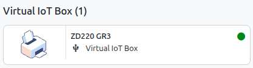
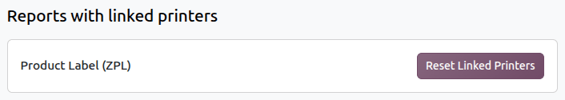

=================
Connect a printer
=================

Connect a printer to an :doc:`IoT gateway <../../iot>` to automatically print product labels,
quotations, and other reports directly from Odoo applications.

.. _iot/printer/connection:

Connection
==========

IoT gateways support office, receipt, and `compatible label printers
<https://www.odoo.com/page/iot-hardware>`_ connected to the IoT gateway via USB or local network. To
connect a printer to an IoT gateway, follow these steps:

#. :doc:`Connect the IoT gateway to Odoo. <../connect>`
#. Connect the printer to the IoT gateway using one of the following methods:

   - **USB printer:** Plug the printer directly into the IoT gateway with a USB cable.
   - **Network printer:** Connect the printer to the **same** local network as the IoT gateway
     through Ethernet or Wi-Fi.

After establishing a connection to the IoT gateway, the printer automatically prints a connection
status report. The connected printers appear in :menuselection:`IoT --> Devices`.

.. tip::
   - To ensure a USB printer is detected during the IoT gateway setup, connect the printer to the
     IoT gateway *before* powering on the IoT gateway.
   - To print a test page and confirm a printer is set up correctly, go to :menuselection:`IoT -->
     Devices`, select the printer, then click :guilabel:`Test`.

.. note::
   - It is possible to use supported :doc:`point of sale receipt printers
     <../../../sales/point_of_sale/hardware_network/receipt_printers>` without an IoT gateway.
   - Printers might take up to five minutes to appear in :menuselection:`IoT --> Devices`.
   - :ref:`Grant Google Chrome local network access if prompted. <pos/lna/browser-permission>`

Use cases
=========

.. _iot/printer/automatic-printing:

Automatic printing
------------------

To automatically print reports (invoices, quotations, product labels, etc.) on a specific printer,
go to :menuselection:`IoT --> Configuration --> Manage Printers`, select the printer, then add the
reports to the :guilabel:`Linked Reports` field.

The first time a linked report is selected for printing, a :guilabel:`Select Printers` pop-up
appears. Select the desired :guilabel:`Printer`, and optionally enable :guilabel:`Do not ask me
again` to automatically use the selected printer for future printouts from the current browser.
Then, click :guilabel:`Print`.

.. tip::
   Alternatively, to assign a report to a printer, :ref:`activate developer mode <developer-mode>`,
   go to :menuselection:`Settings --> Technical --> Reports`, select the report, then select the
   printer in the :guilabel:`Printers` field.

.. important::
   To prevent printing errors, ensure the assigned report format matches the printer type:

   - Office printers can only print :doc:`QWeb (PDF) reports
     <../../../../developer/reference/backend/reports>`.
   - `Supported label printers <https://www.odoo.com/page/iot-hardware>`_ can only print :doc:`Zebra
     Programming Language (ZPL)
     <../../../inventory_and_mrp/inventory/shipping_receiving/setup_configuration/zebra>` reports.
   - Receipt printers *cannot* be used to automatically print reports because they are :doc:`only
     used by the point of sale <../../../sales/point_of_sale/hardware_network/receipt_printers>`.

.. _iot/printer/reset-saved-printer-preferences:

Reset saved printer preferences
~~~~~~~~~~~~~~~~~~~~~~~~~~~~~~~

Every time a user prints a report, the printer choice gets stored in the browser cache. Accessing a
database with different accounts, browsers, or devices creates separate printer preferences that
automatically target different printers.

To unlink a report from all linked printers on the current browser, go to :menuselection:`IoT -->
Configuration --> Reset Linked Printers`, then click :guilabel:`Reset Linked Printers` next to the
relevant report.

.. note::
   This action only prevents the current browser from automatically printing the report on the
   selected printers. The report is still :ref:`linked <iot/printer/automatic-printing>` to the
   selected printers, and the :guilabel:`Select Printers` pop-up appears the next time the report is
   printed.

Manufacturing quality check printing
------------------------------------

To print a label during a manufacturing :doc:`quality check
<../../../inventory_and_mrp/quality/quality_management/quality_checks>`, assign a printer to a
:doc:`quality control point
<../../../inventory_and_mrp/quality/quality_management/quality_control_points>` as follows:

#. Go to :menuselection:`Quality --> Quality Control --> Control Points` and select the control
   point.
#. Select :guilabel:`Operations` configured with :guilabel:`Manufacturing` as the :guilabel:`Type of
   Operation`.
#. Select a :guilabel:`Work Order Operation`.
#. Select :guilabel:`Print Product Label` or :guilabel:`Print Lot/SN Label` as the :guilabel:`Type`.

When the quality check created by the quality control point is reached during manufacturing, a
:guilabel:`Select Printers` pop-up appears. Select the desired :guilabel:`Printer`, and optionally
enable :guilabel:`Do not ask me again` to automatically use the selected printer for future
printouts from the current browser. Then, click :guilabel:`Print`.

The user's printer selections remain stored in the browser cache. Refer to the instructions for
:ref:`resetting saved printer preferences <iot/printer/reset-saved-printer-preferences>` to restore
the selections.

.. seealso::
   :doc:`/applications/inventory_and_mrp/quality`

Troubleshooting
===============

General guidelines
------------------

Perform these checks to resolve common printer problems:

- Check physical connections (power, USB, or Ethernet) and verify every device is powered on.
- Connect the printer to the IoT gateway before powering on the IoT gateway.
- Turn every device off, then back on.
- Restart the :ref:`IoT Box <iot/iot-box/restart>` or the :ref:`Windows virtual IoT
  <iot/windows_iot/restart>`.
- Ensure the paper is loaded correctly in the printer.
- For network printers, confirm that the printer and the IoT gateway are on the same local network,
  and check the Wi-Fi signal strength.
- Install available printer firmware updates.

.. _iot/printer/iot-box-cups:

IoT Box CUPS configuration
--------------------------

The IoT Box uses the Common Unix Printing System (CUPS) to manage printer connections and drivers.
Use CUPS for advanced printer configurations, queue management, and test printing. To open the CUPS
interface, go to the :ref:`IoT Box homepage <iot/iot-box/homepage>` and click
:menuselection:`Printer Server`.

.. important::
   Only the :doc:`IoT Box <../iot_box>` uses CUPS. :doc:`Windows virtual IoT <../windows_iot>` uses
   the Windows Settings to manage printers and drivers.

.. seealso::
   `CUPS documentation <https://www.cups.org/documentation.html>`_

Printer not detected
--------------------

If a printer does not appear in :menuselection:`IoT --> Devices`, add the printer manually as
follows:

.. tabs::
   .. group-tab:: IoT Box

      #. Go to the :ref:`IoT Box homepage <iot/iot-box/homepage>`.
      #. Go to :menuselection:`Printer Server --> Administration --> Add Printer`.
      #. Select the printer and follow the on-screen instructions to complete the setup.

      .. note::
         If the printer is not on the list, the printer is likely :ref:`not connected correctly
         <iot/printer/connection>`.

   .. group-tab:: Windows virtual IoT

      #. `Add or install the printer in Windows.
         <https://support.microsoft.com/en-us/windows/hardware/printer/add-or-install-a-printer-in-windows>`_
      #. Restart the :ref:`Windows virtual IoT service <iot/windows_iot/restart>`.

      .. seealso::
         `Fix printer connection and printing problems in Windows
         <https://support.microsoft.com/en-us/windows/hardware/printer/fix-printer-connection-and-printing-problems-in-windows>`_

Printer prints random characters
--------------------------------

For most printers, the IoT gateway automatically detects and selects the correct driver. However, if
no driver or the wrong driver is selected, the printer might print random characters.

Manually select the correct driver for a printer as follows:

.. tabs::
   .. group-tab:: IoT Box

      #. Go to the :ref:`IoT Box homepage <iot/iot-box/homepage>`.
      #. Go to :menuselection:`Printer Server --> Printers` and select the printer.
      #. Set the :guilabel:`Administration` dropdown menu to :guilabel:`Modify Printer`.
      #. Select the printer, then follow the on-screen instructions to choose the appropriate
         :guilabel:`Make` and :guilabel:`Model`.

      .. note::
         Epson receipt printers (ESC/POS) and Zebra label printers (ZPL) parse raw command streams
         directly from Odoo. To select a generic driver, choose :guilabel:`Generic` as the
         :guilabel:`Make` and :guilabel:`Generic Text-Only Printer (en)` as the :guilabel:`Model`.

   .. group-tab:: Windows virtual IoT

      `Download and install the latest driver in Windows.
      <https://support.microsoft.com/en-us/windows/hardware/printer/download-and-install-the-latest-printer-drivers>`_

      .. note::
         Epson receipt printers (ESC/POS) and Zebra label printers (ZPL) parse raw command streams
         directly from Odoo. To select a generic driver in Windows, follow this `Zebra guide
         <https://supportcommunity.zebra.com/s/article/Print-a-zpl-file-using-the-Generic-Text-Printer>`_.

DYMO printers
-------------

The DYMO LabelWriter 450 Duo is the recommended DYMO printer to use with Odoo IoT gateways.

DYMO Series 5 printers are not compatible with the :doc:`IoT Box <../iot_box>` and require a
:doc:`Windows virtual IoT <../windows_iot>`.

Epson ESC * configuration
-------------------------

.. important::
   The following section applies only to the :doc:`IoT Box <../iot_box>`, not to :doc:`Windows
   virtual IoT <../windows_iot>`.

Certain legacy Epson :doc:`receipt printers
<../../../sales/point_of_sale/hardware_network/receipt_printers>` (such as the TM-U220, TM-U230,
TM-P60, and TM-P60II) print random characters when connected to an IoT Box. By default, the IoT Box
uses the `GS v 0 <https://download4.epson.biz/sec_pubs/pos/reference_en/escpos/gs_lv_0.html>`_
command, which is not supported by those printers. If the printer supports the `ESC *
<https://download4.epson.biz/sec_pubs/pos/reference_en/escpos/esc_asterisk.html>`_ command,
configure the IoT Box to use the `ESC *` command as follows:

#. Go to the :ref:`IoT Box homepage <iot/iot-box/homepage>`.
#. Go to :menuselection:`Printer Server --> Administration --> Add Printer` and select the
   printer.
#. Follow the on-screen instructions, and when prompted for the printer :guilabel:`Name`, use the
   convention `<printer_name>__IMC_<param>_<param>_..._<param>__`, where:

   - `printer_name` is the printer name. Do not use the following characters in the name: `_`, `/`,
     `#`, or ` ` (space character).
   - `param` is an optional printer parameter. The following parameters are available:

     - `SCALE<X>`: The receipt size. `X` is an integer, where `100` is the original size, `50` is
       half the size, and `200` is twice the size.
     - `LDV`: *Low Density Vertical* (defaults to *High Density Vertical* if not specified).
     - `LDH`: *Low Density Horizontal* (defaults to *High Density Horizontal* if not specified).

   .. note::
      - Refer to `Epson's ESC * documentation
        <https://download4.epson.biz/sec_pubs/pos/reference_en/escpos/esc_asterisk.html>`_ to
        determine if the printer requires these parameters to be set.
      - If no parameters are set, the printer name should end with `__IMC__`.

   .. example::
      Proper name formatting:

      - `EPSONTMm30II__IMC__`
      - `EPSONTMU220__IMC_LDV_LDH_SCALE80__`

      Improper name formatting (does not prevent printing, but may produce unexpected output):

      - `EPSON TMm 30II`: The name cannot contain spaces.
      - `EPSONTMm30II`: Valid name, but does not use `ESC *`.
      - `EPSONTMm30II__IMC`: Missing the closing `__`.
      - `EPSONTMm30II__IMC_XDV__`: `XDV` is not a valid parameter.
      - `EPSONTMm30II__IMC_SCALE__`: `SCALE` is missing its integer value.

#. Continue through the setup, and when prompted, set :guilabel:`Make` to :guilabel:`Raw` and
   :guilabel:`Model` to :guilabel:`Raw Queue (en)`.

.. note::
   If the printer was set up incorrectly (for example, it still prints random characters, or the
   printed receipt is the wrong size), you cannot update the parameters by renaming the printer.
   Instead, add a new printer from scratch with the adjusted parameters.

.. todo::
   Rewrite and move the barcode section to a new document.

Barcode scanner issues
======================

The characters read by the barcode scanner do not match the barcode
-------------------------------------------------------------------

By default, most barcode scanners are configured in the US QWERTY format. If the barcode scanner
uses a different layout, go to :menuselection:`IoT --> Devices` and click the barcode device's card.
Then, select the correct language in the :guilabel:`Keyboard Layout` field.

.. note::
   The :guilabel:`Keyboard Layout` is language-specific, with available options varying based on
   the device and the language of the database (e.g., :guilabel:`English (UK)`, :guilabel:`English
   (US)`, etc.).

Nothing happens when a barcode is scanned
-----------------------------------------

Make sure the correct device is selected in the :doc:`Point of Sale settings
</applications/sales/point_of_sale/hardware_network/pos_iot>` (when applicable) and the barcode is
configured to send an `ENTER` character (keycode 28) at the end of every barcode.

The barcode scanner is detected as a keyboard
---------------------------------------------

.. important::
   Some barcode scanners are identified as USB keyboards rather than barcode scanners and are not
   recognized by IoT gateways.

To change the device type manually, go to :menuselection:`IoT --> Devices` and click the barcode
device's card. Then, enable :guilabel:`Is scanner`.

The barcode scanner processes barcode characters individually
-------------------------------------------------------------

When accessing the mobile version of Odoo from a mobile device or tablet paired with a barcode
scanner via the IoT system, the scanner might interpret each character in a barcode as a separate
scan. To resolve this, go to :menuselection:`IoT --> Devices` and click the barcode device's
card. Then, select the correct language in the :guilabel:`Keyboard Layout` field.

.. note::
   The :guilabel:`Keyboard Layout` is language-specific, with available options varying based on
   the device and the language of the database (e.g., :guilabel:`English (UK)`, :guilabel:`English
   (US)`, etc.).
