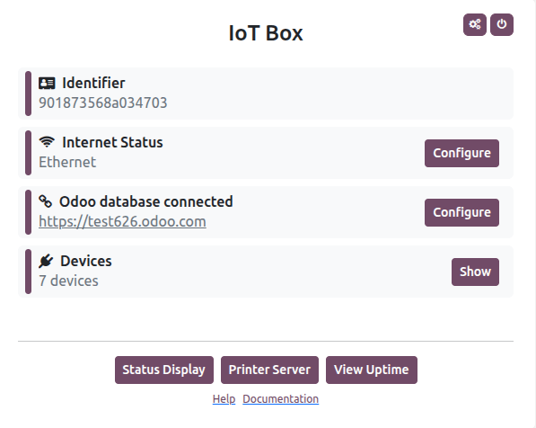

=======
IoT Box
=======

To start using an IoT Box:

#. Connect your :doc:`devices <devices>` to the IoT Box.
#. :ref:`Connect the IoT Box to the network <iot/iot_box/network>`.
#. :doc:`Connect the IoT Box to your Odoo database <connect>`.

.. seealso::
   - `Video: How to Set Up and Use the Odoo IoT Box: A Beginner's Guide
     <https://www.youtube.com/watch?v=w2_Dcm3r_7o&ab_channel=Odoo>`_
   - :doc:`iot_advanced/troubleshooting`

.. _iot/iot_box/subscription:

IoT Box subscription
====================

An IoT Box subscription is required for production use of IoT gateways and generating the
:ref:`HTTPS certificate <iot/connect/https_certificate>`. It is created automatically
when an IoT gateway is :doc:`connected to the database <connect>`. If you have issues related to
your subscription, contact the database's account manager or Odoo partner for assistance.

.. seealso::
   - `Odoo's compatible IoT devices <https://www.odoo.com/app/iot-hardware>`_
   - `Odoo Tutorials: Internet of Things (IoT) Tutorials
     <https://www.odoo.com/slides/internet-of-things-iot-175>`_
   - `IoT gateway FAQ <https://www.odoo.com/app/iot-faq>`_
   - `Magic Sheet - Odoo Internet of Things [PDF]
     <https://drive.google.com/file/d/18D0VqlGvW6kUg-xKmyELrQqJ6J3bHKGy/view>`_

.. _iot/iot_box/network:

Network connection
==================

The IoT Box can be connected to the network via :ref:`Ethernet <iot/iot_box/network-ethernet>` or
:ref:`Wi-Fi <iot/iot_box/network-wifi>`.

.. note::
   It is recommended to connect the IoT Box to the same network as the :doc:`devices <devices>`
   connecting to it.

.. important::
   Never make the IoT Box accessible from the public Internet.
   IoT systems are designed to provide your database with access to devices on your local network.
   Exposing them to the public Internet would create a **security risk**.

.. _iot/iot_box/network-ethernet:

Ethernet
--------

Plug the Ethernet cable into the IoT Box's Ethernet port and an available port on your router, then
connect the IoT Box to a power source.

.. _iot/iot_box/network-wifi:

Wi-Fi
-----

Make sure no Ethernet cable is connected to the IoT Box and follow these steps:

  #. Connect the IoT Box to a power source and wait a few minutes for it to power on.
  #. Access your computer's Wi-Fi settings and select the IoT Box's network. The network name is in
     the format `IoTBox-xxxxxxxxxxxx` (where `xxxxxxxxxxxx` is a unique identifier).
  #. Connect to the IoT Box's Wi-Fi network and sign into it; your browser should automatically
     open and redirect to the :ref:`IoT Box's homepage <iot/iot-box/homepage>`.

     .. note::
        Depending on your operating system, the browser might not open and redirect to the IoT Box's
        homepage. In this case, open your browser manually and navigate to `http://10.11.12.1`
        or any URL starting with **http** (e.g., `http://odoo.com`).

  #. On the IoT Box's homepage, click :guilabel:`Configure` next to the :guilabel:`Internet Status`
     section.

     .. image:: iot_box/iot-wifi.png
        :scale: 75%
        :alt: IoT Box's WiFi hotspot

  #. Wait a few minutes for the available networks to be scanned, select the network, enter the
     Wi-Fi's password, and click :guilabel:`Connect`.

.. note::
   Once connected to the Wi-Fi network, the IoT Box stops emitting its Wi-Fi signal, and the
   computer should automatically reconnect to its original network. If it does not, reconnect to it
   manually.

.. tip::
   If the IoT Box is connected to an :doc:`external monitor <devices/screen>`, you can also scan the
   first QR code displayed on the screen to connect to the network, then scan the second QR code to
   access the IoT Box's :ref:`homepage <iot/iot-box/homepage>`. On the homepage, click
   :guilabel:`Configure` in the :guilabel:`Internet Status` section, select the relevant Wi-Fi
   network, enter the password, and click :guilabel:`Connect`.

.. _iot/iot-box/led-status:

LED status
==========

The IoT Box features two LEDs, located to the right of the SD card slot, which show its status and
help with troubleshooting when no display is connected. The LEDs can be interpreted as follows:

- **Red LED lit**: The IoT Box has no Internet connection. Ensure the Ethernet cable is properly
  connected or :ref:`connect the IoT Box via Wi-Fi <iot/iot_box/network-wifi>`.
- **Green LED flashing**: The IoT Box is awaiting :doc:`connection to a database <connect>`.
- **Green LED constantly lit**: The IoT Box is connected to a database; no further action is
  required.

.. _iot/iot-box/homepage:

IoT Box homepage
================

To access the IoT Box's homepage, open a web browser **on the same network as the IoT Box** and
navigate to the IoT Box's IP address.

The IoT Box's IP address can be retrieved by:

- connecting the IoT Box to an :doc:`external monitor <devices/screen>`: the IP address is displayed
  on the screen.

  .. image:: iot_box/iot-status-display.png
     :scale: 75%
     :alt: Status display with IoT Box's IP address

- connecting the IoT Box to a `supported receipt or label printer
  <https://www.odoo.com/app/iot-hardware>`_ with a USB cable: the IP address is automatically
  printed.
- accessing the administrator interface of the router to which the IoT Box is connected or using
  third-party software to scan the network.

.. tip::
   If the IoT Box is connected to an :doc:`external monitor <devices/screen>` or a :doc:`printer
   <devices/printer>`, its homepage can also be accessed by scanning the displayed or printed QR
   code with a device connected to the same network as the IoT Box.

Once the IoT Box is :doc:`connected to the Odoo database <connect>`, its homepage can be accessed
from the IoT app: click the relevant IoT Box's card, then click :guilabel:`Homepage`.

.. _iot/iot-box/restart:

IoT Box restart
===============

To manually restart the IoT Box, access its :ref:`homepage <iot/iot-box/homepage>`, then click the
:icon:`fa-power-off` :guilabel:`(power off)` button in the top-right corner.

.. tip::
   You can also fully reboot the IoT Box by unplugging and plugging it back in.
