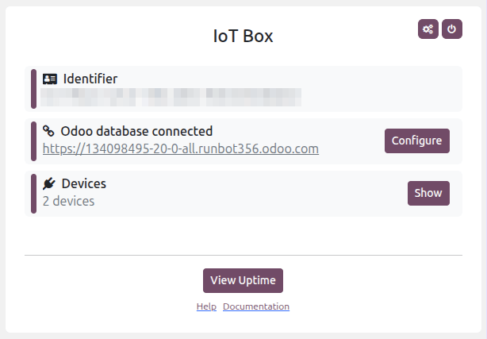
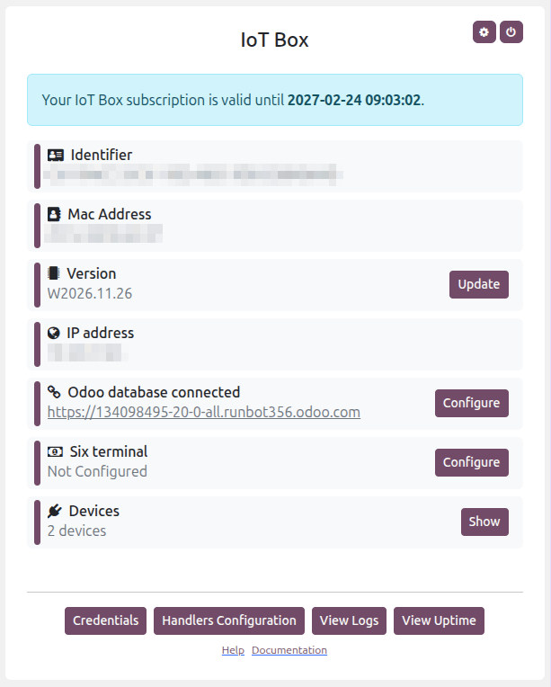

===================
Windows virtual IoT
===================

Windows virtual IoT is an IoT gateway for Windows computers that connects physical :ref:`devices
<iot/windows_iot/devices>` to Odoo. Windows virtual IoT works the same as the :doc:`IoT Box
<iot_box>`, except that Windows virtual IoT is an installable Windows program without additional
hardware. To communicate with connected physical devices, Windows virtual IoT uses the computer's
drivers.

.. warning::
   Do not expose the Windows virtual IoT computer's ports 80, 443, or 8069 to the public internet,
   and always run Windows virtual IoT on a trusted network. Otherwise, anyone with access to Windows
   virtual IoT can control or snoop on the connected physical devices (e.g., control payment
   terminals or read receipt data, including customer information).

.. note::
   Windows virtual IoT is compatible with Windows 10 or higher and Windows Server 2016 or higher.
   However, installing Windows virtual IoT on a virtual machine is not supported by Odoo. For an IoT
   gateway compatible with Linux and macOS, use the :doc:`IoT Box <iot_box>` instead.

.. _iot/windows_iot/installation:

Install Windows virtual IoT
===========================

To install Windows virtual IoT, follow these steps:

#. Open the `Odoo download page <https://odoo.com/page/download>`_.

   .. note::
      Log in to Odoo.com with the login used for your Odoo Enterprise subscription.

#. Go to the :guilabel:`Virtual IOT` section and click :guilabel:`Download`.
#. Run the downloaded :file:`.exe` file.
#. Follow the on-screen installation instructions.

   .. note::
      Enable :guilabel:`Start Odoo` in the final installation step to open the :ref:`Windows virtual
      IoT homepage <iot/windows_iot/homepage>` in a browser.

The Windows virtual IoT program is named :guilabel:`Odoo IoT` followed by the Windows virtual IoT
version number (e.g., :guilabel:`Odoo IoT 20.0`). This number is the Windows virtual IoT version,
not the Odoo version, so the number does not need to match the version of the connected Odoo
database. After installation, Windows virtual IoT runs as a background service named
:guilabel:`odoo-iot`. The service starts automatically at startup.

After installing Windows virtual IoT, follow the :doc:`connection instructions <connect>` to connect
Odoo to the IoT gateway.

.. _iot/windows_iot/restart:

Restart Windows virtual IoT
---------------------------

To restart Windows virtual IoT, go to the :ref:`Windows virtual IoT homepage
<iot/windows_iot/homepage>` and click the :icon:`fa-power-off` :guilabel:`(Restart)` button.

If the homepage is not accessible, restart the Windows virtual IoT service instead:

#. Open the Windows :guilabel:`Start` menu, search for `Services`, and open the :guilabel:`Services`
   app.
#. Scroll to the :guilabel:`odoo-iot` service.
#. Right-click the service and select :guilabel:`Restart`. If the service is stopped, select
   :guilabel:`Start` instead.

.. _iot/windows_iot/uninstall:

Uninstall Windows virtual IoT
-----------------------------

To uninstall Windows virtual IoT from a computer, `uninstall
<https://support.microsoft.com/en-us/windows/apps/uninstall-or-remove-apps-and-programs-in-windows>`_
the :guilabel:`Odoo IoT` program (e.g., :guilabel:`Odoo IoT 20.0`), then follow the on-screen steps.

.. _iot/windows_iot/homepage:

Windows virtual IoT homepage
============================

The Windows virtual IoT homepage is the IoT gateway's control center. The homepage provides
information about the IoT gateway and lets users configure the IoT gateway from a browser. Go to the
Windows virtual IoT homepage in one of the following ways:

- On the Windows virtual IoT computer, go to the URL `http://localhost:8069`.
- On another computer on the same network, go to `http://{IP address}:8069`, where `{IP address}` is
  the Windows virtual IoT's IP address. To find the IP address, open the homepage on the Windows
  virtual IoT computer and click the :icon:`fa-cogs` :guilabel:`(cogs)` button.
- From Odoo, after Windows virtual IoT is :doc:`connected to the Odoo database <connect>`, go to
  :menuselection:`IoT --> IoT Boxes`, click the relevant IoT gateway, then click
  :guilabel:`Homepage`.

The homepage displays the following information about the IoT gateway:

- :icon:`fa-address-card` :guilabel:`Identifier`
- :icon:`fa-link` :doc:`Odoo database connected <connect>`
- :icon:`fa-code` :ref:`Pairing Code <iot/connect/pairing-code>`

  .. note::
      The :guilabel:`Pairing Code` is only displayed when Windows virtual IoT is not connected to a
      database.

- :icon:`fa-plug` :ref:`Devices <iot/windows_iot/devices>`

Click the :icon:`fa-power-off` :guilabel:`(Restart)` button to :ref:`restart Windows virtual IoT
<iot/windows_iot/restart>`.

Click the :icon:`fa-cogs` :guilabel:`(cogs)` button to display additional information about the IoT
gateway:

- :icon:`fa-address-book` :guilabel:`Mac Address`
- :icon:`fa-microchip` :guilabel:`Version`
- :icon:`fa-globe` :guilabel:`IP address`
- :icon:`fa-money` :doc:`Six terminal <../../sales/point_of_sale/payment_methods/terminals/six>`

.. _iot/windows_iot/devices:

Devices
=======

Windows virtual IoT automatically detects physical :doc:`devices <devices>` connected to the
computer and communicates with the devices using the computer's drivers. Make sure the appropriate
drivers for each device are installed on the computer.

The following devices are compatible with Windows virtual IoT:

- :doc:`Printers <devices/printer>`
- Serial devices (:doc:`scales <devices/scale>`, :ref:`black box <belgium/fdm>`, :doc:`USB measuring
  tools <devices/measurement_tool>`)
- :doc:`Payment terminals <../../sales/point_of_sale/payment_methods/terminals>`

The following devices are not compatible with Windows virtual IoT and require an IoT Box:

- :doc:`Screens <devices/screen>`
- :doc:`Bluetooth measuring tools <devices/measurement_tool>`
- :doc:`Cameras <devices/camera>`
- :doc:`Footswitches and keyboards <devices/footswitch>`

To check whether Windows virtual IoT recognizes a device, go to the :ref:`Windows virtual IoT
homepage <iot/windows_iot/homepage>` and click :guilabel:`Show` next to :guilabel:`Devices`.

Troubleshooting
===============

Connection issues from other devices
------------------------------------

If other devices cannot connect to Windows virtual IoT (e.g., the homepage is not accessible from
another computer, or Odoo cannot reach the IoT gateway), check the following:

- Confirm that the device and the Windows virtual IoT computer use the same network, and check the
  Wi-Fi signal strength.
- During installation, Windows virtual IoT adds an inbound Windows Firewall rule named
  :guilabel:`Odoo IoT Box`, followed by the version number. In the Windows Firewall settings, check
  that this rule exists and applies to the network in use.
- Configure third-party firewalls installed on the computer to allow incoming TCP connections on
  ports `80`, `443`, and `8069`.

HTTPS certificate generation
----------------------------

Installing Windows virtual IoT in a folder under ``C:\Users`` might cause issues with :ref:`HTTPS
certificate generation <iot/connect/https_certificate>`. In this case, :ref:`uninstall
<iot/windows_iot/uninstall>` the program, then :ref:`install <iot/windows_iot/installation>` Windows
virtual IoT in the default :guilabel:`Destination Folder`.

.. seealso::
   :doc:`iot_advanced/troubleshooting`
