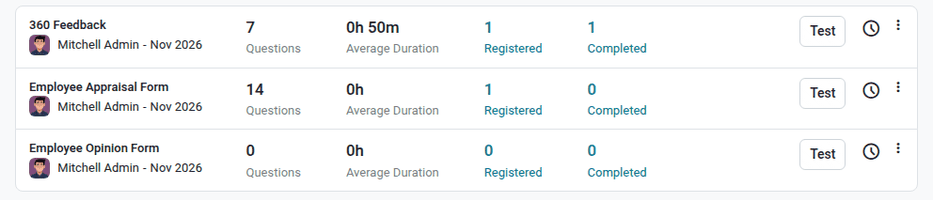
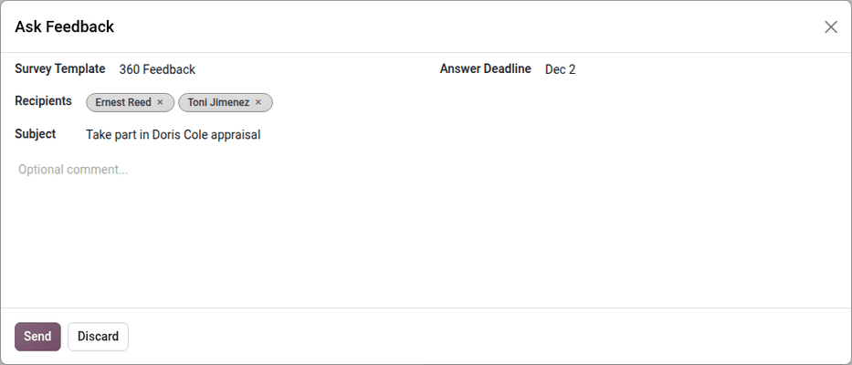
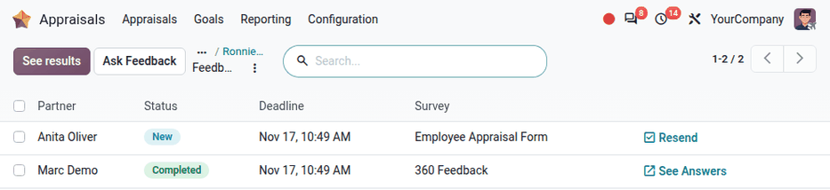

============
360 Feedback
============

Odoo's **Appraisals** app lets managers gather feedback on their direct reports from colleagues,
and from anyone else who works with them, such as customers or partners. This input gives managers
a fuller view of each employee's strengths, growth areas, and collaboration skills.

360 feedback relies on surveys from the **Surveys** app. To use it, navigate to
:menuselection:`Appraisals app --> Configuration --> Settings`, and tick the :guilabel:`360
Feedback` checkbox in the :guilabel:`Appraisals Plans` section. Then, click :guilabel:`Save`.

.. _appraisals/360-dashboard:

360 feedback dashboard
======================

The :guilabel:`360 Feedback` dashboard displays all the surveys configured for the **Appraisals**
app. To view the surveys and their statistics, navigate to :menuselection:`Appraisals app -->
Configuration --> 360 Feedback`.

Each survey is presented on its own card, along with the following information:

- :guilabel:`Survey Name`: The name of the specific survey.
- :guilabel:`Responsible`: The user responsible for the survey, including the month and year the
  survey was created.
- :guilabel:`Questions`: The number of questions in that particular survey.
- :guilabel:`Average Duration`: The average time participants take to complete the survey.
- :guilabel:`Registered`: The number of people who were asked to answer the survey.
- :guilabel:`Completed`: The number of people who have completed the survey.

To test the survey, click the :guilabel:`Test` button on the right side of the survey card. This
opens the survey in a new tab to preview the questions without submitting answers. Close the tab
to return to the dashboard.

To create a new survey, click :guilabel:`New`, then configure the survey as any other :doc:`survey
<../../marketing/surveys/create>`. Surveys created from this dashboard are automatically set as
:guilabel:`Appraisal` surveys, which makes them available in the **Appraisals** app.

.. tip::
   The surveys available for an appraisal can be limited in its :ref:`appraisal template
   <appraisals/modify-template>`, using the :guilabel:`360 Feedback Survey` field.

.. _appraisals/360-request-feedback:

Request feedback
================

To request feedback from a colleague, navigate to the **Appraisals** app, and click on the appraisal
card to open it.

Click the :guilabel:`Ask Feedback` button, and an *Ask Feedback* pop-up window appears.

.. note::
   Only confirmed appraisals (with an :guilabel:`Ongoing` status) display the :guilabel:`Ask
   Feedback` button.

Fill out the following fields:

- :guilabel:`Survey Template`: Select the survey to send. The first available survey is selected by
  default.
- :guilabel:`Answer Deadline`: The date by which the feedback must be submitted. This date is
  automatically set to the :guilabel:`Appraisal Date`. Use the calendar selector to modify the date,
  if desired.
- :guilabel:`Recipients`: Select the people asked to provide feedback. Any contact can be selected,
  including external contacts, such as customers. In the :guilabel:`Search More...` pop-up window,
  the contacts are filtered on employees by default. Multiple recipients may be selected.
- :guilabel:`Subject`: The email subject, populated with `Take part in (Employee Name) appraisal`.
  Modify it, if desired.

Type in any additional comments in the space provided, if desired. The email template copy is *not*
displayed in the pop-up window.

Click :guilabel:`Send`, and the feedback requests are sent by email to the specified recipients.
Recipients who are appraisal officers also receive an activity to fill out the survey.

.. _appraisals/360-view-results:

View results
============

To view the results, click the :icon:`edit_square` :guilabel:`Feedbacks` smart button of the
appraisal form. This smart button displays the number of completed feedback requests out of the
total number of requests. It only appears once feedback has been requested, and is only visible to
the appraisers.

The *Feedback Surveys* list loads, and presents everyone requested to submit feedback. Each line
displays the following information:

- :guilabel:`Partner`: The name of the person who was requested to submit feedback.
- :guilabel:`Status`: A tag indicating if the feedback was :ref:`completed
  <appraisals/completed-360>`, is :guilabel:`In Progress` (the survey was started but not
  submitted), or is :ref:`new <appraisals/new-360>`.
- :guilabel:`Deadline`: The date and time the survey must be completed.
- :guilabel:`Survey`: The name of the survey, which is :guilabel:`360 Feedback` by default.

.. note::
   Feedback requests that have been sent but have **not** been started are referred to as *new*.

To view all responses, click the :guilabel:`See results` button. The combined feedback loads in a
new tab. If the feedback requests use several surveys, a *Choose Survey* pop-up window loads first:
select the survey in the :guilabel:`Survey` field, then click :guilabel:`See Results`.

To ask feedback from more people, click the :guilabel:`Ask Feedback` button above the list.

.. _appraisals/completed-360:

Completed 360 feedback
----------------------

Feedback requests that have been completed display a green :guilabel:`Completed` status tag on the
*Feedback Surveys* list.

To view the individual responses of a completed feedback form, click :icon:`open_in_new`
:guilabel:`See Answers` at the end of the line, and the person's individual responses load in a new
tab.

Close the tab when the review is complete.

.. _appraisals/new-360:

New 360 feedback
----------------

Feedback requests that were sent but have not been started display a blue :guilabel:`New` status
tag on the *Feedback Surveys* list.

If necessary, the request can be resent. Click :icon:`check_box` :guilabel:`Resend` at the end of
the line, and an *Ask Feedback* pop-up window loads. Click :guilabel:`Send` to resend the feedback
request.

To resend several requests of the same survey at once, tick the checkbox next to the requests,
then click :icon:`redo` :guilabel:`Resend all`. In the *Ask Feedback* pop-up window that loads,
click :guilabel:`Send`.
