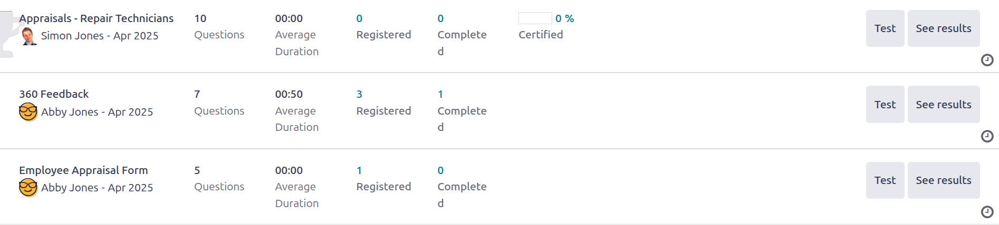
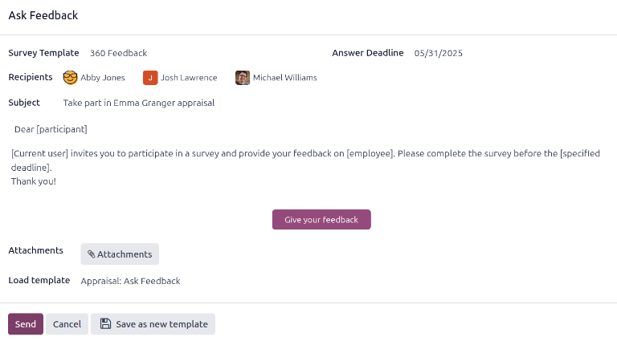

============
360 Feedback
============

Odoo's **Appraisals** app lets managers gather feedback on their direct reports from anyone in the
company. Input from colleagues gives managers a fuller view of each employee's strengths, growth
areas, and collaboration skills.

.. _appraisals/360-dashboard:

360 feedback dashboard
======================

The :guilabel:`360 Feedback` section displays information for all the surveys configured for the
**Appraisals** app. To view the surveys and their statistics, navigate to :menuselection:`Appraisals
app --> Configuration --> 360 Feedback`.

Each appraisal, or survey, is presented on its own line on the :guilabel:`360 Feedback` dashboard,
along with various information related to that particular appraisal.

Each appraisal includes the following information:

- :guilabel:`Survey Name`: The name of the specific survey.
- :guilabel:`Responsible`: The user responsible for the survey, followed by the month and year the
  survey was created.
- :guilabel:`Questions`: The number of questions in that particular survey.
- :guilabel:`Average Duration`: The average time spent completing the survey.
- :guilabel:`Registered`: The number of people who have been asked to complete the survey.
- :guilabel:`Completed`: The number of people who have completed the survey.

To test the survey, click the :guilabel:`Test` button on the right side of the survey line. This
opens the survey in a new tab to preview the questions without submitting answers. Close the tab
to return to the list.

.. _appraisals/360-request-feedback:

Request feedback
================

To request feedback from a colleague, navigate to the **Appraisals** app, and click on the appraisal
card to open it.

Click the :guilabel:`Ask Feedback` button, and an *Ask Feedback* email pop-up window appears, using
the :guilabel:`HR: Ask Feedback 360` email template.

.. note::
   Only appraisals in the :guilabel:`Ongoing` stage display the :guilabel:`Ask Feedback` button.

The :guilabel:`Survey Template` field is automatically populated with a survey allowed by the
appraisal's template. Select a different survey from the drop-down menu, if desired. If no survey is
specified on the appraisal template, all 360 feedback surveys are available.

Next, using the drop-down menu, select the employees being asked to provide feedback in the
:guilabel:`Recipients` field. Multiple employees may be selected. The :guilabel:`Answer Deadline`
date is automatically set to the day the appraisal is due. Use the calendar selector to modify the
date, if desired.

The :guilabel:`Subject` is populated with `Take part in (Employee Name) appraisal`, but can be
modified if desired.

Type in any additional comments in the space provided, if desired. The email template copy is *not*
displayed in the pop-up window.

Click :guilabel:`Send`, and the feedback requests are sent to the specified employees.

.. _appraisals/360-view-results:

View results
============

To view the results, click the :icon:`fa-pencil-square-o` :guilabel:`Feedbacks` smart button on the
appraisal form. This button only appears for managers, once feedback has been requested. The
*Feedback Surveys* dashboard loads, and presents a list of everyone requested to submit feedback.
Each line displays the following information:

- :guilabel:`Partner`: The name of the person who was requested to submit feedback.
- :guilabel:`Status`: A tag indicating if the feedback was :ref:`completed
  <appraisals/completed-360>`, is :guilabel:`In Progress`, or is :ref:`new <appraisals/new-360>`.
- :guilabel:`Deadline`: The date and time the survey must be completed.
- :guilabel:`Survey`: The name of the survey selected when the feedback was requested.

.. image:: 360/results.png
   :alt: The list of all feedback requests on the Feedback Surveys dashboard.

.. note::
   Feedback requests that have been sent but have **not** been started are referred to as *new*.
   Feedback requests that have been started but not submitted are *in progress*.

To view all responses, click the :guilabel:`See results` button. The combined feedback loads in a
new tab. If feedback was requested using more than one survey, a *Choose Survey* pop-up window loads
first. Using the drop-down menu, select the desired survey in the :guilabel:`Survey` field, then
click :guilabel:`See Results`.

To request feedback from additional people, click the :guilabel:`Ask Feedback` button at the top of
the list. To resend all requests that have not been completed, select them, then click
:guilabel:`Resend all`.

.. _appraisals/completed-360:

Completed 360 feedback
----------------------

Feedback requests that have been completed display a green :guilabel:`Completed` status tag on the
*Feedback Surveys* dashboard.

To view the individual responses of a completed feedback form, click :icon:`fa-check-square-o`
:guilabel:`See Answers` at the end of the line, and the employee's individual responses load in a
new tab.

Close the tab when the review is complete.

.. _appraisals/new-360:

New 360 feedback
----------------

Feedback requests that were sent but have not been started display a blue :guilabel:`New` status
tag on the *Feedback Surveys* dashboard. Requests that were started but not submitted display an
orange :guilabel:`In Progress` status tag.

If necessary, any request that has not been completed can be resent. Click
:icon:`fa-check-square-o` :guilabel:`Resend` at the end of the line, and an *Ask Feedback* pop-up
window loads. Click :guilabel:`Send` to resend the feedback request.
