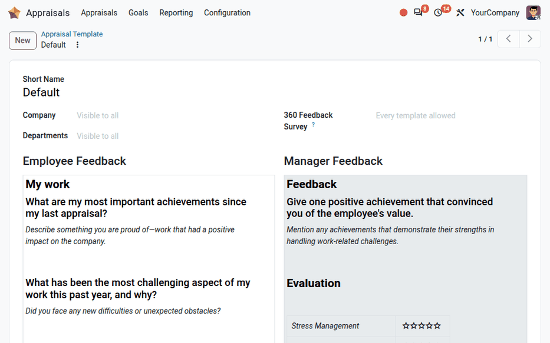

===================
Appraisal templates
===================

.. |5-stars| replace:: :icon:`star` :icon:`star` :icon:`star` :icon:`star` :icon:`star`

The **Appraisals** app uses a preconfigured default template that is general enough to apply to all
employees. If desired, the default template :ref:`can be modified <appraisals/modify-template>`. If
different templates are needed, such as department-specific appraisal templates, new templates
:ref:`can be created <appraisals/create-template>`.

.. _appraisals/modify-template:

Modify appraisal templates
==========================

If needed, changes can be made to the default template. To view the templates, navigate to
:menuselection:`Appraisals app --> Configuration --> Appraisal Templates`.

All templates appear in a list view. The default template is named :guilabel:`Default`. Click the
template to view its details. Make any desired changes to the template.

The template form contains the following fields:

- :guilabel:`Short Name`: The name of the template, displayed in the :guilabel:`Template` field of
  the appraisals.
- :guilabel:`Company`: The company the template is available for. Leave this field empty to make the
  template available for all companies. This field only appears in a multi-company database.
- :guilabel:`Departments`: The departments the template is available for. Leave this field empty to
  make the template available for all departments. On an appraisal, only the templates linked to the
  employee's department, or without any department, can be selected.
- :guilabel:`360 Feedback Survey`: The :doc:`360 feedback <360>` surveys that can be selected when
  asking for feedback on appraisals using this template. Leave this field empty to allow every
  survey. This field only appears if the *360 Feedback* setting is enabled.
- :guilabel:`Employee Feedback`: The questions the employee answers in their self-assessment.
- :guilabel:`Manager Feedback`: The questions the appraisers answer.

.. note::
   Changes made to a template do not modify the feedback sections of existing appraisals. They apply
   to the appraisals that use this template afterwards.

The default template consists of the following questions:

.. list-table:: Odoo **Appraisals** default appraisal template
   :header-rows: 1

   * - **Employee Feedback**
     - **Manager Feedback**

   * - **My work**

       **What are my most important achievements since my last appraisal?**

       *Describe something you are proud of — work that had a positive impact on the company.*

       **What has been the most challenging aspect of my work this past year, and why?**

       *Did you face any new difficulties or unexpected obstacles?*

       **What do I need to improve my work?**

       *How can the company support your needs and objectives to help you reach your goals and
       foster better collaboration?*

       **My future**

       **What are my short- and long-term goals within the company and for my career?**

       - *Provide a short-term objective (within the next 6 months).*
       - *Provide a long-term objective (beyond 6 months).*

       **Which parts of my job do I enjoy the most? Which do I enjoy the least?**

       *Every job has its strong points. In your opinion, which tasks do you enjoy the most and
       which the least?*

       **My feelings**

       **How do I feel about the company?**

       - Company culture and values: |5-stars|
       - Internal Communication: |5-stars|

       **How do I feel about my own role?**

       - Job content: |5-stars|
       - Work organization: |5-stars|
       - Compensation: |5-stars|

     - **Feedback**

       **Give one positive achievement that convinced you of the employee's value.**

       *Mention any achievements that demonstrate their strengths in handling work-related
       challenges.*

       **Evaluation**

       +---------------------+-----------+
       | *Stress Management* | |5-stars| |
       +---------------------+-----------+
       | *Time Management*   | |5-stars| |
       +---------------------+-----------+
       | *Teamwork*          | |5-stars| |
       +---------------------+-----------+
       | *Autonomy*          | |5-stars| |
       +---------------------+-----------+
       | *Proactivity*       | |5-stars| |
       +---------------------+-----------+

       **Improvements**

       **How could the employee improve?**

       *From a manager's point of view, how could you help them overcome their weaknesses?*

       **Short term (6-months) actions / decisions / objectives**

       *Do you need a rapid response to address the current situation?*

       **Long term (> 6 months) career discussion: Where does the employee want to go, and how can
       you help them reach that goal?**

       *How do you see the employee in the future? Does your vision align with the employee's
       goals?*

.. _appraisals/create-template:

Create appraisal templates
==========================

Large companies with many departments may prefer department-specific appraisal templates rather than
a universal default template. Creating and using department-specific templates can be helpful if
specific feedback is needed.

.. example::
   An appliance repair company has two main types of employees: office workers who handle
   administrative tasks and scheduling, and field repair technicians who perform repairs at
   customers' homes.

   This type of company may create two different appraisal templates, one for the office workers and
   one for the on-site repair technicians.

To create a new appraisal template, navigate to :menuselection:`Appraisals app --> Configuration -->
Appraisal Templates` and click the :guilabel:`New` button in the upper-left corner. Enter a
:guilabel:`Short Name`, set the :guilabel:`Company` and :guilabel:`Departments` the template is
intended for, if needed, then write the questions in the :guilabel:`Employee Feedback` and
:guilabel:`Manager Feedback` sections, using the :doc:`rich-text editor
<../../essentials/html_editor>`.

Additionally, a new appraisal template can be created by duplicating an existing template and
modifying the copy. To duplicate a template, navigate to :menuselection:`Appraisals app -->
Configuration --> Appraisal Templates`, then click on the template being duplicated. Click the
:icon:`more_vert` :guilabel:`(Actions)` icon, then click :icon:`content_copy` :guilabel:`Duplicate`.

First, rename the template, then make any desired changes.

.. tip::
   Drag and drop the templates in the list view using the :icon:`drag_indicator`
   :guilabel:`(drag handle)` icon to reorder them. The first available template in the list is
   selected by default on new appraisals.
