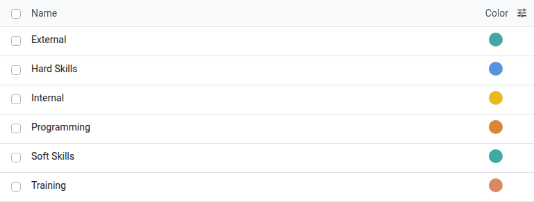
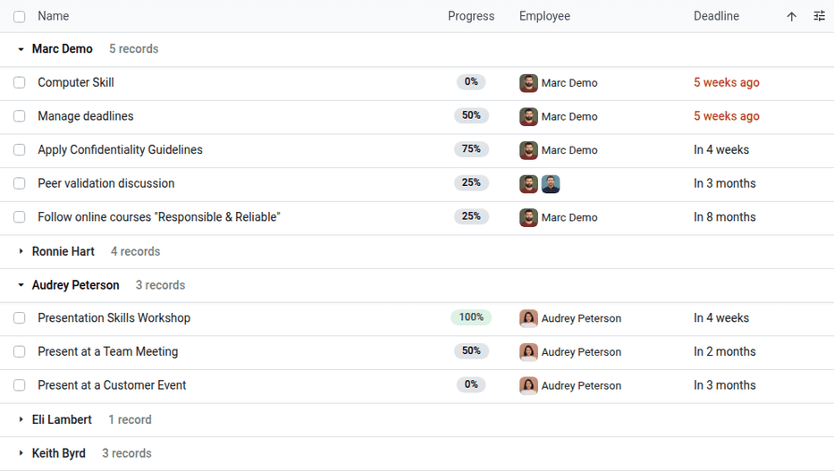
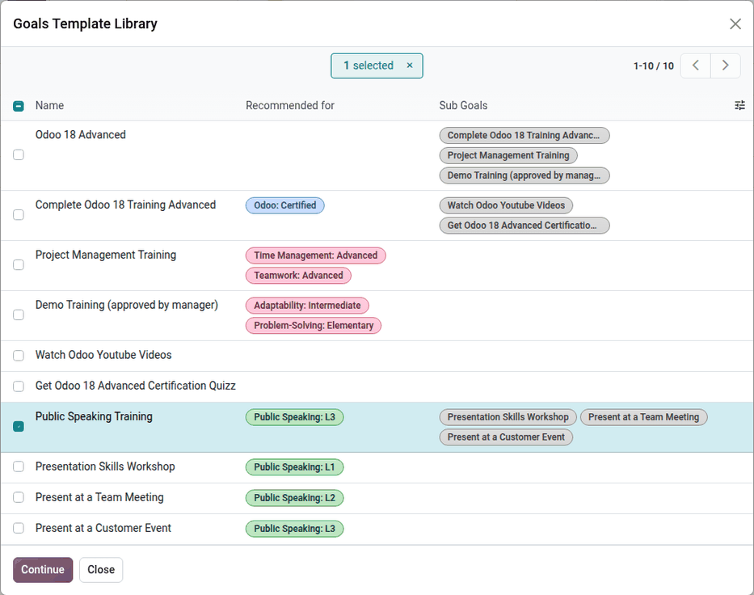
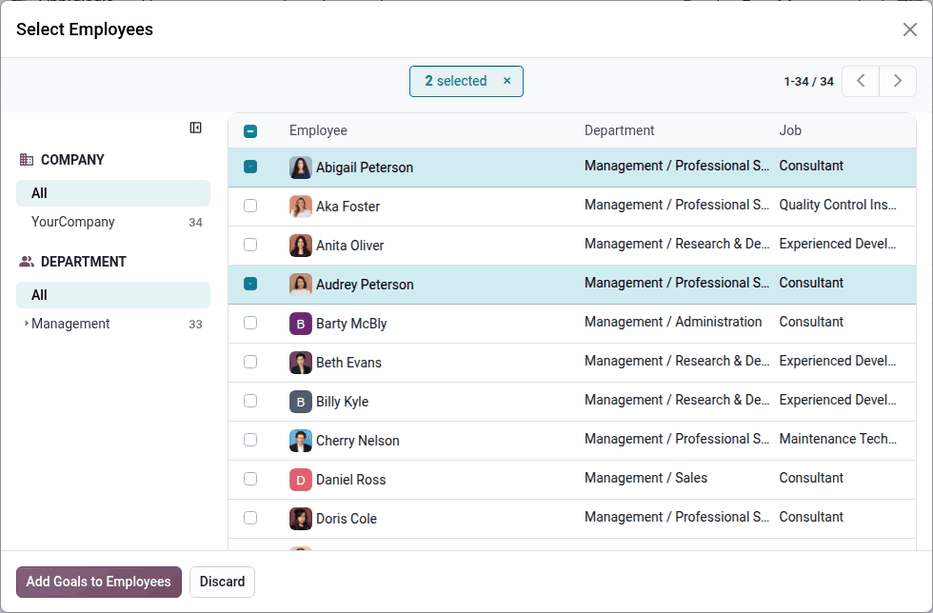
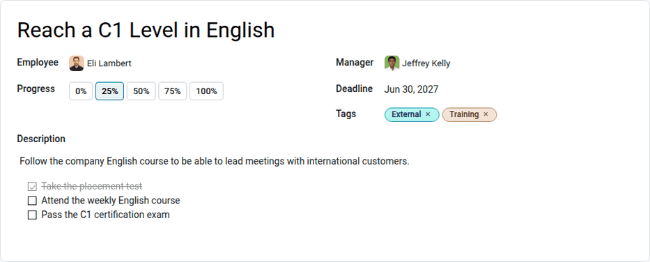
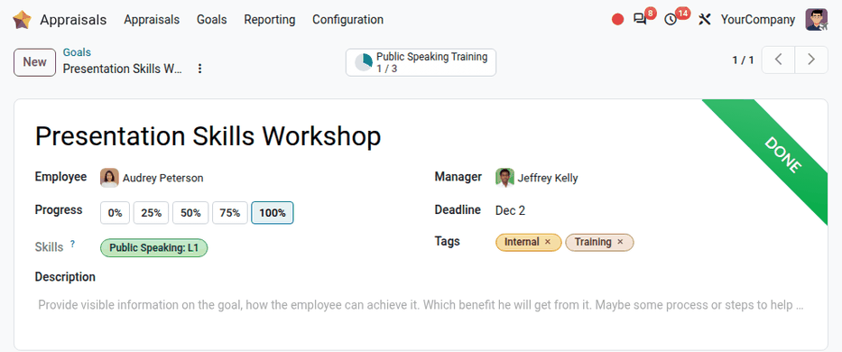

=====
Goals
=====

The Odoo **Appraisals** application allows managers to set and track clear goals for their
employees. Continuous progress towards goals gives employees a concrete target between reviews, and
gives managers reliable insights when evaluating performance.

Goals can be prepared in advance as *goal templates* in the :ref:`goals library
<appraisals/goals-library>`, then :ref:`assigned to employees <appraisals/goals/assign>`.

.. note::
   No goal templates come preconfigured in the **Appraisals** app; all goals must be :ref:`added to
   the database <appraisals/add-goals>`.

.. _appraisals/goals-library:

Goals library
=============

The *Goals Library* houses all the goal templates configured in the database, and is where new goal
templates are added. To view all the currently configured goal templates, navigate to
:menuselection:`Appraisals app --> Configuration --> Goals: Library`, and the *Goals Template*
dashboard loads. All goal templates are displayed in a default list view, and each one displays the
following information:

- :guilabel:`Name`: The name of the goal.
- :guilabel:`Recommended for`: The *skills* and levels the goal works towards. If an employee wants
  to advance a skill listed in the :guilabel:`Recommended for` column, the goal is an effective way
  to attain that skill level.
- :guilabel:`Sub Goals`: The various goals that must be achieved to complete the specified goal.
  These can also be referred to as *prerequisites*.

To view how goals are nested, click the :guilabel:`(Hierarchy)` view icon in the top-right
corner.

.. _appraisals/add-goals:

Create new goals
----------------

To add a new goal to the goals library, navigate to :menuselection:`Appraisals app --> Configuration
--> Goals: Library`, click the :guilabel:`New` button, and a goal template form loads. Fill out the
following information on the form:

- :guilabel:`Name`: Enter a name for the goal in this field.
- :guilabel:`Parent Goal Template`: If the goal is a sub-goal under another goal, referred to as a
  *parent goal*, select it using the drop-down menu.
- :guilabel:`Expected Skills`: Click the :icon:`fa-plus` :guilabel:`(plus)` icon to select the skill
  and level the goal helps to reach. In the *Select Skills* pop-up window, select the skill
  :guilabel:`Category`, the :guilabel:`Skill`, and the :guilabel:`Skill Level`, then click
  :guilabel:`Save & Close`. When an
  employee is evaluated on that skill during an appraisal, the goal is recommended for them.
- :guilabel:`Usual Timing`: Enter the typical amount of time, in months, the goal takes to achieve.
  When the goal is assigned to an employee, the deadline is calculated based on this field. This
  field is required.
- :guilabel:`Tags`: Add any relevant :ref:`tags <appraisals/add-tags>` using the drop-down menu.

.. example::
   A company wants to help employees become comfortable presenting to colleagues and customers. To
   set up this goal, the goal is named `Public Speaking Training`.

   The :guilabel:`Expected Skills` is `Public Speaking: L3`. This means that when an employee is
   evaluated on the `Public Speaking` skill below the `L3` level, they are recommended the `Public
   Speaking Training` goal.

   The :guilabel:`Usual Timing` is set to six months, meaning that it is typical for an employee to
   take six months to achieve the goal.

   Last, the tags `Soft Skills` and `Training` are assigned to the goal.

   .. image:: goals/goals-top-half.png
      :alt: The goal template form, populated for a public speaking training goal.

Description tab
~~~~~~~~~~~~~~~

Enter any relevant information in this tab to provide information, context, and assistance to the
employee.

This text is visible to the employee, and may include steps to take, any benefits from achieving the
goal, and how they can achieve it. Use the :doc:`rich text editor <../../essentials/html_editor>` to
customize the information provided.

.. example::
   The `Public Speaking Training` goal populates the *Description* tab with a short description of
   the goal, a checklist of the steps to complete, as well as instructions for whom to contact to
   book a seat in the next workshop session.

Sub-Goals tab
~~~~~~~~~~~~~

Certain goals can only be achieved after completing related goals, referred to as *sub-goals*. When
this applies, the necessary sub-goals must be added to the *Sub-Goals* tab.

To add a sub-goal, click :guilabel:`Add a line`, and a *Create Sub Goal Template* pop-up window
loads. The form contains the same fields as the :ref:`goal template <appraisals/add-goals>`, except
the :guilabel:`Parent Goal Template` field. Fill out the pop-up window, then click :guilabel:`Save &
Close` if only one goal is needed, or :guilabel:`Save & New` to save the goal and add another.

.. example::
   The `Public Speaking Training` goal has three sub-goals configured: `Presentation Skills
   Workshop`, `Present at a Team Meeting`, and `Present at a Customer Event`. Each sub-goal has its
   own :guilabel:`Usual Timing`, and is recommended for a different level of the `Public Speaking`
   skill.

   .. image:: goals/sub-goals.png
      :alt: The various sub-goals for the public speaking training goal.

.. _appraisals/add-tags:

Tags
----

Adding tags to goals can help when viewing the goals report, to see how many goals with specific
tags are assigned to employees. They also can aid with keeping various goals organized, and see
which goals are related to one another.

To view all the current tags, and add new ones, navigate to :menuselection:`Appraisals app -->
Configuration --> Goals: Tags`. All tags appear in a list view. No tags come preconfigured, so all
tags must be added to the database.

To add a new tag, click the :guilabel:`New` button in the upper-left corner, and a new line appears
at the bottom of the list. Enter the tag name, then press return or click away from the field. Click
on a colored dot at the end of the line to select a color for the tag.

View employee goals
===================

To view all goals assigned to employees, navigate to :menuselection:`Appraisals app --> Goals`. This
presents all the goals for every employee, in a default list view, grouped by :guilabel:`Employee`.

Click on an employee to expand the listed goals. Each goal displays the following information:

- :guilabel:`Name`: The name of the goal.
- :guilabel:`Progress`: The percentage of progress the employee has achieved.
- :guilabel:`Employee`: The employees assigned to the goal.
- :guilabel:`Deadline`: The time remaining until the goal should be achieved.

The :guilabel:`Progress` percentages all appear in gray until a goal has been achieved. Once
achieved, the :guilabel:`Progress` displays `100%` and appears in green.

Any goals whose :guilabel:`Deadline` has passed appear in red text.

.. note::
   - Only employees with goals assigned to them appear in the list.
   - Goals that have sub-goals are not listed: only their sub-goals are. To open the parent goal,
     open one of its sub-goals, then click the smart button displaying the parent goal's name.

.. _appraisals/goals/assign:

Assign goals to employees
=========================

Once goals have been configured in the database, the next step is to assign goals to employees.
Configured goals can be :ref:`assigned to employees <appraisals/goals/existing>`, and new goals can
be :ref:`created and assigned <appraisals/goals/new>`.

.. _appraisals/goals/existing:

Assign existing goals
---------------------

To assign goals to employees, first open the main *Goals* dashboard by navigating to
:menuselection:`Appraisals app --> Goals`. Click the :guilabel:`Open Library` button and a *Goals
Template Library* pop-up window loads, displaying all the currently configured goal templates.
Click the checkbox next to each goal being assigned to employees.

Next, click the :guilabel:`Continue` button and a *Select Employees* pop-up window loads. Click the
checkbox next to each employee being assigned the selected goals, then click the :guilabel:`Add
Goals to Employees` button.

The pop-up window closes, and a goal is created for each selected employee, along with its
sub-goals. The deadline of each goal is set according to its :guilabel:`Usual Timing`, and the
employee's manager is set as the goal's manager. The goals now appear on the *Goals* dashboard.

.. tip::
   Goals can also be assigned during an appraisal: in the *Skills* tab of the appraisal, click the
   :guilabel:`Recommend Goals` link of a skill to open the goal templates that help to reach a
   higher level for this skill. See :ref:`appraisals/skills`.

.. _appraisals/goals/new:

Assign new goals
----------------

If a goal does not exist, it can be created and assigned to an employee from the *Goals* dashboard.
To create new goals, navigate to :menuselection:`Appraisals app --> Goals`, and click
:guilabel:`New` in the top-left corner to open a blank goal form. Add the following information on
the form:

- Goal name: Type in a brief name for the goal in the first field, such as `Improve your English
  level`.
- :guilabel:`Employee`: Select the employees being assigned the goal using the drop-down menu. Once
  this field is populated, the employees' managers populate the :guilabel:`Manager` field.
- :guilabel:`Progress`: Click the current percentage of competency for the goal. The options are
  :guilabel:`0%`, :guilabel:`25%`, :guilabel:`50%`, :guilabel:`75%`, or :guilabel:`100%`.
- :guilabel:`Manager`: Select the managers following the goal using the drop-down menu, if not
  already selected.
- :guilabel:`Deadline`: Enter the due date for the goal using the calendar selector.
- :guilabel:`Tags`: Add any relevant :ref:`tags <appraisals/add-tags>` to the goal using the
  drop-down menu.
- :guilabel:`Description`: Enter any details regarding the goal in this section.

.. tip::
   Some goals can be broken down into steps, which may be input as a checklist. A checklist is a
   tool the employee may use to mark their progress.

To reuse the goal for other employees, click the :guilabel:`Save as Template` button. A copy of the
goal, without employee, is added to the :ref:`goals library <appraisals/goals-library>`.

Update employee goals
=====================

Typically, goals are updated during an employee appraisal: the :guilabel:`Goals` smart button of
the appraisal form opens the employee's goals. However, in some cases, it is necessary to update
goal progress outside of an appraisal. This could be from an employee completing a course or
certification, documenting their goal progress or completion.

To update a goal's progress percentage outside of an appraisal, navigate to
:menuselection:`Appraisals app --> Goals`. Expand the employee whose goals are being updated, and
click on an individual goal to open the goal record.

Click the new :guilabel:`Progress` box to set the new progress level. It is recommended to add notes
in the :guilabel:`Description` section, as the employee progresses with the goal. The notes should
include dates the progress changed, and any supporting information regarding the change. Progress
changes are also logged in the chatter.

The progress of a goal with sub-goals cannot be set manually: it is the average progress of its
sub-goals. For example, if one of three sub-goals is done, another one is at `50%`, and the last one
is at `0%`, the parent goal's :guilabel:`Progress` is `50%`. On a sub-goal, the smart button
displays how many of its sibling sub-goals are done.

Completed employee goals
========================

When a goal has been met, it is important to update the record. Navigate to
:menuselection:`Appraisals app --> Goals`. Expand the employee whose goals are being evaluated, and
click on an individual goal to open the goal record.

Click the :guilabel:`Mark as Done` button in the upper-left corner. A green :guilabel:`Done` banner
appears in the top-right corner of the goal form, and the :guilabel:`Progress` changes to
:guilabel:`100%`.

A goal with sub-goals is automatically marked as done once all its sub-goals are done.

.. note::
   On the :guilabel:`Goals` dashboard, completed goals are indicated with a green :guilabel:`100%`
   tag in the :guilabel:`Progress` column.

