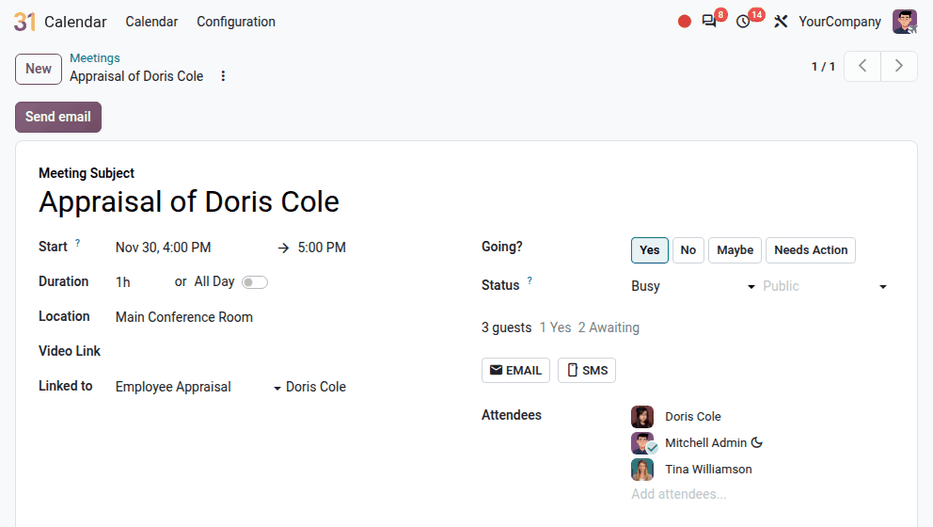
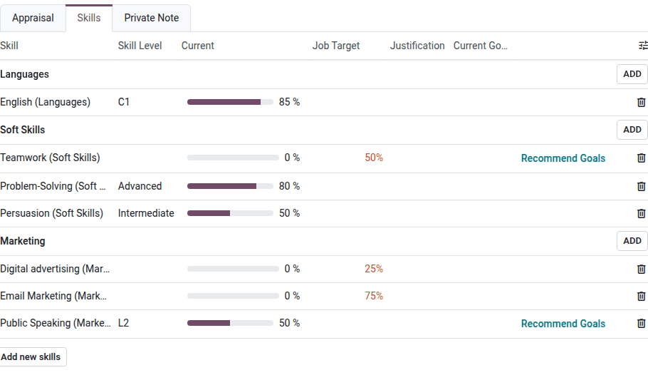

==================
Conduct appraisals
==================

This guide explains the end-to-end appraisal workflow in Odoo, from creation to final rating,
showing how managers and employees collaborate at each stage.

- :ref:`Employee self-assessment <appraisals/employee-feedback>`: The employee completes the
  *Employee's Feedback* template. Responses remain hidden until the employee shares them with the
  appraisers.
- :ref:`Manager feedback <appraisals/manager-feedback>`: While the employee works on their section,
  the manager reviews goals, gathers peer input if needed, and fills out the *Manager's Feedback*
  template. Feedback can remain hidden until the appraisal meeting.
- :ref:`Appraisal review <appraisals/review>`: Manager and employee meet to discuss both feedback
  sections, update skills and goals, and agree on next steps. The meeting can be scheduled directly
  from the appraisal or the calendar.
- :ref:`Completion and rating <appraisals/complete>`: After the discussion, the manager assigns a
  final rating, adds any private notes, and marks the appraisal as done. The record then locks
  unless it is reopened for further edits.

Throughout the process, optional actions, such as requesting peer feedback or logging private
manager notes, enhance the appraisal's accuracy and relevance.

.. _appraisals/employee-feedback:

Employee self-assessment
========================

Once an appraisal is confirmed (its status is :guilabel:`Ongoing`), the employee is required to
fill out the self-assessment.

.. note::
   Only confirmed appraisals can be worked on. If an appraisal is still in :guilabel:`Draft`,
   feedback cannot be recorded.

After the employee is notified that an appraisal is confirmed and scheduled, they are requested to
fill out their half of the appraisal template. A blue banner at the top of the appraisal reminds
them to fill out their feedback before the :guilabel:`Appraisal Date`, then share it with the
appraisers.

Employees can click on the link in the confirmation email to navigate to the appraisal, or they can
open their appraisal in the **Appraisals** app. To do this, open the **Appraisals** app, then click
on the appraisal card.

The :guilabel:`Employee's Feedback` half of the default template includes the following sections:
:guilabel:`My work`, :guilabel:`My future`, and :guilabel:`My feelings`. Each of these sections
consists of several questions for the employee to answer, allowing the employee to perform a
self-assessment, and provide feedback on how they feel about the company and their role.

Complete the self-assessment
----------------------------

The employee feedback remains hidden from management while the employee is performing their
self-assessment: appraisers only see a blurred section with the message :guilabel:`Self Assessment
will show here once published`. Once the employee has completed their half of the appraisal, they
click the toggle between :guilabel:`Private` and :guilabel:`Shared to Appraisers`.
:guilabel:`Shared to Appraisers` turns green, and their responses are then visible to the
appraisers.

.. tip::
   Click the :icon:`expand_content` :guilabel:`(Expand Employee's Feedback)` icon next to the
   section title to fill it out in a larger pop-up window. The same icon is available next to the
   :guilabel:`Manager's Feedback` title.

.. _appraisals/manager-feedback:

Manager feedback
================

While the employee is completing their :guilabel:`Employee's Feedback` section, the manager fills
out the :guilabel:`Manager's Feedback` section.

.. note::
   Multiple appraisers can be selected in the :guilabel:`Appraisers` field in the top half of the
   appraisal form. Anyone added as an appraiser is able to review the appraisal and populate the
   :guilabel:`Manager's Feedback` section.

   Typically, managers conduct appraisals with their employees, one on one. Some cases may require
   more than one appraiser, such as an annual review for an upper management position, or for an
   employee being promoted.

Before the manager fills out their portion of the appraisal, managers typically ask for
:ref:`additional feedback <appraisals/ask-feedback>` from the employee's coworkers, to better
understand all the achievements and challenges for the employee.

Once the manager has all the information they need to evaluate the employee, they fill out the
:guilabel:`Manager's Feedback` section of the appraisal form. The manager's half has the following
sections: :guilabel:`Feedback`, :guilabel:`Evaluation`, and :guilabel:`Improvements`.

The manager's appraisal focuses on the employee's accomplishments, as well as identifying areas of
improvements, with actionable steps to help the employee achieve their goals in both the long and
short term.

When the feedback section is completed, the manager clicks the toggle between
:guilabel:`Private` and :guilabel:`Shared to Employee`. :guilabel:`Shared to Employee` turns green,
and their responses are then visible to the employee.

.. note::
   Some managers prefer to keep their feedback hidden from the employee until they :ref:`meet with
   the employee <appraisals/review>` to discuss the appraisal.

.. _appraisals/ask-feedback:

Ask for feedback
----------------

As part of the appraisal process, the manager can :ref:`request feedback for an employee
<appraisals/360-request-feedback>`  from anyone in the company about an employee. In Odoo, this is
referred to as *360 Feedback*.

Feedback is requested from coworkers and anyone else who works with the employee. This is to get a
more well-rounded view of the employee, and aid in the manager's overall assessment.

.. important::
   To request feedback, the *360 Feedback* setting must be enabled, and the appraisal **must** be
   confirmed. Once confirmed, an :guilabel:`Ask Feedback` button appears in the upper-left corner
   of the form.

.. _appraisals/review:

Appraisal review
================

Once both portions of an appraisal are completed (the :ref:`employee <appraisals/employee-feedback>`
and :ref:`manager <appraisals/manager-feedback>` feedback sections), it is time for the employee and
manager to :ref:`meet and discuss the appraisal <appraisals/schedule>`.

During the appraisal meeting, the manager reviews both the :ref:`Employee's Feedback
<appraisals/employee-feedback>` section as well as their own :ref:`Manager feedback
<appraisals/manager-feedback>`.

Additionally, the employee's :ref:`skills <appraisals/skills>` and :doc:`goals <goals>` are reviewed
at this time, and updated as needed.

.. _appraisals/schedule:

Schedule appraisal review
-------------------------

Meetings to review appraisals are scheduled from the appraisal itself.

To schedule an appraisal meeting, navigate to :menuselection:`Appraisals app --> Appraisals`, and
click on the desired Kanban card.

Click the :guilabel:`Schedule Meeting` button, and the :guilabel:`Meetings` calendar loads, opened
on the :guilabel:`Appraisal Date`. Click on the desired time slot on the calendar, or click
:guilabel:`New` to open the full event form.

The meeting title is populated with `Appraisal of (Employee Name)`, and the meeting is linked to the
appraisal. The employee, the appraisers, and the current user are added as attendees by default. Add
anyone else who should be in the meeting, if necessary.

Adjust the date and time, and add a :guilabel:`Location`, such as `Main Conference Room`, or a
:guilabel:`Video Link` for an online meeting, if desired. Any notes or additional information can be
added in the *Notes* tab.

Once all the desired changes are complete, save the meeting. It now appears on the calendar, and the
attendees are invited by email.

         as attendees.

.. seealso::
   :doc:`../../productivity/calendar`

.. _appraisals/skills:

Review employee skills
----------------------

Part of an appraisal is evaluating an employee's skills and tracking their progress over time. Once
an appraisal is confirmed, the *Skills* tab of the appraisal form auto-populates with the skills
from the :ref:`employee form <employees/skills>`. Additionally, if the :guilabel:`Target Job` field
is populated, the corresponding skills also appear in the *Skills* tab, and the progress expected
for the job appears in red in the :guilabel:`Job Target` column.

Each skill is grouped with like skills, and the following information is displayed for each skill:

- :guilabel:`Skill Level`: The employee's current level for the skill.
- :guilabel:`Current`: The progress corresponding to the skill level.
- :guilabel:`Job Target`: The progress expected for the :guilabel:`Target Job`, if any.
- :guilabel:`Justification`: Notes explaining a change of level.
- :guilabel:`Current Goals`: The completion of the employee's :doc:`goals <goals>` linked to this
  skill. When goal templates of the library can help the employee reach a higher level, a
  :guilabel:`Recommend Goals` link appears. Click it to open the matching goal templates, and
  assign them to the employee.

If a :guilabel:`Skill Level` has changed since the last appraisal, the level must be updated.

.. note::
   The *Skills* tab does not appear on the appraisal until the appraisal is confirmed. While the
   appraisal is ongoing, it is only visible to the appraisers, not to the employee being evaluated.

Click on the :guilabel:`Skill Level` for the skill that has changed, revealing a drop-down menu of
all available levels. Click on the new level for the skill. Once selected, the :guilabel:`Current`
field updates accordingly. Next, click into the :guilabel:`Justification` field for the skill, and
enter any relevant details explaining the change, such as `took a fluency language test` or
`received Javascript certification`.

If necessary, click :guilabel:`Add new skills`, or :guilabel:`Add` in a skill type line, to
:ref:`add new skills <employees/skills>` for the employee.

Skill changes made in the appraisal are applied to the employee form when the appraisal is marked as
done, and are logged in the appraisal's chatter. The next time an appraisal is confirmed, the
updated skills populate the *Skills* tab.

.. _appraisals/complete:

Complete an appraisal
=====================

After the appraisal has been filled out by both the employee and the manager, and both parties have
met and discussed the employee's performance, the manager then :ref:`logs any notes
<appraisals/notes>`, and :ref:`assigns a rating <appraisals/rate>`.

When completed, click the :guilabel:`Mark as Done` button in the upper-left corner of the appraisal
form.

Once the appraisal is marked as *Done*, the status changes from :guilabel:`Ongoing` to
:guilabel:`Done`, and the :guilabel:`Mark as Done` button changes to a :guilabel:`Reopen` button.

.. tip::
   When an appraisal is marked as done, it is locked and modifications are not possible. To make any
   changes to an appraisal with a status of :guilabel:`Done`, click the :guilabel:`Reopen` button,
   then make any needed modifications. Once all modifications are complete, click the
   :guilabel:`Mark as Done` button again.

.. note::
   To start an ongoing appraisal over, click the :guilabel:`Reset` button. After confirmation, the
   appraisal returns to :guilabel:`Draft`, the :guilabel:`Final Rating` is cleared, and all
   manually entered content in the *Employee's Feedback* and *Manager's Feedback* sections is
   erased.

.. _appraisals/notes:

Add a private note
------------------

Managers can log notes on an appraisal that are **only** visible to other managers. Enter any notes
in the *Private Note* tab. This can be done anytime during the appraisal process.

The employee being evaluated does **not** have access to this tab, and the tab does **not** appear
on their appraisal.

The tab is optional and does not affect the final rating.

.. _appraisals/rate:

Provide a final rating
----------------------

After both the manager and employee have met to discuss the employee's performance, the appraisal
must be given a :guilabel:`Final Rating`.

Using the drop-down menu, select the rating for the employee. The default options are:
:guilabel:`Needs improvement`, :guilabel:`Meets expectations`, :guilabel:`Exceeds expectations`, and
:guilabel:`Strongly Exceed Expectations`. The :guilabel:`Final Rating` is never visible to the
employee.

To add a new rating, navigate to :menuselection:`Appraisals app --> Configuration --> Evaluation
Scale`. The ratings of the current company are presented in a list view. To add a new rating, click
the :guilabel:`New` button in the upper-left corner, and a blank line appears at the bottom of the
list. Enter the new rating, then press the enter key, or click away from the line. Add as many new
ratings as needed. Drag and drop the lines using the :icon:`drag_indicator` :guilabel:`(drag
handle)` icon to reorder the ratings.

Click :menuselection:`Appraisals` in the top menu to return to the :guilabel:`Appraisals` dashboard,
click on the appraisal, then select the desired :guilabel:`Final Rating`.

.. seealso::
   - :doc:`../appraisals/goals`
   - :doc:`../appraisals/appraisal_analysis`
   - :doc:`../appraisals/skills_evolution`
