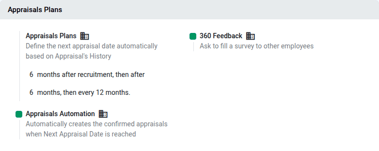
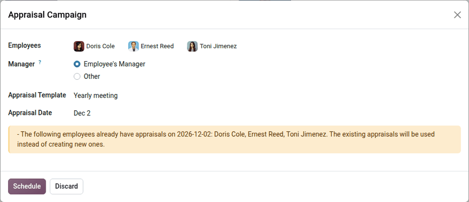
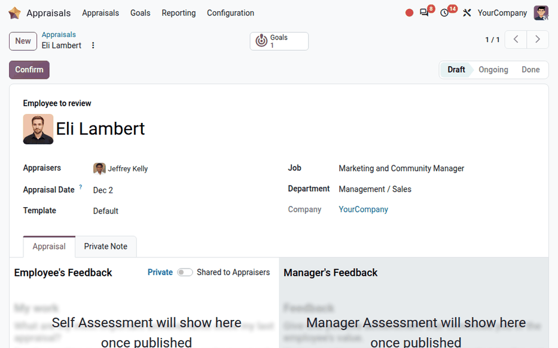

===================
Schedule appraisals
===================

Odoo's **Appraisals** app helps managers run recurring performance reviews. Each review can include
a self-assessment and can follow any schedule the company sets.

Regular appraisals turn day-to-day work into clear goals and measurable skill targets. They also
supply the objective evidence HR needs for raises or promotions, and keep individual performance
aligned with company KPIs.

Reviews can be :ref:`scheduled automatically <appraisals/auto>` through an :ref:`appraisal plan
<appraisals/appraisal-plan>` that triggers evaluations at set intervals, :ref:`launched for a group
of employees <appraisals/campaign>` with an appraisal campaign, or :ref:`created manually
<appraisals/manual>` whenever needed, such as before a promotion or department transfer.

An appraisal goes through three statuses:

- :guilabel:`Draft`: The appraisal is created, but not yet started. The employee and appraisers
  cannot record feedback yet.
- :guilabel:`Ongoing`: The appraisal is confirmed. The employee and appraisers fill out their
  feedback, and the appraisal card displays a :guilabel:`Confirmed` ribbon.
- :guilabel:`Done`: The appraisal is completed and locked. The appraisal card displays a
  :guilabel:`Done` ribbon.

.. _appraisals/auto:

Automatic scheduling
====================

To ensure no appraisal is missed, enable automatic scheduling by going to :menuselection:`Appraisals
app --> Configuration --> Settings`.

The :guilabel:`Appraisals Plans` section determines the frequency with which appraisals are
scheduled. These settings are company-specific.

         enabled.

.. _appraisals/appraisal-plan:

Appraisals plans
----------------

By default, the first appraisal is planned six months after the employee's contract start date,
the second one six months after that, and then one appraisal every twelve months.

To modify this schedule, change the number of months in the fields of the :guilabel:`Appraisals
Plans` setting (:guilabel:`months after recruitment, then after`, :guilabel:`months, then every`,
:guilabel:`months.`), then click :guilabel:`Save`.

Odoo uses this plan to compute the :guilabel:`Next Appraisal Date` displayed in the :ref:`Work
Information tab <employees/work-info-tab>` of the employee form, for every employee who does **not**
have an ongoing appraisal. When an appraisal is ongoing, this field displays :guilabel:`Ongoing`.

.. important::
   Changing the :guilabel:`Appraisals Plans` recomputes the :guilabel:`Next Appraisal Date` of
   **every** employee without an ongoing appraisal, including dates that were modified manually.

Appraisals automation
---------------------

Tick the :guilabel:`Appraisals Automation` checkbox to have Odoo automatically create *and* confirm
appraisals when an employee's :guilabel:`Next Appraisal Date` is reached. This option is enabled by
default.

Automatically created appraisals use the employee's manager as appraiser, and their
:guilabel:`Appraisal Date` is set eight days after the :guilabel:`Next Appraisal Date`. The manager
receives an activity to fill out the appraisal.

When this option is disabled, appraisals are not created automatically: they must be
:ref:`launched in a campaign <appraisals/campaign>` or :ref:`created manually <appraisals/manual>`.

.. _appraisals/campaign:

Launch an appraisal campaign
============================

An *appraisal campaign* creates appraisals for several employees at once, such as for a yearly
review cycle. To launch a campaign, navigate to :menuselection:`Appraisals app --> Appraisals`, and
click the :guilabel:`Launch Campaign` button, next to the :guilabel:`New` button. An *Appraisal
Campaign* pop-up window loads.

Fill out the following fields:

- :guilabel:`Employees`: Select the employees to evaluate. Leave this field empty to create an
  appraisal for **all** employees of the company. Managers who are not appraisal officers can only
  select the employees they manage.
- :guilabel:`Manager`: Select who conducts the appraisals. This field is only visible to Appraisals
  administrators: for other users, the appraisals are conducted by the employee's manager.

  - :guilabel:`Employee's Manager`: Each appraisal is conducted by the employee's direct manager, as
    set on the employee form.
  - :guilabel:`Other`: All appraisals are conducted by the employees selected in the field that
    appears beneath.

- :guilabel:`Appraisal Template`: Select the :doc:`appraisal template <appraisal_templates>` to use
  for all appraisals of the campaign. This field is required.
- :guilabel:`Appraisal Date`: The date by which the appraisals should be completed. By default, this
  is one month from the current date.

If some employees cannot be included, a warning appears at the bottom of the pop-up window, for
example when an employee does not have a manager, or already has an appraisal on the same date with
the same appraisers. In the latter case, the existing appraisal is used instead of creating a new
one.

         meeting template.

Click :guilabel:`Schedule` to create the appraisals. They are created with an :guilabel:`Ongoing`
status, so the employees and appraisers can start filling them out immediately, and the list of the
campaign's appraisals is displayed.

.. _appraisals/manual:

Manually schedule an appraisal
==============================

Managers can schedule an appraisal at any time, outside the regular cycle.

For example, if an employee is promoted, or transfers to a new role or a new department, an
appraisal is scheduled to assess performance in the current role.

To create a new appraisal, open the :menuselection:`Appraisals` app, and click the :guilabel:`New`
button in the upper-left corner. This opens a blank appraisal form.

First, select the employee being evaluated in the :guilabel:`Employee to review` field using the
drop-down menu. Once an employee is selected, their manager populates the :guilabel:`Appraisers`
field. The :guilabel:`Department` and :guilabel:`Company` fields are populated according to the
information on the employee record.

.. note::
   If another appraisal with the same employee and appraisers is already ongoing, a warning appears
   at the top of the form.

The :guilabel:`Appraisal Date` is when the appraisal is scheduled to be completed. The default
deadline is one month from the current date, but can be adjusted using the calendar selector.

Last, select the desired :guilabel:`Template`. The first available :doc:`appraisal template
<appraisal_templates>` populates this field by default. Using the drop-down menu, select a different
template, if desired. Only the templates without department, or linked to the employee's department,
can be selected. This field is only visible while the appraisal is in :guilabel:`Draft`.

Once the information in the top half of the appraisal form is complete, click the
:guilabel:`Confirm` button in the upper-left corner. The status changes to :guilabel:`Ongoing`, and
both the employee and appraisers can start to fill out the appraisal.

Two additional fields appear once the appraisal is confirmed: a :guilabel:`Final Rating` and a
:guilabel:`Target Job` field. The
:guilabel:`Target Job` allows the manager to select a job position the employee may be working
towards. When a job position is selected in this field, any required skills for the job appear in
the *Skills* tab. This aids in seeing where the employee stands in regards to the job requirements
:doc:`during the appraisal <new_appraisals>`. The :guilabel:`Final Rating` field is populated when
the appraisal is :ref:`completed <appraisals/rate>`.

Once the appraisal is marked as done, a :guilabel:`Next Appraisal Date` field appears, populated
with the date of the next appraisal according to the :ref:`appraisal plan
<appraisals/appraisal-plan>`. If no plan applies, the field displays :guilabel:`On demand`.

Once the appraisal is confirmed, click the :guilabel:`Send by email` button to send a message to
the employee, for example to remind them to fill out their self-assessment.

.. _appraisals/bulk-actions:

Manage several appraisals at once
=================================

Several appraisals can be processed at the same time from the list view. Navigate to
:menuselection:`Appraisals app --> Appraisals`, click the :icon:`oi-view-list` :guilabel:`(List)`
icon, and tick the checkbox next to each appraisal to process. Then, click the :icon:`fa-cog`
:guilabel:`Actions` button, and select one of the following actions:

- :guilabel:`Confirm`: Confirms the selected :guilabel:`Draft` appraisals.
- :guilabel:`Mark as Done`: Completes the selected appraisals.
- :guilabel:`Send By Email`: Opens an email pop-up window to send the same message to the employees
  of all selected appraisals.
- :guilabel:`Reset`: Sets the selected :guilabel:`Ongoing` appraisals back to :guilabel:`Draft`.

Appraisals that are not in the expected status are skipped, and a warning notification is
displayed.

.. seealso::
   - :doc:`new_appraisals`
   - :doc:`appraisal_templates`
