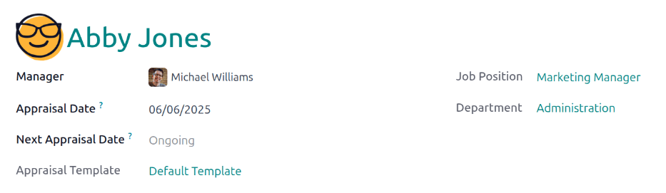

===================
Schedule appraisals
===================

Odoo's **Appraisals** app helps managers run recurring performance reviews. Each review can include
a self-assessment and can follow any schedule the company sets.

Regular appraisals turn day-to-day work into clear goals and measurable skill targets. They also
supply the objective evidence HR needs for raises or promotions, and keep individual performance
aligned with company KPIs.

Reviews can be :ref:`scheduled automatically <appraisals/auto>` through an :ref:`appraisal plan
<appraisals/appraisal-plan>` that triggers evaluations at set intervals, or :ref:`created manually
<appraisals/manual>` whenever needed—such as before a promotion or department transfer.

.. _appraisals/auto:

Automatic scheduling
====================

To ensure no appraisal is missed, enable automatic scheduling by going to :menuselection:`Appraisals
app --> Configuration --> Settings`.

The :guilabel:`Appraisals Plan` settings determine the frequency with which appraisals are
scheduled.

.. image:: schedule_appraisals/appraisal-settings.png
   :alt: The appraisals sections with the timeline filled in and 360 feedback enabled.

.. _appraisals/appraisal-plan:

Appraisals plans
----------------

By default, appraisals are preconfigured to be automatically created six months after an employee is
hired, with a second appraisal six months after the first appraisal date.

Once those two initial appraisals have been completed in the employee's first year, following
appraisals are only created once a year (every twelve months).

To modify this schedule, change the number of months in the blank fields under the
:guilabel:`Appraisals Plans` section.

.. important::
   Changing the :guilabel:`Appraisals Plans` fields recomputes the :guilabel:`Next Appraisal Date`
   of **every** employee who does not currently have a *Draft* or *Ongoing* appraisal.

.. note::
   The :guilabel:`Next Appraisal Date` is only computed from the appraisal plan when the
   :ref:`Appraisals Automation <appraisals/automation>` option is enabled.

.. _appraisals/automation:

Appraisals automation
---------------------

The :guilabel:`Appraisals Automation` checkbox is enabled by default. When it is ticked, Odoo
automatically creates appraisals when an employee's :guilabel:`Next Appraisal Date` is reached,
according to the :ref:`appraisal plan <appraisals/appraisal-plan>`.

Automatically created appraisals skip the *Draft* stage, and are created directly in the *Ongoing*
stage. The employee's manager is set as the appraiser, the :guilabel:`Appraisal Date` is set eight
days after the :guilabel:`Next Appraisal Date`, and both the employee and their manager are notified
and receive an activity to fill out the appraisal.

.. _appraisals/manual:

Manually schedule an appraisal
==============================

Managers can schedule an appraisal at any time, outside the regular cycle.

For example, if an employee is promoted, or transfers to a new role or a new department, an
appraisal is scheduled to assess performance in the current role.

To create a new appraisal, open the :menuselection:`Appraisals` app, and click the :guilabel:`New`
button in the upper-left corner. This opens a blank :guilabel:`Appraisals` form.

First, select the employee being evaluated in the :guilabel:`Employee to review` field using the
drop-down menu. Once an employee is selected, their manager populates the :guilabel:`Appraisers`
field. The :guilabel:`Job` and :guilabel:`Department` fields are populated according to the
information on the employee record.

The :guilabel:`Appraisal Date` is when the appraisal is scheduled to be completed. The default
deadline is one month from the current date, but can be adjusted using the calendar selector.

Once the appraisal is marked as done and a :guilabel:`Final Rating` is set, a :guilabel:`Next
Appraisal Date` field appears. If :ref:`Appraisals Automation <appraisals/automation>` is enabled,
this field is populated with the date of the next appraisal, computed according to the
:ref:`appraisal plan <appraisals/appraisal-plan>`. Otherwise, the field displays :guilabel:`On
demand`, and can be set manually.

Last, select the desired :guilabel:`Template`. This field is populated by default with the first
available template in the :ref:`appraisal templates <appraisals/modify-template>` list that applies
to the employee's company and department. On a new database, this is the :guilabel:`Default`
template, which is created when the **Appraisals** app is installed. Using the drop-down menu,
select a different template, if desired. Only templates without any department, or linked to the
employee's department, are available. The :guilabel:`Template` field is only visible while the
appraisal is in the *Draft* stage.

Once the information in the top-half of the :guilabel:`Appraisals` form is complete, click the
:guilabel:`Confirm` button in the upper-left corner. The appraisal moves from the *Draft* stage to
the *Ongoing* stage, the employee and any other appraisers are notified, and both the employee and
appraisers can start to fill out the appraisal.

Two additional fields appear once the appraisal is confirmed: a :guilabel:`Target Job` and a
:guilabel:`Final Rating` field. The :guilabel:`Target Job` allows the manager to select a job
position the employee may be working towards. When a job position is selected in this field, any
required skills for the job appear in the *Skills* tab. This aids in seeing where the employee
stands in regards to the job requirements :doc:`during the appraisal <new_appraisals>`. The
:guilabel:`Final Rating` field is only populated after the appraisal is complete.

Launch an appraisal campaign
----------------------------

To create appraisals for several employees at once, open the :menuselection:`Appraisals` app, and
click the :guilabel:`Launch Campaign` button at the top of the list or Kanban view. This button is
available to users with *Officer* or *Administrator* access rights for the **Appraisals** app, and
to managers who have at least one direct report.

In the :guilabel:`Appraisal Campaign` pop-up window that appears, configure the following fields:

- :guilabel:`Employees`: select the employees to evaluate. If left empty, appraisals are created
  for all employees the user can access.
- :guilabel:`Manager`: select who conducts the appraisals. Choose :guilabel:`Employee's Manager` to
  set each employee's direct manager as the appraiser, or :guilabel:`Other` to select specific
  employees as the appraisers for every appraisal. This field is only visible to users with
  *Administrator* access rights for the **Appraisals** app. Otherwise, each employee's direct
  manager is used.
- :guilabel:`Appraisal Template`: select the template used for every appraisal in the campaign.
- :guilabel:`Appraisal Date`: select the date the appraisals are scheduled to be completed. The
  default date is one month from the current date.

Click :guilabel:`Schedule` to create the appraisals. The appraisals are created in the *Ongoing*
stage, and the employees and appraisers are notified. If an employee already has an appraisal on the
same date with the same appraisers, the existing appraisal is used instead of creating a new one.

.. note::
   When :guilabel:`Employee's Manager` is selected, no appraisal is created for employees without a
   manager. A warning in the pop-up window lists these employees.
