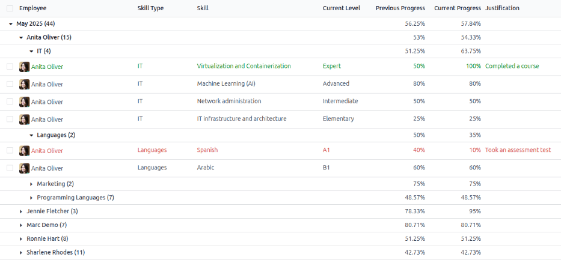
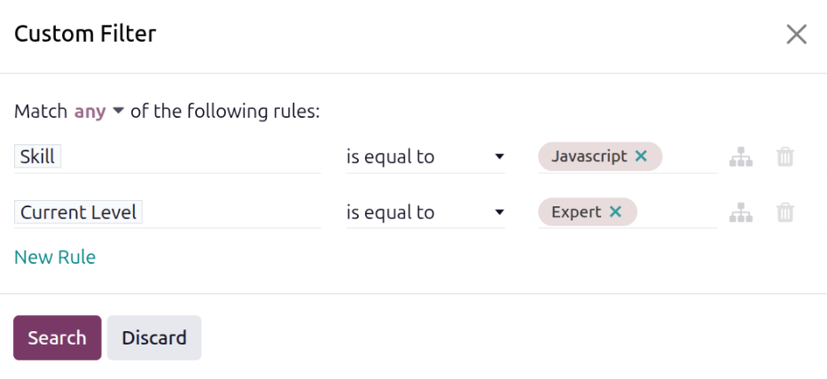
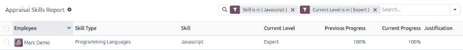

================
Skills evolution
================

In Odoo's **Appraisals** app, it is possible to view employees' skills as they progress over time in
the :ref:`Skills Evolution <appraisals/identify-skills-evolution>` report.

Managers can use this to see how the skill levels of their employees evolve over time, which
employees or skill types are progressing, and which employees have the highest performance in terms
of skill development.

The *Skills Evolution* report also provides the ability to :ref:`search for employees with specific
skills <appraisals/identify-skills>` at certain levels, which can be helpful for scenarios where
specific skills are required.

.. _appraisals/identify-skills-evolution:

Skills evolution report
=======================

To access this *Skills Evolution* report, navigate to :menuselection:`Appraisals app --> Reporting
--> Skills Evolution`.

Doing so reveals the *Skills Evolution* page. By default, all skills are grouped first by the month
of the :guilabel:`Date` the skill level was recorded, then by :guilabel:`Skill Type`, and lastly by
:guilabel:`Skill`.

.. important::
   The *Skills Evolution* report is based on the skills history of all active employees. During an
   appraisal, the skill levels set in the :guilabel:`Skills` tab are only applied to the employee's
   skills once the appraisal is marked as *Done*.

   Any skill level changes from appraisals with a status of *Draft* or *Ongoing* are **not**
   included in this report.

To view the specific details for a skill, expand the :guilabel:`Date`, then the :guilabel:`Skill
Type`, then the :guilabel:`Skill`. This displays a list of all the employees with that skill on
that date. Each line displays the following information:

- :guilabel:`Date`: The date on which the skill level was recorded.
- :guilabel:`Employee`: The name of the employee.
- :guilabel:`Skill Type`: The category the skill falls under.
- :guilabel:`Skill`: The specific, individual skill.
- :guilabel:`Average Progress (%)`: The percentage of competency achieved for the skill, based on
  the progress of the skill level. On grouped lines, the average progress of all the skills in the
  group is displayed.
- :guilabel:`Total Assessed`: The number of skills assessed. On grouped lines, the total number of
  skills in the group is displayed.

The report is also available as a :icon:`fa-area-chart` :guilabel:`(Graph)` view, which displays a
line chart of the :guilabel:`Average Progress (%)` over time, and as an :icon:`oi-view-pivot`
:guilabel:`(Pivot)` view.

This report can be modified to find specific information by adjusting the :ref:`filters
<search/filters>` and :ref:`groupings <search/group>` set in the search bar at the top.

.. _appraisals/identify-skills:

Use case: Identify employees with specific skills
=================================================

Since the *Skills Evolution* report organizes all skills by date, then skill type and skill, it can
be difficult to find employees with a specific skill at a certain level. To find these employees, a
custom filter must be used.

In this example, the report is modified to show employees with an expert level of Javascript
knowledge. As the report displays skill levels as progress percentages, the filter uses the
progress of the :guilabel:`Expert` level, which is `100` in this example. To view only those
employees, first remove all active groupings in the search bar.

Next, click the :icon:`fa-caret-down` :guilabel:`(Toggle Search Panel)` icon in the search bar, then
click :guilabel:`Custom Filter...` beneath the :icon:`fa-filter` :guilabel:`Filters` column to load
a *Custom Filter* pop-up window.

At the top of the pop-up window, first modify the :guilabel:`Match any` :icon:`fa-caret-down`
:guilabel:`of the following rules` sentence. Click the word :guilabel:`any` to change it to
:guilabel:`all`.

Next, using the drop-down menu in the first field, select :guilabel:`Skill`. Then, keep the second
field as-is (:guilabel:`is equal to`), and select :guilabel:`Javascript` for the third field.

Next, click :guilabel:`New Rule`, and another line appears. In this second line, select
:guilabel:`Average Progress (%)` for the first drop-down field, leave the second field as-is
(:guilabel:`is equal to`), then enter `100` in the third field.

Finally, click the :guilabel:`Search` button.

Now, only employees that have reached the :guilabel:`Expert` level for the skill
:guilabel:`Javascript` appear, along with the :guilabel:`Date` on which that level was recorded. To
see each employee only once, group the results by :guilabel:`Employee`.

Use case: Assess highest improvement
====================================

Another way to modify the *Skills Evolution* report is to compare the skill progress of employees
over a specific period of time.

It is possible to view the skills progress over a period of time, such as a specific quarter, or
month. Click the :icon:`fa-caret-down` :guilabel:`(Toggle Search Panel)` icon in the search bar,
then click :guilabel:`Custom Filter...` at the bottom of the :icon:`fa-filter` :guilabel:`Filters`
column, and a *Custom Filter* pop-up window appears.

Select :guilabel:`Date` for the first drop-down field, then select :guilabel:`after` for the second
drop-down field. Once :guilabel:`after` is selected, the current date populates the last field.
Modify the date so it is one day before the desired date range.

Next, click :guilabel:`New Rule`, and a second line appears with identical information. In this
second rule, click on the middle drop-down menu, and select :guilabel:`before`. Modify the last
field so the date is one day after the desired time period.

Once all the fields are properly formatted, click :guilabel:`Search`.

.. example::
   To compare employees' skill progress for the second quarter, click :guilabel:`Custom Filter...`
   at the bottom of the :icon:`fa-filter` :guilabel:`Filters` column.

   In the resulting *Custom Filter* pop-up window, select :guilabel:`Date` for the first drop-down
   field, then select :guilabel:`after` for the second drop-down field. Using the calendar selector,
   set the date to :guilabel:`03/31/2026`. Click :guilabel:`New Rule`, and select
   :guilabel:`before` in the middle field. Using the calendar selector, set the last field to
   :guilabel:`07/01/2026`, then click :guilabel:`Search`.

   .. image:: skills_evolution/custom-filter.png
      :alt: The Custom Filter pop-up with the parameters set.

To view the progress of each employee in further detail, click the :icon:`oi-view-pivot`
:guilabel:`(Pivot)` icon in the top-right corner. This presents a pivot table with the skills
grouped by date in the rows.

Click :guilabel:`Measures` :icon:`fa-caret-down`, and select :guilabel:`Average Progress (%)`. Then,
click :icon:`fa-plus-square` :guilabel:`Total` above the columns, and select :guilabel:`Employee`
from the resulting drop-down menu. This displays the average skill progress of each employee for
each date, making it possible to identify the employees whose skills improved the most.

.. example::
   In this example, the pivot table displays the average skill progress of each employee during
   the second quarter.

   .. image:: skills_evolution/largest-improvement.png
      :alt: The pivot table showing the skill progress for the second quarter.

.. seealso::
   - :doc:`Odoo essentials reporting <../../essentials/reporting>`
   - :doc:`../../essentials/search`
