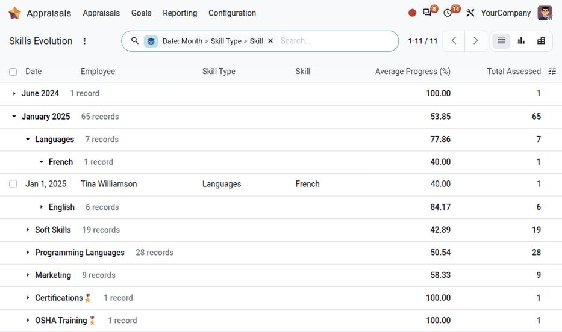
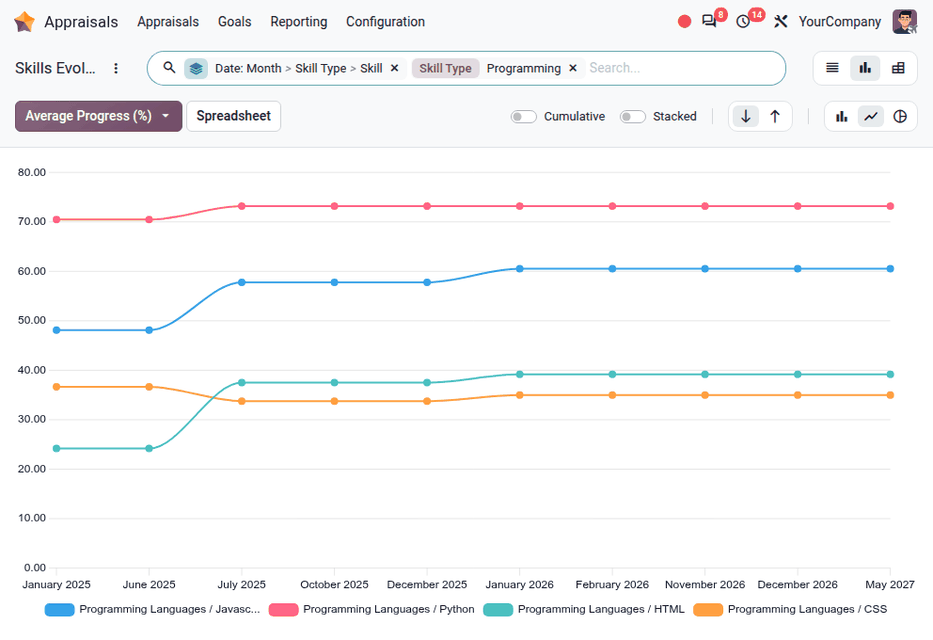
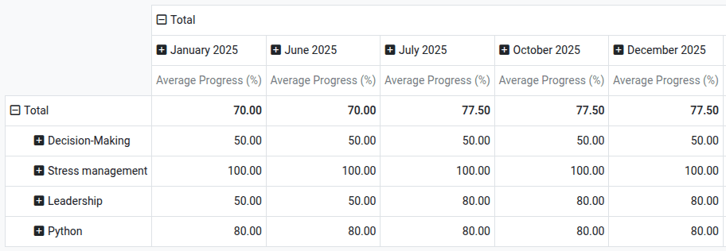

================
Skills evolution
================

In Odoo's **Appraisals** app, it is possible to view how employees' skills progress over time in
the :ref:`Skills Evolution <appraisals/identify-skills-evolution>` report.

Managers can use this report to see how the skills of their teams evolve, which skills improve the
most, and which ones need more training.

.. _appraisals/identify-skills-evolution:

Skills evolution report
=======================

To access the *Skills Evolution* report, navigate to :menuselection:`Appraisals app --> Reporting
--> Skills Evolution`.

The report is built from the skill history of the active employees, as recorded on their
:ref:`employee form <employees/skills>`. Each time a skill level changes for any employee, for
example when an appraisal is marked as done, a new snapshot date is added to the report. For each
snapshot date, the report lists the skill levels of all employees at that date.

By default, the report is displayed in a list view, grouped by month (:guilabel:`Date: Month`), then
by :guilabel:`Skill Type`, then by :guilabel:`Skill`. Each line displays the following information:

- :guilabel:`Date`: The date of the snapshot.
- :guilabel:`Employee`: The name of the employee.
- :guilabel:`Skill Type`: The category the skill falls under.
- :guilabel:`Skill`: The specific, individual skill.
- :guilabel:`Average Progress (%)`: The progress corresponding to the employee's skill level at that
  date. On grouped lines, this column displays the average progress of the group.
- :guilabel:`Total Assessed`: The number of employee skills included in the line or group.

The report is also available as a :icon:`fa-area-chart` :guilabel:`(Graph)` view, which displays
the average progress of each skill over time as a line chart, and as a :icon:`oi-view-pivot`
:guilabel:`(Pivot)` view.

This report can be modified to find specific information by adjusting the :ref:`filters
<search/filters>` and :ref:`groupings <search/group>` set in the search bar at the top. The
available groupings are :guilabel:`Department`, :guilabel:`Employee`, :guilabel:`Skill Type`,
:guilabel:`Skill`, and :guilabel:`Date`.

.. note::
   The report only displays the skills of the companies currently selected in the company
   selector.

.. _appraisals/skills-evolution-skill:

Use case: Follow the evolution of a skill type
==============================================

In this example, the report is used to see how programming skills evolved across the company.

First, click into the search bar, type `Programming`, then select :guilabel:`Search Skill Type for:
Programming` in the drop-down menu. Then, click the :icon:`fa-area-chart` :guilabel:`(Graph)` icon
in the top-right corner.

The line chart displays one line per skill, with the snapshot dates on the horizontal axis, and the
average progress of the employees for that skill on the vertical axis. A rising line indicates that
employees improved in that skill.

.. tip::
   To hide a skill from the chart, click its label in the legend beneath the chart. Click the label
   again to display it.

.. _appraisals/identify-skills:

Use case: Review the skills of an employee
==========================================

In this example, the report is used to review how the skills of a specific employee evolved, to
prepare their next appraisal.

First, remove the default groupings in the search bar. Then, type the name of the employee, such as
`Ronnie Hart`, and select :guilabel:`Search Employee for: Ronnie Hart` in the drop-down menu.

Next, click the :icon:`oi-view-pivot` :guilabel:`(Pivot)` icon in the top-right corner. Click the
:guilabel:`Measures` button, select :guilabel:`Average Progress (%)`, and deselect
:guilabel:`Count`. In the pivot table, click the :guilabel:`Total` row header, and select
:guilabel:`Skill`. Then, click the :guilabel:`Total` column header, select :guilabel:`Date`, then
:guilabel:`Month`.

The pivot table now displays the progress of each of the employee's skills for each snapshot
month, making it easy to spot which skills improved between two appraisals.

.. seealso::
   - :doc:`Odoo essentials reporting <../../essentials/reporting>`
   - :doc:`../../essentials/search`
