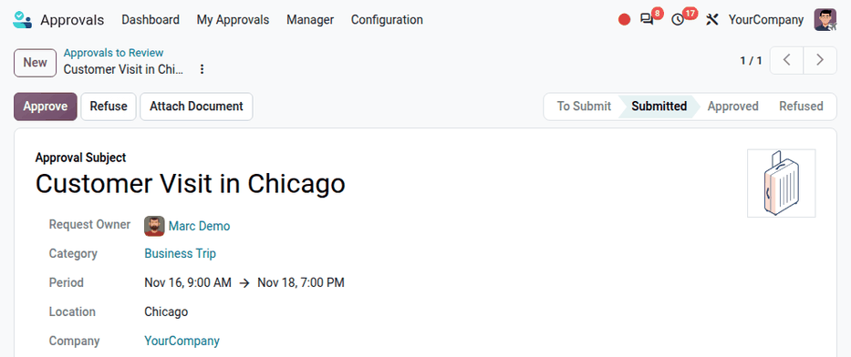
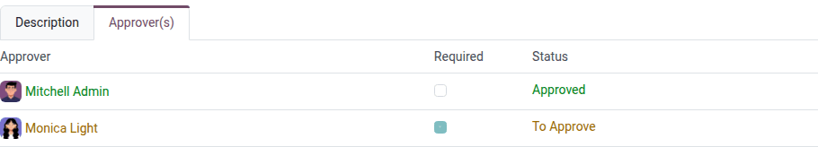
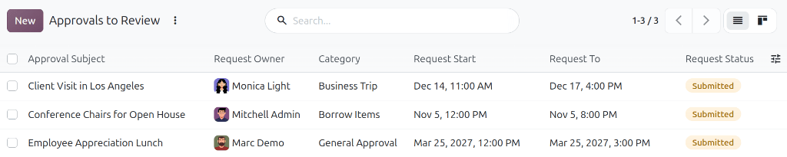
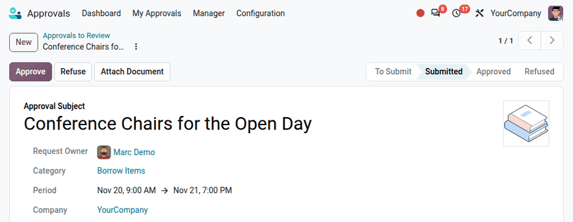
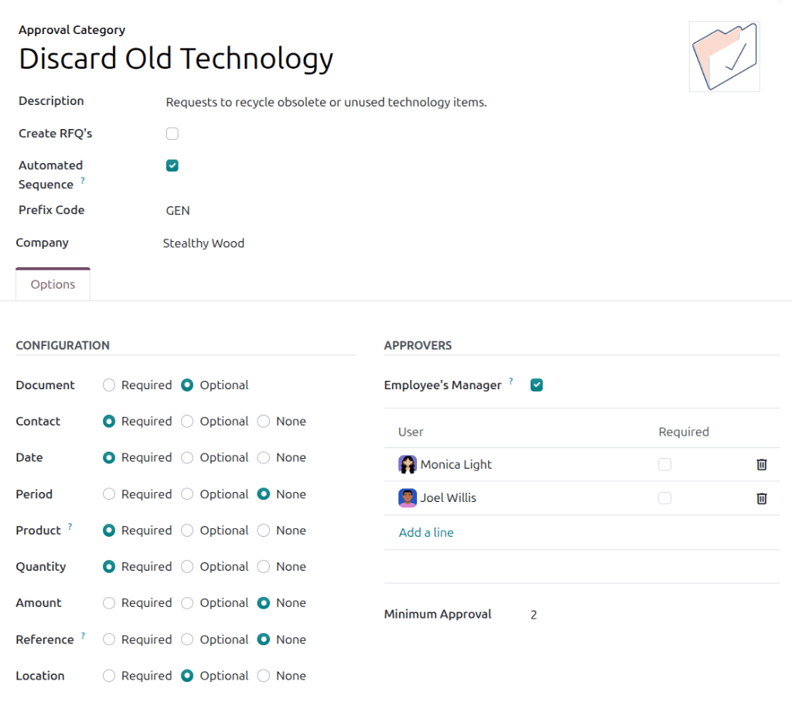

:show-content:

=========
Approvals
=========

The **Approvals** app in Odoo allows employees to make official requests for a variety of things,
allowing management the ability to review requests and then either approve or refuse them. This
keeps all requests in one centralized location, providing clear organization and transparency for
all requests.

.. _approvals/types:

Approval types
==============

When requesting an approval, the category, or *type*, must be specified. The following approval
categories are preconfigured:

- :guilabel:`Business Trip`: For requesting work-related travel.
- :guilabel:`Borrow Items`: For requesting physical items the company owns or sells, for a specified
  period of time.
- :guilabel:`General Approval`: For requests that do not fit in any of the other categories.
- :guilabel:`Contract Approval`: For requesting any type of external contract, excluding
  employment contracts.
- :guilabel:`Payment Application`: For requesting *prior approval* for company-related expenses.

  .. important::
     This approval type is **only** used when requesting approval *in advance* for an expense the
     company directly pays for. This category should **not** be used for expenses employees are
     seeking reimbursement for. That is done through the :doc:`Expenses app
     <../finance/expenses/log_expenses>`.

- :guilabel:`Car Rental Application`: For requesting a rental car.
- :guilabel:`Job Referral Award`: For requesting job referral awards that were earned but not
  completed through the :doc:`Referrals <referrals>` app.
- :guilabel:`Procurement`: Used for requesting work-related items such as office supplies, tools,
  etc.

When the *Approvals - Purchase* module is installed, an additional :guilabel:`Create RFQ's` category
is available, to request a quote for items from a vendor.

Approval categories can be modified, and new ones can be created, in :menuselection:`Approvals app
--> Configuration --> Approval Categories`. See :ref:`approvals/categories`.

.. _approvals/requests:

Approval requests
=================

The **Approvals** app dashboard displays a card for each approval category. To create a new
approval request, open the **Approvals** app, click the :guilabel:`New Request` button on the
approval category card that best fits the request, and a blank approval form loads. Fill out the
various sections and tabs, then click :guilabel:`Submit` to submit the request for approval.

.. tip::
   If the category is not immediately known, click the :guilabel:`New Request` button in the
   upper-left corner of the dashboard to open a generic request form. Once the
   :guilabel:`Category` is selected, the corresponding fields on the form appear.

The :guilabel:`To Review` button on each card displays the number of submitted requests of that
category waiting for the current user's approval. Click it to open these requests.

General information section
---------------------------

The top half of the form contains all of the general information regarding the request. Fill out the
following fields in the top half of the form:

.. note::
   All the fields listed below, except :guilabel:`Quantity`, appear on the form for the
   :guilabel:`General Approval` category. If a different :guilabel:`Category` is selected, some
   fields are hidden, according to the :ref:`category configuration <approvals/categories>`.

- :guilabel:`Approval Subject`: Enter a short title for the request, such as `Customer Visit in
  Chicago`. If the category uses an automated sequence, this field is filled automatically with a
  reference number when the request is saved.
- :guilabel:`Request Owner`: The person responsible for the approval request. The signed-in user
  populates this field by default.
- :guilabel:`Category`: The selected category appears in this field, but can be changed using the
  drop-down menu, as long as the request is not submitted.
- :guilabel:`Date`: Using the calendar selector, set the date and time the request is for. This
  field **only** appears if :guilabel:`Payment Application` or :guilabel:`General Approval` is
  selected for the :guilabel:`Category`.
- :guilabel:`Period`: Using the calendar selector, set the start and end dates and times for the
  request. This field **only** appears if :guilabel:`Business Trip`, :guilabel:`Borrow Items`,
  :guilabel:`Car Rental Application`, or :guilabel:`General Approval` is selected for the
  :guilabel:`Category`.
- :guilabel:`Location`: Enter the specific location the approval request is for. This field **only**
  appears if :guilabel:`Business Trip` or :guilabel:`General Approval` is selected for the
  :guilabel:`Category`.
- :guilabel:`Contact`: Select the point of contact for the request using the drop-down menu. The
  available options are from the **Contacts** app. This field **only** appears if
  :guilabel:`Contract Approval`, :guilabel:`Payment Application`, :guilabel:`Job Referral Award`, or
  :guilabel:`General Approval` is selected for the :guilabel:`Category`.
- :guilabel:`Quantity`: Enter the number of items being requested in this field. This field **only**
  appears if :guilabel:`Procurement` is selected for the :guilabel:`Category`. For categories with
  products, the quantity is set on each line of the *Products* tab instead.
- :guilabel:`Amount`: Enter the amount being requested. This field **only** appears if
  :guilabel:`Contract Approval`, :guilabel:`Payment Application`, :guilabel:`Procurement`, or
  :guilabel:`General Approval` is selected for the :guilabel:`Category`.
- :guilabel:`Reference`: Enter any relevant reference for the request in this field. This field
  **only** appears if :guilabel:`Contract Approval` or :guilabel:`General Approval` is selected for
  the :guilabel:`Category`.

If :ref:`properties <approvals/categories>` are configured for the selected category, they also
appear in this section.

Products tab
------------

If any configured products in the database are being requested, they are listed in the *Products*
tab. This tab **only** appears if :guilabel:`Borrow Items` or :guilabel:`General Approval` is
selected in the :guilabel:`Category` field (and :guilabel:`Create RFQ's`, if the *Approvals -
Purchase* module is installed).

To add a product, click :guilabel:`Add a line` and a blank line appears. Using the drop-down menu,
select the product being requested. Once selected, the product's purchase description, or its name,
populates the :guilabel:`Description` field. The :guilabel:`Quantity` is :guilabel:`1.00` by default, but can be
updated if necessary.

Description tab
---------------

The *Description* tab is where any information to clarify the request is entered. Add any relevant
information in this tab.

.. _approvals/approvers:

Approver(s) tab
---------------

The *Approver(s)* tab lists the people responsible for approving the request. The approvers
configured on the :ref:`approval category <approvals/categories>` populate this tab by default.

To add an approver, click :guilabel:`Add a line`, and a blank line appears. Using the drop-down menu,
select the desired user. Repeat for all other approvers. There is no maximum number of users for
this tab. Only internal users can be selected as approvers.

To indicate a user **must** approve the request, tick the checkbox in the :guilabel:`Required`
column.

As users are added, their :guilabel:`Status` remains :guilabel:`New`. Once the request is
submitted, the :guilabel:`Status` changes to :guilabel:`To Approve`, and each approver receives an
activity to approve the request. Approvers can approve the request in any order.

Attach documents
----------------

All approval requests include the option to attach relevant documents. To attach a document, click
the :guilabel:`Attach Document` button at the top of the page, and a file explorer window loads.
Navigate to the desired file, select it, then click :guilabel:`Open` to attach it. Multiple
documents can be selected and added at the same time.

Once attached, a :guilabel:`Documents` smart button appears at the top of the page, indicating how
many documents are attached. Additionally, the documents are listed in the chatter.

.. note::
   Some categories, such as :guilabel:`General Approval`, require at least one document: the
   request cannot be submitted until a document is attached.

.. _approvals/amanage:

Manage approvals
================

After requests are submitted, they must be approved by the approvers listed in the
:ref:`Approver(s) tab <approvals/approvers>`. To view approvals awaiting action, navigate to
:menuselection:`Approvals app --> Manager --> Approvals to Review`, and the *Approvals to Review*
dashboard loads. All approvals awaiting action by the user appear in a default list view.

.. note::
   Only *submitted* requests that the user is assigned as an approver for appear in the *Approvals
   to Review* dashboard. To view all requests, navigate to :menuselection:`Approvals app -->
   Manager --> All Approvals`. Requests created by the current user are listed in
   :menuselection:`Approvals app --> My Approvals --> My Requests`.

To approve or refuse a request, click the individual request on the *Approvals to Review* dashboard
and the individual request form loads. Requests can also be approved or refused directly from the
:guilabel:`Approval` activity displayed in the chatter.

To approve the request, click the :guilabel:`Approve` button on the individual approval request
form. The approver's :guilabel:`Status` changes to :guilabel:`Approved`, and the text appears green.
The request's status changes to :guilabel:`Approved` once all required approvers, and at least the
:guilabel:`Minimum Approval` number of approvers set on the category, have approved it.

To deny the request, click the :guilabel:`Refuse` button on the individual approval request form.
The approver's :guilabel:`Status` changes to :guilabel:`Refused`, and the text appears red. As soon
as one approver refuses the request, the request's status changes to :guilabel:`Refused`.

An approver who already approved or refused a request can click the :guilabel:`Withdraw` button to
cancel their decision. Their :guilabel:`Status` reverts to :guilabel:`To Approve`, and the request's
status is recomputed accordingly.

The request owner can click :guilabel:`Cancel` to cancel a submitted request, then :guilabel:`Back
To Draft` to modify and submit it again. Approved requests cannot be deleted, but can be archived.

.. tip::
   Users with the *Officer: Approve all requests* access right on the **Approvals** app can approve
   a request without waiting for the approvers. Select the request, click the :icon:`fa-cog`
   :guilabel:`Actions` button, then click :guilabel:`Force Approval`.

.. _approvals/categories:

Configure approval categories
=============================

To modify an approval category, or create a new one, navigate to :menuselection:`Approvals app -->
Configuration --> Approval Categories`. Click on a category to open it, or click :guilabel:`New` to
create a new one.

Fill out the following fields at the top of the form:

- :guilabel:`Approval Category`: The name of the category, displayed on the dashboard card.
- :guilabel:`Description`: A short description of the category.
- :guilabel:`Automated Sequence`: Tick this checkbox to generate the :guilabel:`Approval Subject` of
  the requests automatically. When ticked, enter the :guilabel:`Prefix Code` used in the generated
  references.
- :guilabel:`Company`: The company the category belongs to.

In the :guilabel:`Configuration` section of the *Options* tab, select whether each field of the
request form is :guilabel:`Required`, :guilabel:`Optional`, or not displayed (:guilabel:`None`):
:guilabel:`Document`, :guilabel:`Contact`, :guilabel:`Date`, :guilabel:`Period`,
:guilabel:`Product`, :guilabel:`Quantity`, :guilabel:`Amount`, :guilabel:`Reference`, and
:guilabel:`Location`. The :guilabel:`Document` option can only be :guilabel:`Required` or
:guilabel:`Optional`.

In the :guilabel:`Approvers` section, configure who approves the requests of this category:

- :guilabel:`Employee's Manager`: Tick this checkbox to add the manager of the request owner as a
  required approver of every request.
- Approvers list: Click :guilabel:`Add a line` to add a default approver, and tick the
  :guilabel:`Required` checkbox if their approval is mandatory.
- :guilabel:`Minimum Approval`: The number of approvals needed to approve a request. A warning
  appears if this number is greater than the number of default approvers.

To add custom fields to the requests of a category, open one of its requests, click the
:icon:`fa-cog` :guilabel:`Actions` button, then click :guilabel:`Edit Properties`. The new properties
appear on all the requests of this category.
