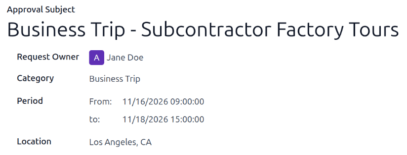
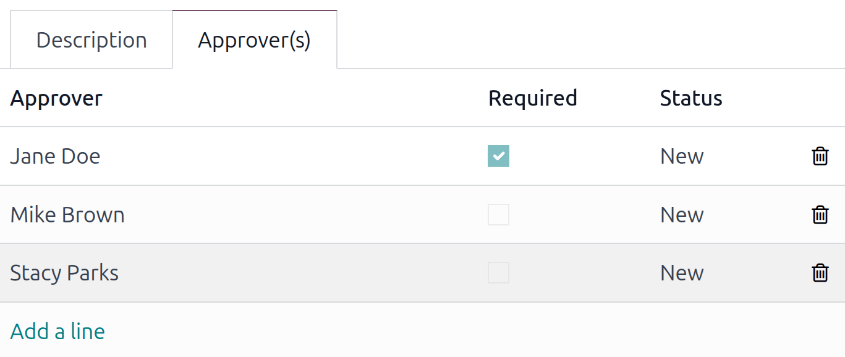
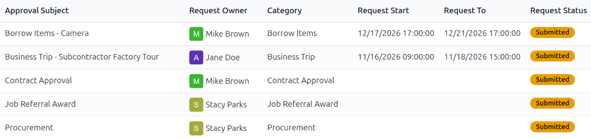
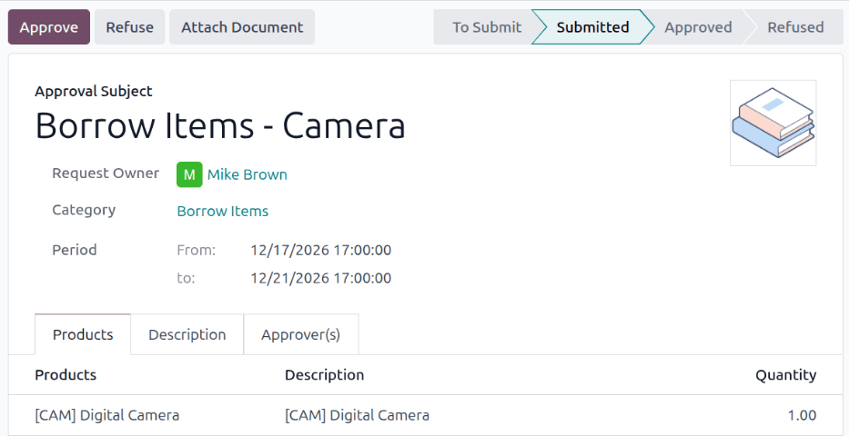

:show-content:

=========
Approvals
=========

The **Approvals** app in Odoo allows employees to make official requests for a variety of things,
allowing management the ability to review requests and then either approve or refuse them. This
keeps all requests in one centralized location, providing clear organization and transparency for
all requests.

.. _approvals/types:

Approval types
==============

When requesting an approval, the category, or *type*, must be specified. There are nine
preconfigured approval categories available to make requests for:

- :guilabel:`Business trip`: For requesting work-related travel.
- :guilabel:`Borrow Items`: For requesting physical items the company owns or sells, for a specified
  period of time.
- :guilabel:`General Approval`: For requests that do not fit in any of the eight other default
  types.
- :guilabel:`Contract Approval`: For requesting any type of external contract, excluding
  :doc:`employee contracts <payroll/contracts>`.
- :guilabel:`Payment Application`: For requesting *prior approval* for company-related expenses.

  .. important::
     This approval type is **only** used when requesting approval *in advance* for an expense the
     company directly pays for. This category should **not** be used for expenses employees are
     seeking reimbursement for. That is done through the :doc:`Expenses app
     <../finance/expenses/log_expenses>`.

- :guilabel:`Car Rental Application`: For requesting a rental car.
- :guilabel:`Job Referral Award`: For requesting job referral awards that were earned but not
  completed through the :doc:`Referrals <referrals>` app.
- :guilabel:`Procurement`: Used for requesting work-related items such as office supplies, tools,
  etc.
- :guilabel:`Create RFQ's`: Used for requesting a quote for items from a vendor.

.. _approvals/requests:

Approval requests
=================

To create a new approval request, open the **Approvals** app, click the :guilabel:`New Request`
button on the approval type card that best fits the request, and a blank approval form loads. Fill
out the various sections and tabs, then click :guilabel:`Submit` to submit the request for approval.

General information section
---------------------------

The top half of the form contains all of the general information regarding the request. Fill out the
following fields in the top half of the form:

.. note::
   All the fields listed below appear on the form for the :guilabel:`General Approval` category. If
   a different :guilabel:`Category` is selected, some fields are hidden.

- :guilabel:`Approval Subject`: This field is automatically populated with the selected approval
  type. Make any desired modifications to the default text to provide any additional context for the
  request.
- :guilabel:`Request Owner`: The person responsible for the approval request. The signed-in user
  populates this field by default.
- :guilabel:`Category`: The selected category appears in this field but can be changed using the
  drop-down menu.
- :guilabel:`Date`: Using the calendar selector, set the date and time the request is for. This
  field **only** appears if :guilabel:`Payment Application` or :guilabel:`General Approval` is
  selected for the :guilabel:`Category`.
- :guilabel:`Period`: Using the calendar selector, set the start and end dates for the request in
  the :guilabel:`From` and :guilabel:`to` fields. This field **only** appears if :guilabel:`Business
  Trip`, :guilabel:`Borrow Items`, :guilabel:`Car Rental Application`, or :guilabel:`General
  Approval` is selected for the :guilabel:`Category`.
- :guilabel:`Location`: Enter the specific location the approval request is for. This field **only**
  appears if :guilabel:`Business Trip` or :guilabel:`General Approval` is selected for the
  :guilabel:`Category`.
- :guilabel:`Contact`: Select the point of contact for the request using the drop-down menu. The
  available options are from the **Contacts** app. This field **only** appears if
  :guilabel:`Contract Approval`, :guilabel:`Payment Application`, :guilabel:`Job Referral Award`, or
  :guilabel:`General Approval` is selected for the :guilabel:`Category`.
- :guilabel:`Quantity`: Enter the number of items being requested in this field. This field **only**
  appears if :guilabel:`Procurement` is selected for the :guilabel:`Category`.
- :guilabel:`Amount`: Enter the amount being requested. This field **only** appears if
  :guilabel:`Contract Approval`, :guilabel:`Payment Application`, :guilabel:`Procurement`, or
  :guilabel:`General Approval` is selected for the :guilabel:`Category`.
- :guilabel:`Reference`: Enter any relevant reference for the request in this field. This field
  **only** appears if :guilabel:`Contract Approval` or :guilabel:`General Approval` is selected for
  the :guilabel:`Category`.

.. tip::
   Each approval type presents different fields on the approval form. This is because each *approval
   type* has its own required fields. If the *type* is not immediately known, click the
   :guilabel:`New Request` button at the top of the page to open a generic request for approval
   form. Once the :guilabel:`Category` is selected, the corresponding fields on the form appear.

Product tab
-----------

If any configured products in the database are being requested, they are listed in the *Products*
tab. This tab **only** appears if :guilabel:`Borrow Items`, :guilabel:`General Approval`, or
:guilabel:`Create RFQ's` is selected in the :guilabel:`Category` field.

To add a product, click :guilabel:`Add a line` and a blank line appears. Using the drop-down menu,
select the product being requested. Once selected, the product's configured :guilabel:`Description`
automatically populates that field. The :guilabel:`Quantity` is :guilabel:`1.00` by default, but can
be updated if necessary.

Description tab
---------------

The *Description* tab is where any information to clarify the request is entered. Add any relevant
information in this tab.

.. _approvals/approvers:

Approver(s) tab
---------------

The *Approvers(s)* tab is where the people responsible for approving the request are configured. To
add an approver, click :guilabel:`Add a line`, and a blank line appears. Using the drop-down menu,
select the desired user. Repeat for all other approvers. There is no maximum number of users for
this tab.

To indicate a user **must** approve the request, click the checkbox in the :guilabel:`Required`
column.

As users are added, their :guilabel:`Status` remains :guilabel:`New`.

Attach documents
----------------

All approval requests include the option to attach relevant documents. To attach a document, click
the :guilabel:`Attach Document` button at the top of the page, and a file explorer window loads.
Navigate to the desired file, select it, then click :guilabel:`Open` to attach it. Multiple
documents can be selected and added at the same time.

Once attached, a :icon:`fa-book` :guilabel:`Documents` smart button appears at the top of the page,
indicating how many documents are attached. Additionally, the documents are listed in the chatter.
If the screen is wide enough, the documents appear on the side of the screen.

.. _approvals/amanage:

Manage approvals
================

After requests are submitted, they must be approved by the required approvers listed in the
:ref:`Approver(s) tab <approvals/approvers>`. To view approvals awaiting action, navigate to
:menuselection:`Approvals app --> Manager --> Approvals to Review`, and the *Approvals to Review*
dashboard loads. All approvals awaiting action by the user appear alphabetically in a default list
view.

.. note::
   Only *submitted* requests that the user is assigned as an approver for appear in the *Approvals
   to Review* dashboard. All other requests remain hidden.

Requests must be individually approved from the approvals form. To approve a request, click the
individual request on the *Approvals to Review* dashboard and the individual request form loads.

To approve the request, click the :guilabel:`Approve` button on the individual approval request
form, and the status changes to :guilabel:`Approved`. As users approve the request, their
:guilabel:`Status` changes to :guilabel:`Approved` and the text appears green.

To deny the request, click the :guilabel:`Refuse` button on the individual approval request form,
and the status changes to :guilabel:`Refused`. When a user refuses a request, its :guilabel:`Status`
changes to :guilabel:`Refused` and the text appears red.

At any point, approval requests that are either :guilabel:`Approved` or :guilabel:`Refused` can
return to the :guilabel:`Submitted` stage by clicking the :guilabel:`Withdraw` button. The
:guilabel:`Status` for all approvers reverts to :guilabel:`To Approve`, and the text appears orange.
