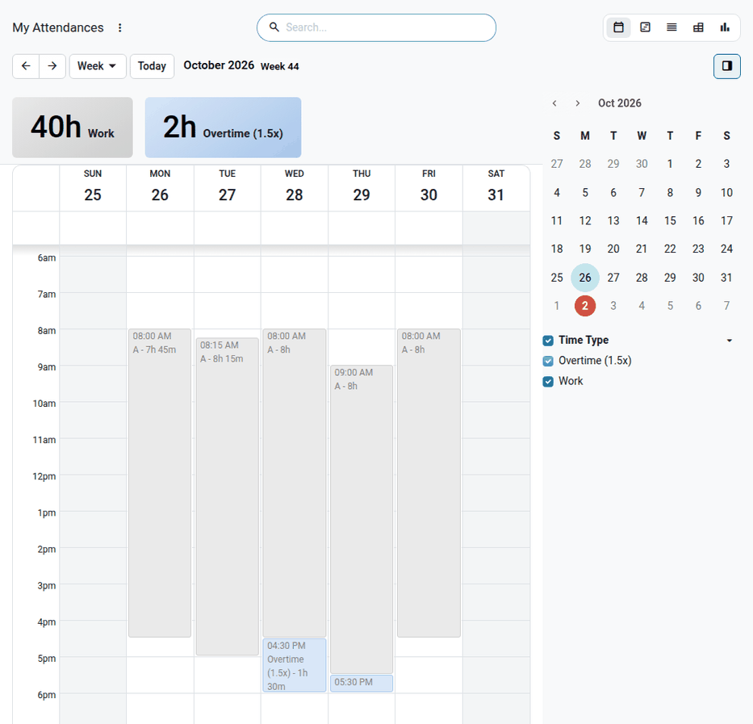
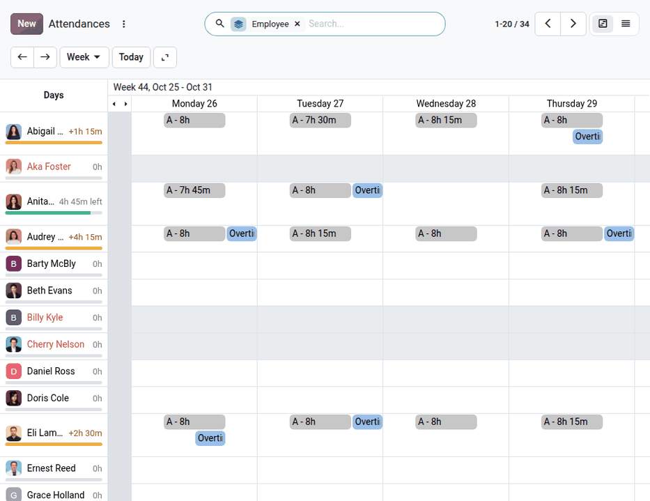
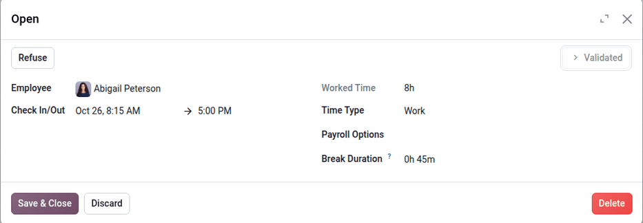
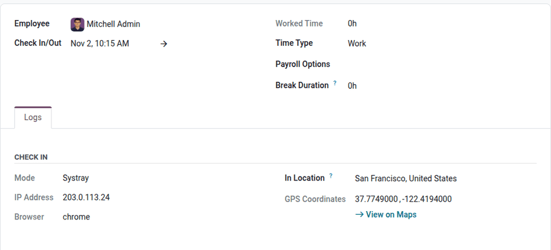

===============
Attendance logs
===============

Every check-in and check-out creates an attendance log. Employees can view their own logs, while
attendance officers and :ref:`approvers <attendances/approvers>` can view the logs of the employees
they manage.

.. _attendances/my-attendances:

My attendances
==============

When entering the **Attendances** application, the :guilabel:`My Attendances` dashboard is
presented by default for users who are allowed to record their own attendances. It is also
available at :menuselection:`Attendances app --> My Attendances`.

The dashboard displays the user's attendance logs (their check in and check out information) for
the current week, in a :icon:`calendar_today` :guilabel:`(Calendar)` view. Each log displays the
check in time, the :ref:`time type <payroll/work-entry-types>`, and the worked hours. The total of
the week, per time type (for example, :guilabel:`Work` and :guilabel:`Overtime (1.5x)`), is
displayed above the calendar. Use the :guilabel:`Time Type` filters in the side panel to show or
hide time types.

Click a log to view its details in a pop-up window. If the user is allowed to modify their
attendance, the details can be corrected directly in the pop-up window.

The dashboard can also be displayed in the :icon:`view_timeline` :guilabel:`(Gantt)`,
:icon:`reorder` :guilabel:`(List)`, :icon:`oi_view-pivot` :guilabel:`(Pivot)`, and
:icon:`bar_chart` :guilabel:`(Graph)` views.

.. _attendances/dashboard-overview:

Attendances dashboard
=====================

To view the attendance logs of all employees, navigate to :menuselection:`Attendances app -->
Management --> Dashboard`. The dashboard displays all employees in a :icon:`view_timeline`
:guilabel:`(Gantt)` view, segmented by hour, for the current day. Users who are :ref:`approvers
<attendances/approvers>` only see the employees they manage.

The periods during which an employee is not expected to work, according to the :ref:`working
schedule <employees/schedule>` and the contract set on their record, appear in gray. For example,
the whole row of an employee without an active contract during the displayed period is gray.

Employees populate the rows, alphabetically. Each attendance log displays the time type
abbreviation and the total hours, and its color depends on its time type. For example, the
attendances created by an :doc:`automatic rule <overtime>` for overtime appear in a different color
than regular work.

Beneath each employee's name, a color-coded bar indicates how many hours out of the total expected
hours the employee has logged for the period. The difference is displayed next to the employee's
name, for example `4h 45m left`, or `+1h 15m` if the employee worked more than expected. The bar
is green when the employee worked up to their expected hours, orange when they worked more, and red
when they worked twice their expected hours or more.

.. note::
   The name of an employee appears in red when the employee has no active contract during the
   displayed period.

The dashboard allows for changing the displayed time period, either :guilabel:`Day`,
:guilabel:`Week`, :guilabel:`Month`, :guilabel:`Quarter`, :guilabel:`Year`, or a custom time period.
To instantly return the dashboard to the present date, click the :guilabel:`Today` button at any
time.

.. _attendances/filters-groups:

Filters and groups
==================

Sometimes, attendance officers and managers need to view specific records, such as all automatic
checkouts, to determine which employees chronically forget to check out, or by department, to
determine which team is working the most overtime.

For these cases, use the search bar to select a :icon:`filter_alt_f` :guilabel:`Filters` or
:icon:`stacks_f` :guilabel:`Group By`, or combine both to present the desired information.

.. seealso::
   :doc:`../../essentials/search`

High-value filters
------------------

.. list-table::
   :header-rows: 1
   :stub-columns: 1
   :widths: 40 60

   * - Filter
     - Common use case
   * - Draft / Validated / Refused
     - View the attendances according to their :ref:`validation status
       <attendances/approve-refuse>`.
   * - At Work
     - Verify employees still on-site before shutting down the building for the night, or to perform
       a head count.
   * - Errors
     - View all errors to correct them prior to payroll processing.
   * - Automatically Checked-Out
     - Perform an audit to determine employees who chronically forget to check-out of work.
   * - Overtime Entries
     - View only the attendances created by :doc:`automatic rules <overtime>`, such as overtime.
       This filter is only available when the **Time Off** app is installed.
   * - Source Attendances
     - View only the attendances recorded by the employees, without the attendances created by
       automatic rules. This filter is only available when the **Time Off** app is installed.
   * - Date
     - Limit results to a specific pay-period or audit window.
   * - Ongoing Contract / No Active Contract
     - Find the attendances of employees without an active contract.
   * - Active/Archived Employees
     - Switch between current staff and former employees when auditing historical data.

Insightful groupings
--------------------

.. list-table::
   :header-rows: 1
   :stub-columns: 1
   :widths: 40 60

   * - Group by
     - When it helps
   * - Employee
     - Review individual attendance logs during a 1:1 meeting.
   * - Department
     - Compare staffing levels and working hours to determine over-working and under-working teams.
   * - Manager
     - Determine where attendance follow-up questions can be directed to for an employee.
   * - Method
     - Spot trends in attendance methods to potentially resolve hardware issues.
   * - Date (Day/Week/Month)
     - Identify absenteeism spikes or seasonal patterns.

.. _attendances/errors:

Attendance log details
======================

Odoo records both the time and location for every check-in and check-out, with fields varying by the
method used. These detailed attendance logs can confirm where an employee was on any given workday.
This can be useful for companies with hybrid working schedules, who may need to perform audits to
ensure proper compliance.

To view an attendance log, click on any attendance entry on the attendances dashboard, and the
attendance log appears in a pop-up window. This log displays a summary, including the following
information:

- :guilabel:`Employee`: The name of the employee.
- :guilabel:`Check In/Out`: The date and time the employee checked in, and the time the employee
  checked out. The check out time **only** appears if the employee has checked out.
- :guilabel:`Worked Time`: The amount of time the employee logged for that specific entry, minus the
  breaks, in an hour and minute format (HH:MM).
- :guilabel:`Time Type`: The :ref:`time type <payroll/work-entry-types>` of the attendance. By
  default, it is the :guilabel:`Attendance Work Entry Type` defined in the :ref:`settings
  <attendances/modes>`; attendances created by :doc:`automatic rules <overtime>` have the time type
  defined on the rule.
- :guilabel:`Payroll Options`: This field is only available when the **Payroll** app is installed.
  It displays the premium pay options applied to the attendance.
- :guilabel:`Break Duration`: The unpaid break time taken during the attendance, in an hour and
  minute format (HH:MM). The break duration is deducted from the :guilabel:`Worked Time`.

The status of the attendance (:guilabel:`Draft`, :guilabel:`Validated`, or :guilabel:`Refused`) is
displayed in the upper-right corner, and the buttons to :ref:`validate or refuse
<attendances/approve-refuse>` it in the upper-left corner.

.. _attendances/check-in-out-details:

Check in/check out details
--------------------------

Additional detailed check in and check out information for the attendance log is available to
**Attendances** app administrators. Click the :icon:`expand_content` :guilabel:`(Expand)` icon in
the upper-right corner of the attendance log, and the detailed record loads.

The following additional information appears for both the *Check In* and *Check Out* sections, in
the :guilabel:`Logs` tab of the expanded attendance log.

- :guilabel:`Mode`: The attendance submission method. The available options are:

  - :guilabel:`Systray`: The employee checked in or out :doc:`directly from the database
    <../attendances/check_in_check_out>`.
  - :guilabel:`Kiosk`: The employee checked in or out using an :ref:`attendance kiosk
    <attendances/kiosk-mode-entry>`.
  - :guilabel:`Manual`: The employee's manager or an **Attendances** app administrator
    :ref:`manually created the attendance record <attendances/create-records>`. This typically
    occurs when an employee forgets to check in or check out.
  - :guilabel:`Automatic Check-Out`: The employee was checked out automatically, according to the
    :guilabel:`Automatic Check-Out` :ref:`setting <attendances/modes>`.
  - :guilabel:`Technical`: The attendance was created by Odoo to record an absence, when the
    :guilabel:`Absence Management` :ref:`setting <attendances/modes>` is enabled.
  - :guilabel:`Biotime`: The attendance was created from a :doc:`BioTime <biotime_integration>`
    transaction. This option is only available when the BioTime integration is installed.

The following information is **only** recorded when the :guilabel:`Device & Location Tracking`
:ref:`setting <attendances/modes>` is enabled, for attendances that were not created manually:

- :guilabel:`IP Address`: The device's IP address used to check in or out.
- :guilabel:`Browser`: The web browser the employee used to check in or out.
- :guilabel:`In Location` / :guilabel:`Out Location`: The city and country, based on the GPS
  coordinates if available, or on the IP address.
- :guilabel:`GPS Coordinates`: The coordinates when the user checked in or out. To view the
  coordinates on a map, click the :icon:`east` :guilabel:`View on Maps` button beneath
  the GPS coordinates. This opens a map in a new browser tab, with the location pointed out.

.. note::
   When the :guilabel:`Take Pictures on Check-In` setting is enabled, the picture taken at check-in
   is posted in the chatter of the attendance log.

Attendance errors
=================

Entries that contain an error appear in red in the :icon:`reorder` :guilabel:`(List)` view of
the attendances dashboard. Use the :guilabel:`Errors` filter to display them.

An error occurs when an employee has checked in but not checked out within 24 hours, or when a
single check-in period exceeds 16 hours.

To fix the error, the attendance entry must be modified or deleted. Click on the entry to reveal a
pop-up containing the details for that particular entry. To modify the :guilabel:`Check In/Out`
information, click on the corresponding date, and a calendar selector appears. Click on the desired
date, then use the time selector beneath the calendar to select the specific time for the entry.
When the information is correct, click :guilabel:`Apply`.

When all the information on the pop-up is correct, click :guilabel:`Save & Close`. When the entry no
longer has an error, the entry no longer appears in red.

To delete an entry, click the red :guilabel:`Delete` button on the pop-up window instead of making
modifications to the entry.
