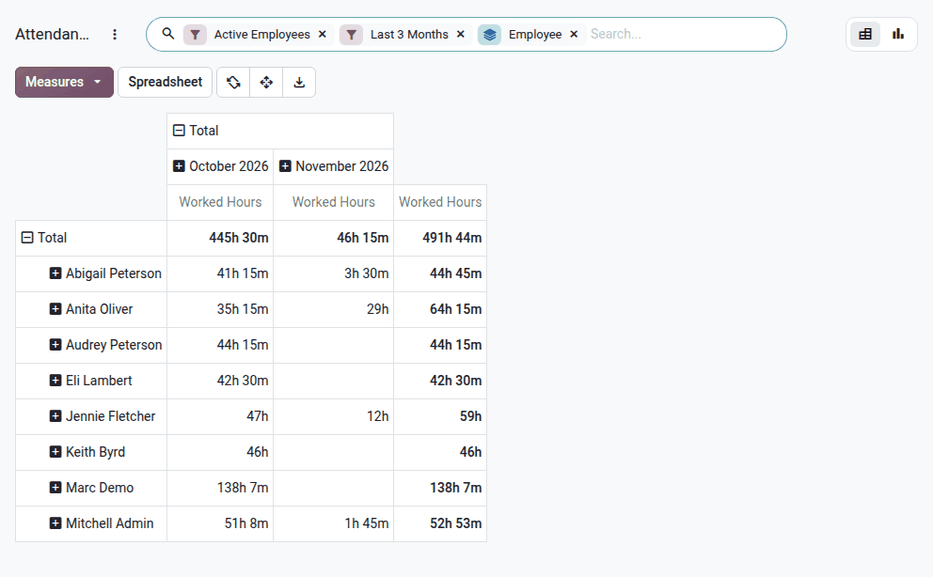

====================
Attendance reporting
====================

The **Attendances** app report helps managers find attendance issues with employees before they
become a problem. The report can give insights on trends by determining :ref:`which employees are
working more overtime <attendances/overtime>`, and who is :ref:`not working their full shifts
<attendances/absent>`.

View report
===========

To view the attendances report, navigate to :menuselection:`Attendances app --> Reporting -->
Attendances`. The default report displays attendance information for current employees over the
past three months, in a default :icon:`oi_view-pivot` :guilabel:`(Pivot)` view. The rows are
populated by employee, while the columns are populated by month.

The default measure is :guilabel:`Worked Hours`: the total logged time the employee worked for the
month, minus the breaks. Click the :guilabel:`Measures` :icon:`arrow_drop_down` button to add other
measures, such as the :guilabel:`Break Duration`.

To present different information, adjust the filters and groups in the same way as in the
:ref:`attendance dashboards <attendances/filters-groups>`. The report can also be displayed as a
:icon:`bar_chart` :guilabel:`(Graph)`.

.. _attendances/overtime:

Use case: monthly overtime
==========================

Overtime affects a company's bottom line, as most companies budget for employee salaries. When
salaries exceed the expected amount, companies may see a rise in overhead costs when salary budgets
are exceeded. This is why the attendance report is needed, to ensure no excessive overtime is
logged.

Overtime is recorded as separate attendances, created by the :doc:`automatic rules <overtime>` when
attendances are validated. To view the overtime by employee, open the attendances report, click
the search bar to open the search options, and select the :guilabel:`Overtime Entries` filter. This
filter is only available when the **Time Off** app is installed. The report then only displays the
hours created by the automatic rules, per employee and per month.

To view the overtime of a specific month, select it with the :guilabel:`Date` filter.

.. example::
   In the below example, the report displays the overtime logged by each employee in October. The
   employee with the highest total logged the most overtime.

   .. image:: attendance_reporting/overtime.png
      :alt: The attendances report, showing only overtime per employee and per month.

.. tip::
   To distinguish the different kinds of overtime (for example, time paid at 150% and at 200%),
   click :icon:`indeterminate_check_box` :guilabel:`Total` above the columns to collapse them. Then,
   click :icon:`add_box_f` :guilabel:`Total` again, and select :guilabel:`Time Type` in the
   :guilabel:`Custom Group` drop-down menu.

.. _attendances/absent:

Use case: absenteeism
=====================

Employees with missing hours have not worked their expected shifts. This can be from forgetting to
log in and out of work, or for working less hours than expected, without any approved time off.

To identify these employees, use the :doc:`Time Off Ledger <time_off_ledger>` report, which compares
the hours worked by each employee with their expected hours and their approved time off, day by day.
Switch to the :icon:`oi_view-pivot` :guilabel:`(Pivot)` view of the report, and keep only the
:guilabel:`Difference` measure. The employee who worked the least has the highest negative
:guilabel:`Difference`.

.. tip::
   To automatically record missing hours, enable the :guilabel:`Absence Management` :ref:`setting
   <attendances/modes>`, and create an :doc:`automatic rule <overtime>` that detects the time worked
   :guilabel:`Less than` the daily schedule.
