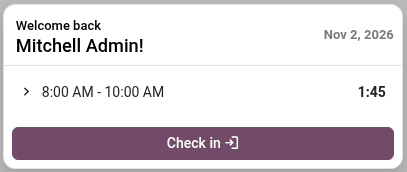
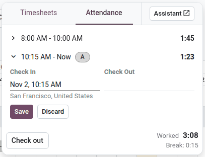

================
Check in and out
================

Odoo's **Attendances** application allows users, who are logged into the database, to check in and
out without needing to go into the **Attendances** application, or use a kiosk. For smaller
companies, where every employee is also a user, this feature may be useful.

.. note::
   This feature is only available when the :guilabel:`Attendances from Backend` :ref:`setting
   <attendances/modes>` is enabled. Otherwise, employees must check in and out with a :doc:`kiosk
   <kiosks>`.

A user can check in and/or out on the main database Odoo dashboard, or while inside any application.
To do so, in the upper-right corner of the top main header menu, which is always visible regardless
of what application the user is in, a :icon:`fa-circle` :guilabel:`(red circle)` or
:icon:`fa-circle` :guilabel:`(green circle)` is visible. Click on the colored circle to reveal the
attendance widget, enabling the user to check in or out.

.. _attendances/check-in:

Check in
========

If the attendance widget circle is red, this indicates the user is not currently checked in. Click
the :icon:`fa-circle` :guilabel:`(red circle)`, and the attendance widget appears. The widget
displays a welcome message with the user's name and the current date, the attendances already
logged for the day (if any), and a :guilabel:`Check in` :icon:`oi-login` button.

         button.

Click the :guilabel:`Check in` :icon:`oi-login` button to check in. The :icon:`fa-circle`
:guilabel:`(red circle)` in the top menu changes to green, and the button changes to a
:guilabel:`Check out` :icon:`oi-logout` button.

Depending on the :ref:`settings <attendances/modes>`, additional information is recorded when
checking in:

- :guilabel:`Device & Location Tracking`: The **Attendances** app logs the location details for the
  user, including the IP address, browser, and GPS coordinates. The user's browser asks for
  permission to access their location. If no valid location can be retrieved, a pop-up window asks
  the user to confirm the check in anyway, by clicking :guilabel:`Proceed Anyway`.
- :guilabel:`Take Pictures on Check-In`: The device's camera opens in the widget, and a picture of
  the user is taken when they check in. The picture is posted in the chatter of the attendance
  record. If the camera is not available, the check in is recorded without a picture, and a
  notification informs the user.

Click anywhere on the screen to close the attendance widget.

Review the day's attendances
============================

Each check in creates a session in the attendance widget, displaying the check in and check out
times, the :ref:`time type <payroll/work-entry-types>` abbreviation, and the duration of the
session. An ongoing session ends with :guilabel:`Now`.

Click a session to expand it and view the :guilabel:`Check In` and :guilabel:`Check Out` details,
including the location if it was recorded. If the user is allowed to modify the attendance, the
:guilabel:`Check In` and :guilabel:`Check Out` times (and the :guilabel:`Break` duration, if
:guilabel:`Break Management on Checkout` is enabled) can be edited directly in the widget. Click
:guilabel:`Save` to record the changes, or :guilabel:`Discard` to cancel them.

.. note::
   Users with the *Self Attendance Edit* :ref:`access right <attendances/access-rights>` can modify
   their own attendances. When :ref:`attendances must be validated <attendances/modes>`, validated
   attendances can no longer be modified by the employee.

When more than one session is logged for the day, the :guilabel:`Worked` total (and the
:guilabel:`Break` total, if break management is enabled) is displayed next to the button.

.. tip::
   When the **Timesheets** app is installed, the widget displays two tabs: :guilabel:`Timesheets`,
   to record the time spent on tasks, and :guilabel:`Attendance`, which displays the sessions
   described above.

Check out
=========

To check out, click the :guilabel:`Check out` :icon:`oi-logout` button. The :icon:`fa-circle`
:guilabel:`(green circle)` in the top menu changes to red, and the session displays its check out
time and duration.

When the user checks out from the database, the **Attendances** app logs the location details for
the user, if :guilabel:`Device & Location Tracking` is enabled and the user grants permission.

.. important::
   If the :guilabel:`Single Check-In Attendance System` :ref:`setting <attendances/modes>` is
   enabled, employees cannot check out from the widget: they are checked out automatically, and the
   message `You've already checked in.` appears if they try to check out.

.. tip::
   The number of times a user can check in and check out is unlimited. Each time an employee checks
   in and out, the information is stored and appears on the **Attendances** dashboards.
