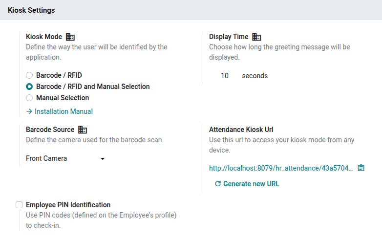
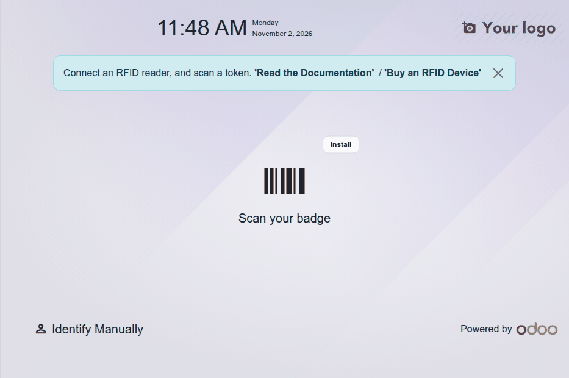
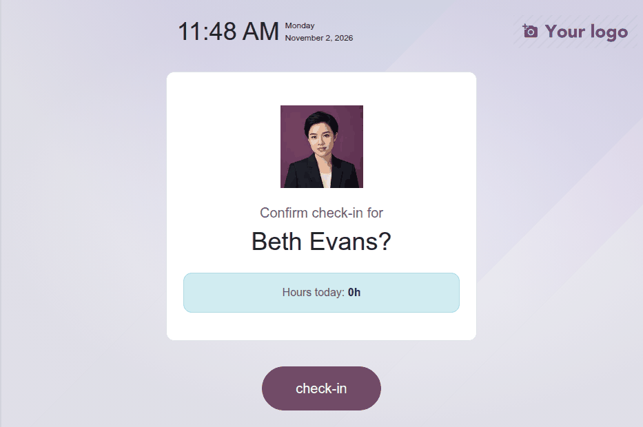
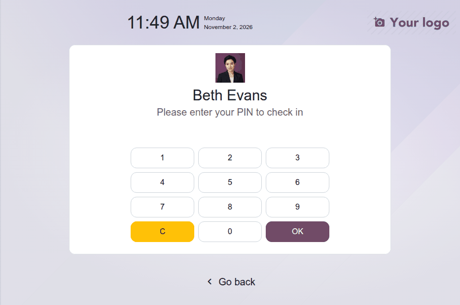
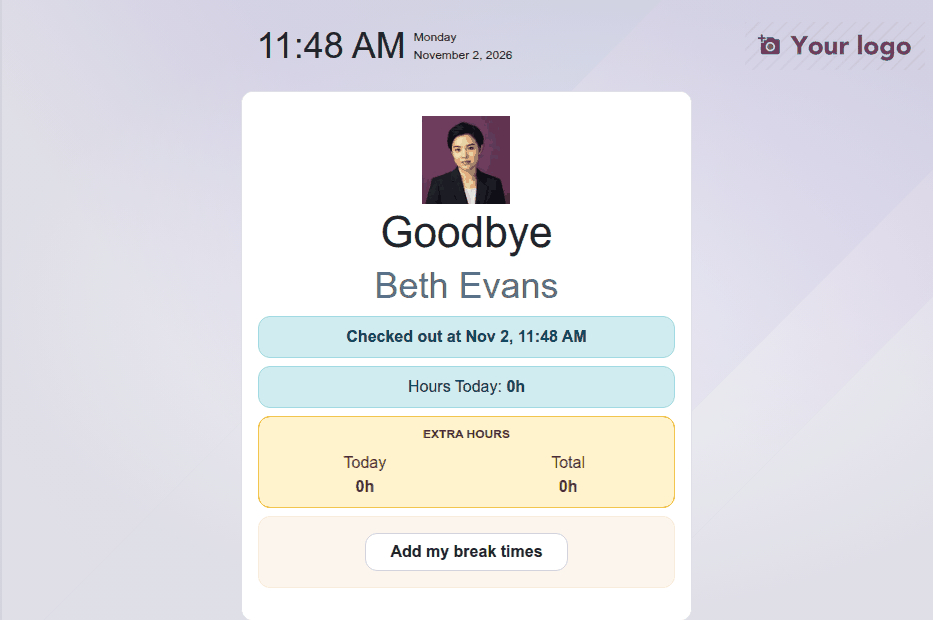

======
Kiosks
======

Odoo's **Attendances** app allows employees to check in and out of work directly from the database
or a kiosk.

A kiosk is a :doc:`dedicated device <hardware>` (a PC, tablet, or mobile phone) for employees to use
when they check in and out.

Kiosks are needed for employees who do **not** have access to the database.

Only employees with access to the Odoo database can check in and out from the **Attendances** app,
and they are referred to as *users*.

.. important::
   If employees :ref:`check in and out <attendances/kiosk-mode-entry>` using a badge or an RFID,
   then an :doc:`accessible device <hardware>` in :ref:`Kiosk Mode <attendances/kiosk-mode>`
   **must** be available in order to use these two methods.

Configuration
=============

To use kiosks in the **Attendances** application, navigate to :menuselection:`Attendances app -->
Configuration --> Settings`, and configure the :ref:`Kiosk Mode <attendances/kiosk-mode>` and the
other :ref:`attendances/kiosk-settings`.

Once all desired settings have been configured, click the :guilabel:`Save` button on the
:guilabel:`Settings` page to activate and enable them.

.. _attendances/kiosk-mode:

Kiosk mode setting
------------------

Determine how an employee checks in at a kiosk, either by searching for their name
(:guilabel:`Manual Selection`), scanning an employee ID or key fob (:guilabel:`Barcode / RFID`), or
both.

In the :guilabel:`Kiosk Settings` section of the settings page, select the desired option for the
:guilabel:`Kiosk Mode` :icon:`business` field: :guilabel:`Barcode / RFID`, :guilabel:`Barcode
/ RFID and Manual Selection`, or :guilabel:`Manual Selection`.

.. note::
   The **Barcode** application **does not** need to be installed to use one of the Barcode/RFID
   settings.

.. _attendances/kiosk-settings:

Kiosk settings
--------------

The other settings in the :guilabel:`Kiosk Settings` section determine how employees check in and
out with kiosks.

- :guilabel:`Display Time` :icon:`business`: Determine how many seconds a check-in/check-out
  confirmation message remains on the kiosk screen before returning to the main check-in screen.
- :guilabel:`Barcode Source` :icon:`business`: This setting appears **only** if one of the two
  *Barcode / RFID* options is selected for the :ref:`Kiosk Mode <attendances/kiosk-mode>` setting.

  Select how barcodes are scanned at the kiosk from the drop-down menu. Barcodes can be scanned with
  a dedicated :guilabel:`Scanner`, or with a device's :guilabel:`Front Camera` or :guilabel:`Back
  Camera`.
- :guilabel:`Attendance Kiosk Url`: Odoo generates a unique web address (URL) to use a device as a
  kiosk, without having to sign in to the Odoo database. When setting up a kiosk device, navigate to
  this unique web address in a web browser to present the **Attendances** app kiosk. Click the
  :icon:`assignment` :guilabel:`(copy)` icon to copy the URL.

  .. important::
     These kiosk URLs are **not** secured with any type of access code. Anyone who has the URL can
     access the **Attendances** app kiosk. If the URL is compromised for any reason, such as in the
     event of a security breach, click :icon:`refresh` :guilabel:`Generate new URL`, located
     beneath the link, to generate a new URL and update the kiosk accordingly.

- :guilabel:`Employee PIN Identification`: Tick this checkbox to require employees to use a unique
  PIN to check in. PINs are configured on each individual employee record. Refer to the :ref:`new
  employee documentation <employees/hr-settings>` for more information on setting up PINs. This
  setting is hidden when the :guilabel:`Kiosk Mode` is set to :guilabel:`Barcode / RFID`.

The following settings, in the :guilabel:`Attendance Rules & Enforcement` section, also affect
kiosks:

- :guilabel:`Take Pictures on Check-In` :icon:`business`: If the kiosk device has a camera, a
  picture of the employee is taken when they check in.
- :guilabel:`Break Management on Checkout` :icon:`business`: After checking out, employees can
  enter the total duration of their breaks. Refer to :ref:`attendances/confirmation`.

.. _attendances/enable-kiosk-mode:

Kiosk mode
==========

Entering *Kiosk Mode* is **only** available for users with specific :ref:`access rights
<attendances/access-rights>`.

*Kiosk Mode* can be activated in two different ways:

#. Navigate to the :menuselection:`Attendances app`, and click :guilabel:`Kiosk Mode` in the top
   menu. The device then signs out of Odoo and enters *Kiosk Mode*.
#. Navigate to :menuselection:`Attendances app --> Configuration --> Settings`. In the
   :guilabel:`Kiosk Settings` section, use the link in the :guilabel:`Attendance Kiosk Url` field to
   open *Kiosk Mode* on any device.

.. important::
   As a security measure, once a device is in *Kiosk Mode*, it is not possible to go back into the
   database without signing back in.

The kiosk loads, displaying the current date and time, along with the following banner at the top:
:guilabel:`Connect an RFID reader, and scan a token. 'Read the Documentation' / 'Buy an RFID
Device'`.

Click the text link :guilabel:`Read the Documentation` to open the :doc:`corresponding documentation
<../attendances/hardware>` in a new tab. Click the text link :guilabel:`Buy an RFID Device` to open
a web search for RFID readers in a new tab. Close either tab to return to the kiosk.

At the end of the banner, a :icon:`close` :guilabel:`(Close)` icon appears. Click the
:icon:`close` :guilabel:`(Close)` icon to close the banner. The banner no longer appears on that
device.

.. tip::
   The kiosk can be installed as an application on the device. Click the :guilabel:`Install` button
   on the kiosk screen, and follow the browser's instructions. This button is only displayed when
   the :guilabel:`Kiosk Mode` includes :guilabel:`Barcode / RFID`.

To exit *Kiosk Mode*, either close the tab in the web browser or return to the main log-in screen of
Odoo.

.. _attendances/kiosk-mode-entry:

Check in and out with a kiosk
=============================

Badge
-----

To check in or out using a badge, tap the :icon:`barcode` :guilabel:`Scan your badge` image in
the center of the kiosk.

Then, scan the barcode on the badge using the method configured in the :ref:`Kiosk Settings
<attendances/kiosk-settings>` section of the configuration menu.

Once the barcode is scanned, the employee is checked in or out, and a :ref:`confirmation message
<attendances/confirmation>` appears with all the information.

RFID
----

To check in or out using an RFID key fob, scan the fob with an RFID reader.

Once scanned, the employee is either checked in or checked out, and a :ref:`confirmation message
<attendances/confirmation>` appears with all the information.

Manually
--------

Users who do not have a scannable badge or an RFID fob can manually check in and out at a kiosk.

Tap the :icon:`person` :guilabel:`Identify Manually` button on the kiosk, and a screen appears
with all the employees who can be checked in or out. Each employee card indicates the employee's
current status (for example, :guilabel:`Absent`). Tap on a person to select them.

To find a specific person, either:

- Search: Tap into the search bar and enter the desired person's name. As the name is typed,
  matching results are displayed on the screen.
- By department: Tap on any desired selection in the department section, located on the left side of
  the screen, to **only** view employees from that specific department. The number at the end of
  each listed department represents how many employees that department has.

If the :guilabel:`Employee PIN Identification` setting is disabled, a confirmation screen appears,
displaying the employee's name and the hours already logged for the day. Tap the
:guilabel:`check-in` (or :guilabel:`check-out`) button to confirm, and a :ref:`confirmation message
<attendances/confirmation>` appears.

PIN
~~~

If the :guilabel:`Employee PIN Identification` checkbox was ticked in the :ref:`Kiosk Settings
<attendances/kiosk-settings>` section of the configuration menu, the employee is prompted to enter a
PIN when manually checking in or out.

After the employee is selected, a number pad appears with a message. When checking in,
:guilabel:`Please enter your PIN to check in` appears above the numbers. When checking out,
:guilabel:`Please enter your PIN to check out` appears above the numbers.

Tap in the PIN using the number pad, then tap :guilabel:`OK` when done. The employee is then checked
in or out, and a :ref:`confirmation message <attendances/confirmation>` appears.

.. _attendances/confirmation:

Confirmation message
--------------------

When an employee checks in or out, a confirmation message appears, with all the check-in or
check-out information.

When checking in, the :guilabel:`Welcome` message appears, along with the employee's name and the
check-in time. If the employee has already checked in and out that day, an :guilabel:`Hours
Previously Today` message also appears, showing the total hours logged earlier.

When checking out, :guilabel:`Goodbye` appears, as well as the check-out time. Beneath the message
is an :guilabel:`Hours Today` field, with the total hours and minutes logged for the day. When
overtime was recorded that day, an :guilabel:`Extra hours` section displays the overtime logged
:guilabel:`Today` and in :guilabel:`Total`.

If the :guilabel:`Break Management on Checkout` setting is enabled, an :guilabel:`Add my break
times` button appears when checking out. Tap it, enter the total duration of the breaks taken
during the attendance, in minutes, then tap :guilabel:`Confirm`. The break duration is deducted
from the worked hours of the attendance.

Beneath the message is a :guilabel:`Next` button. To exit the screen before the preset time in the
kiosk, tap the :guilabel:`Next` button.
