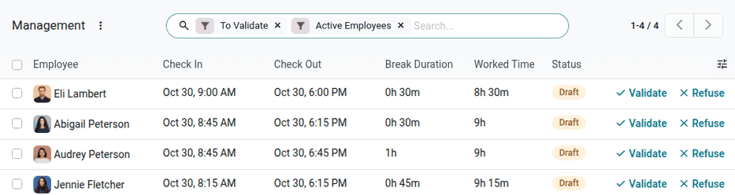
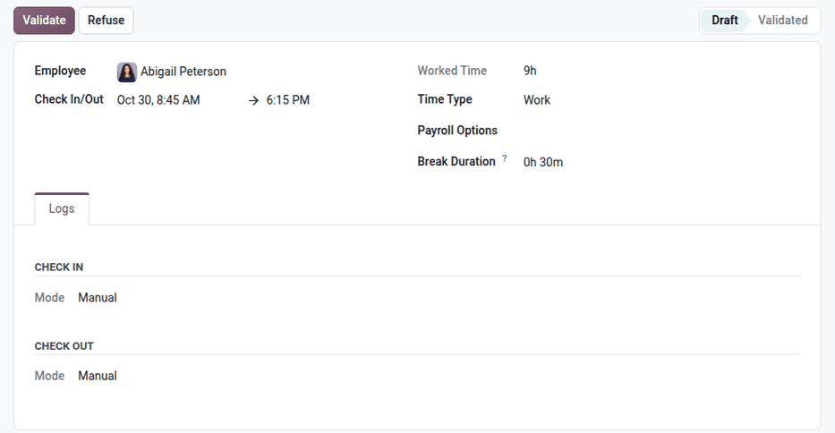
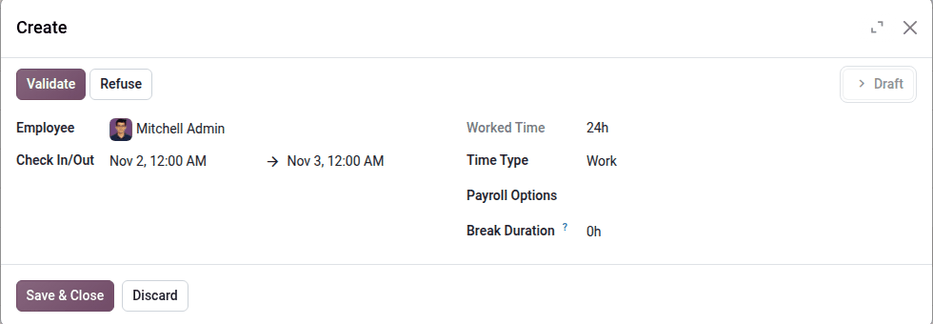

===========================
Work approvals and overtime
===========================

Odoo's **Attendances** app requires management oversight in order to ensure all logged attendances
are correct, especially overtime hours and incomplete shifts.

Attendances have one of the following statuses:

- :guilabel:`Draft`: The attendance is recorded, but not yet validated. Draft attendances are
  **not** taken into account by the :doc:`automatic rules <overtime>`, and are not used to compute
  the employee's pay.
- :guilabel:`Validated`: The attendance is approved. The automatic rules apply to it, for example to
  compute overtime.
- :guilabel:`Refused`: The attendance is rejected, and is not taken into account.

Whether attendances must be validated by an officer depends on the :guilabel:`Attendance
Validation` :ref:`setting <attendances/modes>`. When it is set to :guilabel:`Worked days are
automatically approved`, all attendances are validated as soon as they are recorded.

.. _attendances/dashboard:

Attendances to validate
=======================

All attendance records that require approval are managed from a centralized list. To access it,
navigate to :menuselection:`Attendances app --> Management --> Attendances`.

The list only displays completed attendance records (with a check out). By default, it is also
limited to the attendances of current employees that need to be validated, with the
:guilabel:`To Validate` and :guilabel:`Active Employees` filters in the search bar. Remove the
:guilabel:`To Validate` filter, or select the :guilabel:`Validated` or :guilabel:`Refused` filter,
to view the other attendances.

Each attendance record displays the following information:

- :guilabel:`Employee`: The name of the employee.
- :guilabel:`Check In`: The date and time the employee checked in.
- :guilabel:`Check Out`: The date and time the employee checked out.
- :guilabel:`Break Duration`: The unpaid break time taken during the attendance.
- :guilabel:`Worked Time`: The number of worked hours the employee logged, minus the breaks.
- :guilabel:`Status`: The status of the attendance.

.. _attendances/approve-refuse:

Validate or refuse attendances
==============================

Attendance records can be validated and refused directly from the list. At the far-right of each
record, :icon:`check` :guilabel:`Validate` and :icon:`close` :guilabel:`Refuse` buttons
appear. Click the corresponding button to either validate or refuse the logged attendance record.
To process several records at once, tick the checkbox of each record, click the :icon:`settings_f`
:guilabel:`Actions` button, and select :guilabel:`Validate` or :guilabel:`Refuse`.

It is also possible to click into an attendance record to view the details, and modify the check in
and check out times or the break duration before validating it. Click :guilabel:`Validate` or
:guilabel:`Refuse` at the top of the form.

Once an attendance is validated, the :doc:`automatic rules <overtime>` apply to it. For example, if
the employee worked more than their schedule, the overtime is recorded in a separate attendance.
When the **Time Off** app is installed, it is listed in the :guilabel:`Rules Outputs` tab of the
validated attendance.

When an attendance is refused, the attendances created from it by the automatic rules are refused as
well. To reconsider a refused attendance, click :guilabel:`Reset to Draft`.

.. note::
   Occasionally, verifying an employee's location when checking-in may be needed. The method the
   employee checked-in to work is found on the individual record, in the :guilabel:`Mode` field of
   the :guilabel:`Logs` tab. This tab is only visible to **Attendances** app administrators.

   The :guilabel:`Mode` field is not modifiable, as it only logs the method the attendance record
   was created. Refer to :ref:`attendances/check-in-out-details` for the possible options.

Overtime and time off
=====================

Overtime is not approved separately from the attendance: it is computed by the :doc:`automatic
rules <overtime>` when the attendance is validated. To pay overtime or convert it to time off,
configure the rules accordingly:

- To pay overtime at a specific rate, set the :guilabel:`Set Excess to` field of the rule to an
  overtime time type, such as :guilabel:`Overtime (1.5x)`.
- To convert overtime to time off, set the :guilabel:`Allocate` percentage and the time off type of
  the rule. This field is only available when the **Time Off** app is installed. The time off is
  added to the employee's balance in the **Time Off** app as soon as the attendance is validated.

.. _attendances/create-records:

Create attendance records
=========================

When necessary, users with the required :ref:`access rights <attendances/access-rights>` are able to
create attendance records manually in the **Attendances** app. Some situations requiring this is
when employees forget to check in and out for shifts.

To add a missing attendance record, navigate to :menuselection:`Attendances app --> Management -->
Dashboard`. Click the :guilabel:`New` button in the upper-left corner to open a *Create* pop-up
window. Enter the following information on the form, then click :guilabel:`Save & Close`:

- :guilabel:`Employee`: Select the employee the record is being created for. The signed-in user
  populates this field, by default.
- :guilabel:`Check In/Out`: Using the calendar, select the check in date and time, and the check out
  date and time, then click :guilabel:`Apply`. By default, the current date is selected, from
  `12:00 AM` to `12:00 AM` the following day.
- :guilabel:`Worked Time`: This field is automatically populated with the difference from the
  selected check in and check out times, minus the break duration. This field **cannot** be
  modified.
- :guilabel:`Time Type`: The :ref:`time type <payroll/work-entry-types>` of the attendance. By
  default, the :guilabel:`Attendance Work Entry Type` defined in the settings is selected.
- :guilabel:`Break Duration`: Enter the unpaid break time taken during the attendance, in an
  `HH:MM` format.

.. tip::
   To open the employee records directly from the **Attendances** app, navigate to
   :menuselection:`Attendances app --> Management --> Employees`.
