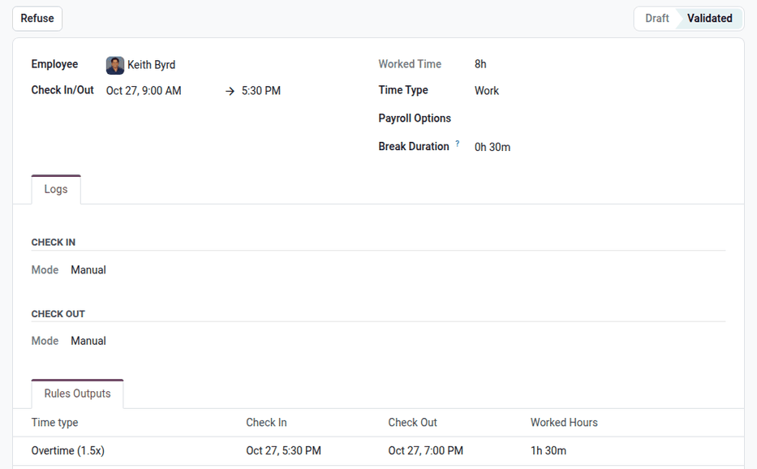
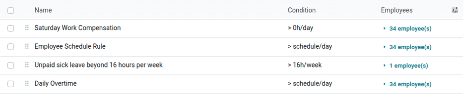
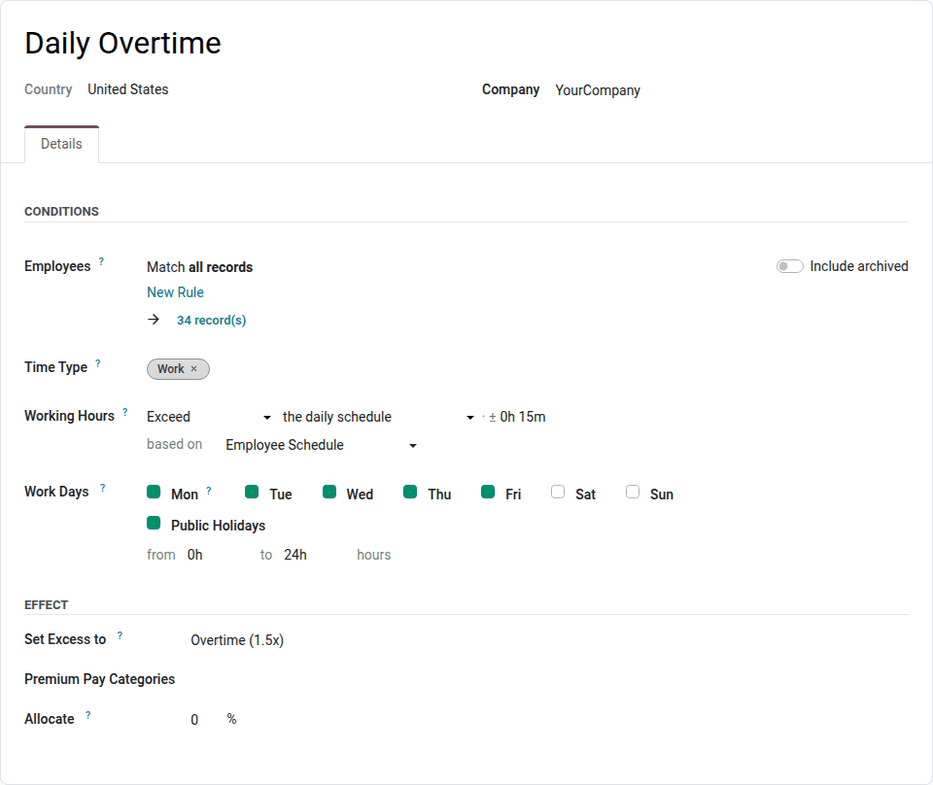
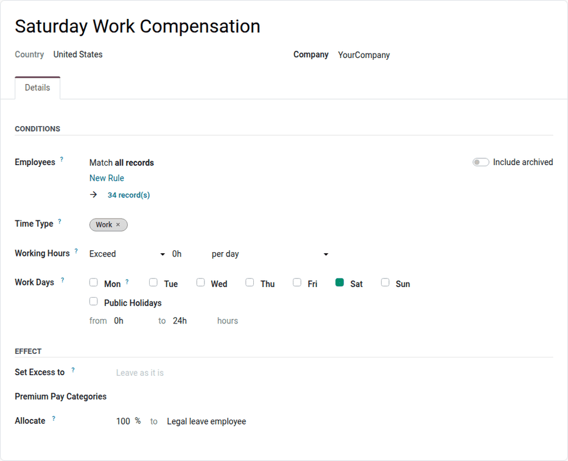

============================
Overtime and automatic rules
============================

Odoo's **Attendances** app uses *automatic rules* to detect overtime (extra hours) and undertime
(missing hours). A rule compares the time an employee works on a day or a week with what is
expected, and decides what happens with the difference: the extra time can be classified with a
different :ref:`time type <payroll/work-entry-types>` (for example, overtime paid at 150%), credited
to a time off balance, or both.

The same rules are shared with the **Time Off** app, where they also apply to time off requests.
This page explains how they work with attendances.

.. _attendances/time-rules:

How automatic rules work
========================

Automatic rules only apply to *validated* attendances. Depending on the :ref:`Attendance Validation
<attendances/modes>` setting, attendances are validated automatically when they are created, or once
an officer :ref:`validates them <attendances/approve-refuse>`.

When an attendance is validated, Odoo evaluates every active rule that applies to the employee:

- If the rule detects an *excess* (more time worked than expected), the attendance is split. The
  original attendance keeps the expected hours, and a new attendance is created for the extra time,
  with the time type defined on the rule (for example, :guilabel:`Overtime (1.5x)`).
- If the rule detects a *deficit* (less time worked than expected), a new attendance is created for
  the missing time, with the time type defined on the rule.
- If the rule allocates time off, the extra time (multiplied by the rule's percentage) is added to
  the employee's time off balance, or the missing time is deducted from it.

The attendances created by a rule appear in the :guilabel:`Rules Outputs` tab of the original
attendance, and can be listed in the attendance dashboards with the :guilabel:`Overtime Entries`
filter. They are validated automatically.

When a validated attendance is modified, the rules are evaluated again and the outputs are updated.
When an attendance is :ref:`refused <attendances/approve-refuse>`, the attendances created from it
are refused as well.

.. note::
   If the original attendance is modified or deleted after the outputs are created, the outputs
   display a :guilabel:`Source attendance modified` or :guilabel:`Source attendance deleted`
   warning. Review the output, then click :icon:`fa-check` :guilabel:`(Mark as Reviewed)` to remove
   the warning.

Default rule
------------

Odoo comes with one rule, :guilabel:`Employee Schedule Rule`, available for all countries and all
companies. It classifies the time worked beyond the employee's daily schedule with the
:guilabel:`Overtime hours non recoverable - 150%` time type.

.. important::
   A rule only considers the attendances whose time type is listed in its :guilabel:`Time Type`
   field. The default rule considers the generic :guilabel:`Work` time type. If the company uses
   country-specific time types (as set in the :guilabel:`Attendance Work Entry Type` :ref:`setting
   <attendances/modes>`), create a rule for that company that uses the company's time types, as in
   the :ref:`example below <attendances/daily-overtime>`.

Automatic rules list
====================

To view the automatic rules, navigate to :menuselection:`Attendances app --> Configuration -->
Automatic Rules`. Each rule displays its :guilabel:`Name`, its :guilabel:`Condition` summary (for
example, `> schedule/day` for time worked beyond the daily schedule), and the number of
:guilabel:`Employees` it applies to.

Rules are evaluated in the order of the list. Drag and drop rules using the :icon:`oi-draggable`
:guilabel:`(drag handle)` icon to reorder them. When several rules classify the same period of time,
the rule placed first in the list takes precedence.

.. tip::
   Use the :guilabel:`Give Salary` filter to view the rules that create paid time, and the
   :guilabel:`Give Time` filter to view the rules that credit time off.

Create an automatic rule
========================

To create a rule, click :guilabel:`New` on the *Time Rules* list. Enter a name for the rule in the
title field (for example, `Exceed 8h per day`), and configure the following fields at the top of the
form:

- :guilabel:`Country`: Select the country the rule applies to. Leave it empty to apply the rule to
  all countries. This field is set automatically, and cannot be modified, when a
  :guilabel:`Company` is selected.
- :guilabel:`Company`: Select the company the rule applies to. Leave it empty to apply the rule to
  all companies.

Conditions section
------------------

The *Conditions* section of the :guilabel:`Details` tab defines which time is considered by the
rule, and when the rule detects an excess or a deficit.

- :guilabel:`Employees`: Define which employees the rule applies to. By default, the rule matches
  all employees. Click :guilabel:`New Rule` to add a condition (for example, only the employees of a
  specific department). The number of matching employees is displayed below the conditions.
- :guilabel:`Time Type`: Select the time types considered by the rule. Only the attendances with one
  of these time types are taken into account. By default, the :guilabel:`Attendance Work Entry Type`
  set in the :ref:`settings <attendances/modes>` is selected.
- :guilabel:`Working Hours`: Define the condition, in three parts:

  - Select :guilabel:`Exceed` to detect extra time (overtime), or :guilabel:`Less than` to detect
    missing time (undertime).
  - Select the reference: :guilabel:`the daily schedule` or :guilabel:`the weekly schedule` to
    compare with the hours of a working schedule, or :guilabel:`per day` or :guilabel:`per week` to
    compare with a fixed number of hours, entered in the field that appears.
  - When comparing with a schedule, the :guilabel:`±` field defines a tolerance, in hours and
    minutes. For an :guilabel:`Exceed` rule, it is a tolerance in favor of the employer: if the
    extra time does not exceed the tolerance, it is ignored; if it exceeds the tolerance, *all* the
    extra time counts. For a :guilabel:`Less than` rule, it is a tolerance in favor of the employee:
    missing time within the tolerance is ignored.

  When comparing with a schedule, select the schedule in the :guilabel:`based on` field:
  :guilabel:`Employee Schedule` to use each employee's :doc:`working schedule
  <../payroll/working_schedules>`, or :guilabel:`Reference Schedule` to use the same schedule for
  everyone, selected in the field that appears (the company's default schedule if left empty).

  For weekly conditions, select the first day of the week in the :guilabel:`week starts on` field.
- :guilabel:`Work Days`: Tick the days the rule applies to, and :guilabel:`Public Holidays` to also
  apply it on public holidays. In the :guilabel:`from` and :guilabel:`to` fields, enter the hours
  of the day the rule applies to (by default, `0h` to `24h`, meaning the whole day). For example, a
  night work rule can apply from `22h` to `24h`.

.. example::
   A rule is set to :guilabel:`Exceed` :guilabel:`the daily schedule`, with a tolerance of `0h 15m`.
   The employee's schedule is eight hours per day.

   If the employee works 8 hours and 10 minutes, the 10 extra minutes are below the tolerance, and
   no overtime is recorded. If the employee works 8 hours and 20 minutes, 20 minutes of overtime
   are recorded.

Effect section
--------------

The *Effect* section defines what happens to the extra or missing time detected by the rule.

- :guilabel:`Set Excess to` (or :guilabel:`Set Deficit to` for a :guilabel:`Less than` rule):
  Select the time type given to the extra or missing time, for example :guilabel:`Overtime (1.5x)`.
  Leave the field empty to keep the extra time as it is (for example, when the rule only credits
  time off).
- :guilabel:`Premium Pay Categories`: This field is only available when the **Payroll** app is
  installed. Select the premium pay categories applied to the extra time. Refer to the
  :doc:`../payroll/salary_rules` documentation for more information.
- :guilabel:`Allocate` (or :guilabel:`Take` for a :guilabel:`Less than` rule): Enter the percentage
  of the extra time credited to the employee as time off (`100` means one hour of time off for one
  extra hour). When a percentage is entered, select the time off type credited (or debited) in the
  field that appears. Only time off types that require an allocation can be selected.

  The extra time is added to the employee's validated allocation of that type that has no end date.
  If no such allocation exists, Odoo creates and validates one. For a :guilabel:`Take` rule, the
  missing time is deducted from that allocation; if the balance is insufficient, the missing time is
  ignored.

Once the rule is configured, the changes are saved automatically. The rule applies to attendances
validated from that moment on, and to the attendances modified afterwards.

.. _attendances/daily-overtime:

Example: daily overtime
=======================

A company in the United States pays the time worked beyond the employee's daily schedule at 150%,
from Monday to Friday. Extra time of 15 minutes or less is not counted.

The company creates a rule named `Daily Overtime`, for its company, with the following conditions:

- :guilabel:`Time Type`: :guilabel:`Work` (the company's attendance time type).
- :guilabel:`Working Hours`: :guilabel:`Exceed` :guilabel:`the daily schedule`, with a tolerance of
  `0h 15m`, based on the :guilabel:`Employee Schedule`.
- :guilabel:`Work Days`: Monday to Friday, and public holidays.
- :guilabel:`Set Excess to`: :guilabel:`Overtime (1.5x)`.

An employee with an eight-hour schedule works from 9:00 AM to 7:00 PM, with a 30-minute break. Once
the attendance is validated, it is split into an eight-hour attendance with the :guilabel:`Work`
time type, and a 1 hour and 30 minute attendance with the :guilabel:`Overtime (1.5x)` time type.

Example: convert overtime to time off
=====================================

The same company credits every hour worked on a Saturday as paid time off. It creates a rule named
`Saturday Work Compensation`, with the following configuration:

- :guilabel:`Working Hours`: :guilabel:`Exceed` `0h` :guilabel:`per day`.
- :guilabel:`Work Days`: Saturday only.
- :guilabel:`Set Excess to`: empty, so the attendance keeps its time type.
- :guilabel:`Allocate`: `100` % to the company's paid time off type.

An employee works four hours on a Saturday. Once the attendance is validated, four hours (half a
day, for a time off type counted in days) are added to the employee's time off balance.

.. seealso::
   - :doc:`management`
   - :doc:`../payroll/work_entries`
