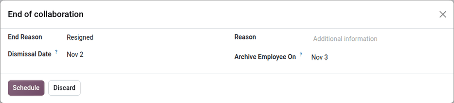

==================================
End of collaboration and archiving
==================================

In Odoo, when an employee leaves the company, their *end of collaboration* must be registered. This
ends their contract, archives the employee record on the chosen date, and cleans up the records
linked to the employee in the other apps. This step is typically done along with the employee's
:doc:`offboarding <offboarding>`.

.. _employees/end-of-collaboration:

Register an end of collaboration
================================

To register the departure of an employee, first navigate to :menuselection:`Employees app -->
Management`. From here, locate the employee leaving the company, and click on their employee card.

The employee form loads, displaying all their information. Click the :icon:`more_vert`
:guilabel:`(Actions)` icon in the top-left corner, and a drop-down menu appears. Click
:guilabel:`End of Collaboration`, and an *End of collaboration* pop-up window appears.

.. note::
   The end of collaboration can only be registered for employees with an ongoing contract, that is,
   with a contract start date in the *Payroll* tab. For employees without a contract,
   :ref:`archive the employee <employees/archive>` instead.

Fill out the following fields on the form:

- :guilabel:`End Reason`: Select the reason the employee is leaving from the drop-down menu. The
  default options are:

  - :guilabel:`Fired`: Select this option when an employee is being let go by the company.
  - :guilabel:`Resigned`: Select this option when the employee no longer wishes to be employed.
  - :guilabel:`Resigned: Retired`: Select this option when the employee is retiring.
  - :guilabel:`Dead`: Select this option when the employee has passed away.

  Some :doc:`payroll localizations <../payroll/payroll_localizations>` add country-specific
  reasons. To create or modify end reasons, refer to the :ref:`departure reasons
  <employees/departure-reasons>` section.

- :guilabel:`Dismissal Date`: Using the calendar selector, select the date the departure process
  starts. Today's date is selected by default. This date is the departure date of the employee:
  their contract ends on this date.

  .. note::
     Some payroll localizations compute a notice period from this date. The departure date, and so
     the end date of the contract, is then the end of the notice period.

- :guilabel:`Reason`: Enter any additional information about the employee's departure in this
  field.
- :guilabel:`Archive Employee On`: The date on which the employee record is archived. By default,
  this is the day after the :guilabel:`Dismissal Date`. It can be modified, but not set before the
  departure date.

When the form is complete, click the button at the bottom of the pop-up window:

- :guilabel:`Apply`: This button appears when the :guilabel:`Archive Employee On` date is today or
  in the past (for example, when the date proposed by default is changed to today). The end of
  collaboration is applied immediately.
- :guilabel:`Schedule`: This button appears when the :guilabel:`Archive Employee On` date is in the
  future. The end of collaboration is saved, and is automatically applied on that date.

As soon as the end of collaboration is saved, the end date of the employee's contract is set to
the departure date (the :guilabel:`Dismissal Date`, unless a localization computes a notice period),
and an *End of Collaboration* tab appears on the employee form. This tab
displays the :guilabel:`End Reason`, the :guilabel:`Dismissal Date`, the :guilabel:`Reason`, and the
:guilabel:`Archive Employee On` date.

.. tip::
   An end of collaboration can also be started from the *Payroll* tab, when the end date of the
   employee's contract is modified. Refer to the :doc:`contracts <../payroll/contracts>`
   documentation for more information.

Apply the end of collaboration
------------------------------

When the end of collaboration is applied, either immediately or on the scheduled date, Odoo:

- archives the employee record;
- deletes the versions of the employee record that start after the departure date;
- archives the related user, unless they are still linked to another active employee. A
  notification lists the users that were archived, or kept active;
- cleans up the records linked to the employee in the other installed apps. For example:

  - **Time Off**: time off and allocations after the departure date are canceled, deleted, or
    shortened to end on the departure date;
  - **Timesheets**: timesheets logged on projects after the departure date are deleted;
  - **Fleet**: the employee is removed as the driver, and as the future driver, of their company
    cars. With the Belgian payroll localization, the cars stay assigned, and a message with the
    departure date is posted on them instead;
  - **Maintenance**: the employee's equipment is unassigned;
  - **Appraisals**: the employee's upcoming appraisals are deleted, the employee is removed as a
    manager of other upcoming appraisals, and their goals are archived;
  - **Planning**: the employee's shifts after the departure date are handled as for an archived
    resource.

Once applied, the *End of Collaboration* tab displays the date on which the departure process was
completed.

Cancel an end of collaboration
------------------------------

To cancel an end of collaboration, open the *End of Collaboration* tab of the employee form, and
click :guilabel:`Cancel End of Collaboration`. If the end of collaboration has already been
applied, click :guilabel:`Cancel Departure` next to the completion date instead, then confirm.

Canceling an end of collaboration unarchives the employee, restores the previous end date of their
contract, and deletes the end of collaboration. The versions of the employee record that were
deleted when it was applied are **not** restored.

.. _employees/departure-reasons:

Departure reasons
=================

To view, create, or modify the available end reasons, navigate to :menuselection:`Employees app -->
Configuration --> Employee --> Departure Reasons`. Click the :guilabel:`New` button, and a blank
line appears at the bottom of the list. Enter the new reason, and click :guilabel:`Save`.

To reorder the reasons in the drop-down menu, drag them using the :icon:`drag_indicator`
:guilabel:`(drag handle)` icon. Reasons that are no longer used can be archived.

.. _employees/archive:

Archive an employee
===================

Employees without a contract, or employee records created by mistake, can be archived directly,
without registering an end of collaboration. On the employee form, click the :icon:`more_vert`
:guilabel:`(Actions)` icon, then click :icon:`archive` :guilabel:`Archive`, and confirm.

The employee record is archived, and a red :guilabel:`Archived` banner appears on the employee
form. The archived employee is also removed from the fields of other employees that reference them,
such as their :guilabel:`Manager`.

To view archived employees, navigate to :menuselection:`Employees app --> Management`, click into
the search bar, and select the :guilabel:`Archived` filter.
