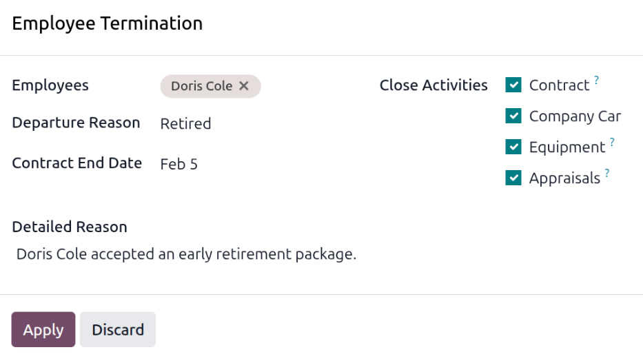

=================
Archive employees
=================

In Odoo, when an employee leaves the company they must be *archived*. This step should be done
*after* the employee has been fully :doc:`offboarded <offboarding>`. To archive an employee, first
navigate to the :menuselection:`Employees app`. From here, locate the employee leaving the company,
and click on their employee card.

The employee form loads, displaying all their information. Click the :icon:`fa-gear`
:guilabel:`(gear)` icon in the top-left corner, and a drop-down menu appears. Click
:icon:`oi-archive` :guilabel:`Archive`, and an *Employee Termination* pop-up window appears.

Fill out the following fields on the form:

- :guilabel:`Employees`: The selected employee populates this field by default. Multiple employees
  can be archived at once by adding the additional employees to archive in this field.
- :guilabel:`Departure Reason`: Select a reason the employee is leaving from the drop-down menu. The
  default options are:

  - :guilabel:`Fired`: Select this option when an employee is being let go, and the company has
    given notice.
  - :guilabel:`Resigned`: Select this option when the employee no longer wishes to be employed, and
    the employee has given notice.
  - :guilabel:`Retired`: Select this option when the employee is retiring.

  .. note::
     If a new departure reason is needed, a new one can be created. Close the *Employee Termination*
     pop-up window, and navigate to :menuselection:`Employees app --> Configuration --> Departure
     Reasons`. Click the :guilabel:`New` button, and a blank line appears at the bottom of the list.
     Enter the new reason, and click :guilabel:`Save`.

- :guilabel:`Contract End Date`: Using the calendar selector, select the last day the employee is
  working for the company.
- :guilabel:`Detailed Reason`: Enter a short description for the employee's departure in this field.
- :guilabel:`Close Activities`: Click the checkbox next to each type of activity to close or delete
  any open activities associated with it. It is recommended to click **all** checkboxes that are
  applicable. The available options are:

  - :guilabel:`Contract`: Applies an end date for the current contract.
  - :guilabel:`Company Car`: Removes the employee as the driver for their current company car, and
    :ref:`assigns the next driver <fleet/new_vehicle/new-driver>`, if applicable.
  - :guilabel:`Equipment`: Unassigns the employee from any assigned equipment.
  - :guilabel:`Appraisals`: Cancels all appraisals scheduled after the contract end date.

When the form is complete, click :guilabel:`Apply`. The employee record is archived, and a red
:guilabel:`Archived` banner appears in the top-right corner of the employee form. The chatter logs
the various details, including the :guilabel:`Departure Date`, :guilabel:`Departure Reason`,
:guilabel:`Contract End Date`, the dates for the last work entries, and the employee version that
was archived.

.. note::
   If any issues exist that prevent Odoo from archiving the employee, the detailed reasons appear in
   a red warning box in the *Employee Termination* pop-up window. The warning states `The plan
   "(Plan Name)" cannot be launched`, then lists the various steps that must be done before
   archiving the employee.
