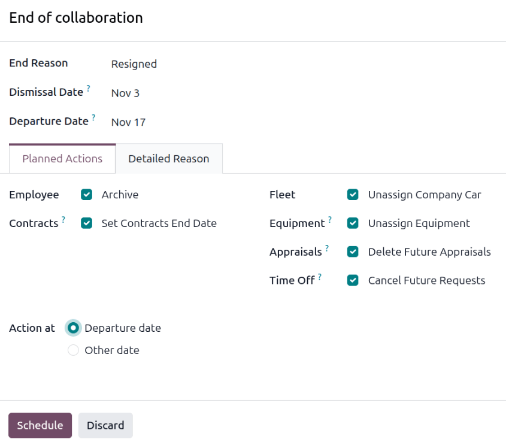
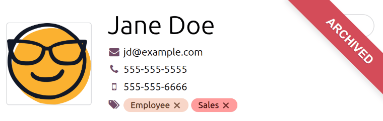

===================
Employee departures
===================

When an employee leaves, the working relationship between the employee and the company must end. In
Odoo, this is referred to as the *end of collaboration*. First, open the **Employees** app, locate
the employee leaving the company, and click on their employee card.

.. important::
   This should be done *after* the employee has been fully :doc:`offboarded <offboarding>`.

End of collaboration pop-up
===========================

Click the :icon:`fa-gear` :guilabel:`(Actions)` icon in the corner, and a drop-down menu appears.
Click :guilabel:`End of Collaboration`, and an *End of collaboration* pop-up window appears.

Fill out the following fields on the form:

- :guilabel:`End Reason`: Select the reason the employee is leaving the company, using the drop-down
  menu. Three default options are available:

  - :guilabel:`Fired`: Select this option when an employee is being let go, and the company has
    given notice.
  - :guilabel:`Resigned`: Select this option when the employee no longer wishes to be employed, and
    the employee has given notice.
  - :guilabel:`Resigned: Retired`: Select this option when the employee is retiring.

  .. tip::
     If a new departure reason is needed, a new one can be created. Close the *End of collaboration*
     pop-up window, and navigate to :menuselection:`Employees app --> Configuration --> Departure
     Reasons`. Click the :guilabel:`New` button, and a blank line appears at the bottom of the list.
     Enter the new reason, and click :guilabel:`Save`.

- :guilabel:`Dismissal Date`: Select the date the departure starts using the calendar selector.
- :guilabel:`Departure Date`: Using the calendar selector, enter the actual day the employee leaves
  the company.

  .. note::
     The :guilabel:`Dismissal Date` may differ from the :guilabel:`Departure Date` in cases where
     the employee must be notified of their termination for a set period of time before their last
     day of work. In this situation, the :guilabel:`Dismissal Date` is the date the employee is
     given notice, and the :guilabel:`Departure Date` is their last day at work.

Planned actions tab
-------------------

The *Planned Actions* tab is where automated actions are set. Check the box in the options below to
perform the related actions:

- :guilabel:`Employee`: Check the :guilabel:`Archive` option to archive the employee.
- :guilabel:`Contracts`: Check the :guilabel:`Set Contracts End Date` option to end the employee's
  current contract and delete any future versions.
- :guilabel:`Fleet`: Check the :guilabel:`Unassign Company Car` option to remove the employee as the
  driver for their current company car and :ref:`assign the next driver
  <fleet/new_vehicle/new-driver>`, if applicable.
- :guilabel:`Equipment`: Check the :guilabel:`Unassign Equipment` option to unassign the employee
  from any assigned equipment.
- :guilabel:`Appraisals`: Check the :guilabel:`Delete Future Appraisals` option to cancel all
  appraisals scheduled after the contract end date and archive all goals.
- :guilabel:`Time Off`: Check the :guilabel:`Cancel Future Requests` option to set the running
  allocation's validity end date and cancel all future time off requests.
- :guilabel:`Action at`: Select when the above actions are done. The options are:

  - :guilabel:`Departure date`: Select this option to have all actions done on the configured
    :guilabel:`Departure Date`.
  - :guilabel:`Other date`: Select this option to have all actions done on a specific day other than
    the configured :guilabel:`Departure Date`. When selected, an :guilabel:`Apply date` field
    appears. Leave the field blank to have the actions done immediately, or select a date using the
    calendar selector.

Detailed reason tab
-------------------

Enter any information regarding the employee's departure in this field.

Process departure
=================

Once the *End of collaboration* pop-up window is configured, click the :guilabel:`Apply` button, and
the configured actions are scheduled for the dates set on the form.

Once the :guilabel:`Departure date` is reached, the employee record is archived if the
:guilabel:`Archive` option was selected, and a red banner appears on the employee record, stating
:guilabel:`Archived`.

.. note::
   If any issues exist that prevent Odoo from archiving the employee, the detailed reasons appear in
   a *Validation Error* pop-up window. Close the warning pop-up, correct the issues, and click
   :guilabel:`Apply`.

.. tip::
   It is possible to archive an employee without using the :guilabel:`End of Collaboration` option,
   but it is **not** recommended as there is less flexibility with related actions.

   To archive an employee instead of ending the collaboration, click the :icon:`fa-gear`
   :guilabel:`(Actions)` icon on the employee record, and click :guilabel:`Archive`.

   The employee is archived, their contract end date is set to the current date, and all appraisals,
   goals, and future time off are canceled. Any vehicles in the **Fleet** app assigned to the
   employee remain, as well as any assigned equipment.

   For these reasons, it is recommended to use the :guilabel:`End of Collaboration` method when an
   employee departs.
