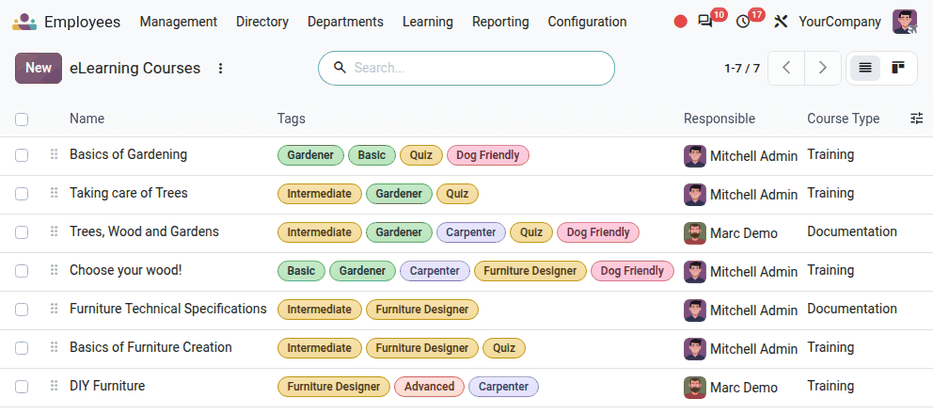
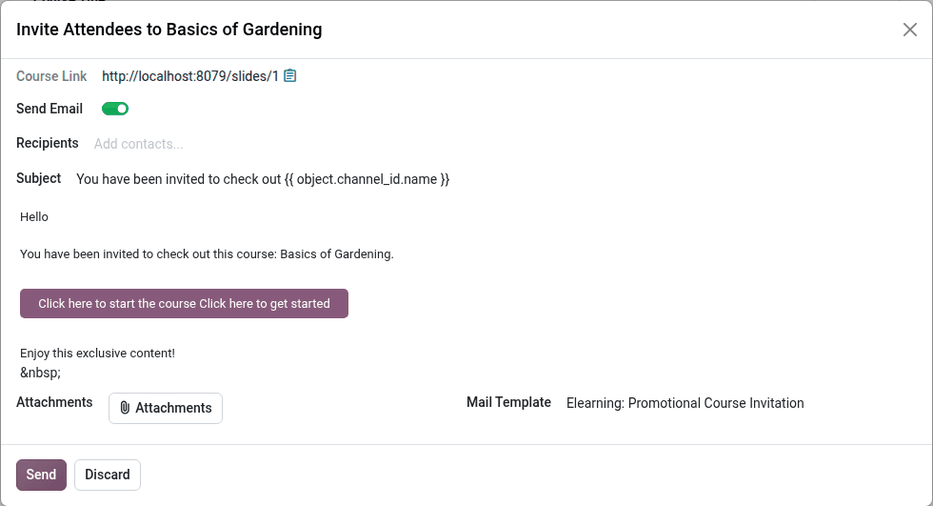

========
Learning
========

The **Employees** app tracks two kinds of learning: virtual :ref:`eLearning <employees/elearning>`
courses, or :ref:`onsite <employees/onsite>` in-person training. Both certifications and training
attendance records are kept in the **Employees** app, and all completed courses and certifications
are logged in the *Resume* tab of each :ref:`employee record <employees/resume>`.

.. _employees/elearning:

eLearning
=========

To train employees using eLearning courses, the **eLearning** app must be :ref:`installed
<general/install>`.

.. tip::
   Courses can be :ref:`created <employees/create>` either through the **Employees** app *or* the
   **eLearning** app.

First, navigate to :menuselection:`Employees app --> Learning --> Courses --> eLearning`, and the
:guilabel:`eLearning Courses` dashboard loads. All currently configured courses appear in a list
view. Each course displays the following information:

- :guilabel:`Name`: The name of the course.
- :guilabel:`Tags`: Add relevant tags, such as level, topic, etc.
- :guilabel:`Responsible`: The user responsible for the course, including inviting participants and
  updating the course as needed. The creator of the course does **not** have to be the
  :guilabel:`Responsible` person.
- :guilabel:`Course Type`: This field determines the format of the course. The two available options
  are:

  - :guilabel:`Training`: The content must be viewed *in order*.
  - :guilabel:`Documentation`: The employee can view the content in the order they choose.

.. _employees/create:

Create an eLearning course
--------------------------

No courses come preconfigured in the **Employees** app. Courses must be created, in either the
**Employees** app or the **eLearning** app.

.. note::
   Once a course is available, it is accessible from both apps.

To create an eLearning course, navigate to :menuselection:`Employees app --> Learning --> Courses
--> eLearning`. Click the :guilabel:`New` button in the upper-left corner, and a blank *eLearning
Course* form loads.

Follow the directions for :ref:`creating a course <elearning/course-creation>`, including adding the
:ref:`content <elearning/content>`, :ref:`description <elearning/description>`, :ref:`options
<elearning/options>`, and :ref:`karma <elearning/karma>` tabs.

.. important::
   Only users with the proper :doc:`access rights <../../general/users/access_rights>` can view,
   modify, or create any learning course.

.. _employees/invite:

Invite employees
----------------

From the :guilabel:`eLearning Courses` dashboard, invite employees to take a course. Navigate to
:menuselection:`Employees app --> Learning --> Courses --> eLearning`, click on the desired course
from the
list, and the course form loads. Click the :guilabel:`Add Attendees` button and an *Enroll Attendees
to (Course Title)* pop-up window loads.

Add all desired employees to the :guilabel:`Recipients` field using the drop-down menu. All
employees in the database are available in this list.

.. tip::
   To filter only employees, click into the :guilabel:`Recipients` field, then click
   :guilabel:`Search more...`.

   In the *Search: Recipients* pop-up window that loads, filter the results by clicking into the
   search box and selecting :guilabel:`Employees` in the :icon:`fa-filter` :guilabel:`Filters`
   column. Only employees are presented, excluding other companies or vendors. Click the checkbox to
   the left of the :guilabel:`Name` column to select all employees.

The email uses the default `Elearning: Add Attendees to Course` :guilabel:`Mail Template`, which
includes a dynamic subject line that includes the course's name.

Make any desired changes to the email, attach any necessary files, then click :guilabel:`Send` to
invite the employees.

Once the invitation is sent, the recipients appear in the attendees list. Click the
:guilabel:`Attendees` smart button to view all invited attendees.

Once the employee completes the eLearning course, the training appears on their employee record, in
the :ref:`Resume <employees/resume>` tab.

.. note::
   Alternatively, click the :guilabel:`Invite` button, and an *Invite Attendees to (Course Name)*
   pop-up window loads. Copy the course link by clicking the :icon:`fa-clipboard` :guilabel:`(Copy)`
   icon to copy the link and send it to employees. Or, click the :guilabel:`Send Email` toggle to
   :ref:`email employees <employees/invite>`.

.. _employees/onsite:

Onsite
======

The **Employees** app can also track in-person training. These can take any format, from lectures to
interactive training. To create onsite training courses, the **Events** app must be :ref:`installed
<general/install>`.

Onsite training can be created either through the **Employees** app *or* the **Events** app.

.. note::
   The **Employees** app only displays the events with at least one employee registered as an
   attendee. All events remain accessible from the **Events** app.

To view all currently configured onsite courses navigate to :menuselection:`Employees app -->
Learning --> Courses --> Onsite`, and the :guilabel:`Onsite Courses` dashboard loads. All onsite
courses appear in a default Kanban view, organized by stage.

Click on an onsite training card to view the details.

.. _employees/create-onsite:

Create an onsite course
-----------------------

To create a new onsite training, navigate to :menuselection:`Employees app --> Learning --> Courses
--> Onsite`. Click the :guilabel:`New` button in the top-left corner and a blank *Onsite Courses*
event form loads.

:ref:`Fill out the event form <events/event-form>` to configure the onsite training course. When
completed, the option to publish it to the website is available, if desired. This option is only
available if the **Website** app is installed.

.. _employees/invite-course:

Invite employees
----------------

Once the onsite training is configured, the next step is to invite employees. Navigate to
:menuselection:`Employees app --> Learning --> Courses --> Onsite` and click on the course Kanban
card. Click the :guilabel:`Invite` button in the upper-left corner, and a blank mailing form loads.

.. note::
   The :guilabel:`Invite` button is only available if the **Email Marketing** app is installed.
   Employees can also be registered directly in the *Attendees* of the event.

The form only allows for inviting employees via :guilabel:`Email`. The :guilabel:`Subject` is
`Event: (Event Title)` by default, and can be changed if desired.

Next, add the employees to the :ref:`Recipients <email_marketing/recipients>` in the respective
field, then create the :ref:`body of the email <email_marketing/mail_body>`.

Click :guilabel:`Send`, and a confirmation pop-up window loads. Click :guilabel:`Send to all` on the
pop-up window and the invitations are sent.
