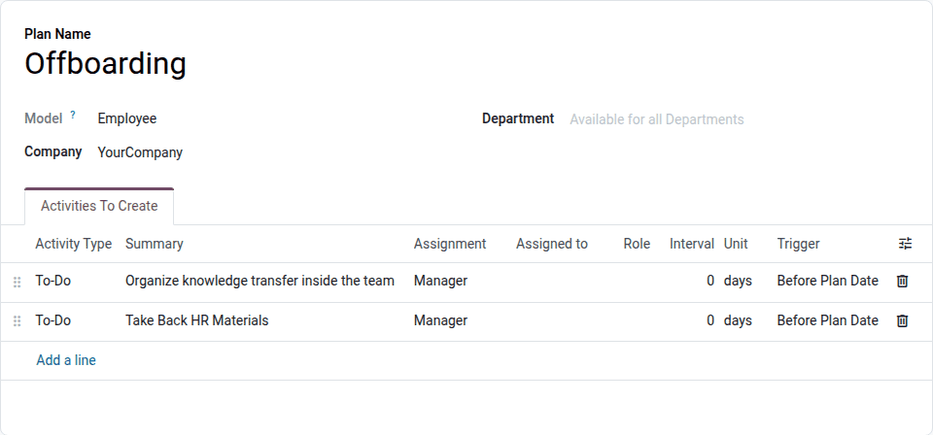

===========
Offboarding
===========

When an employee leaves the company, it is important to have an :ref:`offboarding plan
<employees/offboarding>` to ensure all necessary steps are followed, such as returning equipment,
revoking access to business systems, filling out HR forms, having an exit interview, and more.
Depending on the company, there could be several different offboarding plans, configured for
specific departments or divisions, that have different requirements and steps from the main
offboarding plan.

In addition to an offboarding plan, the :doc:`end of collaboration <archive>` of the employee must
be registered, to log the reason why they left, end their contract, and archive their employee
record.

.. _employees/offboarding:

View offboarding plan
=====================

Before offboarding can begin, it is recommended to check the default offboarding plan that comes
preconfigured with the **Employees** app. To view the current default plan, navigate to
:menuselection:`Employees app --> Configuration --> Employee --> Onboarding / Offboarding`. Click
:guilabel:`Offboarding` to view the detailed offboarding plan form.

.. _employees/offb-plan-form:

Offboarding plan steps
----------------------

The default :guilabel:`Offboarding` plan is minimal, with two default steps. Both steps are *To-Do*
activities assigned to the employee's manager, and are scheduled for the plan date (:guilabel:`0
days Before Plan Date`). The default steps are:

- :guilabel:`Organize knowledge transfer inside the team`: The manager must ensure all knowledge the
  employee has relating to their job position is either documented or shared with colleagues so
  there is no knowledge gap.
- :guilabel:`Take Back HR Materials`: The manager must obtain any documents and materials the HR
  department requires. It is recommended to check with the HR department to ensure everything
  required for this step is completed.

.. note::
   - On a database with demo data, the **Sign** app adds a third step to the plan: a
     :guilabel:`Termination Request` *Signature Request* activity, to have the employee sign a
     termination document.
   - Company cars are automatically unassigned from the employee when their :doc:`end of
     collaboration <archive>` is applied, so no offboarding step is needed for them (except with
     the Belgian payroll localization, where the cars stay assigned).

Modify offboarding plan
=======================

The default offboarding plan is minimal, so that modifications can be made to accommodate any
company's offboarding needs. Every company has different requirements, therefore it is necessary to
add the required steps to the offboarding plan.

If the offboarding plan is universal, add or modify the default offboarding plan. If the offboarding
plan needed is only for a specific department, then :ref:`a new plan should be created
<employees/new-offboarding>`, specifically for that department.

To modify the default plan, first navigate to :menuselection:`Employees app --> Configuration -->
Employee --> Onboarding / Offboarding`, then click on :guilabel:`Offboarding`.

To modify a step, click on the step and an *Open: Activities* pop-up window appears. Make any
desired modifications to the step, then click :guilabel:`Save` to accept the changes and close the
pop-up window.

To add a new step, click :guilabel:`Add a line` at the bottom of the listed activities in the
:guilabel:`Activities To Create` tab, and a blank :guilabel:`Create Activities` pop-up window
appears. Enter all the information in the pop-up window, then click :guilabel:`Save & Close` if
there are no other steps to add, or click :guilabel:`Save & New` if more steps are needed.

Configure all the desired steps for the offboarding plan.

.. _employees/new-offboarding:

Create offboarding plan
=======================

For some companies, specific offboarding plans may be necessary for some departments. For these
cases, a new department-specific offboarding plan may be needed.

To create a new offboarding plan, navigate to :menuselection:`Employees app --> Configuration -->
Employee --> Onboarding / Offboarding`. Click the :guilabel:`New` button in the upper-left corner,
and a blank *Employee Plans* form loads.

Enter the :guilabel:`Plan Name`, and select the :guilabel:`Department` using the drop-down menu.
This creates a plan *exclusively* for that department.

Add the various offboarding activities by clicking :guilabel:`Add a line` in the *Activities To
Create* tab, and :ref:`configure each activity <employees/offb-plan-form>`.

Enter the following information on the form:

- :guilabel:`Plan Name`: The specific name for the plan.
- :guilabel:`Model`: This field specifies where this plan can be used. In this case, in the
  **Employees** app (:guilabel:`Employee`). This field is not able to be modified.
- :guilabel:`Company`: The company the plan is available for. Leave this field blank to make the
  plan available for all companies.
- :guilabel:`Department`: If left blank (the default setting) the plan is available for all
  departments. To make the plan department-specific, select a department using the drop-down menu.

Next, add the various steps for the plan by clicking :guilabel:`Add a line` at the bottom of the
listed activities in the *Activities To Create* tab, and a blank *Create Activities* pop-up window
appears.

Enter the following information in the pop-up window:

- :guilabel:`Activity Type`: Using the drop-down menu, select the specific activity to be scheduled.
  The default options are :guilabel:`To-Do`, :guilabel:`Email`, :guilabel:`Call`,
  :guilabel:`Meeting`, or :guilabel:`Document`. If the **Sign** app is installed, a
  :guilabel:`Signature Request` option is available.
- :guilabel:`Summary`: Enter a short description for the step.
- :guilabel:`Assignment`: Using the drop-down menu, select the person assigned to perform the
  activity. The options are: :guilabel:`Ask at launch`, :guilabel:`Specific User`,
  :guilabel:`Role`, :guilabel:`Manager`, and :guilabel:`Employee`.

  .. note::
     The selection for the :guilabel:`Assignment` role is in relation to the employee. If
     :guilabel:`Manager` is selected, the employee's manager is assigned to the activity.

     If :guilabel:`Specific User` is selected, an :guilabel:`Assigned to` field appears. Using the
     drop-down menu, select the user who will always be assigned this activity. If
     :guilabel:`Role` is selected, a :guilabel:`Role` field appears to select the role assigned to
     this activity.

- :guilabel:`Interval`: Configure the fields in this line to determine the due date of the activity.
  Enter a number in the first field, then, using the drop-down menus in the following two fields,
  configure when the due date should be created; (`#`) of :guilabel:`days`, :guilabel:`weeks`, or
  :guilabel:`months`, either :guilabel:`Before Plan Date` or :guilabel:`After Plan Date`.

When the :guilabel:`Create Activities` form is completed, click :guilabel:`Save & Close` if there
are no other steps to add, or click :guilabel:`Save & New` to add more steps, as needed.

.. example::
   A consulting company has two separate offboarding plans, one for the consultants working at
   client sites, and one for office workers.

   The :guilabel:`Consultant Offboarding` plan is set for the :guilabel:`Professional Services`
   department, and includes specialized tasks relating to those jobs. These include transferring
   the client files to another consultant, returning the access badges of the client sites,
   revoking the access to the client systems, and having an exit interview.

   .. image:: offboarding/department-offboarding.png
      :alt: An offboarding plan configured for the Professional Services department.

Launch offboarding plan
=======================

After an employee has given notice (typically two weeks) or once the company has decided to
terminate the working relationship with the employee, the offboarding plan should be launched.
Navigate to :menuselection:`Employees app --> Management` and click on the departing employee
profile. Click :guilabel:`Activity` in the chatter, and a *Schedule Activity* pop-up window loads.

The top of the pop-up window displays a button for each available plan, as well as a button for the
various available activities. Click the desired offboarding plan to select it. Then, using the
calendar selector, set the plan date in the :icon:`calendar_today_f` :guilabel:`(Due date)` field.
This is typically the employee's last day, but any date can be selected.

.. tip::
   To launch a plan for several employees at once, select them in the list view of
   :menuselection:`Employees app --> Management`, then click :guilabel:`Launch Plan`.

The *Plan Summary* section of the *Launch Plan* pop-up window displays all the steps in the selected
plan, along with the user icon for the person assigned to each activity.

Click the :guilabel:`Schedule` button, and Odoo schedules everything in the plan, according to their
respective due dates.
