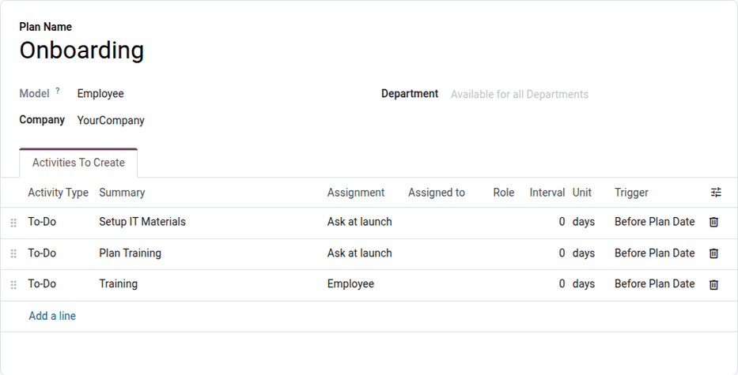
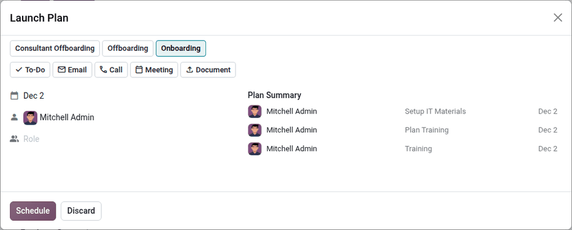
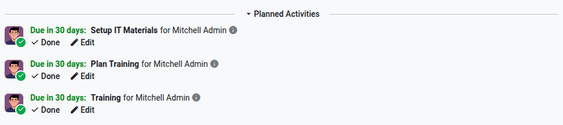

==========
Onboarding
==========

When a new employee is hired, it is important to have an onboarding procedure that can be followed.
This ensures that information, equipment, and training are provided to the employee and any other
necessary steps for the business are assigned to the correct individuals.

Proper onboarding ensures that new employees are given all the information and tools needed to be
successful in their roles and have a smooth transition to their new job.

.. note::
   Depending on the installed applications, additional steps may appear in the onboarding plan.

View onboarding plan
====================

Before onboarding can begin, it is recommended to check the default onboarding plan that comes
preconfigured with the **Employees** app. To view the current default plan, navigate to
:menuselection:`Employees app --> Configuration --> Employee --> Onboarding / Offboarding`, then
click :guilabel:`Onboarding` to view the detailed onboarding plan form.

.. _onboarding/plan-form:

The plan form displays the following information:

- :guilabel:`Plan Name`: The specific name for the onboarding plan.
- :guilabel:`Model`: Specifies where this plan can be used. In this case, in the **Employees** app
  (:guilabel:`Employee`). This field cannot be modified.
- :guilabel:`Company`: The company the plan is available for. Leave this field blank to make the
  plan available for all companies.
- :guilabel:`Department`: If left blank (:guilabel:`Available for all Departments`), this plan is
  available for all departments. Limit the use of the plan to a specific department by selecting
  the department using the drop-down menu.
- :guilabel:`Activities To Create`: This tab lists all the onboarding steps. Each row displays:

  - :guilabel:`Activity Type`: The specific activity for the step. The default options are
    :guilabel:`To-Do`, :guilabel:`Email`, :guilabel:`Call`, :guilabel:`Meeting`, and
    :guilabel:`Document`. If the **Sign** app is installed, a :guilabel:`Signature Request` option
    is available.
  - :guilabel:`Summary`: A one line description of the step.
  - :guilabel:`Assignment`: Chooses who completes the activity, relative to the new hire:

    - :guilabel:`Ask at launch`: Choose the user responsible for the activity when :ref:`launching
      the onboarding plan <employees/launch-plan>`.
    - :guilabel:`Specific User`: Choose a user who always handles this activity. Defined in the
      :guilabel:`Assigned to` field.
    - :guilabel:`Role`: Assigns the activity to a role, defined in the :guilabel:`Role` field,
      instead of a specific user. All users with this role can see and complete the activity.
    - :guilabel:`Manager`: Assigns the employee's manager as defined on the employee record.
    - :guilabel:`Employee`: The new hire completes the activity.

  - :guilabel:`Assigned to`: This field remains blank, unless :guilabel:`Specific User` is selected
    for the :guilabel:`Assignment` field. If :guilabel:`Specific User` is selected, this field is
    populated with the selected user.
  - :guilabel:`Role`: This field remains blank, unless :guilabel:`Role` is selected for the
    :guilabel:`Assignment` field.
  - :guilabel:`Interval`: The number of time units between the plan date and the due date of the
    activity.
  - :guilabel:`Unit`: The set time interval, either :guilabel:`days`, :guilabel:`weeks`, or
    :guilabel:`months`.
  - :guilabel:`Trigger`: How scheduling is determined for the activity. Options are either
    :guilabel:`Before Plan Date` or :guilabel:`After Plan Date`.

    .. example::
       A laptop must be set up and registered to a new employee the day before they start work. The
       person who performs this step should always be the IT Manager, Marc Demo.

       To configure this activity with these parameters, the :guilabel:`Activity Type` is set to
       :guilabel:`To-Do`, with a summary of :guilabel:`Assign Laptop`. The :guilabel:`Assignment`
       field is set to :guilabel:`Specific User`, and the :guilabel:`Assigned to` field is set to
       :guilabel:`Marc Demo`. The :guilabel:`Interval` is :guilabel:`1`, and the :guilabel:`Unit`
       is set to :guilabel:`days`. The :guilabel:`Trigger` is :guilabel:`Before Plan Date`.

       .. image:: onboarding/activity-plan.png
          :alt: An activity configured to assign a laptop the day before an employee starts work.

Onboarding plan steps
---------------------

The default :guilabel:`Onboarding` plan includes three default steps. All steps are
:guilabel:`To-Do` activities, and are scheduled for the plan date (:guilabel:`0 days Before Plan
Date`).

- :guilabel:`Setup IT Materials`: The person responsible for gathering and configuring all IT
  materials is chosen when the plan is launched (:guilabel:`Ask at launch`).
- :guilabel:`Plan Training`: The person responsible for planning the training for the new employee
  is chosen when the plan is launched (:guilabel:`Ask at launch`).
- :guilabel:`Training`: The new employee must complete the planned training.

.. _employees/modify-plan:

Modify onboarding plan
======================

A single onboarding plan works only if the flow works for the entire company.

.. note::
   If the onboarding plan is universal, add to or modify the default onboarding plan. If
   department-specific onboarding plans are needed, :ref:`create a new onboarding plan
   <employees/create-plan>` and limit the plan to a department.

To modify the default plan, first navigate to :menuselection:`Employees app --> Configuration -->
Employee --> Onboarding / Offboarding`, then click on :guilabel:`Onboarding`.

To modify a step, click on it. In the *Open: Activities* pop-up window, make any desired
modifications to the step, then click :guilabel:`Save`.

To add a new step, click :guilabel:`Add a line` at the bottom of the listed activities in the
*Activities To Create* tab, and a blank *Create Activities* pop-up window appears. Enter all the
information in the pop-up window, then click :guilabel:`Save & Close` if there are no other steps to
add, or click :guilabel:`Save & New` if more steps are needed.

.. _employees/create-plan:

Create onboarding plan
======================

Some companies require different onboarding plans, when there are department-specific onboarding
procedures that do not apply to the whole company. For these cases, a new department-specific
onboarding plan must be created.

To create a new onboarding plan, navigate to :menuselection:`Employees app --> Configuration -->
Employee --> Onboarding / Offboarding`. Click the :guilabel:`New` button in the upper-left corner,
and a blank *Employee Plans* form loads.

Enter the :guilabel:`Plan Name`, and select the :guilabel:`Department` using the drop-down menu.
This creates a plan *exclusively* for that department.

Add the various onboarding activities by clicking :guilabel:`Add a line` in the *Activities To
Create* tab, and :ref:`configure each activity <onboarding/plan-form>`.

.. example::
   A software company may need specific onboarding steps for its developers, in addition to the
   general onboarding plan used for all other employees.

   The :guilabel:`Developer Onboarding` plan is set for the :guilabel:`Research & Development`
   department, and includes specialized tasks relating to development jobs. These include assigning
   a laptop, setting up the development environment, granting access to the code repositories,
   introducing a mentor, and completing a code review training one week after the plan date.

   .. image:: onboarding/department-onboarding.png
      :alt: An onboarding plan configured for the Research & Development department.

.. _employees/launch-plan:

Launch onboarding plan
======================

After an employee has been hired and their employee profile :ref:`is created
<recruitment/offer_job_positions/new-employee>`, launch the onboarding plan using one of the
following methods:

- When an employee record is created, a message is logged in its chatter, recommending to set up an
  onboarding plan. Click the :guilabel:`onboarding plan` link in this message.
- On the employee record, click :guilabel:`Activity` in the chatter. The available plans appear at
  the top of the *Schedule Activity* pop-up window.
- To launch a plan for several employees at once, navigate to :menuselection:`Employees app -->
  Management`, switch to the :icon:`oi-view-list` :guilabel:`(List)` view, select the employees,
  then click :guilabel:`Launch Plan`.

In the *Launch Plan* pop-up window that loads, the top of the screen displays a button for each
available plan, as well as a button for the various available activities. Click the desired
onboarding plan to select it. Then, using the calendar selector, set the plan date in the
:icon:`fa-calendar` :guilabel:`(date)` field. This is typically the employee's first day, but any
date can be selected. A date is proposed by default, so make sure to check it before scheduling
the plan.

If any activity assignments are configured to :guilabel:`Ask at launch`, select the user
responsible for these activities in the :icon:`fa-user` :guilabel:`(user)` field, or select a
:guilabel:`Role` instead.

The *Plan Summary* section of the *Launch Plan* pop-up window displays all the steps in the selected
plan, along with the user icon for the person assigned to each activity, and the due date of each
activity.

Click the :guilabel:`Schedule` button, and Odoo schedules everything in the plan according to their
respective due dates.

All scheduled activities appear in the chatter of the employee profile, and in the activities of the
users with assignments relating to the plan.

.. note::
   If an activity is assigned to the employee or their manager, and the employee or their manager is
   not linked to a user, the activity is assigned to the closest manager in the hierarchy who has a
   user. If there is none, or if the employee has no manager, the activity is assigned to the
   current user, and a warning listing the missing information appears in the *Launch Plan* pop-up
   window. The plan can still be launched.
