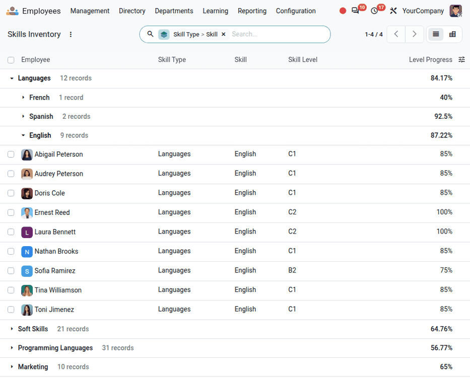
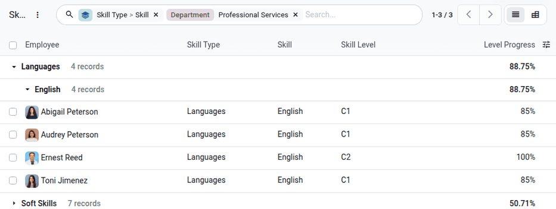

================
Skills inventory
================

The **Employees** app allows users with the correct :doc:`access rights
<../../general/users/access_rights>`, typically managers, to view current employee skills. This
report is helpful in determining which employee best fits a specific task or role requiring certain
skills.

View skills inventory report
============================

To view the *Skills Inventory* report, navigate to :menuselection:`Employees app --> Reporting -->
Skills Inventory`. The report lists all skills, grouped by :guilabel:`Skill Type`, then individual
:guilabel:`Skill`. All results are collapsed by default and must be expanded to view the
:guilabel:`Skill Type`, :guilabel:`Skill`, and :guilabel:`Skill Level`.

Click on any :guilabel:`Skill Type` to expand the list and display the individual
:guilabel:`Skills`. Click on any individual :guilabel:`Skill` to further expand the list and display
all employees with that specific :guilabel:`Skill`, alphabetically.

Both the :guilabel:`Skill Type` and :guilabel:`Skill` lines display the number of records after each
listed line, indicating how many employee skills belong to the specific :guilabel:`Skill Type` or
:guilabel:`Skill`, as well as the average :guilabel:`Level Progress` of these skills.

When fully expanded, each line displays the following information:

- :guilabel:`Employee`: The name of the employee with the skill.
- :guilabel:`Skill Type`: The broader category of the skill.
- :guilabel:`Skill`: The specific skill nested within the :guilabel:`Skill Type`.
- :guilabel:`Skill Level`: The current level the employee has achieved for the skill.
- :guilabel:`Level Progress`: The percentage the employee has achieved, with `100%` indicating the
  skill is mastered.

.. note::
   Only skills that have employees associated with them appear on the list. If no employee has a
   specific skill, the skill is hidden by default.

.. tip::
   Click the :icon:`oi_view-pivot` :guilabel:`(Pivot)` icon in the upper-right corner to display the
   report as a pivot table, with the skills in rows, and the departments and employees in columns.

Use case: Find English-speaking consultants
===========================================

A consulting company has a new client abroad, and needs to send a consultant on site. Since the
meetings with the client are held in English, management wants to send the consultant who speaks
English best.

The *Skills Inventory* report allows for discovering which employees speak English, and at what
level, allowing management to make the best decision.

Navigate to :menuselection:`Employees app --> Reporting --> Skills Inventory`. Since the
consultants are part of the *Professional Services* department, someone from that department is
desired. To only view employees from that department, type `Professional Services` in the search
bar, then select :guilabel:`Search Department for: Professional Services`.

Once the filter is active, expand :guilabel:`Languages` then expand :guilabel:`English`. The
resulting list only displays employees within the *Professional Services* department, with English
language skills.

In this example, based on the demo data, :guilabel:`Ernest Reed` has the highest :guilabel:`Level
Progress` (:guilabel:`100%`), and is the best candidate for the trip to the client.

