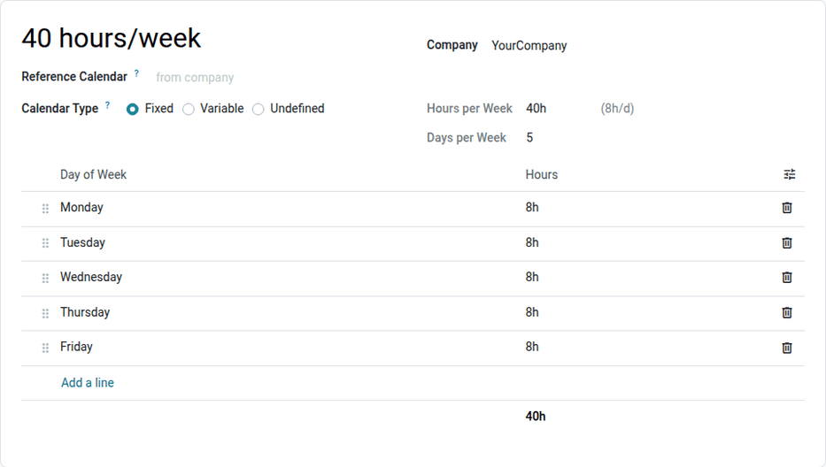
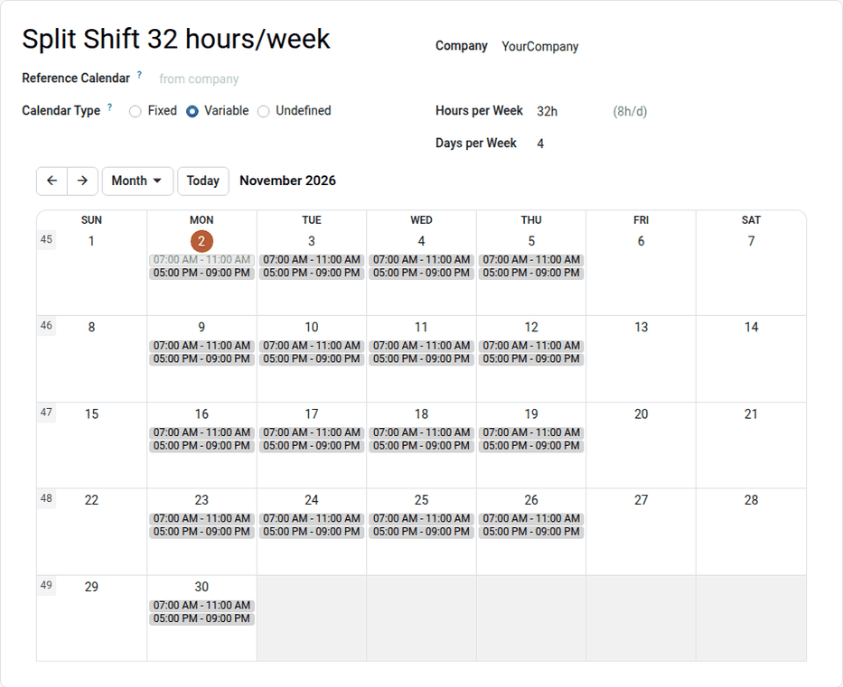

.. meta::
   :description: Working hours define the schedule during which employees or equipment are expected
                 to work or be available for use, and are configured separately for each company in
                 a database.

=============
Working hours
=============

In Odoo, *working hours* are the hours during which employees or equipment are scheduled to work or
be available for use.

.. note::
   Working hours may also be known as a *working schedule* in some Odoo applications.

Working hours can be specific to a company, or shared between companies:

- Working hours with a :guilabel:`Company` are available for that company and its
  :ref:`branches <general/companies/branches>`.
- Working hours without a :guilabel:`Company` (:guilabel:`Visible to all`) are available for all
  companies.

Working hours appear in several apps, including:

- :menuselection:`Employees --> Configuration --> Time Management --> Working Schedules`
- :menuselection:`Payroll --> Configuration --> Time Management --> Working Schedules`
- :menuselection:`Manufacturing --> Configuration --> Work Centers`

.. _employees/working_hours/working_hours_form:

Working hours form
==================

The following fields are available in all working hours forms:

- :guilabel:`Name`: Enter the name for the new working schedule. This should be descriptive and
  clear to understand, such as `20 Hours/Week`.
- :guilabel:`Company`: Select the company that can use these new working hours from the drop-down
  menu. Leaving this field blank indicates that it is available for all companies.
- :guilabel:`Reference Calendar`: Select the full-time working schedule this schedule is compared
  to, for example to compute the work time rate of a part-time schedule. If left blank, the
  company's default working hours are used.
- :guilabel:`Calendar Type`: Select :guilabel:`Fixed`, :guilabel:`Variable`, or
  :guilabel:`Undefined`. :ref:`Fixed working hours <employees/working_hours/fixed-schedule>` are
  good for schedules that repeat identically every week. :ref:`Variable working hours
  <employees/working_hours/variable-schedule>` work best for businesses with split or rotating
  work schedules. :guilabel:`Undefined` working hours have no predefined working slots, and are
  meant for employees who can work whenever they want; refer to the :doc:`working schedules
  <../payroll/working_schedules>` documentation for more information.
- :guilabel:`Hours per Week`: The number of hours per week that the schedule covers. The average
  number of hours per day is displayed next to it.
- :guilabel:`Days per Week`: The number of days per week that the schedule is valid.

The smart buttons at the top of the form display the :guilabel:`Public Holidays` that apply to the
schedule, and the :guilabel:`Employees` and :guilabel:`Materials` that use it.

.. note::
   When the working hours are opened from an employee record, and are shared by several employees, a
   warning appears at the top of the form. Click :guilabel:`Duplicate & Edit for Current Employee`
   to create a copy of the working hours, and assign it to that employee only.

.. _employees/working_hours/fixed-schedule:

Fixed working hours
-------------------

For the :guilabel:`Fixed` option, the :guilabel:`Hours per Week` and :guilabel:`Days per Week`
fields are automatic formula fields that update based on the number of hours configured in the
:guilabel:`Hours` column and the number of days listed in the :guilabel:`Day of Week` column.

The following columns are available in the form:

- :guilabel:`Day of Week`: Select the day of the week that the schedule is made for.
- :guilabel:`Hours`: Specify how many hours the schedule is for on the specified day.
- :guilabel:`Work from`: Specify the time that the schedule starts, in 24-hour format.
- :guilabel:`Work to`: Specify the time that the schedule ends, in 24-hour format.

If a column is not displayed, click the :icon:`tune` :guilabel:`(Optional columns)`
icon and select the checkbox for it.

To edit a day and its hours, click in the :guilabel:`Hours` column and enter the number of working
hours for that day. To add a day, click :guilabel:`Add a line`. To remove a day, click the
:icon:`delete` :guilabel:`(Delete row)` icon. At the bottom of the :guilabel:`Hours` column is
the calculated total of work hours for the work week.

.. _employees/working_hours/variable-schedule:

Variable working hours
----------------------

Variable calendar types are well-suited to businesses with split or rotating work schedules. This
option allows industries with variable demand, such as hotels or businesses that rely heavily on
tourism, to staff peak hours while reducing labor costs during slow midday periods.

When the :guilabel:`Variable` option is chosen, a calendar view displays. Multiple time blocks can
be selected per day. To add time blocks, click the desired days of the calendar to select them (the
number of selected days appears above the calendar), then click :guilabel:`Add`. A time slot pop-up
window displays with the following fields:

- :guilabel:`Duration`: Specify the total number of hours of the configured time slot.
- :guilabel:`Time`: Specify the start and end time of that time slot.
- :guilabel:`Time Type`: The type of time of the slot, :guilabel:`Attendance` by default.
- :guilabel:`Recurrency`: Enable to repeat the time slot. When disabled, the time slot does not
  repeat.
- :guilabel:`Repeat every`: Configure the number of days or weeks between occurrences, and when the
  repetition ends (:guilabel:`Forever`, after a number of :guilabel:`Occurrences`, or
  :guilabel:`Until` a date). This field only displays when :guilabel:`Recurrency` is enabled.

The start and end times can be adjusted manually in the time slot window, and the
:guilabel:`Duration` field recalculates automatically based on these changes.

Click :guilabel:`Add` to confirm the time slot and add it to the selected days of the calendar.
For variable working hours, enter the :guilabel:`Hours per Week` and :guilabel:`Days per Week`
manually. After all the time slots are configured for the variable working hours, click
:icon:`cloud_upload` :guilabel:`(Save manually)`.

.. seealso::
   **Employees**:

   - :doc:`new_employee`

   **Payroll**:

   - :doc:`../payroll/contracts`
   - :doc:`../payroll/working_schedules`
   - :doc:`../payroll/salaries`

   **Manufacturing**:

   - :doc:`../../inventory_and_mrp/manufacturing/advanced_configuration/using_work_centers`
   - :doc:`../../inventory_and_mrp/manufacturing/workflows/work_center_time_off`
