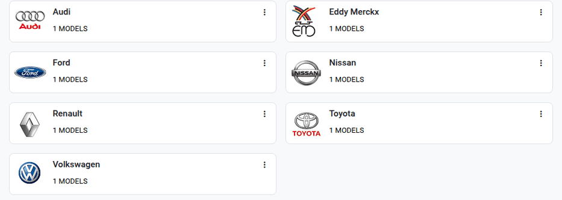
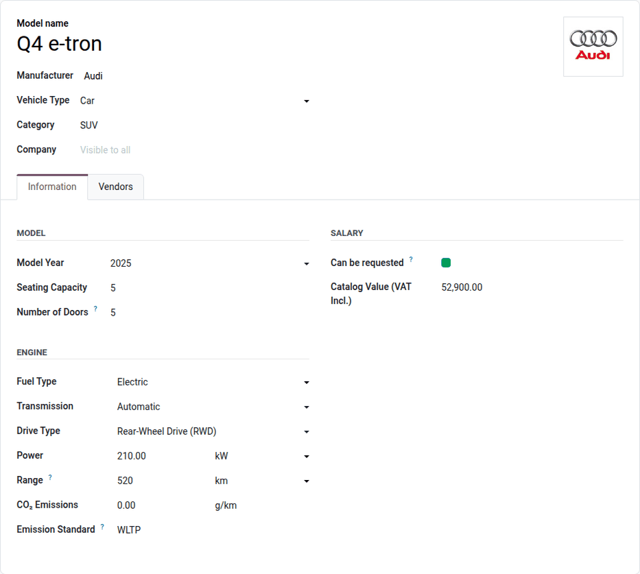
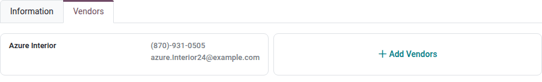

======================
Models & manufacturers
======================

Odoo's **Fleet** app categorizes each vehicle by *manufacturer* and *model* (e.g. `BMW`, `X2`).
Before a vehicle can be added to the Odoo database, its :ref:`manufacturer <fleet/manufacturers>`
and :ref:`model <fleet/add-model>` record must already exist in the database.

.. _fleet/manufacturers:

Manufacturers
=============

Odoo's **Fleet** app comes preconfigured with sixty-seven commonly used car and bicycle
manufacturers in the database, along with their logos. To view the pre-loaded manufacturers, go to
:menuselection:`Fleet app --> Configuration --> Models: Manufacturers`, and the
:guilabel:`Manufacturers` dashboard loads.

The default filter, :guilabel:`With Models`, displays only manufacturers that already have vehicle
models. Remove the default filter to view *all* manufacturers.

Manufacturers are listed alphabetically, and each card shows how many specific :ref:`models
<fleet/models>` are configured for each particular manufacturer.

.. _fleet/add-manufacturers:

Add a manufacturer
------------------

To add a new manufacturer to the database, click :guilabel:`New` in the upper-left corner of the
:guilabel:`Manufacturers` dashboard, and a blank manufacturers form loads. Type the name of the
manufacturer in the :guilabel:`Name` field, and select an image to upload for the :guilabel:`Logo`.

.. _fleet/models:

Models
======

When adding a vehicle to the fleet, specify the vehicle model to maintain updated records, which
keeps track of specific details, like vehicle capacity and parts compatibility.

Unlike :ref:`manufacturers <fleet/manufacturers>`, models do **not** come preconfigured in the
**Fleet** app. When a new vehicle model joins the fleet, the model (and, if necessary, the
manufacturer) **must** be :ref:`added to the database <fleet/add-model>`.

.. _fleet/add-model:

Add a model
-----------

To add a new vehicle model, navigate to :menuselection:`Fleet app --> Configuration --> Models:
Models`. Click :guilabel:`New` in the upper-left corner, and enter the following information on the
new model form.

.. note::
   Depending on the installed :doc:`localization <../../finance/fiscal_localizations>` and
   applications, some fields or sections may not appear.

- :guilabel:`Model name`: Enter the model name in the field.
- :guilabel:`Manufacturer`: Using the drop-down menu, select the manufacturer. If it is not
  configured, :ref:`add the manufacturer <fleet/add-manufacturers>`.
- :guilabel:`Vehicle Type`: Using the drop-down menu, select one of the three preconfigured vehicle
  types: :guilabel:`Car`, :guilabel:`Bike`, or :guilabel:`Other`. The type determines which fields
  appear on the model and vehicle forms (for example, the number of doors only appears for cars).

  .. important::
     Additional vehicle types can **not** be added. **Fleet** keeps them fixed to preserve its
     **Payroll** integration, where vehicles may count as employee benefits.

- :guilabel:`Category`: Using the drop-down menu, select a :ref:`category <fleet/categories>` for
  the vehicle.
- :guilabel:`Company`: In a multi-company database, select the company that can use this model.
  Leave the field empty to make the model available to all companies.

Once saved, a :guilabel:`Vehicles` smart button at the top of the form shows how
many vehicles use this model.

Information tab
---------------

In the :guilabel:`Information` tab, specify details about the model, such as the passenger
capacity, and engine information. These values are copied to each vehicle that uses the model,
where they can be adjusted per vehicle.

Model
~~~~~

- :guilabel:`Model Year`: Select the year the model was manufactured.
- :guilabel:`Seating Capacity`: Enter how many passengers the vehicle can accommodate. This field
  only appears for cars.
- :guilabel:`Number of Doors`: Enter the number of doors the vehicle has, including the trunk or
  hatch doors, if applicable. This field only appears for cars.
- :guilabel:`Electric Assistance`: Tick this checkbox if the bike has electric assistance. This
  field only appears for bikes.

.. note::
   The vehicle's color and trailer hitch are recorded on each :ref:`vehicle
   <fleet/new_vehicle/vehicle-form>`, not on the model.

Salary
~~~~~~

The :guilabel:`Salary` section appears when the **Payroll** app is installed, and is used when
vehicles are offered as employee benefits.

- :guilabel:`Can be requested`: Enable this checkbox if employees can request this model as a new
  vehicle, for example, through the :ref:`salary configurator
  <recruitment/offer_job_positions/configure-package>`.
- :guilabel:`Catalog Value (VAT Incl.)`: Enter the :abbr:`MSRP (Manufacturer's Suggested Retail
  Price)` for the vehicle at the time of purchase or lease.

For companies located in Belgium, the following additional fields appear. The cost values are
*monthly*, except the :guilabel:`Catalog Value (VAT Incl.)` and the :guilabel:`BIK` (yearly).

- :guilabel:`CO2 Fee`: Represents the carbon dioxide emission fee paid to the Belgian government.
  This value is automatically calculated, based on Belgian laws and regulations, and **cannot** be
  modified. The value is based on the figure entered in the :guilabel:`CO₂ Emissions` field (in the
  :guilabel:`Engine` section) and the :guilabel:`Fuel Type`. This field only appears for cars.
- :guilabel:`Cost (Depreciated)`: Enter the monthly vehicle cost, which appears in the salary
  configurator for future employees. This value impacts the gross and net salary of the employee
  assigned to the vehicle.
- :guilabel:`Total Cost (Depreciated)`: This value is the combination of the :guilabel:`Cost
  (Depreciated)` and the :guilabel:`CO2 Fee` fields.
- :guilabel:`BIK`: The yearly benefit in kind of the vehicle, computed from the catalog value, the
  fuel type, and the CO₂ emissions. This field only appears for cars.

Engine
~~~~~~

- :guilabel:`Fuel Type`: Using the drop-down menu, select the type of fuel the vehicle uses. The
  default options are :guilabel:`Diesel`, :guilabel:`Gasoline`, :guilabel:`Full Hybrid`,
  :guilabel:`Plug-in Hybrid Diesel`, :guilabel:`Plug-in Hybrid Gasoline`, :guilabel:`CNG`,
  :guilabel:`LPG`, :guilabel:`Hydrogen`, or :guilabel:`Electric`.
- :guilabel:`Transmission`: Using the drop-down menu, select the type of transmission:
  :guilabel:`Manual`, :guilabel:`Semi-Automatic`, or :guilabel:`Automatic`.
- :guilabel:`Drive Type`: Using the drop-down menu, select which wheels are driven:
  :guilabel:`Front-Wheel Drive (FWD)`, :guilabel:`All-Wheel Drive (AWD)`, :guilabel:`Rear-Wheel
  Drive (RWD)`, or :guilabel:`Four-Wheel Drive (4WD)`.
- :guilabel:`Power`: Enter the power of the engine, then select the unit in the drop-down menu
  next to the value, either :guilabel:`kW` or :guilabel:`Horsepower (hp)`.
- :guilabel:`Range`: Enter the maximum distance the vehicle can travel on a full tank, or a full
  battery charge. Select the unit of distance in the drop-down menu next to the value, either
  kilometers (:guilabel:`km`) or miles (:guilabel:`mi`).
- :guilabel:`CO₂ Emissions`: Enter the average carbon dioxide emissions the vehicle produces, in
  grams per kilometer (:guilabel:`g/km`) or grams per mile (:guilabel:`g/mi`). This information is
  provided by the car manufacturer.
- :guilabel:`Emission Standard`: Enter the regulatory test procedure or guideline used to determine
  the :guilabel:`CO₂ Emissions`, such as `WLTP`, `Euro 6`, or `EPA`.

For companies located in Belgium, a :guilabel:`Tax Deduction` percentage is computed from the fuel
type and CO₂ emissions, and **cannot** be modified. For hybrid fuel types, a :guilabel:`False
Hybrid` checkbox also appears.

Vendors tab
-----------

Specify the vendors a vehicle can be purchased from in this tab. With proper setup, :doc:`requests
for quotations <../../inventory_and_mrp/purchase/manage_deals/rfq>` for vehicles can be created
through Odoo's **Purchase** app.

To add a vendor, click the :guilabel:`Add Vendors` block in the :guilabel:`Vendors` tab. This opens
an :guilabel:`Add: Vendors` pop-up window, with a list of all the vendors currently in the database.
Add any preexisting vendors by clicking the checkbox next to the vendor name, then click
:guilabel:`Select`. No limitations exist on the number of vendors that can be added to this list.

If a vendor is *not* already in the database, add a new vendor by clicking :guilabel:`New` in the
bottom-left of the :guilabel:`Add: Vendors` pop-up window. In the :guilabel:`Create Vendors` form
that appears, :doc:`enter the necessary information <../../essentials/contacts>`, then click
:guilabel:`Save & Close` to add the vendor, or click :guilabel:`Save & New` to add the current
vendor and create another new vendor.

.. tip::
   Vendors are stored in the **Contacts** application.

.. _fleet/categories:

Model category
==============

To aid with fleet organization, it is recommended to have vehicle models housed under a specific
category. Model categories are set on the :ref:`vehicle model form <fleet/add-model>`.

Odoo does **not** come with any categories preconfigured; all categories **must** be added.

To view any categories currently set up in the database, navigate to :menuselection:`Fleet app -->
Configuration --> Models: Categories`. All categories are displayed in a list view.

.. _fleet/new-category:

Add a new model category
------------------------

To add a new category, click the :guilabel:`New` button in the top-left corner of the
:guilabel:`Categories` dashboard. A new entry line appears at the bottom of the list. Type in the
new category, then either click :guilabel:`Save`, or click anywhere on the screen, to save the
entry.

To reorganize how the categories appear in the list, click on the :icon:`oi-draggable`
:guilabel:`(draggable)` icon to the left of any desired category name, and drag the line to the
desired position.

The order of the list does *not* affect the database in any way. However, it may be preferable to
view the vehicle categories in a specific order, for example, by size, or the number of passengers
the vehicle can carry.

.. note::
   When used with the **Inventory** app, the :guilabel:`Max Weight` and :guilabel:`Max Volume`
   fields track a vehicle's capacity. This helps manage in-house deliveries by :doc:`showing how
   much space and weight remain for loading products
   <../../inventory_and_mrp/inventory/shipping_receiving/setup_configuration/dispatch>`.
