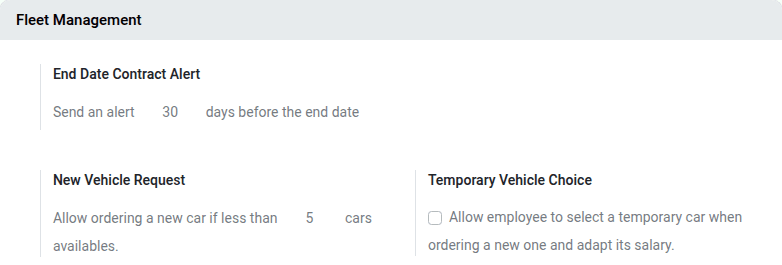
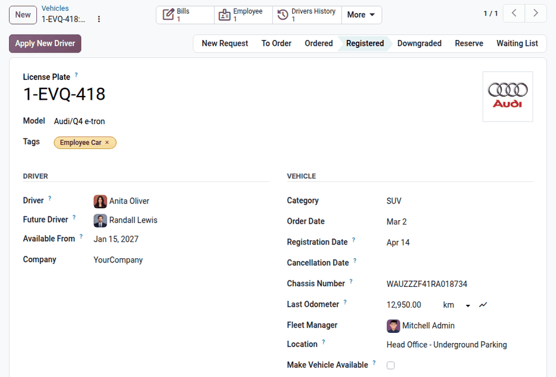
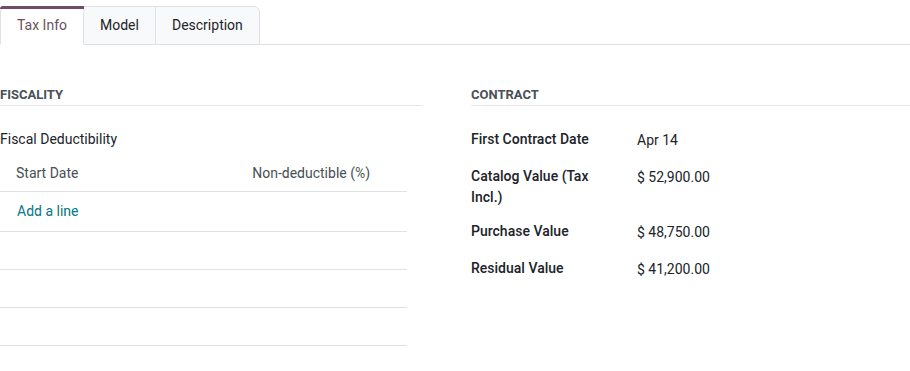
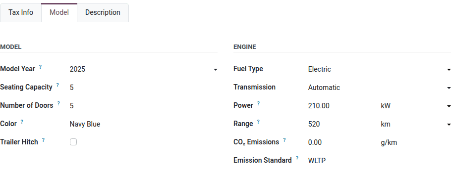

===============
Adding vehicles
===============

Odoo's **Fleet** app manages all vehicles, and the accompanying documentation that comes with
vehicle maintenance and driver records.

Upon opening the :menuselection:`Fleet` application, all vehicles are organized within the
:guilabel:`Vehicles` dashboard, which is the default dashboard. Each vehicle is displayed in its
corresponding Kanban stage, based on its status. The default stages are :guilabel:`New Request`,
:guilabel:`To Order`, :guilabel:`Registered`, and :guilabel:`Downgraded`. Stages can be added or
renamed in :menuselection:`Fleet app --> Configuration --> Vehicle: Status`.

.. _fleet/settings:

Settings
========

Before registering any vehicles, review the **Fleet** settings that directly affect day-to-day
operations and employee benefits. To access the settings, go to :menuselection:`Fleet app -->
Configuration --> Settings`.

- :ref:`End Date Contract Alert <fleet/end-contract>`: Notifies the vehicle contract's
  *Responsible* person a set number of days before the vehicle contract expires, so renewals or
  returns are not missed.
- :ref:`New Vehicle Request <fleet/request>` and :ref:`Temporary Vehicle Choice
  <fleet/temporary-vehicle>`: These settings only appear when the :doc:`Belgian payroll
  localization <../payroll/payroll_localizations/belgium>` is installed, and control which company
  cars employees can choose in the salary configurator.

.. _fleet/end-contract:

End Date Contract Alert
-----------------------

The :guilabel:`End Date Contract Alert` field shows how many days before the end of a vehicle
contract an alert should be sent. The :ref:`responsible parties <fleet/responsible>` receive an
activity informing them that a vehicle contract is about to expire in the number of days defined
in this field.

.. _fleet/responsible:

Responsible parties
~~~~~~~~~~~~~~~~~~~

Vehicle contracts (such as leasing or insurance contracts) are managed in the **Fleet** app, and are
independent from employee contracts. To determine the responsible person for a vehicle contract,
open the vehicle contract. The person listed as :guilabel:`Responsible` under the
:guilabel:`Information` section of the vehicle contract receives the alert.

To open a vehicle contract from a list of all vehicle contracts, navigate to :menuselection:`Fleet
app --> Fleet --> Contracts`, and all vehicle contracts appear in the list. Click on a contract to
open it, and look under :guilabel:`Responsible` to see who receives expiration alerts.

A vehicle contract can also be opened from a specific vehicle by navigating to
:menuselection:`Fleet app --> Fleet --> Fleet` and clicking on an individual vehicle. On the vehicle
form, click the :guilabel:`Contracts` smart button at the top of the page. Only contracts associated
with the vehicle appear in the list. Click on an individual contract to open it.

.. tip::
   When a vehicle contract has expired and does not need to be renewed, click :guilabel:`Mark as
   Done` on the contract. A *Done* contract no longer displays the renewal warning, and its renewal
   activity is removed. Use :guilabel:`Close` for contracts that were cancelled.

.. _fleet/request:

New vehicle request
-------------------

Enter the maximum number of available vehicles below which employees can order a new company car
through the salary configurator. Available vehicles are vehicles without an assigned driver. When
the total number of available vehicles is below this limit, employees can request a new company
car. Once the limit is reached, the option to order a new car is no longer offered by default.

.. example::
   If the :guilabel:`New Vehicle Request` limit is set to 20 vehicles, and there are 25 vehicles
   available, employees cannot request a new car and must select from the 25 already available. If
   there are only 10 cars available, then the employee would be able to request a new vehicle.

.. _fleet/temporary-vehicle:

Temporary vehicle choice
------------------------

Enable this option to allow employees ordering a new company car to select a temporary car, to use
until the new car is delivered. The employee's salary is adapted according to the temporary car.

Add a vehicle
=============

To add a new vehicle to the fleet from the :guilabel:`Vehicles` dashboard, click the :guilabel:`New`
button in the top-left corner, and a blank vehicle form loads. Then, proceed to enter the vehicle
information on the vehicle form.

.. _fleet/new_vehicle/vehicle-form:

Vehicle form fields
===================

- :guilabel:`License Plate`: Enter the vehicle's license plate number. Each license plate must be
  unique in the database. If left empty, the vehicle appears as :guilabel:`Unregistered`.
- :guilabel:`Model`: Using the drop-down menu, select the vehicle's model. Once a model is selected,
  the model's information (category, engine, seating capacity, etc.) auto-populates the
  corresponding fields of the vehicle form. If the model is not listed, type in the model name, and
  click either :guilabel:`Create "model"`, or :guilabel:`Create and edit...` to :ref:`create a new
  model and edit the model details <fleet/add-model>`.
- :guilabel:`Tags`: Select any tags from the drop-down menu. There is no limit on the amount of tags
  that can be selected. Tags are configured in :menuselection:`Fleet app --> Configuration -->
  Vehicle: Tags`.

.. tip::
   Once the vehicle is saved, smart buttons at the top of the form give access to the vehicle's
   :guilabel:`Drivers History`, :guilabel:`Contracts`, :guilabel:`Services`, and
   :guilabel:`Odometer` records. When the driver is an employee, an :guilabel:`Employee` smart
   button opens the employee's record.

.. _fleet/new_vehicle/new-driver:

Driver
------

This section of the vehicle form relates to the person who is currently driving the car, as well as
any plans for a change in the driver in the future, and when.

- :guilabel:`Driver`: Using the drop-down menu, select the driver for the vehicle. If the driver is
  not listed, :ref:`create the new driver and edit the driver details
  <fleet/new_vehicle/add-driver>`.

  .. important::
     A driver does *not* have to be an employee. When creating a new driver, the driver is added to
     the **Contacts** app (if installed), *not* in the **Employees** app.

- :guilabel:`Mobility Card`: This field only appears for companies located in Belgium. If the
  driver is an employee with a mobility card (such as a fuel or electricity card) registered on
  their employee record, the card number automatically appears in this field.
- :guilabel:`Future Driver`: If the next driver for the vehicle is known, select the next driver
  from the drop-down menu. Or, type in the next driver and click either :guilabel:`Create "future
  driver"` or :guilabel:`Create and edit...` to :ref:`create a new future driver, and edit the
  driver details <fleet/new_vehicle/add-driver>`.

  When a future driver is set, the :guilabel:`Make Vehicle Available` checkbox is automatically
  ticked on the vehicle that person currently drives, as that vehicle will soon be available.

  .. note::
     If this field is populated, an :guilabel:`Apply New Driver` button appears at the top of the
     vehicle form. Click the :guilabel:`Apply New Driver` button to make the future driver the
     current driver. The new driver is removed as the driver of their previous vehicle of the same
     type, and the change is recorded in the :guilabel:`Drivers History`.

- :guilabel:`Available From`: Using the calendar selector, select the date from which the vehicle
  becomes available for another driver. If this field is left blank, the vehicle is available
  immediately.
- :guilabel:`Company`: Select the company from the drop-down menu. This field only appears in a
  multi-company database.

.. note::
   With the **Payroll** app, when an employee chooses a company car in the salary configurator, or
   when a company car is added to the employee's benefits, the employee becomes the car's
   :guilabel:`Future Driver`. The fleet manager then applies the new driver once the car is handed
   over.

.. _fleet/new_vehicle/add-driver:

Create a new driver
~~~~~~~~~~~~~~~~~~~

If a driver is not already in the system, the new driver should first be configured and added to the
database. A new driver can be added either from the :guilabel:`Driver` or :guilabel:`Future Driver`
fields on the :ref:`vehicle form <fleet/new_vehicle/vehicle-form>`.

First, type in the name of the new driver in either the :guilabel:`Driver` or :guilabel:`Future
Driver` field, then click :guilabel:`Create and edit...`. A :guilabel:`Create Driver` or
:guilabel:`Create Future Driver` form appears, depending on which field initiated the form.

Both the :guilabel:`Create Driver` and :guilabel:`Create Future Driver` forms are identical, and are
stored in the **Contacts** app. :doc:`Configure the new contact <../../essentials/contacts>`, then
click :guilabel:`Save`.

.. note::
   Depending on the installed applications, different tabs or fields may be visible on the
   :guilabel:`Create Driver` and :guilabel:`Create Future Driver` forms.

.. _fleet/new_vehicle/general-info:

Vehicle
-------

This section captures key physical details of a vehicle. Selecting an existing :guilabel:`Model`
auto-fills the :guilabel:`Category`.

Fill in the following fields on the form:

- :guilabel:`Category`: Using the drop-down menu, select the vehicle category from the available
  options. If the **Inventory** app is installed, the category affects any configured :doc:`dispatch
  management system
  <../../inventory_and_mrp/inventory/shipping_receiving/setup_configuration/dispatch>`.
- :guilabel:`Order Date`: Using the calendar selector, select the date the vehicle was ordered.
  Keeping track of how long vehicles have been in the fleet can help when making decisions on
  expensive repairs, or help decide when to surrender a vehicle.
- :guilabel:`Registration Date`: Using the calendar selector, select the date the vehicle was
  registered. This field is optional, but for companies located in Belgium, it is needed to compute
  the car's benefit in kind.
- :guilabel:`Cancellation Date`: Using the calendar selector, select the date the vehicle's license
  plate was cancelled, for example, when the vehicle is sold, or no longer part of the fleet.
- :guilabel:`Chassis Number`: Enter the chassis number in the field. This is known in some countries
  as the :abbr:`VIN (Vehicle Identification Number)` number. Every vehicle has a unique number, so
  in the event of a theft or accident, a vehicle can be identified with this unique number.
- :guilabel:`Last Odometer`: Enter the last known odometer reading in the number field. Using the
  drop-down menu next to the number field, select whether the odometer reading is in kilometers
  :guilabel:`(km)` or miles :guilabel:`(mi)`. Click the :guilabel:`(Odometer Report)` icon at the
  end of the line to open the :doc:`odometer analysis <odometers>` of the vehicle.
- :guilabel:`Fleet Manager`: Select the fleet manager from the drop-down menu. The fleet manager
  receives an activity to review the change whenever the driver or future driver of the vehicle
  changes.
- :guilabel:`Location`: Type in the specific location where the vehicle is typically located in this
  field. The entry should clearly explain where the vehicle can be found, such as `Main Garage` or
  `Building 2 Parking Lot`. This is crucial information for companies with many locations where
  vehicles are stored.
- :guilabel:`Make Vehicle Available`: Tick the checkbox if the vehicle can be selected when an
  employee fills out the :ref:`salary configurator
  <recruitment/offer_job_positions/configure-package>`.

Tax Info tab
------------

Depending on the localization setting for the database, and what additional applications are
installed, other fields may be present on the form.

Fiscality
~~~~~~~~~

- :guilabel:`Fiscal Deductibility`: When the **Accounting** app is installed, configure the
  percentage of the vehicle-related costs (fuel, maintenance, depreciation, etc.) that **cannot**
  be deducted from the company's taxable income. Click :guilabel:`Add a line`, then enter the
  :guilabel:`Start Date` from which the rate applies, and the :guilabel:`Non-deductible (%)` rate.

For companies located in Belgium, the :guilabel:`BIK` (yearly benefit in kind), the :guilabel:`CO2
Fee` (monthly), and the :guilabel:`Tax Deduction` of the car are computed and displayed in this
section.

Contract
~~~~~~~~

- :guilabel:`First Contract Date`: Select the start date for the vehicle's first contract using the
  calendar selector. Typically this is the day the vehicle is purchased or leased.
- :guilabel:`Catalog Value (Tax Incl.)`: Enter the :abbr:`MSRP (Manufacturer's Suggested Retail
  Price)` for the vehicle at the time of purchase or lease.
- :guilabel:`Purchase Value`: Enter the purchase price or the original value of the lease for the
  vehicle.
- :guilabel:`Residual Value`: Enter the current value of the vehicle.

For companies located in Belgium, the :guilabel:`Total Cost (Depreciated)` of the vehicle per
month, including the CO2 fee, is also displayed.

.. note::
   The values listed above affect the accounting department. It is recommended to check with the
   accounting department for more information and/or assistance with these values.

Model tab
---------

If the model for the new vehicle is already configured in the database, the :guilabel:`Model` and
:guilabel:`Engine` sections are populated with the corresponding information. If the model is *not*
already in the database and the :guilabel:`Model` tab needs to be configured, :ref:`configure the
new vehicle model <fleet/add-model>`.

Check the information in the :guilabel:`Model` tab to ensure it is accurate. The
:guilabel:`Color` and :guilabel:`Trailer Hitch` fields are specific to each vehicle, and are not
copied from the model. For bikes, the :guilabel:`Bike Frame Type`, :guilabel:`Frame Size`, and
:guilabel:`Electric Assistance` fields appear instead.

Description tab
---------------

Enter any other information related to the vehicle in this tab. This description is displayed in
the salary configurator when the vehicle is offered to employees.

.. seealso::
   - :doc:`../fleet/models`
   - :doc:`../fleet/service`
   - :doc:`../fleet/accidents`
