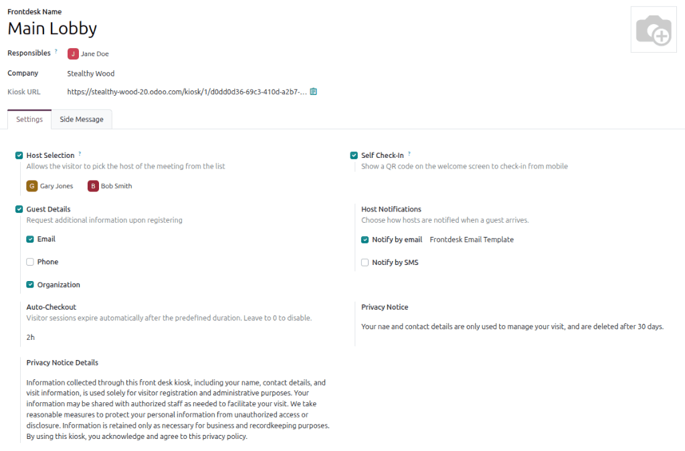
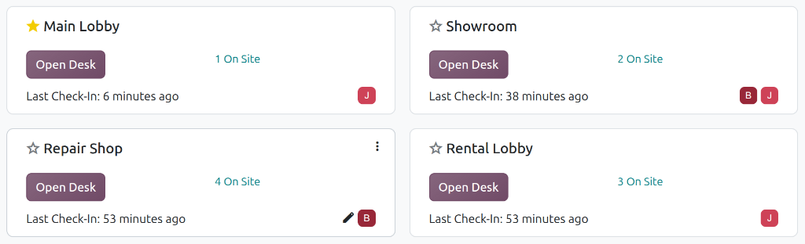
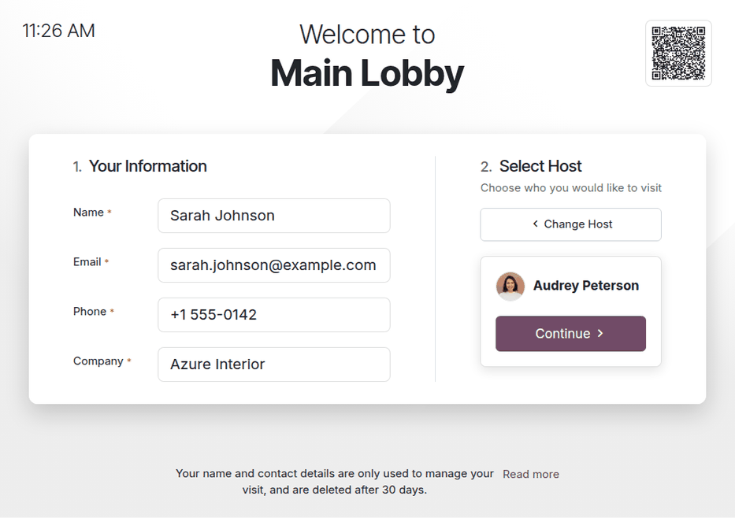
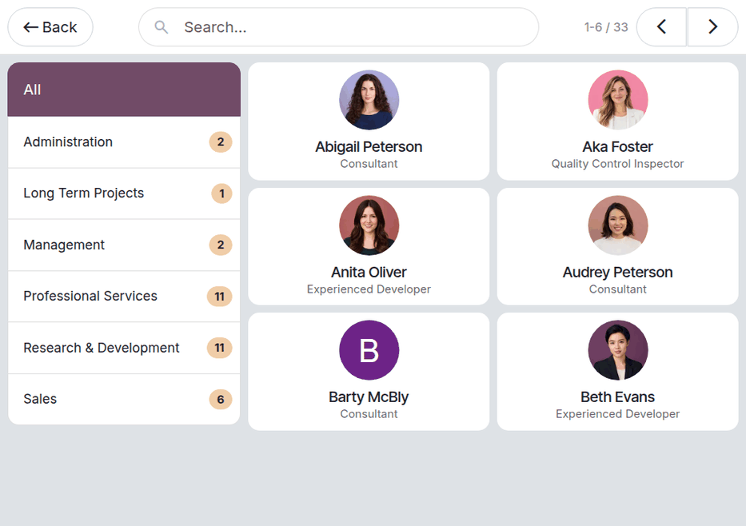
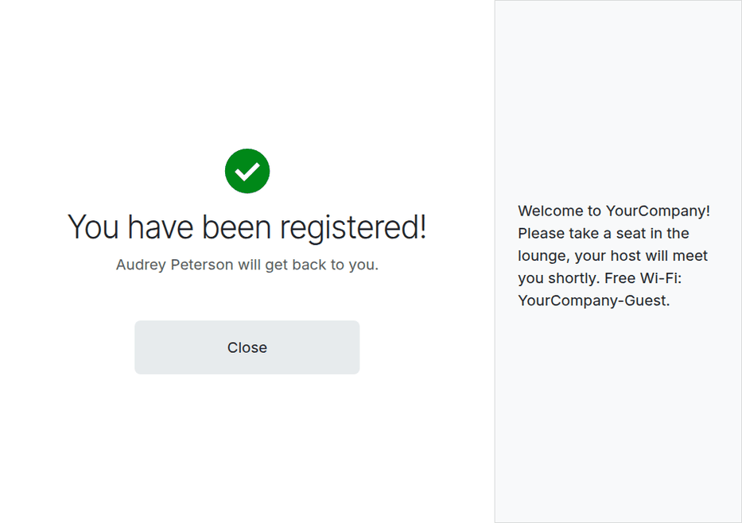

:show-content:

=========
Frontdesk
=========

The Odoo **Frontdesk** application provides a way for visitors to check in to a building or
location, and alert the person they are meeting about their arrival.

This application is ideal for businesses that do **not** have someone working at a reception desk,
or locations **without** a designated waiting area available to guests and visitors.

Configuration
=============

The only item to configure in the **Frontdesk** application is the *station*.

.. _frontdesk/stations:

Stations
--------

In Odoo's **Frontdesk** application, a *station* can be thought of as any location where someone can
sign in and wait for an employee. This is typically some form of waiting room, such as a lobby. Each
station has a kiosk where visitors check in.

When setting up the **Frontdesk** application, a minimum of one station **must** be configured, but
there is no limit to how many stations can be created and configured.

To create a station, navigate to :menuselection:`Frontdesk app --> Stations`, and click
:guilabel:`New`. When clicked, a blank station form appears.

Enter the following information on the form:

- :guilabel:`Frontdesk Name`: Enter a name for the specific frontdesk location. This should be short
  and identifiable, such as `Reception Desk` or `Main Lobby`. This field is required.
- :guilabel:`Responsibles`: Select the users who are notified, in the **Discuss** app, every time a
  visitor checks in at this station. Multiple selections can be entered. This field is required.
- :guilabel:`Company`: The company the station belongs to. This field only appears in multi-company
  databases.
- :guilabel:`Kiosk URL`: This field is automatically populated when the station is saved. This URL
  is one way the station's kiosk is accessed. Click the :icon:`fa-clipboard` :guilabel:`(Copy)` icon
  at the end of the URL to copy it.

.. tip::
   To add an image to the station, hover over the :icon:`fa-camera` :guilabel:`(camera)` icon in the
   top-right of the form, and click the :icon:`fa-pencil` :guilabel:`(Edit)` icon that appears.
   Navigate to the desired image file, then click :guilabel:`Open` to select it.

   The image selected for the station appears as the background image of the station kiosk.

.. _frontdesk/settings-tab:

Settings tab
~~~~~~~~~~~~

.. _frontdesk/host:

- :guilabel:`Host Selection`: Allows the visitor to select the employee they are visiting (the
  *host*) from a list, so that this person is notified. By default, all the employees of the
  company can be selected. To restrict the list, select the available employees in the
  :guilabel:`Select Hosts` field that appears beneath.
- :guilabel:`Self Check-In`: Displays a QR code on the kiosk welcome screen. The QR code allows
  guests to check in using their mobile device, instead of using the kiosk. This option is
  recommended for a busy kiosk with multiple guests checking in at any time.
- :guilabel:`Guest Details`: Requests additional information when a guest checks in. Tick the
  checkbox next to each detail to request: :guilabel:`Email`, :guilabel:`Phone`, and
  :guilabel:`Organization`. The requested details are mandatory on the kiosk. When this option is
  disabled, guests only enter their name.
- :guilabel:`Host Notifications`: Choose how hosts are notified when a guest arrives, in addition to
  the **Discuss** notification hosts with a user account receive:

  - :guilabel:`Notify by email`: An email is sent to the host's work email, using the template
    selected in the field that appears (by default, :guilabel:`Frontdesk Email Template`).
  - :guilabel:`Notify by SMS`: An SMS is sent to the host's work phone, using the template selected
    in the field that appears (by default, :guilabel:`Frontdesk SMS Template`).

- :guilabel:`Auto-Checkout`: Enter a duration, in hours and minutes, after which checked-in visitors
  are automatically checked out. Leave this field to `00:00` to disable automatic check-out.
- :guilabel:`Privacy Notice`: Enter a short summary of how visitors' personal data is processed.
  This text is displayed at the bottom of the kiosk welcome screen.
- :guilabel:`Privacy Notice Details`: Enter the full privacy notice, covering data storage, rights,
  and contact information. Visitors can display this text by clicking :guilabel:`Read more` on the
  kiosk.

.. note::
   The host notification options are only useful if :ref:`Host Selection <frontdesk/host>` is
   enabled. If no host is selected, only the station's :guilabel:`Responsibles` are notified.

Side Message tab
~~~~~~~~~~~~~~~~

Enter any desired text to appear on the station kiosk after a guest has checked in, such as a
welcome greeting or any necessary instructions. The text appears on the confirmation page, on the
right side of the screen, after a guest has completed the check-in process.

.. _frontdesk/dashboard:

Station dashboard
=================

The :menuselection:`Frontdesk app --> Stations` dashboard displays a card for each station, with
the following information:

- :guilabel:`Open Desk`: A button to open the station's :ref:`kiosk <frontdesk/kiosk>`.
- :guilabel:`On Site`: The number of visitors currently checked in at this station. Click it to open
  the list of these visitors.
- :guilabel:`Last Check-In`: How long ago the last visitor checked in.
- The avatars of the station's :guilabel:`Responsibles`.

Click the :icon:`fa-star-o` :guilabel:`(star)` icon next to a station's name to mark it as a
favorite. Click a card to open all the visitors of the station. To modify a station, click the
:icon:`fa-ellipsis-v` :guilabel:`(vertical ellipsis)` icon on its card, then click
:guilabel:`Configuration`.

.. _frontdesk/kiosk:

Kiosk setup
===========

Set up each kiosk for use after configuring the various stations. It is recommended to use a
dedicated device for each frontdesk kiosk, such as a tablet.

Navigate to the kiosk in one of the following ways:

- Navigate to the :menuselection:`Frontdesk app --> Stations` dashboard, and click the
  :guilabel:`Open Desk` button on the desired station card. The kiosk loads in the current browser
  tab.
- Open the station form, and click the :guilabel:`Open Kiosk` button. A pop-up window displays the
  kiosk URL to open on the kiosk device, and an :guilabel:`Install App` button to install the kiosk
  as an application on the device.
- Copy the :guilabel:`Kiosk URL` from the station form, and paste it into a browser on the kiosk
  device.

.. important::
   Once a frontdesk kiosk is accessed, the user is *automatically signed out of the database* on
   that specific device.

   This is a security measure designed to prevent unauthorized access to the database.

.. _frontdesk/visitor-flow:

Visitor check-in
================

When a visitor arrives, they fill out the *Your Information* section of the kiosk welcome screen:
their :guilabel:`Name`, and the :guilabel:`Email`, :guilabel:`Phone`, and :guilabel:`Company`
details requested by the station's :guilabel:`Guest Details` setting.

If :guilabel:`Host Selection` is enabled, the visitor then clicks :guilabel:`Browse All Hosts` in
the *Select Host* section. A list of hosts appears, which can be filtered by department, or searched
by name. The visitor clicks the person they are visiting, then clicks :guilabel:`Continue`. If
:guilabel:`Host Selection` is disabled, the visitor clicks :guilabel:`Check In`.

A confirmation screen appears, displaying the station's side message. The visitor is recorded as
checked in, and the station's responsibles and the host are notified.

.. note::
   If the selected host is on time off, or no longer works for the company, the visitor is informed
   that their host is not available, by email if the station requests the visitor's email (and by
   SMS if the station requests their phone number and the *Frontdesk SMS* module is installed).

If :guilabel:`Self Check-In` is enabled, visitors can instead scan the QR code displayed in the
top-right corner of the welcome screen with their mobile device, and fill out the same information
on their phone, in the language selected on the kiosk.

Reporting
=========

To analyze visits, navigate to :menuselection:`Frontdesk app --> Visitors`, remove the default
filters, and click the :icon:`fa-area-chart` :guilabel:`(Graph)` or :icon:`oi-view-pivot`
:guilabel:`(Pivot)` icon in the top-right corner. By default, the graph displays the number of
visitors by station.

As with all reports in Odoo, the filters and groups can be modified to show other metrics, as well.

.. seealso::
   - :doc:`frontdesk/visitors`

.. toctree::
   :titlesonly:

   frontdesk/visitors
