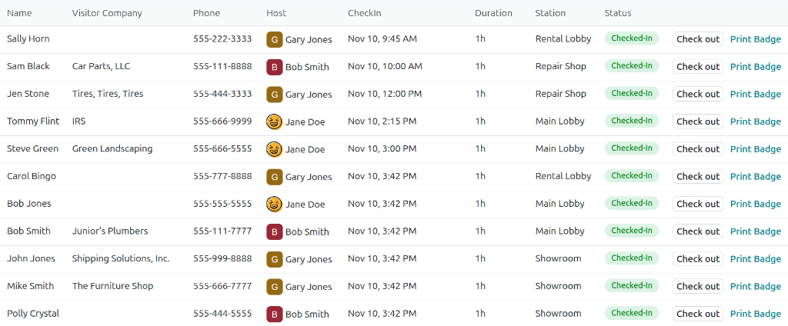
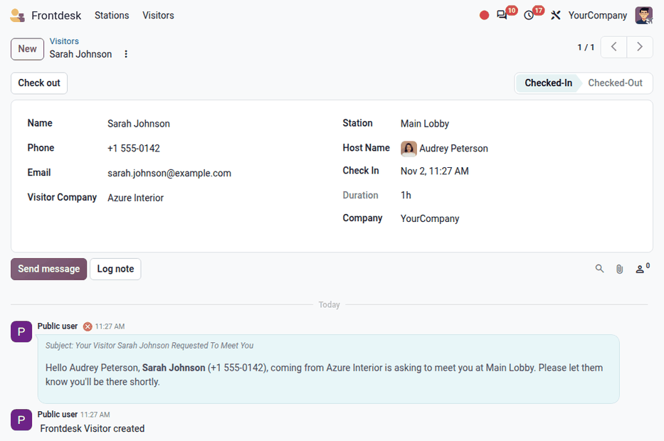

========
Visitors
========

In the Odoo **Frontdesk** application, a *visitor* refers to any non-employee (e.g., repair person,
job candidate, auditor, etc.). Visitor arrivals and departures are typically logged for security
purposes, ensuring an accurate record of who is on the premises at any given time.

.. _frontdesk/list:

Visitor list
============

To access the list of all visitors for all stations, navigate to :menuselection:`Frontdesk app -->
Visitors`. By default, the list only displays visitors who are currently checked in
(:guilabel:`Checked-In` and :guilabel:`Date: MMM DD` filters are active). Remove these filters in
the search bar to view all visitors.

All visitors are presented in a default list view, with the following details that were entered
upon check in:

- :guilabel:`Name`: The guest's name.
- :guilabel:`Visitor Company`: The company the guest represents.
- :guilabel:`Phone`: The guest's phone number.
- :guilabel:`Host`: The employee the guest is visiting.
- :guilabel:`CheckIn`: The date and time the guest checked in.
- :guilabel:`Duration`: The amount of time the guest has been checked in.
- :guilabel:`Station`: The station the guest checked in at.
- :guilabel:`Status`: The status of the guest. All guests in this list have a status of
  :guilabel:`Checked-In`.

When a guest leaves, click the :guilabel:`Check out` button at the end of their line to log the date
and time they left. To check out several guests at once, click the checkbox next to each guest,
click the :icon:`settings_f` :guilabel:`Actions` button, then click :guilabel:`Check out`.

If the :guilabel:`Auto-Checkout` feature is enabled on the :ref:`station
<frontdesk/settings-tab>`, guests are automatically checked out once the configured duration has
passed.

Click the :guilabel:`Print Badge` button at the end of a checked-in guest's line to download a PDF
file of the visitor's badge. The badge displays the date and time the visitor checked in, the
visitor's name and company, who they are visiting, and the logo of the company they are visiting.

.. _frontdesk/planned:

Register a visitor manually
===========================

If a guest arrives and does not check in using a kiosk, they can be registered from the backend.
Navigate to :menuselection:`Frontdesk app --> Visitors`, click :guilabel:`New`, and a blank visitor
form loads. Enter the guest's information on the visitor form, including their :guilabel:`Name`,
:guilabel:`Phone`, :guilabel:`Email`, and :guilabel:`Visitor Company`, the :guilabel:`Station`, and
the :guilabel:`Host Name`.

The guest is checked in as soon as the record is saved, and the station's responsibles and the
host are notified, as with a kiosk check-in.

To check out a guest from their form, click the :guilabel:`Check out` button in the upper-left
corner. The notifications sent to the host are logged in the chatter of the visitor form.

Visitor flow
============

When a visitor arrives at a facility, they approach a :ref:`Frontdesk kiosk <frontdesk/kiosk>`, and
enter their information. If the station allows it, they select the host they are visiting. See
:ref:`frontdesk/visitor-flow` for details.

Once the visitor is checked in, the following people are notified:

- The station's :guilabel:`Responsibles` receive a message from OdooBot in the **Discuss** app, such
  as `Frontdesk Check-In: John Smith ((644)-169-1353) (Smith LLP) to meet Marc Demo`.
- The host, if they have a user account, receives a **Discuss** message stating that the visitor
  just checked in.
- The host receives an email and/or an SMS, depending on the station's :guilabel:`Host
  Notifications` settings.

.. note::
   The **Discuss** app is installed by default when creating an Odoo database, and does not count
   towards billing. As long as the **Discuss** application is not intentionally uninstalled, the
   notifications work.

.. important::
   Visitors do **not** check themselves out when they leave. It is important for **Frontdesk** users
   to check out visitors for accurate record-keeping.

   Always have an accurate list of who is on the premises at any given time. This is important for
   security purposes, and in the case of an emergency.
