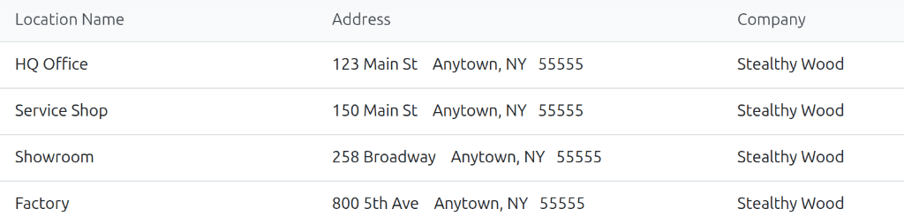
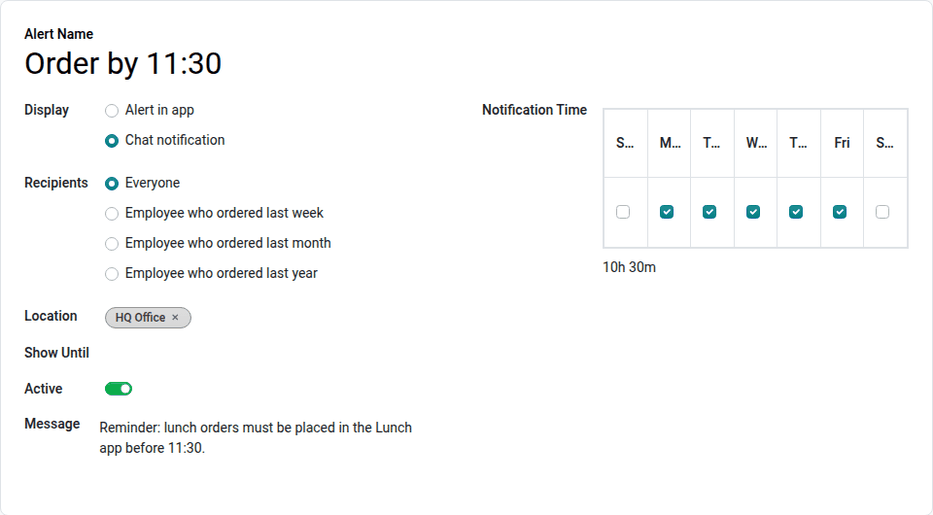

:show-content:

=====
Lunch
=====

The **Lunch** application in Odoo allows users to conveniently order food and pay for their meal
directly from the database.

Before employees can use the **Lunch** application, there are a number of configurations that need
to be made: :ref:`settings <lunch/settings>`, :doc:`vendors <lunch/vendors>`, :ref:`locations
<lunch/locations>`, :doc:`products <lunch/products>`, and :ref:`product categories
<lunch/product-categories>`. Once these are created and configured, employees can view offerings and
order food.

.. _lunch/settings:

Settings
========

In the :guilabel:`Settings` menu, only two items need to be configured: overdraft settings and
notifications. To access the settings, navigate to :menuselection:`Lunch app --> Configuration -->
Settings`.

Configure the following:

- :guilabel:`Lunch Overdraft`: Enter the maximum negative balance employees can reach in the
  :guilabel:`Overdraft` field. The default value of `0.00` means employees can only order what their
  :doc:`lunch account <lunch/user-accounts>` balance covers. The currency is the company's currency.
- :guilabel:`Reception notification`: Set the message users receive when a **Lunch** manager
  :ref:`notifies them that their order has been delivered <lunch/notify>`. The default message
  `Your lunch has been delivered. Enjoy your meal!` populates this field, but can be modified, if
  desired.

Both settings are defined per company.

.. note::
   If several languages are :doc:`installed <../general/users/language>` in the database, the
   :guilabel:`Reception notification` message, as well as the names and descriptions of products,
   the names of product categories, and the names and messages of alerts, can be translated. Click
   the language code (for example, :guilabel:`EN`) displayed next to the field to open the
   translation pop-up window, enter the text for each language, then click :guilabel:`Save`.

.. _lunch/locations:

Locations
=========

By default, Odoo creates an `HQ Office` location when the **Lunch** application is installed. If a
company has more than one location, they must be configured.

To add a location, navigate to :menuselection:`Lunch app --> Configuration --> Locations`. The
currently configured locations appear in a list view. Click the :guilabel:`New` button in the
top-left corner and a blank line appears beneath the last location in the list.

Enter the name of the location in the :guilabel:`Location Name` field. Next, click into the
:guilabel:`Address` field to the right of the name, and enter the location's address. It is possible
to enter multiple lines in the address field. In a multi-company database, select the
:guilabel:`Company` the location belongs to.

Repeat this for all locations that need to be added.

.. _lunch/alerts:

Alerts
======

It is possible to set up alerts that can either be displayed in the **Lunch** app, or be sent to
specific employees via the **Discuss** app.

To set up an alert, navigate to :menuselection:`Lunch app
--> Configuration --> Alerts`. Click the :guilabel:`New` button in the top-left corner and a blank
lunch alert form loads. Enter the following information on the form:

- :guilabel:`Alert Name`: Enter a name for the alert. This should be short and descriptive, such as
  `New Lunch Vendor` or `Order by 11:30`. This field is **required**.
- :guilabel:`Display`: Select how the alert is shown. The options are:

  - :guilabel:`Alert in app`: The alert is visible on the main **Lunch** app dashboard, in an orange
    box, above the user's name on the right side of the dashboard.
  - :guilabel:`Chat notification`: The alert is sent to users as a notification, received in their
    **Discuss** inbox or by email, depending on their notification preferences. If this option is
    selected, the following additional field appears:

    - :guilabel:`Recipients`: Select who receives the chat alert. The options are:
      :guilabel:`Everyone` (every user who has already placed a lunch order), :guilabel:`Employee
      who ordered last week`, :guilabel:`Employee who ordered last month`, or :guilabel:`Employee
      who ordered last year`.

- :guilabel:`Location`: Select the locations the alert appears for using the drop-down menu.
  Multiple locations can be selected. This field is **required**, therefore, if the alert applies to
  all locations, select all the locations from the drop-down menu. Chat notifications are only sent
  to users whose last lunch location is one of the selected locations.
- :guilabel:`Show Until`: If the alert should expire on a specific date, select the date from the
  calendar picker.
- :guilabel:`Active`: This option is enabled (appears green) by default. To turn off the alert,
  click the toggle so that it no longer appears green.
- :guilabel:`Message`: Enter the alert message in this field. This field is **required**.
- Days of the week: Tick the days of the week the alert is visible or sent. By default, all seven
  days are ticked.
- :guilabel:`Notification Time`: This field **only** appears if :guilabel:`Chat notification` is
  selected for the :guilabel:`Display` option. Enter the time the chat message is sent, in the
  24-hour `HH:MM` format (for example, `10:30`).

         employees to order before 11:30.

.. seealso::
   - :doc:`lunch/vendors`
   - :doc:`lunch/products`
   - :doc:`lunch/orders`
   - :doc:`lunch/user-accounts`
   - :doc:`lunch/management`

.. toctree::
   :titlesonly:

   lunch/vendors
   lunch/products
   lunch/orders
   lunch/user-accounts
   lunch/management
