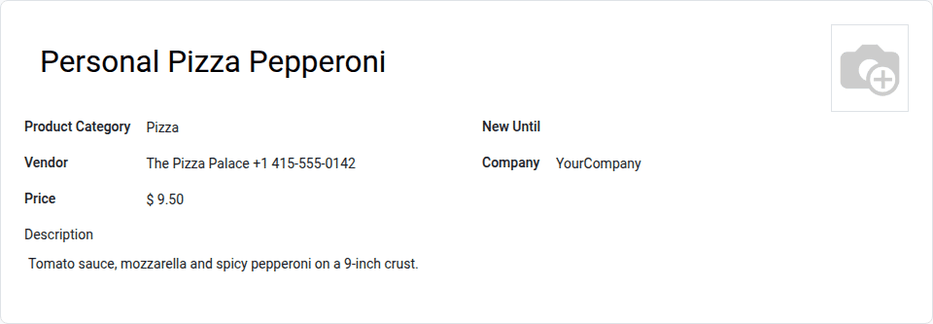
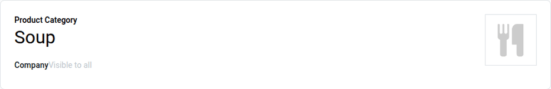

========
Products
========

Odoo's **Lunch** app does *not* come with any products preconfigured. The individual products being
offered must first be configured before orders can be placed.

To add and configure products for the **Lunch** app, navigate to :menuselection:`Lunch app -->
Configuration --> Products`. Next, click the :guilabel:`New` button in the top-left corner, and a
blank product form loads.

Enter the following information on the form:

- :guilabel:`Product Name`: Enter the name for the product. This field is **required**.
- :guilabel:`Product Category`: Using the drop-down menu, select the :ref:`category
  <lunch/product-categories>` this product falls under. This field is **required**.
- :guilabel:`Vendor`: Using the drop-down menu, select the :doc:`vendor <vendors>` that supplies
  this product. This field is **required**.
- :guilabel:`Price`: Enter the price for the product. The currency is determined by the company's
  localization. This field is **required**.
- :guilabel:`New Until`: Using the calendar popover, select the date until which the product is
  labeled as new. Until this date, a green :guilabel:`New` tag appears on the product.
- :guilabel:`Company`: This field is populated with the vendor's company, and **only** appears in a
  multi-company database. If this field is left blank, the product is visible to **all** companies.
- :guilabel:`Description`: Enter a description of the product in this field. This description
  appears on the product card when users are viewing the available options.
- **Image**: Hover over the image box in the top-right corner of the form, and click the
  :icon:`edit_f` :guilabel:`(Edit)` icon that appears. A file explorer pop-up window appears.
  Navigate to the image, then click :guilabel:`Open`. If no image is set, the image of the product
  category is displayed.

.. _lunch/product-categories:

Product categories
==================

Product categories organize the offerings in the **Lunch** app, and allows users to filter offerings
when reviewing the menu for the day.

To add or modify categories, navigate to :menuselection:`Lunch app --> Configuration --> Product
Categories`. The available categories appear in a list view.

In the **Lunch** app, there are four default categories: :guilabel:`Sandwich`, :guilabel:`Pizza`,
:guilabel:`Burger`, and :guilabel:`Drinks`.

To add a new category, click the :guilabel:`New` button in the top-left corner, and a blank category
form loads.

Enter a name in the :guilabel:`Product Category` field. If the category is company-specific and
should only appear for a certain company, select the :guilabel:`Company` from the drop-down menu.
If this field is left blank, the category is visible to all companies.

If desired, add a photo for the category. Hover over the image box in the top-right, and click the
:icon:`edit_f` :guilabel:`(Edit)` icon that appears. This opens a file explorer pop-up window.
Navigate to the image, then click :guilabel:`Open`.

