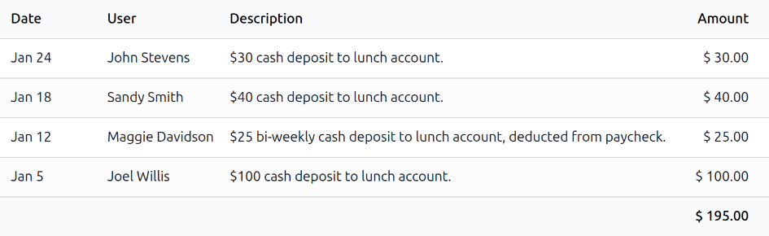
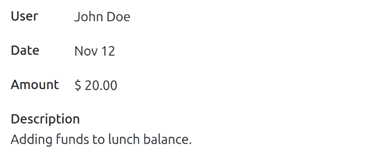
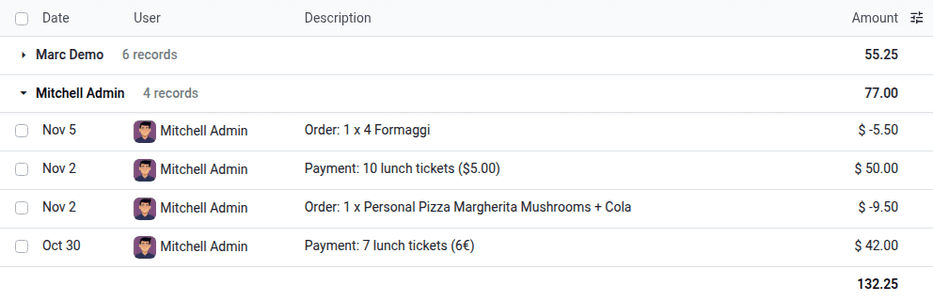

====================
Manage user accounts
====================

In Odoo's **Lunch** application, users pay for products directly from their **Lunch** app account.
For funds to appear in their account, a **Lunch** app manager must transfer funds into each user's
account.

.. important::
   To add funds and manage user accounts, the user must have *Administrator* :doc:`access rights
   <../../general/users/access_rights/>` for the **Lunch** application. Access rights can be managed
   by navigating to the :menuselection:`Settings app` and clicking :icon:`east`
   :guilabel:`Manage Users`. Click on a user to view their individual access rights.

The **Lunch** application does **not** directly interface in any way with software or products
linked to any monetary accounts or billing. Money **cannot** be transferred from users' bank
accounts, nor can users' credit cards be charged.

Odoo's **Lunch** application **only** allows for manual entries of cash exchanges that are handled
by the **Lunch** app manager. It is up to each individual company to create the method with which
lunch accounts are replenished.

.. example::
   Some examples of how lunch money can be organized and transferred within a company:

   - Cash is handed to the **Lunch** app manager, who then updates the user's account.
   - Money is deducted from the user's payslips, then the **Lunch** app manager updates the account
     when payslips are issued. This requires creating a :doc:`payslip adjustment
     <../payroll/salary_attachments>` for the employee in the **Payroll** app. The **Lunch** app
     does **not** create this deduction automatically.
   - Companies can sell "lunch tickets" at a set price (for example, one ticket costs $5.00). Users
     can purchase tickets from a **Lunch** app manager, who then updates the user's account.

.. _lunch/cash-moves:

Cash Moves
==========

To add funds to user accounts, each cash move must be individually logged. To view all cash move
records, or create a new cash move, navigate to :menuselection:`Lunch app --> Manager --> Cash
Moves`. Doing so reveals the *Cash Moves* dashboard.

On the *Cash Moves* dashboard, all cash moves are presented in a default list view,
displaying each record's :guilabel:`Date`, :guilabel:`User`, :guilabel:`Description`, and
:guilabel:`Amount`. The total of all the cash moves is displayed at the bottom of the
:guilabel:`Amount` column.

Add funds
---------

To add funds to a lunch account, click the :guilabel:`New` button, located in the upper corner of
the :guilabel:`Cash Moves` dashboard.

A blank *Lunch Cashmove* form loads. Enter the following information on the form:

- :guilabel:`User`: Select the user depositing cash into their account from the drop-down menu. The
  signed-in user populates this field by default. This field is **required**.
- :guilabel:`Date`: Select the date the transaction occurred using the calendar popover. The current
  date populates this field by default.
- :guilabel:`Amount`: Enter the amount being added to the lunch account. A negative amount can be
  entered to withdraw money from the account.
- :guilabel:`Description`: Enter a brief description of the transaction.

Control Accounts
================

The main *Control Accounts* dashboard provides an overview of every transaction in the **Lunch**
app, including all cash deposits and purchases. To access this dashboard, navigate to
:menuselection:`Lunch app --> Manager --> Control Accounts.`

Transactions are grouped :guilabel:`By Employee`, and listed alphabetically by the user's first
name. Their available balance is displayed in the :guilabel:`Amount` column. This takes into account
all deposits and the orders with an :guilabel:`Ordered`, :guilabel:`Sent`, or :guilabel:`Received`
status.

Individual transactions are hidden in the default view. To view all transactions for a specific
user, click the :icon:`arrow_right` :guilabel:`(right arrow)` icon next to their name to
expand the full list of transactions associated with their lunch account.

Each line includes the transaction :guilabel:`Date`, :guilabel:`User`, :guilabel:`Description`, and
:guilabel:`Amount`.

.. important::
   The :guilabel:`Control Accounts` dashboard is a view-only list of transactions within the
   **Lunch** app, and does **not** allow modifications to be made to any records listed.

   Cash moves can be modified through the :ref:`Cash Moves <lunch/cash-moves>` dashboard, only.

   Product-related records **cannot** be modified.
