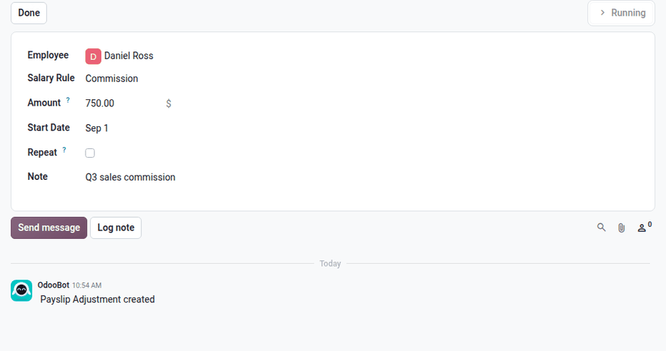

===========
Commissions
===========

Commissions are payments earned by employees on top of their salary, usually after a sale is made.
The amount is typically a percentage of the sale, or follows a commission plan defined by the
company. Commissions can be computed with the :doc:`Commissions <../../sales/sales/commissions>`
feature of the **Sales** app.

In the **Payroll** app, a commission is paid as a :ref:`salary input
<payroll/payslips/salary-inputs>` of the employee's payslip, using a salary rule of the pay
structure that accepts commissions. For example, the United States pay structure provides a
:guilabel:`Commission` salary rule, which adds the amount to the gross pay, so that it is taxed
like the salary.

.. note::
   The salary rules available for commissions depend on the installed :doc:`payroll localization
   <payroll_localizations>`. If the pay structure has no such rule, ask the accounting department
   before :doc:`creating one <salary_rules>`.

Pay a commission
================

To pay a commission on the next payslip of an employee, create a :doc:`payslip adjustment
<salary_attachments>`:

#. Open the employee record, from :menuselection:`Payroll app --> Employees --> Employees`, and
   click the *Payslip Adjustments* tab.
#. Click :guilabel:`Add Adjustment`.
#. Select the :guilabel:`Commission` :guilabel:`Salary Rule`, and enter the :guilabel:`Amount` of
   the commission.
#. Set the :guilabel:`Start Date` within the next pay period, leave the :guilabel:`Repeat` checkbox
   unticked, and enter a :guilabel:`Payslip Description`, such as `Q3 sales commission`. The
   description appears on the payslip.
#. Click :guilabel:`Save & Close`.

The commission is automatically added to the employee's next payslip. To pay commissions to several
employees at once, select them in the list view of the employees, and click the :guilabel:`Payslip
Adjustment` button.

Alternatively, if the payslip is already created and not validated yet, open it, click
:guilabel:`Add Inputs`, select the :guilabel:`Commission` salary rule, enter the amount, then click
:guilabel:`Compute`.

.. seealso::
   - :doc:`salary_attachments`
   - :doc:`payslips`
