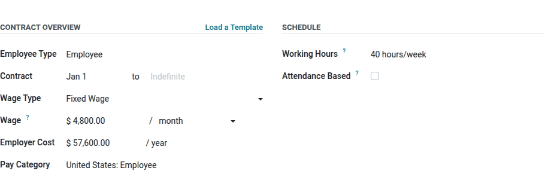
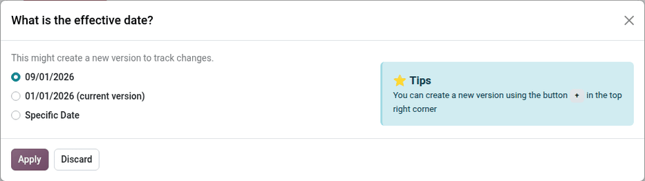
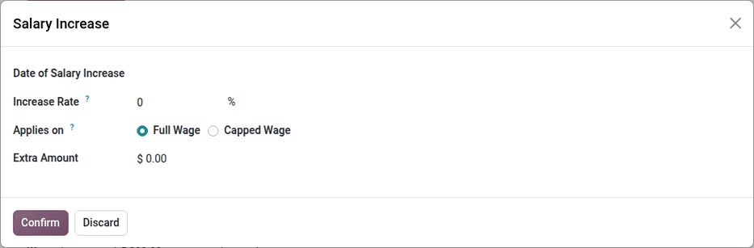
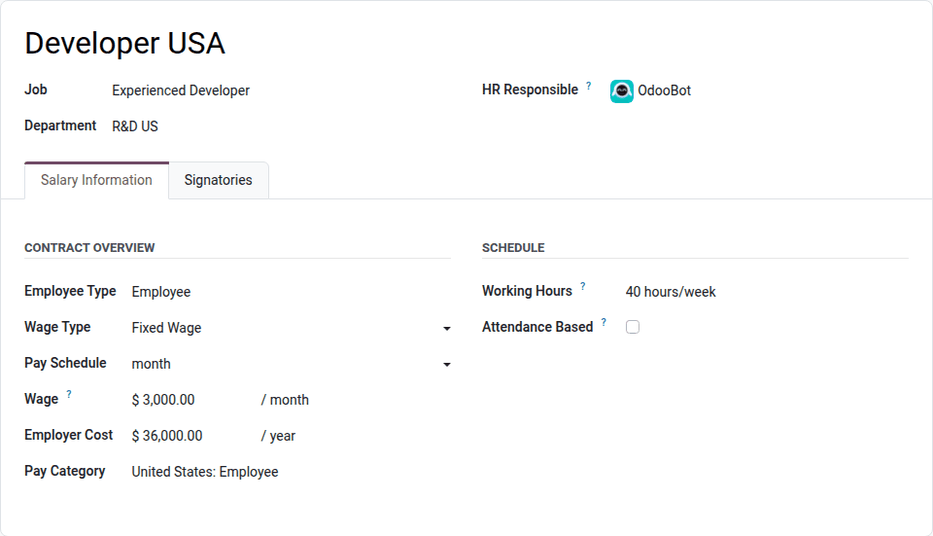

=========
Contracts
=========

In Odoo, an employee's contract is not a separate document: the contractual terms (contract dates,
employee type, wage, pay category, working hours, etc.) are stored directly on the employee record,
in the *Payroll* tab. To be included in payroll, an employee **must** have a contract start date
covering the pay period.

Each change to these terms is kept in a dated *version* of the employee record. The **Payroll** app
uses the version that is valid on each day of a pay period to compute the payslip, so a salary
change in the middle of a month, for example, is correctly prorated.

Employee records can be found by navigating to :menuselection:`Payroll app --> Employees -->
Employees`, or on the main dashboard of the **Employees** app.

.. note::
   The *Payroll* tab is visible to **Payroll** users only. Depending on the installed
   :doc:`payroll localization <payroll_localizations>`, additional sections and fields appear in
   this tab, such as tax or benefit information. The tab also displays the employee-level
   :ref:`salary inputs <payroll/salaries/salary-input-types>` of the employee's pay structure.

.. _payroll/new-contract:

Set up an employee's contract
=============================

Open the employee record, then click the *Payroll* tab. To prefill the fields with standard
values, click :guilabel:`Load a Template` in the *Contract Overview* section, select a
:ref:`contract template <payroll/contract-template>` in the pop-up that appears, then click
:guilabel:`Load
Template`. The fields of the template are copied to the employee record, and can then be adjusted
for the specific employee.

.. _payroll/gen-info:

Contract overview section
-------------------------

- :guilabel:`Employee Type`: Select the type of employment, such as :guilabel:`Employee`,
  :guilabel:`Student`, or :guilabel:`Intern`. Employee types are managed in
  :menuselection:`Payroll app --> Configuration --> Contracts --> Employee Types`. They are used to
  filter employees when :ref:`creating a pay run <payroll/new-pay-run>`, and some localizations
  rely on them (for example, for social security declarations).
- :guilabel:`Contract`: Enter the start date of the contract in the first field. If the contract
  ends on a known date, enter it in the :guilabel:`to` field; otherwise, leave it empty
  (:guilabel:`Indefinite`). Without a start date, the employee is considered :guilabel:`Not
  Employed`, and is not included in pay runs.

  When a contract has an end date, a :guilabel:`New Contract` button appears next to it. Click it,
  then select the start date of the new contract, to rehire the employee under a new contract.
- :guilabel:`Wage Type`: Select :guilabel:`Fixed Wage` for salaried employees, or
  :guilabel:`Hourly Wage` for employees paid according to the hours they work. When
  :guilabel:`Hourly Wage` is selected, an :guilabel:`Hourly Wage` field appears.
- :guilabel:`Wage`: Enter the gross wage, then select the pay frequency in the field next to it
  (:guilabel:`month`, :guilabel:`week`, :guilabel:`2 weeks`, etc.). The frequency is the employee's
  pay schedule, and is used to define the period of their payslips.
- :guilabel:`Employer Cost`: The total yearly cost of the employee for the company. This field and
  the :guilabel:`Wage` field are linked: updating one updates the other, according to the benefits
  configured for the employee.
- :guilabel:`Pay Category`: Select the :ref:`structure type <payroll/salaries/structure-types>` of
  the employee, such as :guilabel:`Employee` or :guilabel:`Worker`. The pay category determines the
  pay structure used to compute the employee's payslips. Employees without a pay category are
  excluded from pay runs.

Schedule section
----------------

- :guilabel:`Working Hours`: Select the :doc:`working schedule <working_schedules>` of the
  employee. The working schedule defines the expected working time, which is the basis for the
  :doc:`worked time <work_entries>` on the payslips.
- :guilabel:`Attendance Based`: Tick this checkbox if the employee's worked time must come from
  their check-ins and check-outs in the **Attendances** app instead of their working schedule. This
  field only appears if the **Attendances** app is installed.

.. _payroll/contracts/versions:

Versions of the employee record
===============================

The dates displayed in the top-right corner of the employee record are the *effective dates* of its
versions. The highlighted date is the version currently displayed. Click another date to open a
previous or future version.

To record a change that takes effect on a specific date, such as a raise or a new working schedule,
click the :icon:`add` :guilabel:`(New Employee Record)` button next to the dates, select the
effective date of the change, then modify the fields. The previous versions remain unchanged.

When a field used by payroll is modified on the latest version of an employee record, and this
version is already covered by validated or paid payslips, Odoo immediately asks :guilabel:`What is
the effective date?`:

- The first option, when available, is the start of the first period that has not been paid yet.
  Selecting it creates a new version from that date, and the existing payslips stay correct.
- :guilabel:`(current version)` modifies the current version, from its effective date. The
  validated payslips covering this version then need to be corrected: they are flagged on the
  :doc:`payroll dashboard <dashboard>` and on the payslips themselves.
- :guilabel:`Specific Date` creates a new version starting on the selected date.

Click :guilabel:`Apply` to confirm, or :guilabel:`Discard` to cancel the change.

.. note::
   - A version linked to a payslip cannot be deleted, and a version with validated payslips cannot
     be archived.
   - To view all versions of all employees in a list, enable :ref:`developer mode
     <developer-mode>`, then navigate to :menuselection:`Payroll app --> Employees --> Employee
     Records`.

.. seealso::
   :ref:`Correct a payslip <payroll/payslips/correct>`

.. _payroll/contracts/review:

Review employee changes
-----------------------

When a user who is not a payroll officer creates an employee, or modifies one of their main
payroll fields (wage, contract dates, pay category, etc.), the employee is marked as :guilabel:`To
Review`. The review status is displayed in the top-right corner of the employee record.

Payroll officers check the change, then click the status to set it to :guilabel:`Reviewed`, or to
:guilabel:`Anomaly` if something must be fixed. Employees to review and employees with anomalies
are listed on the :doc:`payroll dashboard <dashboard>`, and in the warnings displayed when
:ref:`creating a pay run <payroll/new-pay-run>`.

.. _payroll/contracts/salary-increase:

Increase salaries
=================

To increase the wage of one or several employees at once, navigate to :menuselection:`Payroll app
--> Employees --> Employees`, select the employees in the list view, then click :icon:`settings_f`
:guilabel:`Actions` and select :guilabel:`Salary Increase`. The action is also available in the
:icon:`more_vert` :guilabel:`(Actions)` menu of an employee record.

In the :guilabel:`Salary Increase` pop-up window, configure the following fields:

- :guilabel:`Date of Salary Increase`: The date from which the new wage applies.
- :guilabel:`Increase Rate`: The percentage of the increase.
- :guilabel:`Applies on`: Select :guilabel:`Full Wage` to apply the rate on the whole wage, or
  :guilabel:`Capped Wage` to apply it on the wage up to the amount entered next to it.
- :guilabel:`Extra Amount`: A fixed amount added to the wage, in addition to the rate.

Click :guilabel:`Confirm`. Odoo creates a new version of each employee record on the selected date,
with the increased wage, and logs the increase in the chatter. Versions after that date are
increased as well.

If the increase date is in the past and payslips have already been validated after that date, Odoo
proposes to :ref:`correct those payslips <payroll/payslips/correct>`.

.. _payroll/contract-template:

Contract templates
==================

Contract templates store standard contractual terms, such as the wage, pay category, and working
schedule of a job position. They are loaded on employee records with the :guilabel:`Load a
Template` button, and are also used to create job offers with the **Salary Configurator**
(`hr_contract_salary`) module.

To create or modify contract templates, navigate to :menuselection:`Payroll app --> Configuration
--> Contracts --> Templates`, then click :guilabel:`New`, or open an existing template.

Configure the following fields on the template form:

- :guilabel:`Template Name`: Enter a short, descriptive name, such as `Full-time developer`.
- :guilabel:`Job` and :guilabel:`Department`: Select the job position and department the template is
  meant for.
- :guilabel:`HR Responsible`: Select the user responsible for the contracts created with this
  template.
- *Salary Information* tab: Configure the same fields as in the :ref:`Contract overview
  <payroll/gen-info>` and *Schedule* sections of the employee's *Payroll* tab, as well as the salary
  inputs of the selected pay category. The :guilabel:`Pay Schedule` field defines the pay frequency
  of the wage.
- *Signatories* tab: If the **Salary Configurator** module is installed, select the
  :guilabel:`PDF Template` to sign for a :guilabel:`New Contract` and for a :guilabel:`Contract
  Update`, and the person who must sign each role of the document (the :guilabel:`Employee`, the
  :guilabel:`HR Responsible`, or a specific partner).

.. seealso::
   - :doc:`../employees/new_employee`
   - :doc:`../../productivity/sign`
