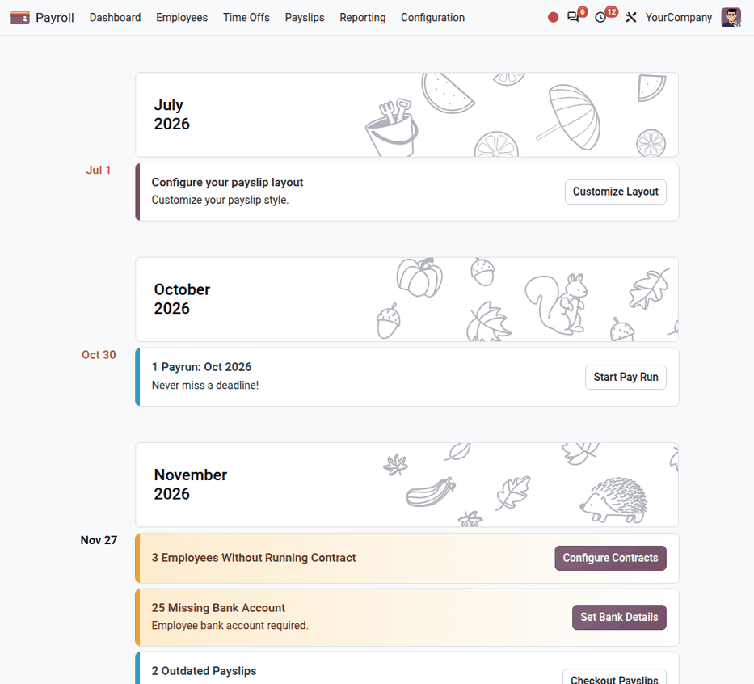
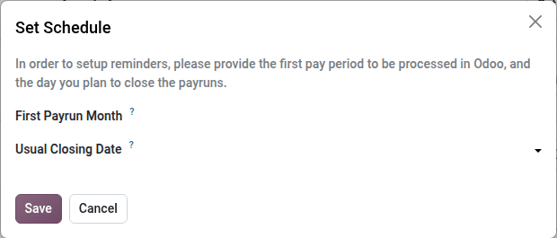
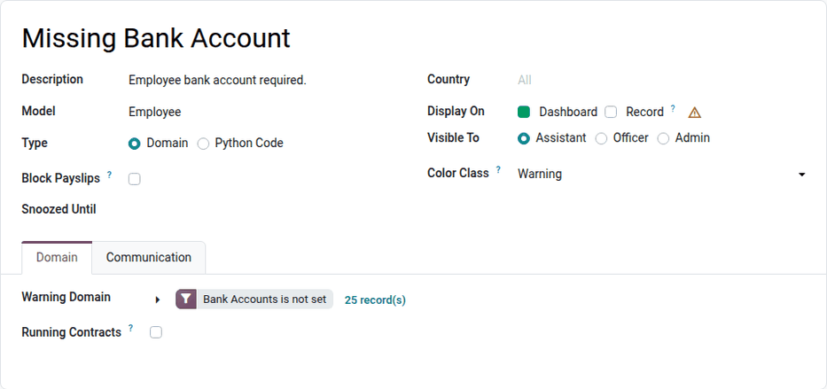

=========
Dashboard
=========

The **Payroll** app dashboard lists everything that requires the attention of the payroll
department: the next pay runs to process, the configuration steps to complete, and the issues
detected in the employees' data or in the payslips. To open it, navigate to :menuselection:`Payroll
app --> Dashboard`.

Each item is displayed as a *warning card*, in a timeline grouped by month. The date on the left of
a card is its deadline. Each card shows the number of records concerned, a short description, and a
button to review or fix them directly, such as :guilabel:`Set Bank Details` or :guilabel:`Start Pay
Run`.

The color of a card indicates its importance. For example, warnings about employees without a
running contract or without a bank account are highlighted, because they prevent the employees from
being paid correctly.

To hide a card, hover over it and click the :icon:`close` :guilabel:`(Hide warning)` icon on its
right. In the :guilabel:`Hide this warning?` pop-up window, click :guilabel:`Hide` to hide the
warning for 25 days, or tick :guilabel:`Never show it again` first to archive it.

.. note::
   When there is nothing left to review, the dashboard displays :guilabel:`All done`.

Set the pay schedule
====================

On a new database, the first cards guide the configuration of the **Payroll** app, for example
:guilabel:`Choose your pay schedule` and :guilabel:`Configure your payslip layout`.

Click :guilabel:`Set Schedule` on the :guilabel:`Choose your pay schedule` card, and configure the
following fields:

- :guilabel:`First Payrun Month`: The first pay period to process in Odoo.
- :guilabel:`Usual Closing Date`: The day of the month on which the pay runs are usually closed,
  either a day of the pay month (for example, the 25th) or a day of the following month.
- :guilabel:`Working Hours`: The default working schedule of the company. This field only appears
  if the company has no default working schedule yet.

Then, click :guilabel:`Save`. These values are also available in the :ref:`Payroll settings
<payroll-payroll-settings>`.

Once the pay schedule is set, the dashboard displays a card for each pay period, such as
:guilabel:`Payrun: Oct 2026`, with a :guilabel:`Start Pay Run` button that opens the
:ref:`creation of the pay run <payroll/new-pay-run>` for that period. When the pay run exists, the
card shows its status and a :guilabel:`Continue` button.

Configure warnings
==================

The warnings are configured in :menuselection:`Payroll app --> Configuration --> Dashboard -->
Warnings`. Odoo provides warnings for the most common issues, such as :guilabel:`Missing Bank
Account`, :guilabel:`Employees Without Running Contract`, :guilabel:`Payslips With Zero or Negative
Net`, or :guilabel:`Duplicate Payslips`. Localizations and other apps add their own warnings.

Open a warning to modify it, or click :guilabel:`New` to create one. Configure the following
fields:

- :guilabel:`Description`: The text displayed on the card.
- :guilabel:`Model`: The type of records checked, such as :guilabel:`Employee` or
  :guilabel:`Payslip`.
- :guilabel:`Type`: Select :guilabel:`Domain` to define the records concerned with filters, in the
  *Domain* tab, or :guilabel:`Python Code` to compute them with code.
- :guilabel:`Block Payslips`: Tick this checkbox to prevent the validation of the payslips concerned
  by the warning.
- :guilabel:`Snoozed Until`: The date until which the warning is hidden.
- :guilabel:`Country`: The country of the companies concerned. Leave it empty for all countries.
- :guilabel:`Display On`: Tick :guilabel:`Dashboard` to display the warning on the dashboard, and
  :guilabel:`Record` to also display it at the top of the records concerned (employees, time off,
  and payslips).
- :guilabel:`Visible To`: The minimum access level required to see the warning.
- :guilabel:`Color Class`: The color of the card, such as :guilabel:`Warning` or
  :guilabel:`Danger`.

In the *Communication* tab, configure the :guilabel:`Deadline` of the warning (a number of days
before or after a reference date, such as the :guilabel:`Next Payslip` closing date or the
:guilabel:`Contract End`), the name of the button of the card, and, optionally, an email message
sent a number of days after the deadline to the selected recipients.

.. seealso::
   - :doc:`payslips`
   - :doc:`pay_runs`
