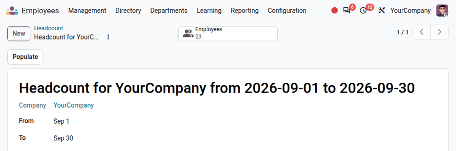
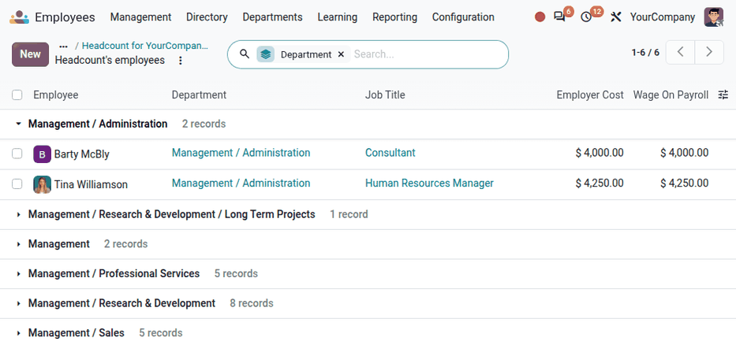

================
Headcount report
================

The *Headcount* report lists the employees under contract at a specific date, or during a period,
with their department, job, and cost. Saved headcount reports allow comparing the headcount between
different periods. This report is available when the **Payroll** app is installed.

Create a headcount report
=========================

Navigate to :menuselection:`Employees app --> Reporting --> Headcount` and click :guilabel:`New`.
Configure the following fields:

- :guilabel:`Company`: The company of the report. This field only appears in multi-company
  databases.
- :guilabel:`From`: The start date of the report. The current date populates this field by default.
- :guilabel:`To`: The end date of the report. Leave it empty to count the employees at the
  :guilabel:`From` date only.

The name of the report is generated automatically, in the format `Headcount for (Company) from
(date) to (date)`, and can be modified.

Next, click :guilabel:`Populate` to generate the report. The :icon:`fa-users`
:guilabel:`Employees` smart button displays the number of employees under contract during the
period. Click :guilabel:`Populate` again to update the report, for example after a change in the
employee records.

View all headcount reports
==========================

To view all saved headcount reports, navigate to :menuselection:`Employees app --> Reporting -->
Headcount`. Each line displays the name of the report, the user who created it, the date of the
last update, and the number of employees.

View employees in a headcount
-----------------------------

Click the :icon:`fa-users` :guilabel:`Employees` smart button of a headcount report to view its
employees in a list, grouped by :guilabel:`Department`. Click a department to expand it.

- :guilabel:`Employee`: The employee's full name.
- :guilabel:`Department`: The department of the employee.
- :guilabel:`Job Title`: The job position of the employee.
- :guilabel:`Employer Cost`: The cost of the employee for the company.
- :guilabel:`Wage On Payroll`: The wage of the employee on payroll.

The :guilabel:`Employee Type` and :guilabel:`Working Rate` columns can be added with the
:icon:`oi-settings-adjust` :guilabel:`(optional columns)` icon.

