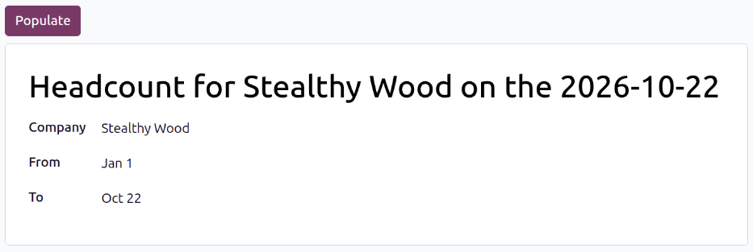
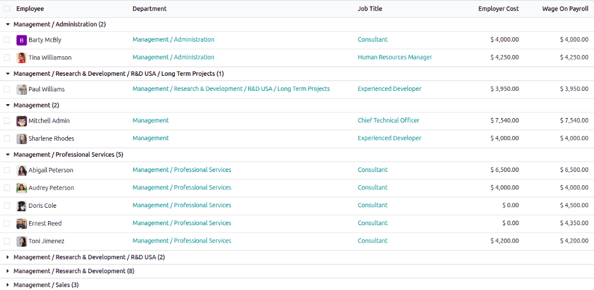

================
Headcount report
================

The *Headcount* report in the **Payroll** app shows the number of employees on payroll and allows
headcount comparisons between different periods of time.

Create a headcount report
=========================

Create a headcount report to see the number of employees at a specific time or compare headcounts
across periods.

To create a headcount report, navigate to :menuselection:`Payroll app --> Reporting --> Headcount`
and click :guilabel:`New`.

- :guilabel:`Report name`: The name is generated automatically as `Headcount for (Company Name) on
  the (YYYY-MM-DD)` and **cannot** be modified.
- :guilabel:`Company`: The company is automatically populated (works in both single and
  multi-company databases).
- :guilabel:`From`: Using the calendar selector, select the start date for the report. The current
  date populates this field by default.
- :guilabel:`To`: Using the calendar selector, select the end date for the report.

Next, click :guilabel:`Populate` to generate the report.

At the top of the form, an :icon:`fa-users` :guilabel:`Employees` smart button appears. Clicking the
button displays the total number of employees for the selected period.

View all headcount reports
==========================

See how the company headcount has changed over time by viewing all headcount reports in a list view.

To view all headcount reports, navigate to :menuselection:`Payroll app --> Reporting --> Headcount`.

View employees in a headcount
-----------------------------

To get an overall view of employees and their salary impact on the company, view all employee
records of a specific headcount report.

To view the employees of a specific headcount report, click the :icon:`fa-users`
:guilabel:`Employees` smart button at the top of a headcount report.

All employees from the headcount appear in a list view, grouped by :guilabel:`Department`.

- :guilabel:`Employee`: The employee's full name.
- :guilabel:`Department`: The department their job position is in.
- :guilabel:`Job Title`: Their specific role.
- :guilabel:`Employer Cost`: How much the company pays the employee each pay period.
- :guilabel:`Wage On Payroll`: The monetary amount on payroll reports.

Click on any department to expand the list and view the employees.

