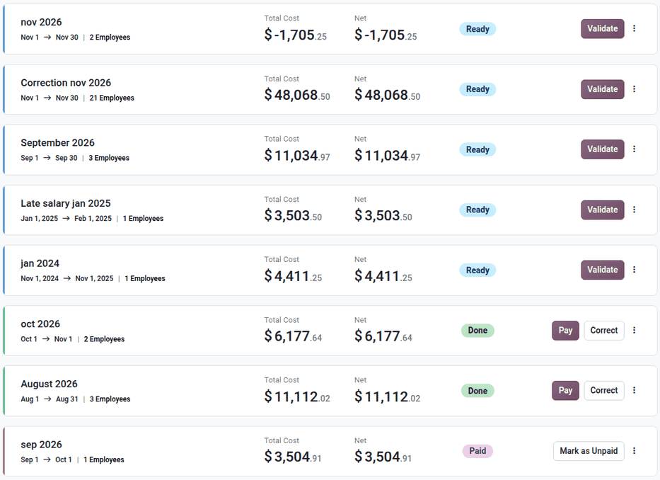
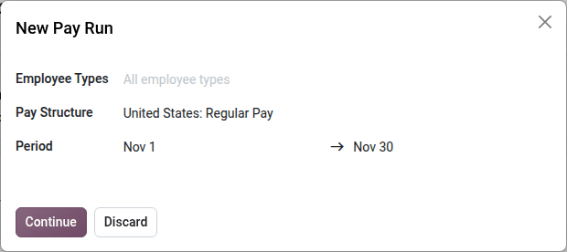
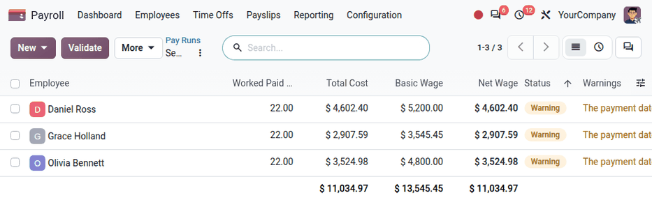
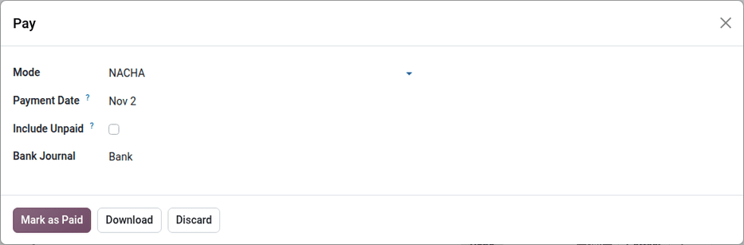

========
Pay runs
========

*Pay runs* are used to generate the :doc:`payslips <payslips>` of many employees at once, for the
same pay period, and to process them together: compute, validate, and pay. Typically, the payroll
department creates one pay run per pay period (for example, every month), and per pay structure if
several are used.

View pay runs
=============

To view all pay runs, navigate to :menuselection:`Payroll app --> Payslips --> Pay Runs`. Each pay
run is displayed as a card, with its name, period, number of employees, :guilabel:`Total Cost`,
:guilabel:`Net` amount, and status:

- :guilabel:`Ready`: The payslips are created, and can be reviewed, computed, and validated.
- :guilabel:`Done`: All payslips are validated. The employees can be paid.
- :guilabel:`Paid`: All payslips are paid.

The button on each card depends on the status of the pay run (:guilabel:`Validate`,
:guilabel:`Pay`, :guilabel:`Correct`, or :guilabel:`Mark as Unpaid`). Click the
:icon:`fa-ellipsis-v` :guilabel:`(vertical ellipsis)` icon of a card for more actions, such as
:guilabel:`Work times` (the worked time of the pay run, by employee and time type),
:guilabel:`Payroll Journal` (the salary rule lines of all payslips), :guilabel:`Set to Draft`, or
:guilabel:`Delete`.

.. tip::
   The :doc:`payroll dashboard <dashboard>` shows a card for the current pay period, with a
   :guilabel:`Start Pay Run` button, once the pay schedule of the company is configured.

.. _payroll/new-pay-run:
.. _payroll/pay-runs-pay-run:
.. _payroll/new-pay-run-pop-up:

Create a pay run
================

Navigate to :menuselection:`Payroll app --> Payslips --> Pay Runs`, and click :guilabel:`New`. The
:guilabel:`New Pay Run` pop-up window can also be opened with the :guilabel:`Pay Run` button of the
:menuselection:`Payroll app --> Payslips --> Payslips` list.

Configure the following fields:

- :guilabel:`Employee Types`: Select the :ref:`employee types <payroll/gen-info>` to include, or
  leave the field empty to include all employee types.
- :guilabel:`Pay Structure`: Select the pay structure used to compute the payslips. Only employees
  whose pay category includes this structure are included.
- :guilabel:`Period`: The first and last days of the pay period.

Click :guilabel:`Continue`. Before creating the pay run, Odoo checks the employees concerned, and
displays warnings if something needs to be reviewed first, for example:

- :guilabel:`Employees to Review`: Employees whose data was modified and is not
  :ref:`reviewed <payroll/contracts/review>` yet, or has an anomaly.
- :guilabel:`Time Offs to Review`: Time off requests of the period that are not approved yet.
- :guilabel:`No Time Offs`: No time off at all is recorded for the period, which might mean it was
  not encoded.

Each warning has a button to review the corresponding records. The pay run can be created anyway.

Odoo then creates the pay run, with one computed payslip for each employee whose contract covers
the period, and opens the list of its payslips.

.. note::
   The name of the pay run is generated from its period. It can be modified once the pay run is
   opened, for example to `August 2026 - Hourly workers`.

.. _payroll/payslips-pay-run:
.. _payroll/add-payslips:

Review the payslips of a pay run
================================

Click a pay run card to open the list of its payslips. Each line displays the employee, the
worked paid days, the :guilabel:`Total Cost`, the :guilabel:`Basic Wage`, the :guilabel:`Net
Wage`, the :guilabel:`Status`, and the :guilabel:`Warnings` of the payslip. Click a line to open
the payslip, and modify it if needed (see :doc:`payslips`).

The following buttons are available at the top of the list:

- :guilabel:`New`: Create a :guilabel:`Payslip` in this pay run, or a new :guilabel:`Pay Run`.
- :guilabel:`Validate`: Validate all the computed payslips of the pay run.
- :guilabel:`More`: Access additional actions:

  - :guilabel:`Test Print`: Generate the PDF of the payslips, to check them before validation.
  - :guilabel:`Work times` and :guilabel:`Payroll Journal`: Open the worked time and the salary
    rule lines of the pay run.
  - :guilabel:`Re-compute Payslips`: Recompute all the draft payslips, for example after
    correcting the worked time or adding salary inputs.
  - :guilabel:`Add Employees`: Add employees that are missing from the pay run. Odoo lists the
    employees who match the pay run criteria and do not have a payslip in it yet.
  - :guilabel:`Delete`: Delete the pay run.

To remove a payslip from the pay run, and process it separately, click the :guilabel:`Off-Cycle`
button at the end of its line.

.. _payroll/pay-run-process:

Process a pay run
=================

Once all the payslips are correct, click :guilabel:`Validate`, either in the list of payslips, or
on the card of the pay run. All the computed payslips are validated, and the pay run status changes
to :guilabel:`Done`. If the **Accounting** app is installed, the journal entries of the payslips
are created in draft, unless the :guilabel:`Anonymize Journal Entries` setting is enabled, in which
case a single entry is created for the whole pay run.

.. note::
   Payroll users who are not payroll officers cannot validate a pay run with warnings or errors.

To pay the employees, click :guilabel:`Pay` on the card of the pay run. In the :guilabel:`Pay`
pop-up window, configure the following fields:

- :guilabel:`Mode`: Select :guilabel:`Manually` if the payment is made outside of Odoo, or a file
  format to generate a payment file for the bank: :guilabel:`CSV`, or a format added by the
  localization or by the **Payroll SEPA** setting (such as :guilabel:`NACHA` in the United States,
  or :guilabel:`SEPA`).
- :guilabel:`Payment Date`: The date the payment is made.
- :guilabel:`Include Unpaid`: Tick this checkbox to also include other validated, unpaid payslips of
  the employees in the payment.

Depending on the localization, additional fields can appear, such as the :guilabel:`Bank Journal`
used for the payment.

Click :guilabel:`Download` to download the payment file, and upload it to the bank. Once the
payment is made, click :guilabel:`Mark as Paid`: the payslips and the pay run status change to
:guilabel:`Paid`. The payment file remains available on the pay run card.

.. tip::
   - To undo the payment, click :guilabel:`Mark as Unpaid` on the pay run card.
   - To modify the payslips of a :guilabel:`Done` pay run, click the :icon:`fa-ellipsis-v`
     :guilabel:`(vertical ellipsis)` icon of the card, then :guilabel:`Set to Draft`. This is not
     possible once some payslips are paid.

Correct a pay run
=================

If the payslips of a :guilabel:`Done` or :guilabel:`Paid` pay run are wrong, click
:guilabel:`Correct` on the pay run card. Odoo creates a new pay run, named after the original one
followed by `(Correction)`, which contains, for each employee, a validated refund of the original
payslip and a new draft payslip computed with the current data. Process this correction pay run
like any other pay run.

To correct only some payslips, use the :guilabel:`Correct` button of the payslips instead (see
:ref:`correct a payslip <payroll/payslips/correct>`).
