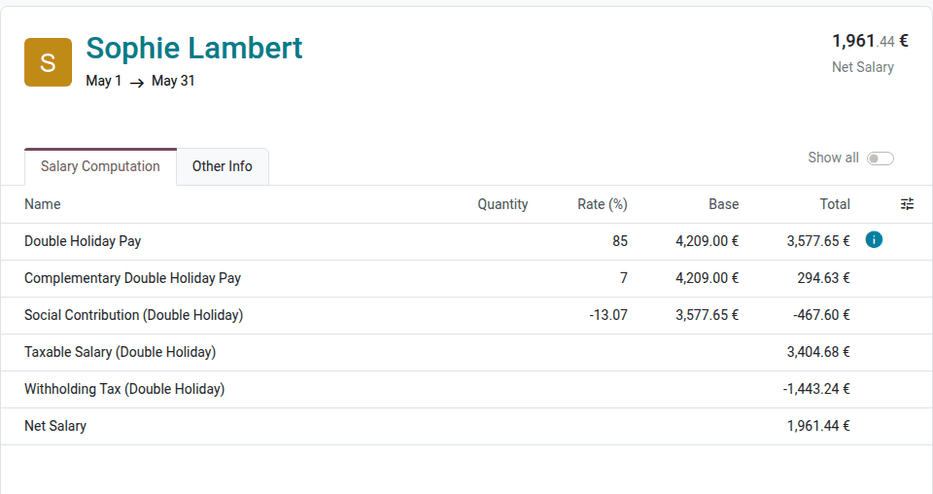
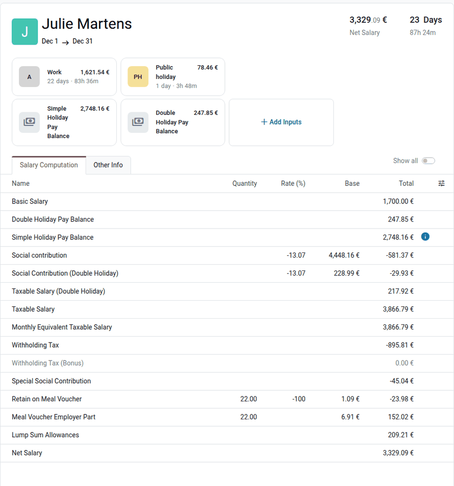
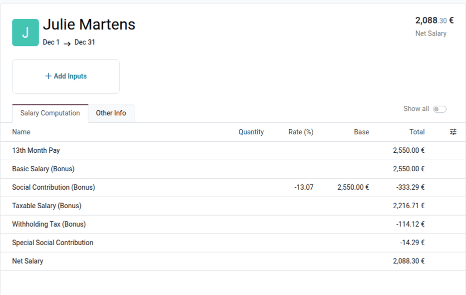

===============
Annual payments
===============

This page covers the payments made once a year to Belgian employees: the double holiday pay, the
December holiday pay balance, the thirteenth month, and the eco-vouchers.

.. note::
   The examples on this page come from employees of the joint committee 200 (white-collar
   employees). The holiday pay of the manual workers is paid by their holiday pay fund, not by the
   employer.

.. _payroll/l10n_be/double_holiday_pay:

Double holiday pay
==================

During their main holidays, employees receive their normal salary for the days of legal leave
(the *simple holiday pay*), and a *double holiday pay*, usually paid in May or June. The double
holiday pay amounts to 92% of the gross monthly salary, for a full year of work during the previous
year (the *holiday exercise*).

Computation
-----------

The double holiday pay is computed with the :guilabel:`Double Holidays (BE)` structure:

#. **Monthly reference salary**: the wage of the employee at the date of the payslip, plus the
   benefits in kind subject to social contributions (internet, phone, laptop, etc.). Under time
   credit, the wage of the hours still worked is used.
#. **Months of the holiday exercise**: the months worked or assimilated during the previous year,
   weighted by the work time rate of each period compared to the current one. The days of the
   absences that are not assimilated (for example, unpaid leave) are deducted. The months recorded
   on the holiday certificates of the previous employers are added (see :doc:`time_off`).
#. **Double holiday pay**: the reference salary multiplied by the months, divided by 12. It is
   paid in two lines:

   - :guilabel:`Double Holiday Pay`: 85% of this amount, subject to the employee's social
     contribution (:guilabel:`Social Contribution (Double Holiday)`, 13.07%).
   - :guilabel:`Complementary Double Holiday Pay`: the remaining 7%, not subject to social
     contributions.

#. **Deductions**:

   - :guilabel:`Double Holiday Pay Recovery`: the double holiday pay already paid by a previous
     employer for the same months, as stated on the holiday certificates.
   - :guilabel:`European Leaves Deduction`: the European time off taken during the previous year,
     which is an advance on the double holiday pay (see :doc:`time_off`).

#. **Variable salary**: when the employee earns commissions, the :guilabel:`Double Holiday on
   Variable Salary` lines add the double holiday pay on the average variable salary. When the
   :guilabel:`Loss on Commission for Paid Time Off` setting is set to :guilabel:`With the Double
   Holiday Pay`, the :guilabel:`Simple Holiday on Variable Salary` line also compensates the loss on
   commission of the paid time off (see :ref:`payroll/l10n_be/configuration/settings`).

The double holiday pay is taxed separately, with the withholding tax rates of the holiday pay (rule
parameters *Holiday Pay: Withholding Taxes Rates*, *Holiday Pay: Withholding Taxes Exoneration*, and
*Holiday Pay: Withholding Taxes Rate Reduction*). The rate depends on the annual gross salary of the
employee and on the number of dependent children.

To force the number of months or the variable salary, add a :guilabel:`Forced # Months` or
:guilabel:`Forced Variable Salary` input on the payslip, then click :guilabel:`Compute`.

.. example::
   An employee earns €4,200 per month, with benefits in kind of €5 (internet) and €4 (phone
   subscription), and worked the whole previous year. In May 2026:

   - Reference salary: :math:`4,200 + 5 + 4 = \text{€}4,209`, for 12 months.
   - :guilabel:`Double Holiday Pay`: :math:`4,209 \times 85\% = \text{€}3,577.65`.
   - :guilabel:`Complementary Double Holiday Pay`: :math:`4,209 \times 7\% = \text{€}294.63`.
   - :guilabel:`Social Contribution (Double Holiday)`: :math:`3,577.65 \times 13.07\% =
     -\text{€}467.60`.

Pay the double holiday pay
--------------------------

#. Navigate to :menuselection:`Payroll app --> Payslips --> Pay Runs`, and click :guilabel:`New`.
#. In the :guilabel:`New Pay Run` window, select the :guilabel:`Double Holidays (BE)`
   :guilabel:`Pay Structure` and the period of the payment (for example, May 2026), then select the
   employees to pay. One payslip is generated and computed for each employee.
#. Check the payslips, then validate the pay run and pay the employees as for the monthly
   payslips.

.. seealso::
   :doc:`../../pay_runs`

.. _payroll/l10n_be/december_pay:

December holiday pay balance
============================

Why a December settlement?
--------------------------

The holiday pay of a year is based on the remuneration of the previous year. In two cases, the
holiday pay already paid during the year is lower than the holiday pay due, and the employer must
pay the balance in December:

- The employee **reduced their working time** during the year (for example, switch to part-time
  work, partial career break, thematic leave, or partial resumption after an incapacity). The
  holidays taken after the reduction are paid at the new, lower salary, while they were earned with
  the previous one.
- The employee **could not take all their legal holidays** before the end of the year (for example,
  because of an illness, a work accident, or a maternity, paternity, birth, or parental leave). The
  unused days must be paid by December 31.

Since the end of 2024, the days that could not be taken because of one of these suspensions (except
force majeure and the protective maternity leave measures) can be carried over for 24 months. As the
holiday pay of these days is paid in December, no additional payment is made when the carried-over
days are taken.

Computation in Odoo
-------------------

The balance is computed automatically on the December payslip of the :guilabel:`Monthly Pay (BE)`
structure, for the employees of the joint committee 200. Two inputs are added to the payslip:

- :guilabel:`Simple Holiday Pay Balance`: 7.67% of the remuneration of the previous year, minus the
  simple holiday pay already paid during the year (the salary of the legal leave days taken, the
  simple holiday pay recovered for the previous employers, and the loss on commission on paid time
  off). The balance is subject to social contributions and to the normal withholding taxes.
- :guilabel:`Double Holiday Pay Balance`: the double holiday pay due (7.67% of the remuneration of
  the previous year, or the double holiday pay computed on the months worked if higher), minus the
  double holiday pay already paid during the year. The balance is taxed as a double holiday pay.

The remuneration of the previous year is the gross salary of the monthly payslips of that year,
plus a fictitious salary for the assimilated absences (for example, sick days after the guaranteed
salary). The thirteenth month is not included. Only the validated and paid payslips of the year are
taken into account: validate the payslips of January to November before computing the December
payslips.

A negative balance is not recovered: the amount is set to zero. The amounts of the inputs can be
changed before validating the payslip, for example to encode a balance computed outside of Odoo.

.. example::
   An employee works full time until June 2026, with a wage of €3,400, then half time from
   July 2026, with a wage of €1,700. Her remuneration of 2025 amounts to €44,013.69. In 2026, she
   takes 4 days of legal leave (€627.69) and receives a double holiday pay of €3,128.

   - Holiday pay due: :math:`44,013.69 \times 7.67\% = \text{€}3,375.85`.
   - :guilabel:`Simple Holiday Pay Balance`: :math:`3,375.85 - 627.69 = \text{€}2,748.16`.
   - :guilabel:`Double Holiday Pay Balance`: :math:`3,375.85 - 3,128 = \text{€}247.85`.

.. _belgium_payroll/end_of_year_bonus:

Thirteenth month
================

The thirteenth month (end-of-year bonus) is paid in December to the employees of the joint
committees that provide it, such as the joint committee 200.

Computation
-----------

The thirteenth month is computed with the :guilabel:`13th Month (BE)` structure:

#. **Eligibility**: the employee must have started before July of the current year. When the
   number of months is forced with a :guilabel:`Forced # Months` input, at least six months are
   required.
#. **Fixed salary**: the full-time equivalent wage of each month of the year, multiplied by the
   work time rate of the month and by the presence rate, divided by 12. Up to 60 calendar days of
   sickness and 10 days of absence for imperative reasons are assimilated to worked days; the other
   unpaid absences reduce the amount.
#. **Variable salary**: the average monthly variable salary (commissions) of the last 12 months,
   prorated on the months taken into account. Use a :guilabel:`Forced Variable Salary` input to set
   it manually.
#. **Ceiling**: for the sales representatives of the joint committee 200, the amount is capped at
   the highest of the wage and the minimum wage of the salary scale D.

The thirteenth month is subject to social contributions (:guilabel:`Social Contribution (Bonus)`,
13.07%) and to the withholding tax rates of the exceptional allowances (rule parameter
*Exceptional Allowances: Withholding Taxes Rates*), which depend on the annual gross salary of the
employee and on the number of dependent children.

.. example::
   An employee works full time from January to June 2026 with a wage of €3,400, and half time from
   July with a wage of €1,700. Her thirteenth month amounts to :math:`(6 \times 3,400 + 6 \times
   1,700) / 12 = \text{€}2,550`.

The joint committee 302 (hotel industry) has its own conditions (seniority, assimilated days,
minimum worked days for temporary workers), set in the *CP302: 13th Month - ...* rule parameters.

When an employee leaves the company during the year, the prorated thirteenth month is paid with the
departure payslips. See :doc:`departure`.

Pay the thirteenth month
------------------------

#. Navigate to :menuselection:`Payroll app --> Payslips --> Pay Runs`, and click :guilabel:`New`.
#. In the :guilabel:`New Pay Run` window, select the :guilabel:`13th Month (BE)` :guilabel:`Pay
   Structure` and the December period, then select the employees to pay. One payslip is generated
   and computed for each employee.
#. Check the payslips, then validate the pay run and pay the employees.

.. _payroll/l10n_be/eco_vouchers:

Eco-vouchers
============

Eco-vouchers are vouchers to buy environmentally friendly products and services. Within the legal
limit, they are exempt from social contributions and withholding taxes. They are valid for 24
months.

Computation
-----------

The eco-vouchers are computed on the monthly payslip of the month set for the joint committee of
the employee, in the *Eco Voucher Configuration* rule parameter. For the joint committee 200, they
are computed on the June payslip, for the reference period from June 1 of the previous year to May
31 of the current year.

The amount depends on the work time rate of the employee (joint committee 200):

.. list-table::
   :header-rows: 1

   * - Work time rate
     - Amount for a full reference period
   * - 80% or more
     - €250
   * - From 60% to less than 80%
     - €200
   * - From 50% to less than 60%
     - €150
   * - Less than 50%
     - €100

The amount is prorated on the working days of the reference period: the days worked or assimilated
(for example, legal leave, maternity, and paternity leave), divided by the working days of the
working schedule over the whole period. The unpaid days (for example, unpaid leave, or sick days
paid by the health insurance fund) reduce the amount. When the working time changes during the
period, each version of the employee is prorated with its own amount.

When an employee leaves the company, the eco-vouchers of the ongoing reference period are computed
on their last payslip.

.. example::
   An employee is hired on September 1, 2024, with a 4/5 working schedule. On the June 2025
   payslip, she worked 9 months of the reference period (June 2024 to May 2025), and receives
   :math:`250 \times 9/12 = \text{€}187.50` of eco-vouchers.

Order the eco-vouchers
----------------------

Navigate to :menuselection:`Payroll app --> Reporting --> Belgium --> Eco-Vouchers`, and select the
:guilabel:`Reference Year`. The list shows, for each employee, the :guilabel:`NISS` and the amount
of eco-vouchers of the validated payslips of the year. Click :guilabel:`Export XLS` to download the
file to send to the eco-voucher provider.

.. seealso::
   `List of the products and services eligible for eco-vouchers
   <https://cnt-nar.be/sites/default/files/documents/fr/Liste-F-23.pdf>`_
