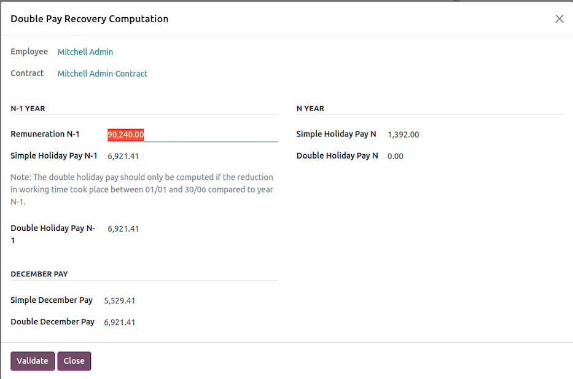
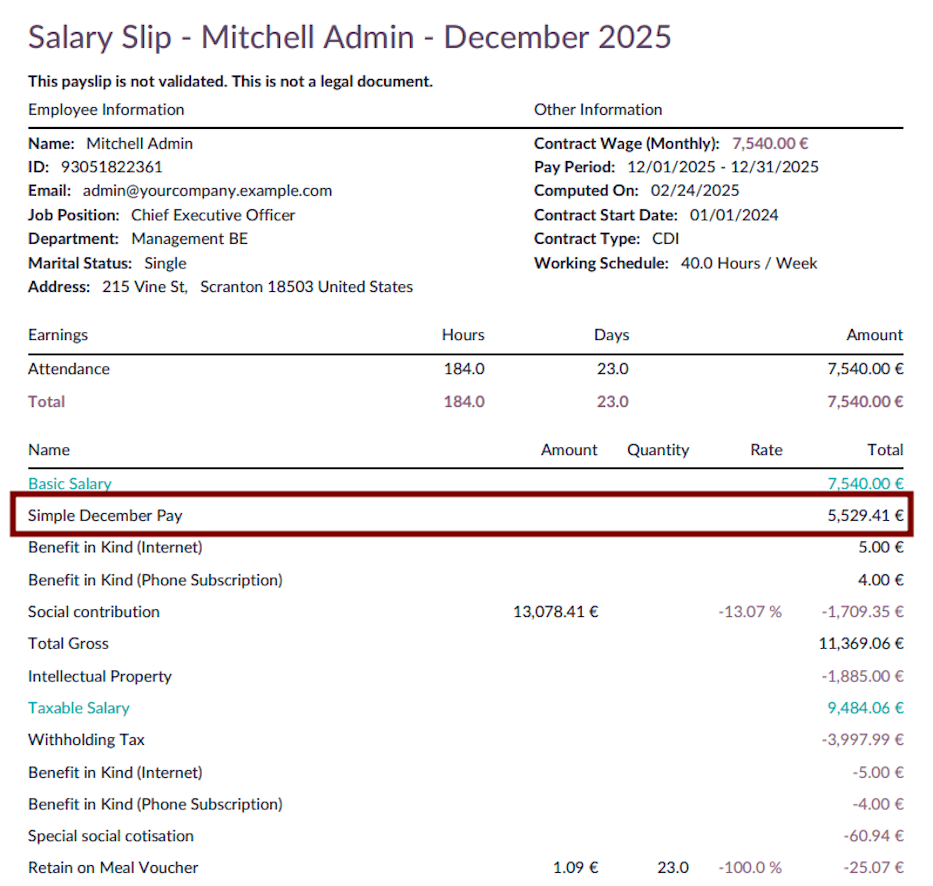
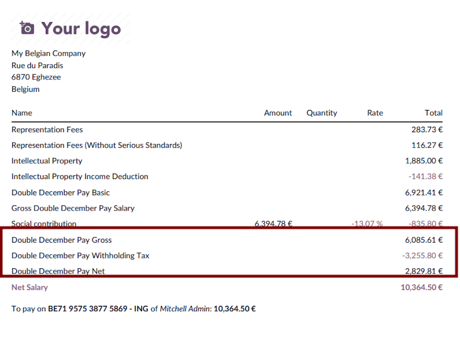
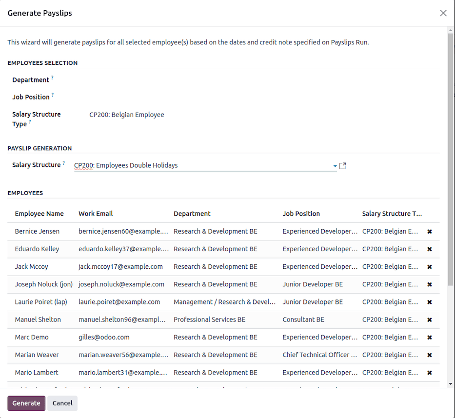
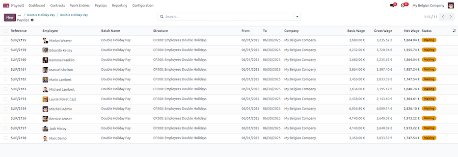
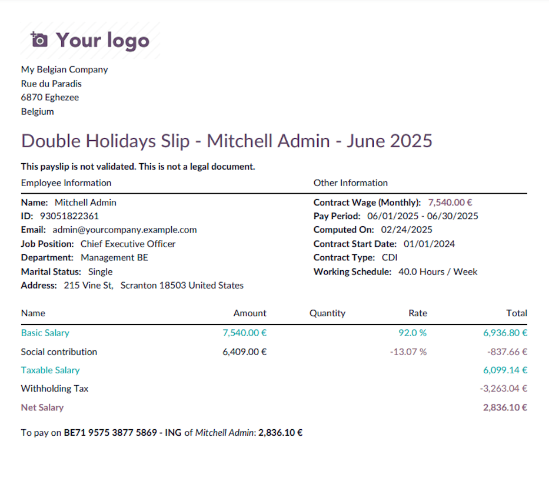
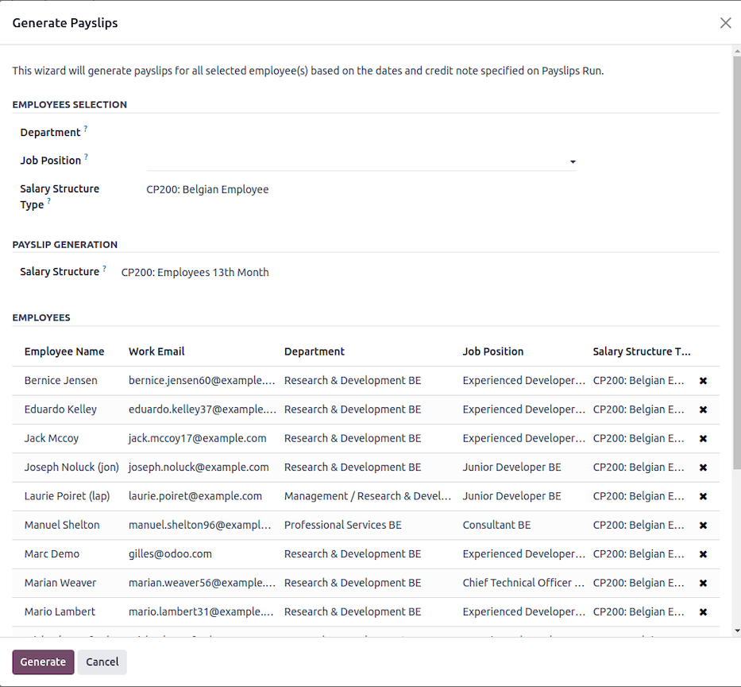
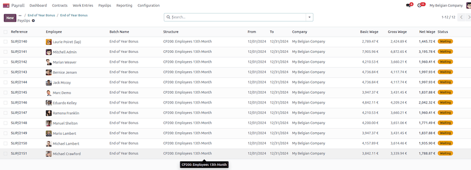
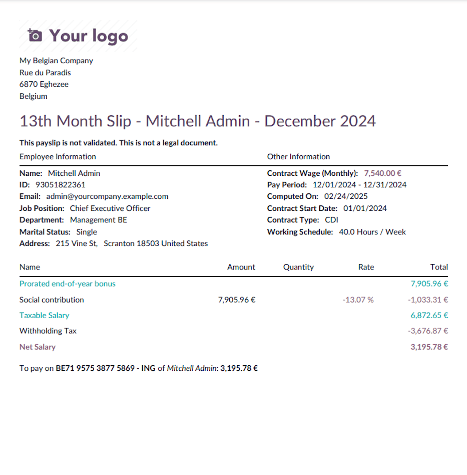

===============
Annual payments
===============

This page covers the payments made once a year to Belgian employees.

.. _payroll/l10n_be/december_pay:

December pay
============

Why a December settlement?
--------------------------

An employer must pay a vacation allowance to an employee in December under two conditions:

- If the employee has reduced their working hours during the vacation year.
- If the employee is unable to take all their vacation days before the end of the year.

In principle, employers must ensure that employees take their annual vacation before December 31.
However, certain circumstances may prevent employees from using all their vacation days. In these
cases, the employer must pay the simple vacation allowance for unused days before the end of the
year. Additionally, if the employee has not received the double vacation allowance earlier in the
year (typically in May or June), they are entitled to receive it.

Reduction of working hours
--------------------------

When an employee reduces their average working hours with the same employer, the employer must pay
the vacation allowance in December of the year in which the reduction occurs, as if the employee
had left the company.

**Possible scenarios**:

- Transition to part-time work.
- Partial career break.
- Thematic leave on a part-time basis.
- Partial return to work after a full incapacity period.

The settlement is calculated based on the previous vacation year's earnings and includes:

- **Simple vacation allowance**: 7.67% of the yearly gross salary from the previous year, including
  any fictitious salary for assimilated interruption days, minus the simple vacation allowance
  already paid during the vacation year.
- **Double vacation allowance**: 7.67% of the yearly gross salary from the previous year, including
  any fictitious salary for assimilated interruption days, minus the double vacation allowance
  already paid during the vacation year.

If all vacation days have been taken before the reduction in working hours, no additional
calculation is required.

Inability to use vacation days
------------------------------

As a general rule, all vacation days must be used within the vacation year. However, if an employee
is unable to take all their vacation due to force majeure or specific suspension reasons, the
employer must pay the following by December 31:

- **Simple vacation allowance** for unused days, based on the December salary.
- **Double vacation allowance** if it has not yet been paid, based on the December salary.

**Eligible reasons include**:

- Common illness or accident.
- Work accident or occupational disease.
- Maternity leave, paternity leave (converted maternity leave), prophylactic leave.
- Birth, adoption, or reception leave.
- Parental leave or protective maternity leave measures.

New rule (effective end of 2024)
~~~~~~~~~~~~~~~~~~~~~~~~~~~~~~~~

Employees unable to take vacation due to the above reasons (except force majeure or protective
maternity leave measures) can carry over unused days for up to 24 months. Since the vacation
allowance is already paid in December of the vacation year, no additional payment will be made when
the carried-over days are used.

Employer payment responsibilities
---------------------------------

The employer must pay any outstanding simple vacation allowance based on 7.67% of the gross salary
from the previous year. However, an exit vacation allowance based on the current year's gross salary
is not due.

If an employee reduces their working hours and continues in the same role the following year, an
additional vacation allowance calculation may be required in December.

Example calculation
-------------------

#. In 2013, an employee works full-time (5 days per week).
#. In 2014, the employee works full-time until June 30, then switches to part-time (5 half-days per
   week).
#. The employee takes vacation in August 2014 under the new part-time regime (20 half-days over 4
   weeks).
#. They receive a simple vacation allowance for 20 half-days and a double vacation allowance
   equivalent to 92% of their monthly salary.
#. In December 2014, the employee receives additional simple (7.67%) and double (7.67%) vacation
   allowances based on 2013's gross salary, minus previously paid amounts.
#. In 2015, if the employee continues part-time, they receive vacation based on part-time hours plus
   5 full-time vacation days from the 2014 vacation year.
#. A second settlement in December 2015 includes additional simple (7.67%) and double (7.67%)
   vacation allowances based on the 2014 gross salary, minus previously paid amounts.

How to do it in Odoo
--------------------

On a classic :doc:`payslip <../../payslips>` issued in December, press the :guilabel:`Compute December
Holiday Pay` button to open a configuration wizard.

Based on the allocated and requested time off, the :guilabel:`Simple Holiday Pay N-1` and
:guilabel:`Double Holiday Pay N-1` for the December payslip are computed (and editable for manual
encoding). Click :guilabel:`Validate` to confirm.

After validation, two additional inputs are stored on the payslip, and the payslip is re-computed to
take those new remunerations into account.

The simple holiday pay is included into the gross remuneration.

The double holiday pay is computed separately and included into the net amount.

.. _payroll/l10n_be/double_holiday_pay:

Double holiday pay
==================

Double holiday pay is an additional bonus paid to employees and workers during their annual leave.
The amount depends on the employee's or worker's salary.

How is double holiday pay calculated?
-------------------------------------

For employees, double holiday pay amounts to 92% of their gross salary for the month when they
take their main annual leave. This amount is calculated based on the number of months worked or
considered equivalent in the previous year.

Impact of additional or European leave
--------------------------------------

If you take additional or European leave, your employer will pay you regular holiday pay for that
leave. However, the following year, this amount will be deducted from your double holiday pay. This
is because additional leave is considered an advance on the next year's legal leave.

Factors affecting the calculation
---------------------------------

#. **Months Worked**: The calculation is based on the number of months you worked in the previous
   year.
#. **Absences**: If you had unpaid absences, they may reduce your double holiday pay.
#. **Variable Revenues**: Bonuses and commissions earned in the previous year can impact the total
   amount of double holiday pay.
#. **Withholding Taxes**: The double holiday pay is subject to income tax deductions, which depend
   on your annual earnings and family situation.

Withholding tax calculation
---------------------------

The withholding tax is calculated using a progressive rate system. The process involves:

#. **Identify the Employee's Annual Taxable Revenue**:

   - Compute the annualized salary, including benefits in kind (e.g., company car, internet, mobile
     phone, laptop).
   - Apply reductions for dependent children.

#. **Apply Tax Rates**:

   - Use predefined tax brackets to determine the base withholding tax rate.
   - If applicable, apply a reduction based on the number of dependent children.

Tax brackets
~~~~~~~~~~~~

The withholding tax is applied progressively based on the following brackets (as of 2025):

+--------------+--------------+------------+
| Lower Bound  | Upper Bound  | Tax Rate   |
+==============+==============+============+
| 0.00         | 10,415.00    | 0.00%      |
+--------------+--------------+------------+
| 10,415.01    | 13,330.00    | 19.17%     |
+--------------+--------------+------------+
| 13,330.01    | 16,960.00    | 21.20%     |
+--------------+--------------+------------+
| 16,960.01    | 20,340.00    | 26.25%     |
+--------------+--------------+------------+
| 20,340.01    | 23,020.00    | 31.30%     |
+--------------+--------------+------------+
| 23,020.01    | 25,710.00    | 34.33%     |
+--------------+--------------+------------+
| 25,710.01    | 31,070.00    | 36.34%     |
+--------------+--------------+------------+
| 31,070.01    | 33,810.00    | 39.37%     |
+--------------+--------------+------------+
| 33,810.01    | 44,770.00    | 42.39%     |
+--------------+--------------+------------+
| 44,770.01    | 58,460.00    | 47.44%     |
+--------------+--------------+------------+
| 58,460.00    | ∞            | 53.50%     |
+--------------+--------------+------------+

Tax exemption
~~~~~~~~~~~~~

A withholding tax exemption is granted when the normal annual gross income does not exceed a
specific threshold, which is determined based on the number of dependent children [2].

A disabled dependent child counts as two.

The method involves referring to a two-column table:

- **Column 1**: Indicates the number of dependent children.
- **Column 2**: Specifies the maximum allowable normal annual gross income, based on the number of
  dependent children listed in Column 1, which must not be exceeded to qualify for full or partial
  exemption from withholding tax.

After determining the annual gross income, two scenarios may arise:

#. If the annual income exceeds the threshold, no exemption is granted.
#. If the annual income does not exceed the threshold, an exemption will be applied.

The amount of this exemption corresponds to the difference between the annual gross income and the
threshold amount.

Of course, if this difference exceeds the base withholding tax amount, no withholding tax will
be due.

+-----------------+------------------------+
| No. of Children | Max Revenue (EUR)      |
+=================+========================+
| 1               | 18,400.00              |
+-----------------+------------------------+
| 2               | 21,930.00              |
+-----------------+------------------------+
| 3               | 28,270.00              |
+-----------------+------------------------+
| 4               | 35,330.00              |
+-----------------+------------------------+
| 5               | 42,390.00              |
+-----------------+------------------------+
| 6               | 49,450.00              |
+-----------------+------------------------+
| 7               | 56,510.00              |
+-----------------+------------------------+
| 8               | 63,570.00              |
+-----------------+------------------------+
| 9               | 70,630.00              |
+-----------------+------------------------+
| 10              | 77,690.00              |
+-----------------+------------------------+
| 11              | 84,750.00              |
+-----------------+------------------------+
| 12              | 91,810.00              |
+-----------------+------------------------+

Tax reductions
~~~~~~~~~~~~~~

When there is no justification for fully or partially exempting the exceptional allowance from
withholding tax, it is still possible to grant a reduction in withholding tax.

To determine eligibility for this reduction, one must check whether the normal annual gross salary
exceeds a certain higher threshold, which varies according to the number of dependent children [3].
This threshold is higher than the one used for exemption purposes.

A disabled child counts as two.

The method involves referring to a three-column table:

- **Column 1**: Indicates the number of dependent children (up to a maximum of 5).
- **Column 2**: Specifies the percentage reduction in withholding tax, based on the number of
  dependent children listed in Column 1, which must not be exceeded to qualify for the reduction.
- **Column 3**: Shows the threshold amount that must not be exceeded, corresponding to the number
  of dependent children listed in Column 1.

Two scenarios may arise:

#. If the threshold amount is exceeded, no reduction will be granted.
#. If the threshold amount is not exceeded, a reduction will be applied to the withholding
   tax amount, up to a percentage rate determined in Column 2.

For employees with dependent children, tax reductions apply as follows:

+-----------------+------------------+----------------+
| No. of Children | Reduction (%)    | Max Revenue    |
+=================+==================+================+
| 1               | 7.5%             | 28,245.00      |
+-----------------+------------------+----------------+
| 2               | 20.0%            | 28,245.00      |
+-----------------+------------------+----------------+
| 3               | 35.0%            | 31,070.00      |
+-----------------+------------------+----------------+
| 4               | 55.0%            | 36,720.00      |
+-----------------+------------------+----------------+
| 5+              | 75.0%            | 39,550.00      |
+-----------------+------------------+----------------+

Final tax calculation
~~~~~~~~~~~~~~~~~~~~~

The final withholding tax amount is:

.. math::
   :class: overflow-scroll

   \text{Tax} = \text{Gross Double Holiday} \times \text{Applicable Tax Rate} -
   \text{Reduction (if applicable)}

The resulting tax is deducted from the gross double holiday salary to determine the net amount
payable to the employee.

The calculation considers work duration, absences, variable revenue, and applicable withholding
taxes. Odoo automates these calculations to ensure compliance with Belgian labor laws and tax
regulations.

Generate a batch in Odoo
------------------------

Navigate to :menuselection:`Payroll App --> Payslips --> Batches` and create a new record with valid
dates (here december 2024)

Then click the **Generate Payslips** button, select the CP200 salary structure type and the
Thirteen Month salary structure. You can also filter eligible employees by department and / or
job position.

Once validated, a payslip is generated for each employee.

You can now check the different payslips before validation. Once validated, the PDF files are
generated and posted on employee portals as for classic payslips.

Conclusion
----------

Double holiday pay is a significant benefit that rewards employees for their work in the previous
year. Understanding how it is calculated helps in better financial planning for the holiday period.

.. _belgium_payroll/end_of_year_bonus:

End of year bonus
=================

This document explains the calculation of the thirteenth-month salary (year-end bonus) in Belgium
within Odoo. The calculation considers the employee's contracts, working time rates, and applicable
taxes.

Calculation of the thirteenth-month salary
------------------------------------------

Eligibility criteria
~~~~~~~~~~~~~~~~~~~~

- The employee must have worked for at least **six complete months** in the year.
- Both full-time and part-time employees are eligible, with prorated calculations based on work
  time.

Salary calculation
~~~~~~~~~~~~~~~~~~

The thirteenth-month salary is computed as follows:

#. **Determine the basic salary**:

   - Retrieve the employee's contractual wage.
   - Identify the applicable work rate.

#. **Compute eligible months**:

   - If explicitly provided (`MONTHS` input), use the given number of months.
   - Otherwise, calculate the number of complete months worked.
   - Prorate the salary for partial-year work.

#. **Adjust for absences**:

   - Deduct unpaid absences to obtain the presence prorata.
   - Consider up to 60 days of sick leave as paid time off.

#. **Include variable revenues**:

   - If explicitly provided (`VARIABLE` input), use the given value.
   - Otherwise, calculate the average variable revenue over the last year.

#. **Final amount**:

   - The final thirteenth-month amount is the sum of the prorated fixed salary and average variable
     revenues.

Withholding tax calculation
---------------------------

The withholding tax is calculated using a progressive rate system. The process involves:

#. **Identify the employee's annual taxable revenue**:

   - Compute the annualized salary, including benefits in kind (e.g., company car, internet, mobile
     phone, laptop).
   - Apply reductions for dependent children.

#. **Apply Tax Rates**:

   - Use predefined tax brackets to determine the base withholding tax rate.
   - If applicable, apply a reduction based on the number of dependent children.

Tax brackets
~~~~~~~~~~~~

The withholding tax is applied progressively based on the following brackets (as of 2025):

+--------------+--------------+------------+
| Lower Bound  | Upper Bound  | Tax Rate   |
+==============+==============+============+
| 0.00         | 10,415.00    | 0.00%      |
+--------------+--------------+------------+
| 10,415.01    | 13,330.00    | 23.22%     |
+--------------+--------------+------------+
| 13,330.01    | 16,960.00    | 25.23%     |
+--------------+--------------+------------+
| 16,960.01    | 20,340.00    | 30.28%     |
+--------------+--------------+------------+
| 20,340.01    | 23,020.00    | 35.33%     |
+--------------+--------------+------------+
| 23,020.01    | 25,710.00    | 38.36%     |
+--------------+--------------+------------+
| 25,710.01    | 31,070.00    | 40.38%     |
+--------------+--------------+------------+
| 31,070.01    | 33,810.00    | 43.41%     |
+--------------+--------------+------------+
| 33,810.01    | 44,770.00    | 46.44%     |
+--------------+--------------+------------+
| 44,770.01    | 58,460.00    | 51.48%     |
+--------------+--------------+------------+
| 58,460.00    | ∞            | 53.50%     |
+--------------+--------------+------------+

Tax exemption
~~~~~~~~~~~~~

A withholding tax exemption is granted when the normal annual gross income does not exceed a
specific threshold, which is determined based on the number of dependent children [2].

A disabled dependent child counts as two.

The method involves referring to a two-column table:

- **Column 1**: Indicates the number of dependent children.
- **Column 2**: Specifies the maximum allowable normal annual gross income, based on the number of
  dependent children listed in Column 1, which must not be exceeded to qualify for full or partial
  exemption from withholding tax.

After determining the annual gross income, two scenarios may arise:

#. If the annual income exceeds the threshold, no exemption is granted.
#. If the annual income does not exceed the threshold, an exemption will be applied.

The amount of this exemption corresponds to the difference between the annual gross income and the
threshold amount.

Of course, if this difference exceeds the base withholding tax amount, no withholding tax will
be due.

+-----------------+------------------------+
| No. of Children | Max Revenue (EUR)      |
+=================+========================+
| 1               | 18,400.00              |
+-----------------+------------------------+
| 2               | 21,930.00              |
+-----------------+------------------------+
| 3               | 28,270.00              |
+-----------------+------------------------+
| 4               | 35,330.00              |
+-----------------+------------------------+
| 5               | 42,390.00              |
+-----------------+------------------------+
| 6               | 49,450.00              |
+-----------------+------------------------+
| 7               | 56,510.00              |
+-----------------+------------------------+
| 8               | 63,570.00              |
+-----------------+------------------------+
| 9               | 70,630.00              |
+-----------------+------------------------+
| 10              | 77,690.00              |
+-----------------+------------------------+
| 11              | 84,750.00              |
+-----------------+------------------------+
| 12              | 91,810.00              |
+-----------------+------------------------+

Tax reductions
~~~~~~~~~~~~~~

When there is no justification for fully or partially exempting the exceptional allowance from
withholding tax, it is still possible to grant a reduction in withholding tax.

To determine eligibility for this reduction, one must check whether the normal annual gross salary
exceeds a certain higher threshold, which varies according to the number of dependent children [3].
This threshold is higher than the one used for exemption purposes.

A disabled child counts as two.

The method involves referring to a three-column table:

- **Column 1**: Indicates the number of dependent children (up to a maximum of 5).
- **Column 2**: Specifies the percentage reduction in withholding tax, based on the number of
  dependent children listed in Column 1, which must not be exceeded to qualify for the reduction.
- **Column 3**: Shows the threshold amount that must not be exceeded, corresponding to the number
  of dependent children listed in Column 1.

Two scenarios may arise:

#. If the threshold amount is exceeded, no reduction will be granted.
#. If the threshold amount is not exceeded, a reduction will be applied to the withholding
   tax amount, up to a percentage rate determined in Column 2.

For employees with dependent children, tax reductions apply as follows:

+-----------------+------------------+----------------+
| No. of Children | Reduction (%)    | Max Revenue    |
+=================+==================+================+
| 1               | 7.5%             | 28,245.00      |
+-----------------+------------------+----------------+
| 2               | 20.0%            | 28,245.00      |
+-----------------+------------------+----------------+
| 3               | 35.0%            | 31,070.00      |
+-----------------+------------------+----------------+
| 4               | 55.0%            | 36,720.00      |
+-----------------+------------------+----------------+
| 5+              | 75.0%            | 39,550.00      |
+-----------------+------------------+----------------+

Final tax calculation
~~~~~~~~~~~~~~~~~~~~~

The final withholding tax amount is:

.. math::
   :class: overflow-scroll

   \text{Tax} = \text{Gross Thirteenth Month} \times \text{Applicable Tax Rate} -
   \text{Reduction (if applicable)}

The resulting tax is deducted from the gross thirteenth-month salary to determine the net amount
payable to the employee.

The calculation considers work duration, absences, variable revenue, and applicable withholding
taxes. Odoo automates these calculations to ensure compliance with Belgian labor laws and tax
regulations.

How to do it in Odoo
--------------------

Navigate to :menuselection:`Payroll app --> Payslips --> Batches` and create a new record with valid
dates (here december 2024).

Then click the :guilabel:`Generate Payslips` button, select the :guilabel:`CP200: Belgian Employee`
:guilabel:`Salary Structure Type` and the :guilabel:`CP200: Employees 13th Month` :guilabel:`Salary
Structure`. You can also filter eligible employees by :guilabel:`Department` and / or :guilabel:`Job
Position`.

Once validated, a payslip is generated for each employee.

You can now check the different payslips before validation. Once validated, the PDF files are
generated and posted on employee portals as for classic payslips.

.. _payroll/l10n_be/eco_vouchers:

Eco vouchers
============

Overview
--------

Eco vouchers are a tax-free employee benefit designed to support the purchase of
environmentally-friendly products and services. These vouchers are ordered via external providers
and are exempt from social security contributions.

Eligibility & allocation
------------------------

Employees who have worked during the **reference period (01/06/N-1 - 31/05/N)** are eligible for
up to **250€** in eco vouchers, which are granted at the beginning of **July**.

.. example::
   For 2025, employees must have worked between **01/06/2024 and 31/05/2025** to qualify.

For employees who join during the reference period, the voucher amount is prorated based on their
worked days.

.. example::
   An employee hired on **06/01**, having worked **6 out of 12 months**, would receive:

   .. math::
      :class: overflow-scroll

      250\text{€} \times (6/12) = 125\text{€}

For part-time employees, the amount is adjusted as follows:

.. list-table::
   :header-rows: 1

   * - Work Regime
     - Voucher Amount (€)
   * - 4/5
     - 250€
   * - 3/5
     - 200€
   * - 1/2
     - 125€
   * - < 1/2
     - 100€

.. example::
   If an employee starts on **1st September** in **full-time** and then switches to **half-time** on
   **1st April 2024**, the calculation will be:

   .. math::
      :class: overflow-scroll

      250\text{€} \times (7/12) + 125\text{€} \times (2/12) = 166\text{€}

Exceptions & adjustments
------------------------

If an employee worked full-time for the entire reference period but did not receive **250€**,
certain non-assimilated leave days may have affected the calculation.

The following leave types are **not** considered for eco-voucher entitlement:

- **Unpaid leaves**
- **Sick leave compensated by mutual insurance** (after 30 days of work incapacity)

Usage & validity
----------------

Eco vouchers are valid for **24 months** from the date of issuance.

.. seealso::
   The list of eligible products and services that can be purchased with eco vouchers is available
   here:

   - `Eco-Voucher Eligible Products <https://cnt-nar.be/sites/default/files/documents/fr/Liste-F-23.pdf>`_
